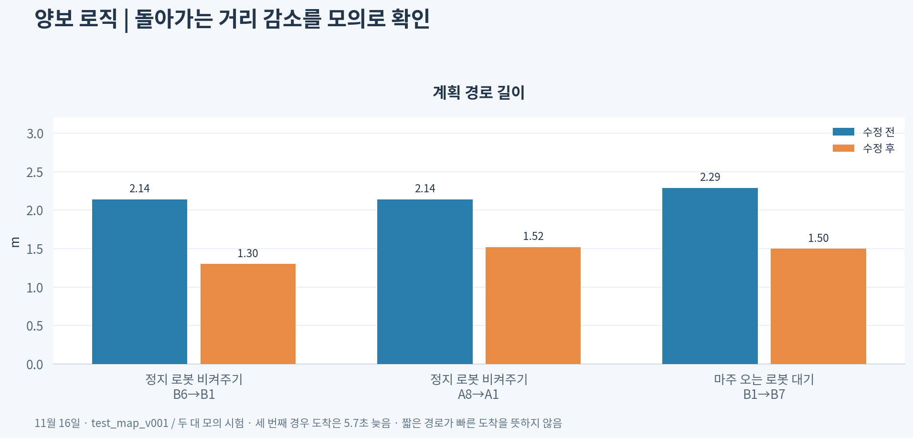

# 수정 기록 (2026-11-16)

> 2026-11-19: 11월 16~18일 실행 폴더(`runs/run_2026111[6-8]_*` 등)는 `archive/runs_2026-11-16_18/`로 옮겼습니다. 이 문서의 실행 이름은 그 폴더 아래에 있습니다.

실기기 시험에서 나온 요청 3건과 코드 리뷰 0순위 발견 R0-1 ~ R0-7을 반영한 기록입니다. 대상은 `src/frybot`의 패키지이고, 실기기 지도는 `test_map_v001` 기준입니다.

> 이 문서는 16일 당시 수정·검증 기록입니다. 옛 등록부 경로와 당시 배포·미확인 상태를 현재 지침으로 사용하지 마세요. 현재 명령은 [COMMANDS.md](COMMANDS.md), 후속 조치는 [17일 리뷰 통합](2026-11-17_CODE_REVIEW.md)과 [18일 실측](2026-11-18_REAL_TEST.md)에 있습니다.

## 확인 범위

| 확인한 것 | 방법 |
|---|---|
| 관제 로직(양보, 노드 복귀, 자동 재시도) | `test_map_v001` 그래프 위에서 관제 코어를 모의 로봇으로 실행 |
| 기존 시나리오 회귀 | `fleet_bench` normal·rush·bottleneck × 스케줄러 2종 × 플래너 4종 × 3회. 수정 전과 완료 수 동일, 최소 로봇 간격 0.16 m 유지 |
| 생존 신호, 비상 정지 채널, 관제 재시작 감지 | 경량 시뮬레이션(`sim.launch.py`, 별도 ROS 도메인)에서 관제 프로세스를 강제 종료·재시작 |
| SSH 접속과 Ctrl-C 전달 | pinky1·2·3에 등록된 계정으로 접속 점검(`--check`), pinky1에서 무해한 명령으로 종료 전달 확인 |

**실기기 확인(같은 날 오후, pinky1·pinky3):** 관제 기동, 초기 자세, 노드 간 이동 7건, 두 대 동시 이동, 경로가 겹칠 때의 계획 대기까지 확인했습니다. 아래 "오후 추가 수정과 실기기 결과"를 보세요. 새로 넣은 양보(비켜 주기·후진), 노드 이탈 복귀, 주행 실패 재시도, 비상 정지는 실기기에서 아직 보지 못했으니 처음 볼 때 손이 닿는 거리에서 지켜보세요.

## 1. 노드에서 벗어났을 때 그대로 멈춤 → 자동 복귀

**원인**

- `mobile_controller.py`: 실측 지도에서 Nav2가 한 구간을 15초 동안 진행하지 못하면 실패 표시(`FAILED`)를 남겼는데, 이 표시가 지워지지 않았습니다. 그 뒤에 오는 모든 경로가 받자마자 `NAV2_FAILED`로 끝났습니다(11-16 15:30 실행 기록에서 재시도 0.6초 뒤 다시 실패한 것이 이 경우).
- `fleet_core.py`: 로봇이 노드에서 6 cm 넘게 떨어져 있으면 이동 명령을 거절했습니다. 구간 중간에서 실패한 로봇은 손으로 노드에 옮겨야 했습니다.
- 임무가 `SUSPENDED`로 남으면 새 이동 명령도 받지 않았습니다.

**수정**

| 파일 | 내용 |
|---|---|
| `frybot_mobile/mobile_controller.py` | 실패 표시를 시도마다 지움. 같은 구간을 지역 코스트맵을 비우고 2번 더 시도한 뒤에만 `NAV2_FAILED` 보고(`nav2_retries`) |
| `frybot_control/fleet_core.py` `_rejoin` | 서 있는 로봇이 노드에서 6 cm 넘게 벗어나 있으면 다음 경로를 가장 가까운 빈 노드에서 시작. 로봇은 그 노드로 먼저 돌아간 뒤 통행 허가를 받음. 1 m 안에 빈 노드가 없으면 거절 |
| `fleet_core.py` `on_route_result` | 주행 실패(`NAV2_FAILED` 등) 시 바로 보류하지 않고 2번까지 자동 재계획(`ROUTE_RETRY`). 뒤쪽 노드로 복귀한 뒤, 도달하지 못한 노드를 60초 동안 피해 다른 길이 있으면 그 길로 감. 그래도 실패하면 기존처럼 `SUSPENDED` |
| `fleet_core.py` `_move_to_vertex` | 노드에서 벗어난 로봇에도 이동 명령 가능. 보류된 이동 임무가 있으면 새 명령이 그것을 대체 |
| `frybot_web/static/admin.html` | 로봇 표에 "노드 이탈" 표시, 지표에 "노드 복귀"·"주행 실패 자동 재시도" 추가 |

## 2. 동선이 겹치면 크게 돌아감 → 양보

두 대 모의 시험의 계획 거리 비교입니다. 경로가 짧아져도 대기 때문에 도착이 늦어질 수 있으며, 실제 로봇의 이동 시간 측정과 구분합니다.

**원인:** 경로 계획(SIPP)은 도착 시각이 가장 빠른 경로를 고릅니다. 기다리는 것보다 돌아가는 쪽이 빠르다고 계산되면 돌아갔고, 일 없이 서 있는 로봇은 비켜 주지 않았습니다. 실측 지도에서는 후진도 꺼져 있었습니다.

**수정 (`fleet_core.py`)**: 계획된 경로가 최단 거리의 1.4배를 넘고 0.4 m 이상 더 길 때만 아래 순서로 양보를 시도합니다. 해당하지 않으면 기존 계획 그대로입니다.

| 순서 | 상황 | 동작 | 기록 이벤트 |
|---|---|---|---|
| 1 | 일 없이 서 있는 로봇이 최단 경로(또는 목적지 바로 옆)를 막고 있음 | 그 로봇이 가장 가까운 옆 노드로 비켜 섬(`mode=YIELD`, 뒤쪽이면 후진). 목적지를 막고 있어 계획이 계속 실패하던 경우도 풀림 | `RETREAT ... idle_makes_way` |
| 2 | 이동 중인 로봇과 경로가 겹침 | 최단 경로 위에서 기다렸다가 통과(우회보다 25초 넘게 늦어지면 하지 않음) | `YIELD_WAIT` |
| 3 | 기다릴 자리가 없음(마주 오는 경우) | 옆 노드로 비켜 섰다가 상대가 지나간 뒤 재출발 | `RETREAT ... by_choice` |
| - | 상대의 목적지가 내 최단 경로 위에 있음, 또는 손님 안내·음식 운반 중 | 양보하지 않고 우회(양보해도 길이 열리지 않음) | - |

- 비켜 주는 중인 로봇에 이동 명령을 내리면 거절하지 않고, 비켜 선 뒤 이어서 출발합니다.
- `mobile_controller.py`: 실측 지도에서 `YIELD` 구간과 "옆 노드에 들어갔다가 같은 길로 나오는" 구간은 `cmd_vel`로 후진합니다(최대 0.05 m/s). 후진 전에 라이다로 뒤쪽 50° 범위를 확인하고, 0.10 m 안에 물체가 있거나 스캔이 없으면 멈춥니다. 6초 동안 막혀 있으면 돌아서 전진합니다. 파라미터: `yield_reverse`, `rear_stop_dist`, `lidar_yaw`.
- 관제 화면 로봇 표에 "양보→pinkyN" 표시. 끄려면 런치 인자 `prefer_yield:=false`.

**모의 시험 결과(`test_map_v001`, 2대)**

| 상황 | 수정 전 | 수정 후 |
|---|---|---|
| pinky2(B6→B1)의 길 위 B3에 pinky1이 서 있음 | pinky2가 A열로 우회, 2.14 m | pinky1이 C1로 비켜 섬, pinky2 1.30 m |
| pinky2(A8→A1)의 길 위 A5에 pinky1이 서 있음 | pinky2 우회 2.14 m | pinky1이 C2로 비켜 섬, pinky2 1.52 m |
| pinky1(B1→B7)과 pinky2(B5→A1)가 B열에서 마주침 | pinky1 우회 2.29 m | pinky1이 B1에서 대기 후 통과, 1.50 m(도착은 5.7초 늦음) |
| 양 끝을 서로 맞바꾸는 이동 | 한 대 우회 | 변화 없음(한 대는 돌아가야 함) |

## 3. 실행 명령이 복잡함 → 관제 PC에서 한 번에 기동

**추가 (`frybot_bringup`)**

| 파일 | 내용 |
|---|---|
| `config/robots.yaml` | 로봇 등록부: pinky1 `192.168.0.9`, pinky2 `192.168.0.29`, pinky3 `192.168.0.28`, 계정 `pinky`, 비밀번호, 로봇 작업 공간 `~/frybot_robot_ws` |
| `frybot_bringup/robot_remote.py` | SSH로 로봇의 `robot.launch.py`를 실행. 기동 전 남아 있던 로봇 프로세스를 정리하고, 관제 PC의 `ROS_DOMAIN_ID` 등을 로봇에 넘김(로봇 3대의 `~/.bashrc` 도메인이 73·30·99로 달라서 필요). `--check`, `--stop`, `--deploy` 지원 |
| `launch/real.launch.py` | 등록된 로봇을 모두 SSH로 함께 기동. Ctrl-C 하면 로봇 쪽도 종료. `robots:=N`, `remote:=false`, `rviz:=true`, `prefer_yield` 인자 추가 |
| `launch/robots.launch.py` | 로봇 쪽만 기동 |
| `maps/test_map_v001/roadmap.json` | `homes`에 pinky3용 `W1` 추가(2대분만 있어 3대로 실행할 수 없었음). **임의로 고른 값이니 실제 출발 위치에 맞게 바꾸세요** |

- 비밀번호는 요청대로 `config/robots.yaml`에 평문으로 들어 있고 git에 올라갑니다. 저장소 밖에 두려면 같은 내용을 `~/.config/frybot/robots.yaml`에 두고 패키지 파일의 `password`를 비우세요. SSH 키(`ssh-copy-id`)를 등록하면 비밀번호 없이도 동작합니다.
- 실행 중 비밀번호는 명령줄에 나타나지 않습니다(SSH가 환경 변수에서 읽는 도우미 사용, `sshpass` 불필요).

## 4. 코드 리뷰 0순위 (R0-1 ~ R0-7)

| 번호 | 발견 | 수정 |
|---|---|---|
| R0-1 | 관제 재시작 뒤 옛 `plan_version` 허가가 새 경로에 적용됨 | 관제가 경로 번호를 시각 기반 값에서 시작해 재시작해도 겹치지 않음. 로봇은 현재 경로보다 오래된 허가를 버리고, 관제 재시작(세션 변경)을 감지하면 허가와 진행 중 경로를 버림 |
| R0-2 | 허가를 한 번만 발행 | 진행 중인 모든 경로의 현재 허가를 0.5초마다 다시 발행 |
| R0-3 | 비상 정지 전용 채널·관제 생존 신호 없음 | `FleetHeartbeat.msg` 추가(`/fms/heartbeat`, 5 Hz, 세션 ID와 비상 정지 대상 목록). 로봇은 2초 동안 신호가 없으면 그 자리에 멈추고(`WAIT_FMS`), 목록에 들어 있으면 주행과 팔을 멈춤(`E_STOP`). 수락 전인 목표를 취소하면 수락되는 즉시 취소 |
| R0-4 | `RobotStatus`의 `error`, `node_id` 미기입 | 로봇이 `node_id`(마지막 도달 노드)와 `error`(`EMERGENCY_STOP`, `COMMUNICATION_ERROR`, `DRIVE_ERROR`)를 채움. 관제 화면의 기기 상태에 표시. 주석의 상태 목록을 실제 값으로 고침 |
| R0-5 | 로봇이 `not_before`를 읽지 않음 | 동작은 그대로 두고 정의를 실제에 맞춤(참고용 값, 출발 시각은 관제가 허가로 지킴). 관제가 늦은 로봇의 계획을 계속 밀기 때문에 로봇이 옛 시각을 따르면 오히려 어긋남 |
| R0-6 | 인터페이스 주석과 실제 불일치 | `TaskEvent` 상태 전체 목록, `NavigateRoute`의 `YIELD`·`NAV2_FAILED`·`REJECTED`·`FMS_RESTART`, `AdminCommand`/`FleetCommand` 명령 목록을 실제 구현대로 고침. 구현이 없는 `CANCEL_VISIT`는 주석에서 뺌 |
| R0-7 | `task_id` 미사용, `params_json` 형식 없음, 팔 작업 취소 불가 | `task_id`는 기록용임을 명시, `params_json` 키를 정의. 서빙 팔 액션이 취소를 받고, 비상 정지 시 관제가 팔 작업을 취소 |

남은 것: 조리 팔 대역(2026-11-17부터 `frybot_arm/arm_controller.py`)은 취소를 받지 않습니다. 비상 정지는 여전히 소프트웨어 정지이고 하드웨어 정지와 연결되어 있지 않습니다.

## 후속 검증 항목

기동·배포·점검 명령은 [COMMANDS.md](COMMANDS.md)로 통합했습니다. 아래는 16일에 제안한 검증 절차이며, 실시 완료를 뜻하지 않습니다.

| 항목 | 방법 | 기대 결과 |
|---|---|---|
| 노드 이탈 복귀 | 로봇을 노드에서 10 cm쯤 옮겨 놓고 이동 명령 | 화면 메시지에 "…로 복귀 후 이동", 로봇 표의 "노드 이탈" 표시가 사라지고 목적지 도착 |
| 주행 실패 복구 | 주행 중 구간 앞을 상자로 막음 | 로봇 로그 `retry 1/2`, 관제 기록 `ROUTE_RETRY`, 다른 길이 있으면 우회. 계속 막혀 있으면 `SUSPENDED` |
| 서 있는 로봇의 양보 | pinky1을 B3에 두고 pinky2를 B6 → B1로 이동 | pinky1이 옆 노드로 비켜 서고 표에 "양보→pinky2" |
| 대기 양보 | pinky2를 B5 → A1, 바로 이어서 pinky1을 B1 → B7 | pinky1이 B1에서 기다렸다가 출발 |
| 비상 정지 | 관제 화면 "비상 정지" | 로봇 상태 `E_STOP`, "재개" 후 이어서 주행 |
| 관제 중단 | 주행 중 관제 터미널에서 Ctrl-C | 로봇이 2초 안에 정지 |

기록은 `runs/<실행 ID>/events.csv`에서 `YIELD_WAIT`, `RETREAT`, `REJOIN`, `ROUTE_RETRY`로 찾을 수 있습니다.

## 오후 추가 수정과 실기기 결과

**실기기에서 드러나 고친 것**

| 문제 | 원인 | 수정 |
|---|---|---|
| 로봇 쪽 기동이 출력 없이 바로 끝남 | 기동 스크립트의 정리 단계(`pkill -f robot.launch.py`)가 자기 셸을 종료 | 스크립트 안에서 런치 이름이 한 덩어리로 보이지 않게 함 |
| 기동 중 SSH가 끊기면 로봇 프로그램도 꺼짐 | Nav2 기동 때 로봇 부하가 높아(부하 평균 11.7) SSH가 수십 초 응답하지 않음 | 로봇 프로그램을 SSH와 분리해 실행(로그 `~/.frybot/robot_launch.log`), 끊기면 자동 재접속. Ctrl-C 때 로봇 정지를 100초까지 기다림 |
| 로봇 배포 빌드 실패인데 `deploy finished` 표시 | 예전에 `--symlink-install` 없이 빌드된 작업 공간, 종료 코드 누락 | 첫 배포 때 세 패키지의 옛 빌드 결과를 지우고 빌드, 실패 시 `deploy FAILED` |
| 초기 자세를 60초 안에 주지 않으면 Nav2가 기동을 포기 | 코스트맵 `initial_transform_timeout` 기본값 60초 | `nav2_store.yaml`에서 900초로 늘림 |
| RViz 없이는 초기 자세를 줄 수 없음 | - | 런치 인자 `poses:=pinky1:A2,pinky3:W3[:각도]` 추가(노드 이름 → AMCL 초기 자세) |
| RViz 설정이 pinky1·pinky2 고정, 2D Pose Estimate 도구 없음 | - | `rviz:=true`일 때 선택한 로봇에 맞는 설정을 만들고 로봇별 2D Pose Estimate 도구를 넣음(로봇 순서대로) |
| 로봇을 이름으로 고를 수 없음 | `robots:=N`만 지원 | `robots:=pinky1,pinky3` 지원 |
| `mobile_controller.py` 126~127행 문법 오류 | 편집 중 글자가 끼어듦(16:45 저장분) | 끼어든 부분 제거 |
| 로봇 CPU 부하 | 후진용 라이다 뒤쪽 검사를 스캔마다 계산 | 후진하려는 동안에만 계산 |

**실기기 결과** (실행 기록 `archive/runs_2026-11-16_18/run_20261116_175751`)

- pinky1 A2→A3, A3→A5, B1→B3, B3→A7 / pinky3 W3→B6, A1→A3, A3→C2 모두 완료. 오류 로그와 SSH 끊김 없음.
- B3→A7과 A3→C2는 A5·C2에서 경로가 겹쳐 pinky3이 A4에서 약 10초 기다렸다가 출발(계획 대기, `REPLAN` 1회).
- pinky3의 첫 이동(W3→B6, 15 cm)은 13.9초 걸렸고 보고된 y좌표가 크게 움직였음. 시작 자세가 실제와 달랐을 가능성. 원인 미확인.
- 로봇을 손으로 옮긴 뒤에는 라이다 스캔을 지도와 맞춰 방향을 추정해 AMCL 자세를 다시 넣었음(임시 스크립트, 패키지에는 아직 없음).

**주의:** 실기기를 쓸 때 이 PC에서 `pinky_rmf_bringup sim.launch.py`(Open-RMF 시뮬레이션)를 같이 띄우지 마세요. `/pinky1`, `/pinky2` 이름으로 Nav2를 돌려 실제 로봇과 토픽·액션이 겹칩니다.

## 남은 일

- 실기기 미확인: 서 있는 로봇의 비켜 주기, 후진 양보, 노드 이탈 복귀, 주행 실패 자동 재시도, 비상 정지, 관제 중단 시 정지.
- 토픽·서비스·액션 메시지 타입 전체 재검사, Open-RMF 쪽을 참조해 잘못 고쳐졌을 수 있는 코드 확인.
- 로봇 추가 등록: `robots.yaml`에 항목을 추가하면 SSH 기동은 되지만, 지도 `roadmap.json`의 `homes`가 3대분이라 4대째부터는 출발 노드를 추가해야 함.
- 손으로 옮긴 로봇의 위치 재설정 도구를 패키지 명령으로 넣기, 관제 웹에서 초기 자세 지정.
- pinky2는 새 코드를 아직 배포하지 않음(`ros2 run frybot_bringup robot_remote pinky2 --deploy`).

