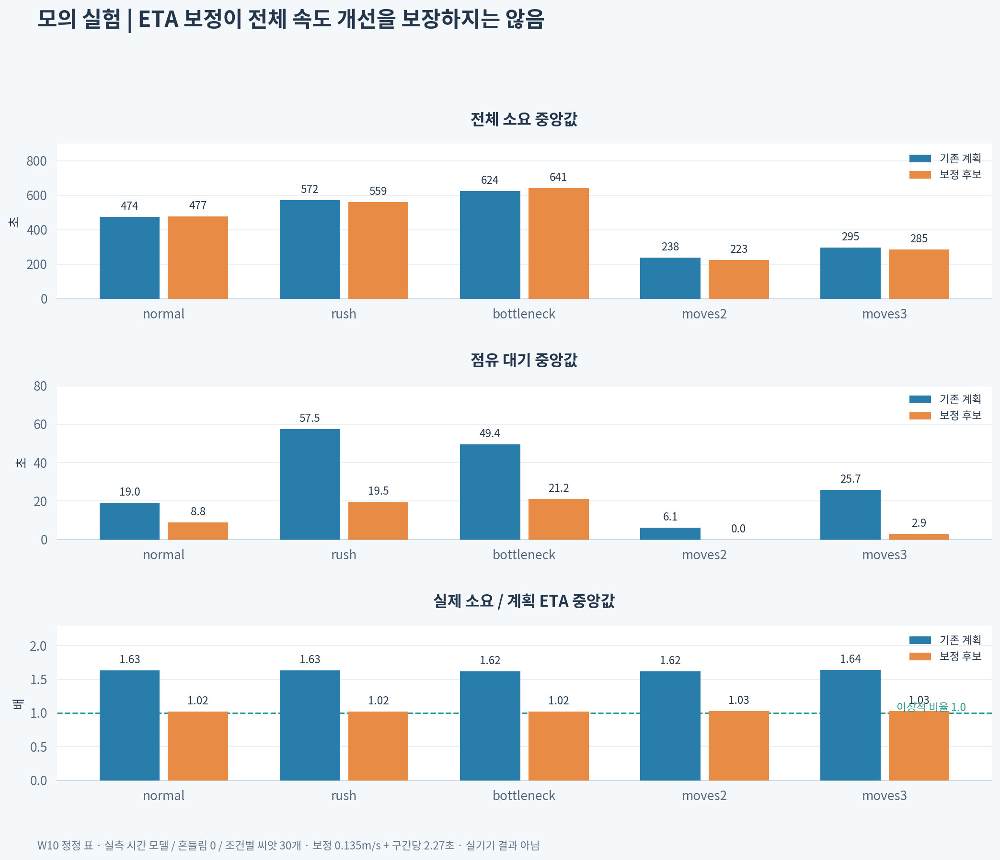

# FryBot 수정·보완 기획안 (2026-11-18)

> 2026-11-19: 11월 16~18일 실행 폴더(`runs/run_2026111[6-8]_*` 등)는 `archive/runs_2026-11-16_18/`로 옮겼습니다. 이 문서의 실행 이름은 그 폴더 아래에 있습니다.

작성 근거: src/frybot 8개 패키지의 구조·의존성 검토, dev_docs 설계 문서(SW/HW 아키텍처 v016/v018, SR v2, 데이터 모델) 대조, 측정 도구 코드 검토, docs/CODE_REVIEW_CHECKLIST.md와 TROUBLESHOOTING(T-22~T-29)의 실기기 기록.
이번 검토는 읽기 전용이었고 빌드·실행·실기기 확인은 하지 않았습니다. 아래의 목표 수치는 모두 제안이며 측정 결과가 아닙니다.
개정: 2026-11-18 검토 의견 반영(실행 로그의 커밋 표기, T-25~T-29, E0·E1·E3 절차, 단계 순서).

## 1. 결론

이 그래프는 실측 시간 모델을 넣은 **모의 결과**입니다. W10 정정 표의 흔들림 0·씨앗 30개 조건에서 기존 계획과 보정 후보를 비교했습니다. ETA 비율은 1에 가까워졌지만 전체 소요 시간은 일부 작업 부하에서 늘었습니다. 실기기 기본 설정의 변경·검증 완료를 뜻하지 않습니다.

- 패키지를 새로 만들지 않고 현재 구조에서 수정을 이어갑니다. 구성은 SW 아키텍처의 컴포넌트와 이미 1:1로 맞습니다.
- 새 패키지는 지도·로드맵 공용 패키지(frybot_map, 가칭) 하나만 분리합니다.
- 가장 큰 공백은 구조가 아니라 측정입니다. 실기기에서 문제를 찾아 고친 기록은 있지만, 고친 뒤 실기기에서 다시 잰 수치가 없어 "개선됐다"를 보여 줄 수 없습니다.
- 그래서 이 기획의 중심은 "실기기에서 부족했던 점 → 수정 → 같은 조건으로 재측정 → 기준선과 비교"의 증거를 만드는 것입니다.

## 2. 지금 가진 실기기 근거 (문서에 기록된 것)

| 번호 | 실기기에서 드러난 부족한 점 | 수정 | 수정 뒤 실기기 확인 |
| --- | --- | --- | --- |
| T-22 / R1-1 | 직접 주행 중 경로가 취소되면 마지막 속도가 남음 | 정지 시 0 속도 발행 | 안 함 |
| R0-1, R0-2 | 관제 재시작 시 옛 허가 적용, 허가 유실 시 로봇이 계속 대기 | 경로 번호 시각 기반, 허가 0.5초 재발행 | 안 함 |
| R0-3 | 비상 정지·관제 생존 신호 채널 없음 | /fms/heartbeat 추가 | 안 함 |
| T-23 / R5-4 | 실제 소요가 계획 ETA의 1.76배 (실기기 구간 = 2.27초 + 거리 ÷ 0.135 m/s, 계획 = 거리 ÷ 0.072 m/s) | 미수정 | - |
| T-23 / R5-3 | 11/16 실행에서 겹침 6번이 모두 락 대기 → 정체 재계획, 양보 0건. 판단이 로그에 없음 | PLAN_WAIT, YIELD_SKIP 이벤트 추가 | 안 함 |
| T-24 / R5-6~8 | 서로 양보하며 30초씩 대기, PLAN_FAIL 무한 반복, 1초마다 우선순위 뒤집기 | 상대 양보 중이면 대기, 출구 막은 로봇부터 비킴, 뒤집기 8초 제한 | 안 함 |
| R5-5 | 양보 기준(1.4배, 0.4 m)이 실측 지도에서 미검증. 막힌 조합의 41%가 우회 | 미수정 | - |
| T-26 | 길을 비켜 준 로봇이 원래 노드로 돌아가지 않음 | 양보 후 복귀 | 안 함(모의 확인) |
| T-27 | 연결된 로봇이 관리자 화면 지도에 나오지 않음 | 수정(원인 추정) | 안 함 |
| T-28 | 실기기 동행 확인·후진 안내 없음 | /frybot/guest_track 기준 검사, 안내 후진 | 안 함(시뮬 확인) |
| T-29 | 속도 명령이 끊겨도 모터가 돎, 끊긴 로봇에 계속 허가, 굳은 위치 보고, 오류 로봇에 임무 배정 | pinky_driver의 cmd_vel 0.5초 감시, TF 1초, 상태 보고 2초 기준 | 안 함 |

"수정 전" 수치는 실기기 주행 로그 run_20261116_175751(pinky1·pinky3, 이벤트 639건) 한 건에서만 얻을 수 있습니다. 실기기 실행은 11-18에 두 건 더 있지만(run_20261118_000127, _000145) 이벤트가 3건·1건이고 주행 기록이 없습니다. 따라서 수정 뒤의 실기기 주행 로그는 아직 없습니다.
모든 실행의 manifest.json이 commit 4ab5d33으로 찍혀 있어, 커밋 값으로는 수정 전후를 구분할 수 없습니다. 지금은 실행 날짜로 구분해야 하고, 수정 전 코드는 따로 커밋되어 있지 않아 다시 돌릴 수 없습니다.

## 3. 보여 주려는 것 (주장과 증거)

| 주장 | 증거가 되는 측정 | 비교 대상 |
| --- | --- | --- |
| A. 로봇 한 대 폭 통로에서 여러 대가 교착 없이 다닌다 | 마주침 해소 시간, 교착·PLAN_FAIL 건수, 최소 로봇 간격 | 수정 전 로그, 기준선 조합(fifo_nearest + independent_astar) |
| B. 관제·통신·위치 추정이 끊기면 로봇이 스스로 멈춘다 | 끊김부터 정지까지의 시간과 이동 거리 | 설계값(cmd_vel 0.5초, TF 1초, 상태 보고 2초) |
| C. 시뮬 예측이 실기기와 맞아 매장 투입 전에 검증할 수 있다 | 구간별 계획 ETA 대비 실제 소요, replay_run의 모의/실제 비율 | 보정 전 1.76배 |
| D. 배정·경로 알고리즘이 서비스 시간을 줄인다 | 같은 명령 대본의 총 소요·대기 시간 | 기준선 조합 |
| E. 같은 코드로 시뮬·Gazebo·실기기를 돌린다 | 세 환경의 같은 지표 표 | - |

## 4. 측정 계획 (핵심)

### 4.1 지금 측정되는 것

- runlog.py: 실행마다 runs/<run_id>/events.csv + manifest.json
- restaurant.py: 접수→착석, 주문→전달, 조리 완료→전달, 이용 종료→테이블 가용
- fleet_core의 카운터: 점유 대기, 계획 대기, 재계획, 비켜서기, 양보, 뒤집기, 계획 실패, 계획 시간, 재배정, 주행 거리
- analyze_run: 위 값의 건수·중앙값·최소·최대
- fleet_bench: 스케줄러×플래너 조합 비교(ROS 없음). 통과·실패 판정은 없음
- replay_run: 실기기 로그의 구간 시간 모델 추정, 모의/실제 비교, 양보 조합 탐색

### 4.2 추가할 측정

| 번호 | 지표 | 정의 | 원천 | 필요한 작업 | 쓰는 주장 |
| --- | --- | --- | --- | --- | --- |
| M1 | ETA 오차 | 구간별 실제 소요 ÷ 계획 소요 | events.csv의 ZONE_ENTER/EXIT와 PLAN | analyze.py 확장 (코드만) | C |
| M2 | 마주침 해소 시간 | 두 로봇이 서로를 막은 시점부터 둘 다 통과할 때까지 | YIELD_WAIT, PLAN_WAIT, RETREAT, ZONE_GRANT | analyze.py 확장 | A |
| M3 | 교착·반복 | 같은 로봇의 PLAN_FAIL 연속 횟수, 뒤집기 횟수, 30초 넘는 정지 | events.csv | analyze.py 확장 | A |
| M4 | 실제 최소 간격 | 로봇 중심 간 최소 거리, SAFE_DIST(0.155 m) 미만 시간 | 관제가 받는 /fleet/robot_status | fleet_core에 계산 추가, 주기 기록 | A |
| M5 | 정지 반응 | 끊김·비상 정지 시점부터 속도 0까지의 시간과 거리 | 로봇의 odom, WAIT_FMS 진입 시각 | mobile_controller가 정지 사유와 시각을 보고 | B |
| M6 | 정차 정확도 | 도착 노드에서의 위치·방향 오차 | 로봇의 AMCL 자세 | mobile_controller가 구간 도착 시 오차 보고 | 팔 작업의 전제 |
| M7 | 주행 신뢰도 | Nav2 구간 실패·재시도율, SENSOR_ERROR 횟수와 지속 시간 | ROUTE_RETRY, RobotStatus.error | analyze.py 확장 + 오류 이벤트 기록 | A, B |
| M8 | 가동률·배터리 | 임무 중·유휴·충전·오류 시간 비율, 임무당 배터리 소모 | robot_status, TASK_ASSIGN/DONE | 상태 변화 이벤트 기록, analyze.py 확장 | 대수 산정 |
| M9 | 서비스 시간 분포 | 주문→전달 등의 상위 5% 값, 목표 초과 건수 | 기존 이벤트 | analyze.py 확장, 목표값 합의 | D |
| M10 | 실행 조건 | 지도, 로봇, 조합, 명령 대본, 커밋, 미커밋 변경 여부와 diff 해시, 시간 모델, 실험 이름 | manifest.json | 항목 추가. E0보다 먼저 함 | 재현성 |
| M11 | 실행 간 비교 | 여러 run을 조건별로 묶어 전후 표로 출력 | events.csv 여러 개 | 새 도구(compare_runs, 가칭) | 전체 |

M1~M3, M7 일부, M9, M11은 이미 있는 이벤트로 계산할 수 있습니다. M4~M6, M8은 로봇·관제 코드가 값을 내도록 고쳐야 하고, M5는 odom 기반이라 관제 로그만으로는 잴 수 없고 로봇 쪽 기록이 필요합니다. M5·M6은 frybot_mobile 변경이라 시뮬·실기기 공통 코드와 REAL_ROBOT_GUIDE.md 갱신이 필요합니다.

### 4.3 실기기 실험

모든 실험은 같은 지도(test_map_v001), 같은 로봇, 같은 출발 위치, 같은 명령 대본으로 조건당 5회 이상 반복하고 manifest에 실험 이름을 남깁니다. 횟수와 통과 기준은 팀 합의가 필요합니다.

| 실험 | 내용 | 지표 | 비교 |
| --- | --- | --- | --- |
| E0 기준선 고정 | 사용자가 현재 코드를 커밋·태그한 뒤, fleet_bench rush·bottleneck 결과를 옛 시간 모델과 실측 시간 모델 둘 다로 저장. 기존 실기기 로그를 replay_run으로 재분석 | 전체 | 이후 모든 비교의 기준 |
| E1 시간 모델 보정 | 계획 시간 모델을 파라미터로 두고, replay_run의 fit_segments가 추정한 실측 구간 시간(지연 + 거리 ÷ 속도)을 입력으로 씀(R5-4) | M1 | 보정 전 1.76배 → 보정 후 |
| E2 마주침 | replay_run --find-yield로 찾은 마주침 조합을 실기기에서 재현 | M2, M3, M4 | T-24 수정 전 로그 → 수정 후, 기준선 조합 |
| E3 안전 정지 | 주행 중 task_manager 종료, 네트워크 차단, ESTOP, AMCL 종료, cmd_vel 발행 중단 | M5 | 설계값 |
| E4 알고리즘 비교 | 이동 명령 대본을 기본 조합(min_cost_eta_rh + sipp)과 기준선 조합으로 각각 실행 | 총 소요, 점유 대기, M3, M4 | 조합 간 |
| E5 시뮬 일치 | E2·E4 로그를 replay_run으로 재실행 | 모의/실제 비율, 이벤트 건수 차이 | 보정 전후 |
| E6 서비스 흐름 | 작업 지점을 넣은 실측 지도에서 접수→안내→서빙→회수 주행(팔은 대역) | M6, M9 | 경량 시뮬, Gazebo |

E3은 사람이 로봇 옆에 있는 상태에서 저속, 짧은 직선 구간, 한 번에 고장 한 가지로만 진행하고, 절차를 REAL_ROBOT_GUIDE.md에 먼저 적습니다. E4의 기준선 조합은 실행 중 점유 대기에만 기대어 실제 근접이 생길 수 있으므로, 실기기에서 돌릴지(로봇 2대·저속·비상 정지 대기) replay_run 모의로만 비교할지 결정이 필요합니다. E6은 5.2의 작업 지점 추가가 끝나야 가능합니다.

### 4.4 결과물

- 실험별 전후 표 한 장(지표, 수정 전, 수정 후, 기준선, 반복 횟수)과 원본 run 폴더 목록
- TROUBLESHOOTING.md의 해당 T-번호에 "실기기 확인" 결과 추가
- 확인하지 못한 항목은 "실기기 확인 필요"로 남김

## 5. 구조 보완

### 5.1 먼저 할 것

1. 현재 작업 트리 커밋·태그(수정 60여 개, 미추적 frybot_arm·frybot_description·maps). E0의 전제이며 사용자가 직접 합니다.
2. frybot_bringup/config/robots.yaml의 SSH 비밀번호를 저장소 밖(~/.config/frybot/)으로 옮기고 .gitignore에 추가(R7-2). 지금은 미추적이면서 무시 목록에도 없습니다. 그 경로를 읽는 기능은 이미 있어 코드 변경은 필요 없고, 측정과 무관하게 바로 할 수 있습니다.
3. package.xml 의존성 보완: frybot_mobile(sllidar_ros2, tf_transformations, dynamixel_sdk, 메시지 패키지), frybot_control(scipy), frybot_sim(lifecycle_msgs).

### 5.2 구조

4. frybot_map 분리: layout.py, map_catalog.py, store_map.py, maps/. 지금은 frybot_mobile이 이 모듈 때문에 frybot_control 전체(관제 로직·DB·플래너)를 Pinky에 배포합니다.
5. 실측 지도에 작업 지점 추가: 테이블 안내·서빙 위치, 받는 곳, 퇴식구를 roadmap.json에 넣고 proto도 같은 형식으로 읽게 함. 지금 실기기는 노드 간 이동만 됩니다. 데이터 모델의 location 엔터티에 해당합니다.
6. ROS 없이 도는 부분(planners, schedulers, restaurant)에 pytest 추가. 지금은 테스트가 없습니다.
7. fleet_core.py(1,852줄), mobile_controller.py(1,014줄)를 패키지 안에서 모듈로 분리. 서빙 팔 제어를 떼면 설계의 FrybotMobile Arm Controller와 맞습니다. 6번 뒤에 진행합니다.

### 5.3 설계 문서와의 차이 (결정 필요)

- DB: 논리 데이터 모델 14개 중 8개 테이블만 있음(location, menu, robot, vision_result, system_config, schema_version 없음). visit 상태 이름이 모델과 다름. 모델은 State Diagram v3, 코드는 v4 기준이라 어느 쪽에 맞출지 확인 필요.
- 손님 안내: 실기기 런치는 손님 추적 값이 없으면 출발하지 않는데, 그 값을 만드는 AI 서버가 실기기 구성에 없음(SR-006~008 미구현).
- 조리 팔·서빙 팔은 대역이라 팔 작업 성공률·시간은 측정 대상이 아님.
- device_state.py는 기기별 상태 흐름 V0.07 기준, 최신 문서는 V0.10.

## 6. 순서

| 단계 | 작업 | 끝났다는 기준 |
| --- | --- | --- |
| 1 | 5.1의 1~3, M10, E0 | 사용자가 커밋·태그한 뒤, 기준선 fleet_bench 결과(시간 모델 2종)와 기존 로그 분석표 저장 |
| 2 | M1~M3, M9, M11 (분석 도구) | 기존 실기기 로그로 "수정 전" 표가 나옴 |
| 3 | M4~M8 (로봇·관제 계측) | 경량 시뮬 demo 시나리오에서 새 지표가 기록됨 |
| 4 | E1~E5 실기기 실험 | 전후 표 완성, T-번호에 실기기 확인 기록 |
| 5 | 5.2의 4~5, E6 | 실측 지도에서 접수→서빙 주행이 끝까지 돎. frybot_map 분리는 로봇 배포 목록이 바뀌므로 E1~E5가 끝난 뒤에 함 |
| 6 | 5.2의 6~7 | 분리 전후 fleet_bench 결과가 같음 |

2단계는 실기기 없이 진행할 수 있어 바로 시작할 수 있습니다. 4단계는 실기기와 사람이 필요합니다.

## 7. 위험과 미확인

- 수정 뒤에도 실기기 수치가 나아지지 않을 수 있습니다. 그 경우 그대로 보고하고 원인을 고친 뒤 다시 잽니다.
- "수정 전" 근거가 기존 로그 몇 건뿐이라 표본이 적습니다.
- 경량 시뮬과 fleet_bench의 시간 수치는 E1 전까지 실기기 근거로 쓸 수 없습니다.
- 5.2의 4번은 4개 패키지의 import 경로와 로봇 배포 목록이 함께 바뀝니다.

## 8. 결정을 요청하는 것

1. 실험 반복 횟수와 통과 기준. 검토 의견의 제안: E2·E4는 조건당 5회, E3은 고장 종류당 3회. 보정 후 구간 ETA 비율 중앙값 0.8~1.2, 정지 반응은 설계값 + 0.5초 이내이고 이동 거리 0.155 m 미만, 마주침에서 PLAN_FAIL 연속 3회 이상 0건(2026-11-18 W4에서 "같은 목적지의 계획 실패가 20초 넘게 이어지는 경우 0건"으로 변경), 30초 넘는 정지 0건(2026-11-18 W7에서 "계획에 없는 정지가 30초 넘게 이어진 경우 0건"으로 변경, 의도된 대기는 따로 보고). 2026-11-18 W11에서 "의도된 대기가 20초 넘게 이어진 경우 0건"을 추가(9.10)
2. 기준선 조합을 실기기에서 돌릴지, replay_run 모의로만 비교할지(E4)
3. DB·상태 이름을 State Diagram v3와 v4 중 어느 쪽에 맞출지. 검토 의견은 v4에 맞추고 데이터 모델 문서를 갱신하는 쪽(팀 확인 필요)
4. 1~4단계(측정)와 5~6단계(구조) 중 어느 쪽을 먼저 할지. 제안은 측정 먼저입니다.

## 9. 모의 비교 결과 (2026-11-18, 작업 지시서 W3)

원본: `archive/mock_compare_2026-11/`
- 조건별 폴더 8개마다 작업 부하별 `*.raw.csv`(씨앗당 한 줄), `*.mean.csv`, `*.txt`가 있습니다.
- 실행 스크립트는 `run_compare.sh`, 전체 표는 `SUMMARY.md`입니다.
- 수정 전 기준 결과는 `baseline/`에 있습니다.

실행 조건:
- 도구: `fleet_bench`(관제 코어 + `mock_fleet.MockFleet`)
- 씨앗: 조건당 30개
- 조합: 기본 rh+sipp(`min_cost_eta_rh` + `sipp`), fifo+sipp, rh+indep(`independent_astar`), 기준선 fifo+indep
- 작업 부하: 가상 매장 normal·rush·bottleneck(로봇 3대), 실측 지도 `test_map_v001` 이동 명령(`moves`, 로봇 2대·3대, 로봇당 8건)
  - 이동 명령은 로봇을 지정하므로 배정 방식이 영향을 주지 않습니다. 그래서 `min_cost_eta_rh`에 플래너 2종만 비교했고, 이때 기준선은 rh+indep입니다.
- 실행 시간 모델: 기존(지연 0, 0.08 m/s), 실측(2.27초 + 거리 ÷ 0.135 m/s, 안내 구간은 0.05 m/s)
- 흔들림: 0, 0.2
- 계획 속도: 지금 값(0.072 m/s), 0.04 m/s
- 최대 모의 시간: 기존 모델 1500초, 실측 모델 3000초

가정:
- 실측 시간 모델은 11-16 실기기 실행 한 건(로봇 2대, 구간 147개)에서 맞춘 값입니다. 가상 매장에 그대로 적용한 것은 가정입니다.
- 흔들림 0.2는 임의로 고른 값입니다.
- 손님 안내 구간의 실측 속도는 없어 0.05 m/s를 그대로 썼습니다.

### 9.1 요약 표

[2026-11-18 W4 갱신] 통과 기준을 바꾼 뒤 다시 실행한 결과입니다. 해시 씨앗과 난수 씨앗을 고정한 뒤라 같은 명령은 같은 결과를 냅니다(9.4).
칸의 값은 전체 소요 중앙값, 완료한 씨앗 수, 기준선보다 빨리 끝난 씨앗 수입니다. ✓·✗는 새 통과 기준(9.3)의 판정입니다.
[2026-11-18 W10 정정] 마지막 열(계획 속도 0.04)의 normal·rush·bottleneck 칸은 W10에서 다시 실행한 값이고 판정은 W7 기준입니다. 앞 값은 `--plan-speed`가 배율로 들어가 손님 안내 계획 속도가 0.025 m/s(실행의 절반)였던 조건의 값입니다.

| 작업 부하 | 조합 | 기존(지연 0·0.08 m/s, 흔들림 0) | 실측(2.27초+거리/0.135), 흔들림 0 | 실측, 흔들림 0.2 | 실측, 흔들림 0.2, 계획 속도 0.04 |
|---|---|---|---|---|---|
| normal | rh+sipp | 387s, 30/30, 기준선보다 빠름 29/30 ✓ | 474s, 30/30, 기준선보다 빠름 28/30 ✓ | 475s, 30/30, 기준선보다 빠름 30/30 ✗ | 506s, 30/30, 기준선보다 빠름 29/30 ✓ (W10에서 정정) |
| normal | rh+indep | 458s, 24/30, 기준선보다 빠름 19/30 ✗ | 527s, 30/30, 기준선보다 빠름 20/30 ✓ | 529s, 29/30, 기준선보다 빠름 21/30 ✗ | 532s, 30/30, 기준선보다 빠름 15/30 ✓ (W10에서 정정) |
| normal | fifo+sipp | 395s, 30/30, 기준선보다 빠름 26/30 ✓ | 484s, 30/30, 기준선보다 빠름 29/30 ✗ | 474s, 30/30, 기준선보다 빠름 27/30 ✗ | 528s, 30/30, 기준선보다 빠름 24/30 ✓ (W10에서 정정) |
| normal | fifo+indep | 446s, 21/30 ✗ | 556s, 21/30 ✗ | 567s, 29/30 ✗ | 570s, 30/30 ✗ (W10에서 정정) |
| rush | rh+sipp | 367s, 30/30, 기준선보다 빠름 30/30 ✗ | 572s, 30/30, 기준선보다 빠름 28/30 ✗ | 572s, 30/30, 기준선보다 빠름 30/30 ✗ | 652s, 30/30, 기준선보다 빠름 12/30 ✓ (W10에서 정정) |
| rush | rh+indep | 393s, 30/30, 기준선보다 빠름 28/30 ✗ | 680s, 30/30, 기준선보다 빠름 11/30 ✗ | 640s, 30/30, 기준선보다 빠름 23/30 ✗ | 624s, 30/30, 기준선보다 빠름 22/30 ✓ (W10에서 정정) |
| rush | fifo+sipp | 371s, 30/30, 기준선보다 빠름 30/30 ✓ | 581s, 30/30, 기준선보다 빠름 29/30 ✗ | 582s, 30/30, 기준선보다 빠름 28/30 ✗ | 671s, 30/30, 기준선보다 빠름 11/30 ✓ (W10에서 정정) |
| rush | fifo+indep | 432s, 28/30 ✗ | 651s, 30/30 ✗ | 671s, 30/30 ✗ | 647s, 30/30 ✓ (W10에서 정정) |
| bottleneck | rh+sipp | 425s, 30/30, 기준선보다 빠름 29/30 ✓ | 624s, 30/30, 기준선보다 빠름 28/30 ✗ | 627s, 30/30, 기준선보다 빠름 30/30 ✗ | 705s, 30/30, 기준선보다 빠름 25/30 ✓ (W10에서 정정) |
| bottleneck | rh+indep | 462s, 29/30, 기준선보다 빠름 21/30 ✗ | 703s, 30/30, 기준선보다 빠름 11/30 ✗ | 734s, 30/30, 기준선보다 빠름 17/30 ✗ | 709s, 30/30, 기준선보다 빠름 22/30 ✗ (W10에서 정정) |
| bottleneck | fifo+sipp | 442s, 30/30, 기준선보다 빠름 24/30 ✗ | 653s, 30/30, 기준선보다 빠름 29/30 ✗ | 635s, 30/30, 기준선보다 빠름 28/30 ✗ | 735s, 30/30, 기준선보다 빠름 19/30 ✓ (W10에서 정정) |
| bottleneck | fifo+indep | 483s, 29/30 ✗ | 694s, 30/30 ✗ | 730s, 30/30 ✗ | 739s, 30/30 ✓ (W10에서 정정) |
| moves2 | rh+sipp | 137s, 29/30, 기준선보다 빠름 25/30 ✗ | 231s, 30/30, 기준선보다 빠름 27/30 ✓ | 226s, 30/30, 기준선보다 빠름 26/30 ✓ | 245s, 29/30, 기준선보다 빠름 21/30 ✗ |
| moves2 | rh+indep | 173s, 19/30 ✗ | 292s, 18/30 ✗ | 336s, 20/30 ✗ | 336s, 20/30 ✗ |
| moves3 | rh+sipp | 166s, 30/30, 기준선보다 빠름 29/30 ✓ | 290s, 28/30, 기준선보다 빠름 28/30 ✗ | 298s, 27/30, 기준선보다 빠름 26/30 ✗ | 308s, 29/30, 기준선보다 빠름 28/30 ✗ |
| moves3 | rh+indep | 1500s, 8/30 ✗ | 3000s, 7/30 ✗ | 3000s, 10/30 ✗ | 3000s, 10/30 ✗ |

### 9.2 결과

아래 수치는 W3 실행 값입니다. W4 재실행(9.4의 고정 뒤)에서 달라진 것은 이동 명령과 흔들림이 있는 일부 조건뿐이고, 결론은 그대로입니다. 바뀐 값은 9.1 표를 따릅니다.

- **경로 계획의 효과는 모든 조건에서 뚜렷함.**
  - `independent_astar`는 끝내지 못하는 실행이 있었습니다. 가상 매장 기준선(fifo+indep)은 기존 모델에서 normal 21/30, rush 28/30, bottleneck 29/30만 끝났고, 실측 지도 3대(moves3)는 rh+indep가 7~10/30만 끝났습니다.
  - 점유 대기 중앙값은 indep가 105~245초, sipp는 0~60초였습니다.
- **배정의 효과는 작고 시나리오에 따라 다름.** 같은 씨앗끼리 비교(rh+sipp 대 fifo+sipp)했을 때:
  - bottleneck은 24개 조건 중 모든 조건에서 rh가 빨랐습니다(빠른 씨앗 21~28/30, 차 중앙값 -13~-89초).
  - rush는 16~21/30에서 빨랐고 차 중앙값은 -0.6~-15초였습니다.
  - normal은 실측 모델에서 차가 0초였습니다.
  - 배정만으로 장점을 주장하기에는 bottleneck 말고는 근거가 약합니다.
- **실측 시간 모델에서는 계획과 실행이 어긋남.** 전체 소요가 기존 모델보다 1.2~1.6배 늘었고, sipp의 점유 대기가 0초 안팎에서 19~60초로 늘었습니다(T-23에서 본 현상과 같은 방향).
- **계획 속도만 0.04 m/s로 낮추는 보정은 득이 없음.** 0.04는 실측 지도 구간 중앙값 13 cm 기준으로 0.13 ÷ (2.27 + 0.13 ÷ 0.135)에서 나온 값입니다.
  - 실측 모델 rush에서 점유 대기는 58초에서 19초로 줄었습니다.
  - 그러나 전체 소요는 572초에서 633~638초로 늘었고, 30초 넘는 정지도 20~23건에서 35건으로 늘었습니다.
  - 기존 모델에서는 rush가 367초에서 576초로 크게 나빠졌습니다.
  - 속도 대신 구간 지연을 계획에 직접 넣는 방식(E1)을 검토할 근거가 됩니다.
  - [W10 정정] 위 수치는 안내 계획 속도가 0.025 m/s로 함께 낮아진 조건의 값입니다. 일반 계획 속도 0.04 m/s, 안내 계획 0.045 m/s로 다시 실행하면 다음과 같고, 결론("득이 없음")은 그대로입니다.
    - 기존 모델 rush: 367초 → 522초(앞 값 576초). 나빠지는 폭은 줄었지만 여전히 큽니다.
    - 실측 모델 rush: 점유 대기 57초 → 42초, 전체 소요 572초 → 655~652초.
    - 가상 매장 12개 조건(시나리오 3 × 실행 모델 2 × 흔들림 2) 모두 기본 조합의 전체 소요가 지금 값보다 깁니다.
- **흔들림 0.2는 중앙값에 영향이 작았습니다.** 기준선(fifo+indep)이 끝내지 못하는 실행은 오히려 줄었습니다(normal 21/30 → 29~30/30). 흔들림이 우연히 교착을 풀어 준 것으로 보이며, 원인은 확인하지 못했습니다.
- **로봇 간격:** 모든 실행(3,840회)에서 최소 간격이 0.156 m였고, 0.155 m 미만인 시간은 0초였습니다.
- **기본 조합도 통과 기준을 넘지 못한 경우:**
  - 실측 지도 이동 명령에서 끝내지 못한 실행이 있었습니다. moves2는 기존 모델에서 29/30, 계획 속도 0.04에서 29/30이었고, moves3는 실측 모델에서 27~29/30이었습니다(W4 재실행 값). 원인은 아직 보지 않았습니다(확인 필요).
  - 실측 모델 rush에서 30초 넘는 정지가 30개 씨앗 중 20~23건 나왔습니다.

### 9.3 통과 기준에 대해

[2026-11-18 W4 변경] 사용자 결정에 따라 "PLAN_FAIL 연속 3회 이상 0건"을 "같은 목적지의 계획 실패가 20초 넘게 이어지는 경우 0건"으로 바꿨습니다.
- 묶음은 한 로봇이 같은 목적지로 연속해서 계획에 실패한 구간입니다. 계획이 성공하거나 목적지가 바뀌면 끝나고, 실행이 끝날 때까지 이어진 묶음도 셉니다. 첫 실패부터 마지막 실패까지가 20초를 넘으면 1건입니다.
- 지표는 `plan_fail_long`, 위치는 `plan_fail_long_at`(로봇@목적지:첫 시각-마지막 시각)입니다. 예전의 `plan_fail_run`은 참고 열로 남겼습니다.
- 바꾸기 전: 기존 기준으로는 128개 중 2개가 통과했습니다. 바꾸게 된 이유는 1.1초마다 다시 계획하며 생기는 몇 초짜리 정상 대기까지 실패로 셌기 때문입니다.

새 기준 결과:
- 128개 중 17개가 통과합니다.
- 실패 이유별 조건 수(겹침 있음): 30초 넘는 정지 107, 미완료 40, 20초 넘는 계획 실패 8, 간격 미달 0
- 20초 넘는 계획 실패가 있었던 실행은 12회이고, 모두 기본 조합(rh+sipp)입니다. 목록은 `archive/mock_compare_2026-11/plan_fail_long_runs.csv`에 있습니다.
  - ideal / j0 / ps default, moves2, 씨앗 19: `pinky1@W3:119-1500`
  - ideal / j0.2 / ps default, moves2, 씨앗 19: `pinky1@W3:119-1499`
  - measured / j0 / ps default, moves3, 씨앗 19: `pinky1@W3:214-2999`
  - measured / j0 / ps default, moves3, 씨앗 21: `pinky1@W3:263-2999`
  - measured / j0 / ps 0.04, moves2, 씨앗 19: `pinky1@W3:237-3000`
  - measured / j0 / ps 0.04, moves3, 씨앗 5: `pinky2@W3:169-2999`
  - measured / j0 / ps 0.04, moves3, 씨앗 11: `pinky3@W1:304-2999`
  - measured / j0.2 / ps default, moves3, 씨앗 11: `pinky3@W1:286-3000`
  - measured / j0.2 / ps default, moves3, 씨앗 19: `pinky1@W3:232-2999`
  - measured / j0.2 / ps default, moves3, 씨앗 21: `pinky1@W3:224-3000`
  - measured / j0.2 / ps 0.04, moves2, 씨앗 19: `pinky1@W3:210-2999`
  - measured / j0.2 / ps 0.04, moves3, 씨앗 5: `pinky2@W3:174-2999`
- 처음에는 재계획 성공(`REPLAN`)에서 묶음을 끝내지 않아 1,418회로 셌습니다. 고친 뒤 다시 실행한 값이 위 숫자입니다.
- "30초 넘는 정지"는 서 있는 경우만 셉니다. 로봇이 조금씩 오가며 맴도는 경우는 잡지 못하고, 그런 경우는 "전부 완료" 기준에서 걸러집니다.
- [2026-11-18 W7 변경] 30초 정지는 계획에 없는 정지(`unplanned30`)만 판정에 씁니다. 의도된 대기는 `intended30`, `intended_wait_max`로 따로 보고합니다(9.7).
- [2026-11-18 W11 변경] 의도된 대기가 20초 넘게 이어진 경우(`intended20`) 0건을 판정에 더했습니다. 계획에 없는 정지 20초(`unplanned20`)는 참고 열입니다(9.10).

### 9.4 수정 전과 같은지 (리팩터링 확인)

- 모의 로봇을 `mock_fleet.py`로 옮긴 뒤, 기존 시간 모델·흔들림 0에서 `fleet_bench` rush·bottleneck(씨앗 5개, 4개 조합)의 조합별 평균이 W0 표와 같았습니다(계획 시간 `plan_ms` 제외).
- `replay_run archive/runs_2026-11-16_18/run_20261116_175751` 출력이 W0와 같았습니다(0.53, 1.01).
- `replay_run --find-yield --map-id test_map_v001`의 출력이 수정 전 코드와 같았습니다.
- [2026-11-18 W5] 같은 씨앗도 실행마다 결과가 달랐던 원인 두 가지를 찾아, 모의 도구에서 고정했습니다.
  - 관제 코어가 문자열 집합을 도는 순서가 `PYTHONHASHSEED`에 따라 달라집니다. `fleet_bench`와 `replay_run`은 해시 씨앗을 0으로 두고 자신을 다시 실행합니다.
  - `fleet_core.py`가 물러날 때 쓰는 전역 `random.uniform`을, 이동 명령 작업 부하(`run_moves`)만 씨앗으로 고정하지 않았습니다(W3에서 빠뜨림).
  - 그래서 W3에 처음 적은 이동 명령 수치는 실행마다 조금씩 달랐습니다. 9.1은 고정한 뒤의 값입니다.
  - 고정한 뒤 128개 조건을 두 번 실행해 40개 원본 파일이 `plan_ms` 열만 빼고 같았습니다. W0 표와 replay_run 출력도 그대로입니다.
  - 관제 코어의 판단이 집합 순서에 따라 달라지는 것 자체는 실기기에도 해당합니다. W6와 별개로 보고합니다.

### 9.5 약점 원인 조사 (2026-11-18, 작업 지시서 2 W5)

대상: 기본 조합(rh+sipp)에서 끝내지 못했거나 30초 넘는 정지가 있었던 실행 전부입니다. 고정한 원본(9.4)에서 다시 뽑았고, 실행 261회, 문제 묶음 481개입니다.
- 지시서의 씨앗 목록은 결과가 실행마다 달라지던 W3 원본에서 나온 것이라 조금 다릅니다. 미완료는 13회이고, 지시서 A 목록의 실행이 거의 모두 들어 있습니다.
- 방법: `archive/mock_compare_2026-11/w5_trace.py`가 각 실행을 다시 돌려 0.5초마다 로봇 상태를 남깁니다. 문제 시점 앞 30초 동안 가장 많았던 상태로 분류하고, 앞 60초의 관제 이벤트를 발췌합니다.
- 결과: `w5_classified.csv`(묶음별 분류), `w5_excerpts.md`(근거 발췌)
- 관제 코드는 바꾸지 않았습니다.

#### 분류표

| 문제 | 원인 분류 | 건수 | 주로 나온 조건 | 근거 (발췌) |
| --- | --- | --- | --- | --- |
| 미완료 | 목적지(막다른 대기 위치 W3)에 먼저 도착한 로봇이 그대로 서 있는데, 뒤 로봇이 그 자리로 가는 계획을 세워 길목 B7까지 들어옴. 앞 로봇은 B7이 막혀 비킬 수 없어 둘 다 멈춤 | 8회 | moves2·moves3, 기존·실측 모델 모두 | moves2 씨앗 19(기존 모델): pinky2가 마지막 명령으로 109초에 W3 도착, pinky1이 116.4초 `ZONE_REQUEST W3 held_by=pinky2`, 119.5초부터 1500초까지 1.1초마다 `PLAN_FAIL W3`, 임무 보류 없음 |
| 미완료 | 길목(B7·B1)에 임무 없는 로봇이 서 있고 비키지 않음. 다시 계획하기를 10.7초 주기로 되풀이함(`REPLAN` → `ZONE_REQUEST held_by` → `PLAN_FAIL` ×2) | 3회 | moves3, 실측 모델 | moves3 씨앗 15(실측 모델, 계획 속도 0.04): pinky3이 임무 없이 B7에 서 있고, pinky1(W3행)과 그 뒤의 pinky2가 2,900초 넘게 같은 순환 |
| 미완료 | 세 대가 맞물려 W3행 계획이 계속 실패함(원인 추가 확인 필요) | 2회 | moves3 씨앗 5, 실측 모델 + 계획 속도 0.04 | pinky2가 174초에 `RETREAT yield_to=plan` 뒤 `PLAN_FAIL W3`가 반복됨. 다른 두 대는 임무와 경로가 있는 채로 끝남 |
| 30초 정지 | 계획에 든 대기: SIPP가 다른 로봇의 예약이 끝날 때까지 출발 시각을 늦춰 30초 넘게 세워 둠(받는 곳·회수 지점 앞 줄서기) | 271 | 계획 속도 0.04 조건이 220건(기존 모델 89, 실측 모델 131), 실측 모델·기본 속도 50, 기존 모델·기본 속도 1 | normal 씨앗 10(기존 모델, 계획 속도 0.04): pinky1이 WOK_PICKUP(N183_50)에서 `PLAN_WAIT wait=12.6s for=pinky2`, 이어서 `REPLAN N183_72 eta=30.1` |
| 30초 정지 | 비켜 선 뒤 상대가 지나가기를 기다림: 양보 대기는 설계상 최대 30초(`fleet_core.py:1259`, `:1527` `yield_until = t + 30.0`)이고, 이동 시간이 더해지면 30초 정지 기준을 넘음 | 185 | 실측 모델·moves가 127건, 실측 모델·매장 20건, 기존 모델·기본 속도는 3건 | rush 씨앗 0(실측 모델): pinky1이 301초에 `RETREAT yield_to=pinky3 by_choice`로 N38_28에 비켜 서고, 338초까지 서 있다가 `REPLAN` |
| 30초 정지 | 임무 없는 로봇이 서 있어 막힘(위 미완료 실행의 같은 장면) | 10 | moves | 미완료 첫 행과 같음 |
| 30초 정지 | 다시 계획할 때를 기다림 | 2 | moves3 씨앗 5 | 미완료 셋째 행과 같음 |
| 30초 정지 | 팔 작업 중 | 0 | - | 팔 작업은 4초 이하라 30초에 닿지 않음 |

- [W10 정정] 계획 속도 0.04 조건의 가상 매장분은 안내 계획 속도가 0.025 m/s였던 실행에서 나온 값입니다. W5 분류를 다시 돌리지는 않았습니다. 대신 W7 지표 `intended30`(기본 조합, normal·rush·bottleneck, 흔들림 0·0.2 합계)으로 비교했습니다. 기존 모델은 71건에서 54건으로, 실측 모델은 84건에서 95건으로 바뀌었습니다. 계획 속도를 낮추면 계획 대기가 생긴다는 판단은 그대로입니다.

#### 가설 판정

- **가설 1(지표 문제): 일부 맞음.**
  - 30초 정지 468건 중 456건(97%)은 관제가 의도한 대기입니다. SIPP의 계획 대기(271건)와 양보 대기(185건)입니다.
  - 팔 작업이나 손님·음식을 기다리는 단계는 들어가지 않았습니다.
  - 의도한 대기가 정상인지는 따로 판단해야 합니다. 받는 곳 앞 줄서기는 정상이지만, 양보 대기 30초 상한이 지표 기준 30초와 겹쳐 있어 걸리는 것이 당연한 구조입니다.
  - 정의 수정 제안(사용자 결정 필요): 30초 정지를 "계획에 없이 선 경우"(락 대기, 경로 없음, 계획 실패 반복)만으로 세고, 계획 대기와 양보 대기는 "가장 긴 의도된 대기" 같은 별도 지표로 보고합니다.
- **가설 2(계획과 실행의 어긋남): 맞는 방향. W6 뒤에 다시 확인.**
  - 기본 계획 속도에서 계획 대기와 양보 대기로 생긴 30초 정지는 기존 모델이 4건(계획 대기 1, 양보 3), 실측 모델이 197건(계획 대기 50, 양보 147)입니다.
  - 계획 속도만 0.04로 낮추면 기존 모델에서도 계획 대기가 89건 생깁니다. 로봇이 계획보다 빨리 도착해 예약된 출발 시각까지 서 있기 때문입니다. W3에서 "속도만 낮춘 보정이 오히려 나쁨"으로 나온 이유가 이것입니다.
  - 확인 대상: 실측 모델·기본 계획 속도에서 나온 계획 대기 50건과 양보 대기 147건을 W6 보정값으로 다시 돌립니다.
- **가설 3(양보 대기): 맞음.** 30초 정지의 원인은 `yield_max_wait`(25초, 짧은 길에서 기다릴지 정하는 값)가 아니라, 비켜 선 뒤의 대기 상한 `yield_until = +30초`입니다.
- **가설 4(교착·맴돌기): 미완료 13회는 모두 교착 또는 맴돌기였고, 계기는 목적지·길목을 임무 없는 로봇이 차지한 것입니다.**
  - 우선순위 뒤집기(`FLIP_HOLD`) 반복은 보이지 않았습니다.
  - 실측 지도의 `quiet` 규칙(임무 없는 로봇은 남을 비키게 하지 않음)은 이번 실행과 직접 관계가 없었습니다. 막는 쪽이 임무 없는 로봇이었습니다.
  - `_make_way`가 있지만, W3는 B7로만 드나드는 막다른 자리라 뒤 로봇이 B7에 들어선 뒤에는 비킬 곳이 없습니다.

#### 시간 모델과 무관한 관제 문제 (따로 보고, 수정은 사용자 승인 뒤)

1. **도착 뒤 점유 시간 예약이 짧음**
   - 내용: `_hold_estimate(at_goal=True)`(`fleet_core.py:598~606`)가 이동 중인 로봇은 목적지에 도착하고 4초 뒤 떠난다고 예약합니다. 그런데 이동 명령(`MOVE`)이 끝난 로봇처럼 다음 일이 없으면 그 자리에 계속 섭니다. 그래서 뒤 로봇의 SIPP가 그 목적지를 비어 있다고 보고 계획합니다.
   - 기존 모델에서도 나옵니다(moves2 씨앗 19).
   - 수정 제안: 마지막 단계가 이동이고 그 뒤 할 일이 없는 임무(MOVE)는 도착 뒤 점유를 무한대(`INF`)로 잡습니다. 또는 이동 명령을 받을 때 다른 로봇이 그 목적지에 있거나 그리로 가는 중이면 거절합니다.
2. **계획 실패가 끝없이 반복되고 임무 보류가 없음**
   - 내용: W3행 계획이 1,380초 동안 1.1초마다 실패해도 임무가 `SUSPENDED`가 되지 않아 관리자 알람도 나가지 않습니다.
   - 수정 제안: 같은 목적지 계획 실패가 20초(W4 기준)를 넘으면 임무를 `SUSPENDED(PLAN_FAIL)`로 두고 알립니다.
3. **같은 입력에도 판단이 실행마다 다름**
   - 내용: 문자열 집합의 순서(`PYTHONHASHSEED`)에 따라 동점 처리가 달라져, 같은 씨앗의 결과가 완료와 미완료로 갈렸습니다(9.4).
   - 수정 제안: 판단에 쓰는 집합 순회를 정렬된 순서로 바꿉니다. 실기기에서 같은 상황이 재현되지 않는 원인이 될 수 있습니다.

#### 분류별 수정 제안 (W5에서는 고치지 않음)

- 계획에 든 대기: 받는 곳 앞 줄서기는 정상이므로 지표 정의만 바꿉니다(가설 1의 제안). 줄이 길어지는 원인은 계획·실행 어긋남이므로 W6 보정으로 줄어드는지 봅니다.
- 양보 대기: 비켜 선 로봇의 대기 상한(30초)을 상대 경로의 남은 예상 시간에 맞춰 정하면, 실측 모델에서 상대가 느릴 때도 근거 있는 상한이 됩니다. 시간 모델과 얽혀 있어 W6 뒤에 다시 봅니다.
- 미완료: 위 관제 문제 1·2를 고치면 없어질 것으로 봅니다(확인 필요).

### 9.6 구간 지연 보정 결과 (2026-11-18, 작업 지시서 2 W6)

#### 수정 내용
- `PlanRequest.overhead`(기본 0.0)를 추가했습니다. 구간 시간 = 지연 + 거리 ÷ 속도입니다.
- 이 식을 쓰는 곳:
  - SIPP와 협조 A*
  - 관제 코어(배정 비용, 계획 요청, 구간 중간에서의 출발 시각, 물러날 때의 시간)
  - `task_manager`의 `plan_overhead` 파라미터
  - 런치 3개(sim, gazebo, real)의 `plan_overhead` 인자. 모두 기본 0.0입니다.
  - `fleet_bench --plan-overhead`, `replay_run --plan-overhead --plan-speed`
- 바꾸지 않은 플래너:
  - `independent_astar`는 시각을 계획하지 않아 지연을 쓰지 않습니다. 지시서와 다른 점입니다.
  - `rmf`, `rmf_task`는 외부 도우미가 속도만 받아 지연을 지원하지 않는다고 설명에 적었습니다.
  - `ccbs`는 하위 탐색(SIPP)에 요청을 그대로 넘겨 따로 고칠 곳이 없습니다.

#### 확인
1. 지연 0.0에서 동작이 같습니다. fleet_bench rush·bottleneck 조합별 평균이 W0 표와 같고(`plan_ms` 제외), replay_run 출력(0.53, 1.01)도 같습니다.
2. `frybot_control/test/test_plan_overhead.py` 7건이 통과했습니다.
   - SIPP: 구간 도착 시각 차이가 지연 + 거리 ÷ 속도와 같음
   - 협조 A*: 그 값 이상이고 0.5초 격자 한 칸 미만 차이
   - 기준선(`independent_astar`): 시각 0이고 경로가 같음
3. `colcon build --packages-select frybot_control frybot_bringup`이 성공했습니다. `ros2 launch ... --show-args`에서 런치 3개 모두 `plan_overhead`(기본 0.0)가 보이고, `task_manager`가 파라미터 2.27을 받는 것을 확인했습니다.
4. 보정 효과 비교: 씨앗 30개, 10개 조건, 실행 4,800회. 원본은 `archive/mock_compare_2026-11/w6/`에 있습니다. 아래는 기본 조합입니다.

[2026-11-18 W10 정정] 아래 표는 W10(`--plan-speed` 수정, 구간 출발 지연 분류)과 W8이 들어간 코드로 다시 실행한 값입니다.
- 앞 표는 `--plan-speed`가 배율로 들어가 안내 계획 속도가 함께 바뀐 조건(보정 0.084 m/s, 속도만 0.04는 0.025 m/s)의 값이었습니다. 앞 표는 `archive/mock_compare_2026-11/w10/before_w10/`에 있습니다.
- 계획 인자
  - 보정: `--plan-speed 0.135 --plan-speed-factor 1.0 --plan-overhead 2.27`
  - 보정×0.9: `--plan-speed 0.135 --plan-overhead 2.27`(0.1215 m/s, 실기기 런치의 `speed:=0.135 plan_overhead:=2.27`과 같음)
  - 속도만 0.04: `--plan-speed 0.04 --plan-speed-factor 1.0 --plan-guide-speed 0.045`
- "30초 정지(예전 지표)"는 `stall30`입니다. 판정은 "계획에 없는 정지 30초"(W7)로 합니다.

| 작업 부하 | 조건 | 완료 | 전체 소요 중앙값(s) | 점유 대기 중앙값(s) | 30초 정지(예전 지표) | 계획에 없는 정지 30초 | 계획 실패 20초 | ETA 비율 중앙값 |
|---|---|---|---|---|---|---|---|---|
| normal | 실측·흔들림0·지금 값 | 30/30 | 474 | 19.0 | 0 | 0 | 0 | 1.63 |
| normal | 실측·흔들림0·속도만 0.04 | 30/30 | 506 | 12.4 | 7 | 0 | 0 | 1.08 |
| normal | 실측·흔들림0·보정 | 30/30 | 477 | 8.8 | 5 | 0 | 0 | 1.02 |
| normal | 실측·흔들림0·보정×0.9 | 30/30 | 466 | 8.7 | 11 | 0 | 0 | 1.00 |
| normal | 실측·흔들림0.2·지금 값 | 30/30 | 477 | 20.5 | 5 | 0 | 0 | 1.65 |
| normal | 실측·흔들림0.2·속도만 0.04 | 30/30 | 506 | 12.4 | 9 | 0 | 0 | 1.08 |
| normal | 실측·흔들림0.2·보정 | 30/30 | 485 | 10.3 | 3 | 0 | 0 | 1.07 |
| normal | 실측·흔들림0.2·보정×0.9 | 30/30 | 470 | 7.3 | 2 | 0 | 0 | 1.04 |
| normal | 기존·흔들림0·지금 값 | 30/30 | 387 | 0.0 | 0 | 0 | 0 | 0.99 |
| normal | 기존·흔들림0·보정 | 30/30 | 441 | 3.2 | 6 | 0 | 0 | 0.92 |
| rush | 실측·흔들림0·지금 값 | 30/30 | 572 | 57.5 | 20 | 0 | 0 | 1.63 |
| rush | 실측·흔들림0·속도만 0.04 | 30/30 | 655 | 42.2 | 73 | 0 | 0 | 1.07 |
| rush | 실측·흔들림0·보정 | 30/30 | 559 | 19.5 | 11 | 0 | 0 | 1.02 |
| rush | 실측·흔들림0·보정×0.9 | 30/30 | 560 | 15.9 | 23 | 1 | 0 | 1.00 |
| rush | 실측·흔들림0.2·지금 값 | 30/30 | 572 | 56.0 | 23 | 0 | 0 | 1.65 |
| rush | 실측·흔들림0.2·속도만 0.04 | 30/30 | 652 | 39.4 | 47 | 0 | 0 | 1.09 |
| rush | 실측·흔들림0.2·보정 | 30/30 | 594 | 27.8 | 17 | 0 | 0 | 1.07 |
| rush | 실측·흔들림0.2·보정×0.9 | 30/30 | 584 | 13.8 | 23 | 0 | 0 | 1.04 |
| rush | 기존·흔들림0·지금 값 | 30/30 | 367 | 0.1 | 1 | 0 | 0 | 0.99 |
| rush | 기존·흔들림0·보정 | 30/30 | 538 | 11.8 | 12 | 0 | 0 | 0.94 |
| bottleneck | 실측·흔들림0·지금 값 | 30/30 | 624 | 49.4 | 6 | 0 | 0 | 1.62 |
| bottleneck | 실측·흔들림0·속도만 0.04 | 30/30 | 660 | 30.2 | 32 | 0 | 0 | 1.06 |
| bottleneck | 실측·흔들림0·보정 | 30/30 | 641 | 21.2 | 26 | 0 | 0 | 1.02 |
| bottleneck | 실측·흔들림0·보정×0.9 | 30/30 | 605 | 12.3 | 40 | 0 | 0 | 1.00 |
| bottleneck | 실측·흔들림0.2·지금 값 | 30/30 | 625 | 59.2 | 4 | 0 | 0 | 1.66 |
| bottleneck | 실측·흔들림0.2·속도만 0.04 | 30/30 | 705 | 31.5 | 30 | 0 | 0 | 1.10 |
| bottleneck | 실측·흔들림0.2·보정 | 30/30 | 647 | 23.9 | 30 | 0 | 0 | 1.07 |
| bottleneck | 실측·흔들림0.2·보정×0.9 | 30/30 | 645 | 18.5 | 28 | 0 | 0 | 1.05 |
| bottleneck | 기존·흔들림0·지금 값 | 30/30 | 425 | 3.2 | 0 | 0 | 0 | 0.99 |
| bottleneck | 기존·흔들림0·보정 | 30/30 | 581 | 10.3 | 21 | 0 | 0 | 0.94 |
| moves2 | 실측·흔들림0·지금 값 | 30/30 | 238 | 6.1 | 0 | 0 | 0 | 1.62 |
| moves2 | 실측·흔들림0·속도만 0.04 | 30/30 | 239 | 0.3 | 1 | 0 | 0 | 1.01 |
| moves2 | 실측·흔들림0·보정 | 30/30 | 223 | 0.0 | 1 | 0 | 0 | 1.03 |
| moves2 | 실측·흔들림0·보정×0.9 | 30/30 | 221 | 0.0 | 2 | 0 | 0 | 1.00 |
| moves2 | 실측·흔들림0.2·지금 값 | 30/30 | 233 | 5.9 | 1 | 0 | 0 | 1.65 |
| moves2 | 실측·흔들림0.2·속도만 0.04 | 30/30 | 245 | 0.2 | 2 | 0 | 0 | 1.02 |
| moves2 | 실측·흔들림0.2·보정 | 30/30 | 230 | 0.2 | 2 | 0 | 0 | 1.06 |
| moves2 | 실측·흔들림0.2·보정×0.9 | 30/30 | 233 | 0.0 | 1 | 0 | 0 | 1.03 |
| moves2 | 기존·흔들림0·지금 값 | 30/30 | 139 | 0.0 | 0 | 0 | 0 | 0.99 |
| moves2 | 기존·흔들림0·보정 | 30/30 | 203 | 0.0 | 2 | 0 | 0 | 0.94 |
| moves3 | 실측·흔들림0·지금 값 | 30/30 | 295 | 25.7 | 7 | 0 | 0 | 1.64 |
| moves3 | 실측·흔들림0·속도만 0.04 | 30/30 | 324 | 4.3 | 11 | 0 | 0 | 1.02 |
| moves3 | 실측·흔들림0·보정 | 30/30 | 285 | 2.9 | 13 | 0 | 0 | 1.03 |
| moves3 | 실측·흔들림0·보정×0.9 | 30/30 | 293 | 2.9 | 15 | 0 | 0 | 1.00 |
| moves3 | 실측·흔들림0.2·지금 값 | 30/30 | 299 | 26.1 | 12 | 0 | 0 | 1.66 |
| moves3 | 실측·흔들림0.2·속도만 0.04 | 30/30 | 303 | 4.8 | 21 | 0 | 0 | 1.03 |
| moves3 | 실측·흔들림0.2·보정 | 30/30 | 295 | 5.6 | 11 | 0 | 0 | 1.06 |
| moves3 | 실측·흔들림0.2·보정×0.9 | 30/30 | 295 | 4.1 | 18 | 0 | 0 | 1.04 |
| moves3 | 기존·흔들림0·지금 값 | 30/30 | 180 | 0.0 | 5 | 0 | 0 | 0.99 |
| moves3 | 기존·흔들림0·보정 | 29/30 | 255 | 0.0 | 6 | 0 | 1 | 0.94 |

5. W5에서 가설 2로 분류된 실행 60회(실측 모델·기본 계획 속도에서 계획 대기·양보 대기로 30초 정지가 난 실행)를 보정값으로 다시 돌렸습니다.
   - 양보 대기 정지: 147건 → 6건
   - 계획 대기 정지: 50건 → 34건
   - 60회 중 24회는 30초 정지가 없어졌습니다.
6. 11-16 실기기 로그를 보정한 계획으로 재생했습니다(실측 실행 모델).

   | 계획 | 소요 비율 중앙값(최소~최대) | REPLAN | ZONE_REQUEST | PLAN_WAIT |
   | --- | --- | --- | --- | --- |
   | 실제 | - | 10 | 9 | 0 |
   | 지금 값 | 1.01 (0.20~1.48) | 7 | 11 | 7 |
   | 보정 (0.135, 2.27초) | 1.00 (0.20~1.16) | 2 | 2 | 6 |
   | 보정 × 0.9 (0.1215, 2.27초) | 1.00 (0.20~1.19) | 3 | 2 | 6 |
   | 보정 (W10에서 정정) | 1.00 (0.20~1.16) | 0 | 1 | 4 |
   | 보정 × 0.9 (W10에서 정정) | 1.00 (0.20~1.19) | 0 | 0 | 4 |

   - [W10 정정] 표의 "(W10에서 정정)" 두 줄은 W8과 W10이 들어간 코드로 다시 재생한 값입니다. 소요 비율은 같고, 이벤트 건수는 W8(도착 뒤 점유 예약)과 W10(물러날 때의 시간에 0.135 m/s를 씀)이 함께 바꾼 것입니다.

   - 이벤트 건수는 실제와 더 멀어졌습니다. 실제 로그는 보정하지 않은 계획으로 달린 기록이라, 계획을 보정하면 재계획과 락 대기가 줄어드는 것이 예상한 방향입니다.
   - 이 비교로 "실기기에 가까워졌다"는 확인할 수 없습니다. 보정한 계획으로 실기기를 다시 돌려야 합니다(실기기 확인 필요).
7. 경량 시뮬 demo(기본값 `plan_overhead` 0.0, `run_20261118_124052`)는 229초에 끝났습니다. 임무 10건 완료, 중단 0건이고, analyze_run 결과는 W2 실행과 비슷합니다(주문→전달 중앙값 67.6초).

#### 해석

[2026-11-18 W10 정정] 아래 굵은 글씨 항목의 수치는 안내 계획 속도가 잘못 들어간 앞 표의 값입니다. 다시 실행한 값은 다음과 같습니다(기본 조합, 실측 실행 모델).
- 전체 소요 중앙값(지금 값 → 보정 / 보정×0.9)
  - 흔들림 0: normal 474 → 477 / 466초, rush 572 → 559 / 560초, bottleneck 624 → 641 / 605초
  - 흔들림 0.2: normal 477 → 485 / 470초, rush 572 → 594 / 584초, bottleneck 625 → 647 / 645초
  - 흔들림 0에서는 보정×0.9가 세 시나리오 모두 지금 값과 같거나 빠릅니다. 흔들림 0.2에서는 rush·bottleneck이 10~20초 느립니다.
- 점유 대기 중앙값(흔들림 0): normal 19.0 → 8.8 / 8.7초, rush 57.5 → 19.5 / 15.9초, bottleneck 49.4 → 21.2 / 12.3초
- ETA 비율: 보정 1.02(흔들림 0)·1.07~1.08(흔들림 0.2), 보정×0.9 1.00·1.04
- 30초 정지(예전 지표) bottleneck 흔들림 0: 6 → 26 / 40건(앞 값 44 / 57건). 계획에 없는 정지 30초는 보정×0.9 rush 흔들림 0의 1건 말고는 0건입니다.
- 같은 씨앗끼리 보정이 지금 값보다 느린 씨앗(bottleneck): 흔들림 0에서 보정 16/30(차 중앙값 +10.7초), 보정×0.9 13/30(-9.1초). 흔들림 0.2에서는 둘 다 18/30입니다.
- 기존 실행 모델 + 보정: normal 387 → 441초, rush 367 → 538초, bottleneck 425 → 581초로 14~46% 늘었습니다(앞 값 10~35%). ETA 비율은 0.92~0.94입니다. 경량 시뮬 기본값을 0.0으로 두는 근거는 그대로입니다.
- 이동 명령(moves)은 안내가 없어 안내 속도의 영향은 없습니다. 다만 보정 조건의 수치가 조금 바뀌었습니다(moves3 보정 흔들림 0: 289 → 285초). 관제 코어가 물러날 때의 시간과 배정 비용에 일반 속도(`speed`)를 배율 없이 쓰는데, 앞 도구는 이것을 0.08 m/s로 두었기 때문입니다. 지금은 실기기 런치처럼 0.135 m/s입니다.

(앞 해석)
- **ETA 정확도(통과 기준 0.8~1.2): 보정으로 통과.**
  - 실측 실행 모델에서 계획 ETA 대비 실제 소요 비율이 1.61~1.66(지금 값)에서 1.00~1.10(보정)으로 내려왔습니다.
  - 속도만 0.04로 낮춰도 1.02~1.07이 되지만, 전체 소요가 늘어 9.2와 같이 득이 없습니다.
- **점유 대기: 줄어듦.** 중앙값 기준입니다.
  - rush 58초 → 21~28초
  - normal 19초 → 12초
  - moves2 10초 → 0.3초
  - moves3 34초 → 5~6초
- **전체 소요: 거의 같음.** 보정은 서비스 시간을 줄이지 못했습니다. bottleneck은 오히려 늘었습니다.
  - 흔들림 0: normal 474 → 480초, rush 572 → 571초, bottleneck 624 → 660초, moves3 290 → 286초
  - 흔들림 0.2: rush 572 → 589~591초, bottleneck 627 → 654~655초
- **30초 정지: 줄지 않음. 일부는 늘어남.**
  - 흔들림 0, 기본 조합 기준으로 bottleneck 6 → 44건, moves3 72 → 107건입니다.
  - 정지를 분류하면 bottleneck은 계획 대기가 5 → 42건, moves3는 양보 대기가 63 → 97건 늘었습니다.
  - 보정한 계획은 실제로 걸릴 대기를 미리 계획합니다. 그래서 예전에 락 대기와 재계획으로 나타나던 대기가 계획 대기와 양보 대기로 옮겨 가고, 지금의 30초 정지 지표는 그것을 셉니다.
  - 가설 1(지표 정의) 결정이 이 결과의 해석에 직접 영향을 줍니다.
- **미완료: 그대로.** moves3에서 27/30이고, 20초 넘는 계획 실패도 2~3건 남았습니다. 9.5의 관제 문제 1(도착 뒤 점유 예약)이 원인이라 보정과는 무관합니다.
- **기존 실행 모델에 보정값을 쓰면 나빠짐.**
  - ETA 비율이 0.92~0.95로 계획이 비관적입니다.
  - 전체 소요는 normal 387 → 427초, rush 367 → 457초, bottleneck 425 → 576초로 10~35% 늘었습니다(W10에서 정정: 14~46%, 위 정정 항목).
  - 지연 없이 움직이는 경량 시뮬의 기본값을 0.0으로 두는 근거입니다.

#### 제안
- **`plan_speed_factor`(0.9)를 보정값과 함께 쓸지:** 함께 쓰는 쪽(보정 × 0.9)을 권합니다.
  - [W10 정정] 다시 실행한 결과에서도 같습니다. 흔들림 0 bottleneck에서 보정×0.9가 605초로 보정(641초)과 지금 값(624초)보다 빠르고, ETA 비율은 1.00·1.04입니다. 아래 수치는 앞 표의 값입니다.
  - 흔들림 0.2에서 ETA 비율이 1.04~1.06으로, 보정(1.06~1.10)보다 1.0에 가깝습니다. 전체 소요는 같은 수준입니다.
  - 실기기 런치에 `speed:=0.135 plan_overhead:=2.27`을 주면 0.9가 곱해져 이 조건이 됩니다.
  - 흔들림 0에서는 bottleneck 30초 정지가 44 → 57건으로 늘어서 우열이 분명하지는 않습니다.
- **지연에도 여유를 둘지:** ETA 비율이 이미 통과 범위 안이고 계획 대기가 늘어나는 방향이라, 이번 결과로는 지연에 여유를 더할 근거가 없습니다.
- **실기기 기본값:** 지시서대로 0.0으로 두었습니다. 권장값과 "실기기 확인 필요"는 `docs/REAL_ROBOT_GUIDE.md` 10장에 적었습니다.
- **가정:** 손님 안내 구간도 같은 지연(2.27초)을 씁니다. 실측값은 없습니다.

### 9.7 30초 정지 정의 변경과 관제 문제 수정 (2026-11-18, 작업 지시서 3 W7·W8)

#### W7. 30초 정지의 정의
- `mock_fleet.py`가 임무 중 서 있는 로봇의 이유를 매 단계 나눕니다.
  - 의도된 대기: 계획상 출발 시각 전, 비켜 선 뒤 상대를 기다림, 팔 작업
  - 계획에 없는 정지: 락 대기, 경로·예정 없음, 계획 실패 뒤 재시도 대기
- 같은 종류가 이어진 시간만 잽니다.
- 지표
  - `unplanned30`: 계획에 없는 정지가 30초 넘게 이어진 횟수. 판정에 씁니다.
  - `intended30`: 의도된 대기가 30초를 넘은 횟수. 참고용입니다.
  - `intended_wait_max`: 가장 길게 이어진 의도된 대기(초)
  - `stall30`: 예전 지표. 참고용으로 남겼습니다.
- 확인
  - fleet_bench rush·bottleneck 평균이 W0 표와 같습니다(지표만 추가).
  - W5 분류와의 대조(실행 261회): 계획에 없는 정지(임무 없는 로봇에 막힘, 재계획 대기)는 W5 12건, `unplanned30` 12건으로 같습니다. 의도된 대기(계획 대기, 양보 대기)는 W5 456건 중 335건만 `intended30`에 들어갔습니다.
  - 빠진 121건은 30초 안에서 이유가 바뀐 경우입니다. 예를 들어 rush 씨앗 3(기존 모델, 흔들림 0.2, 계획 속도 0.04)은 재시도 대기 5초 뒤에 계획 대기 25초가 이어졌습니다. W7 정의(종류별로 이어진 시간)를 따른 결과이고 계산 오류는 아닙니다.
- 새 기준의 통과 수
  - [W10 정정] W10 뒤 다시 실행: W3 비교 128개 중 91개, W6 비교 160개 중 109개(W8 뒤 90개, 112개). 아래는 W7 당시 값입니다.
  - W3 비교: 128개 중 82개(W4 기준에서는 17개)
  - W6 비교: 160개 중 99개
  - W3 비교의 실패 이유별 조건 수(겹침 있음): 미완료 40, 계획에 없는 정지 34, 20초 넘는 계획 실패 8
- 의도된 대기 최장 시간(기본 조합, W6 조건): 칸의 값은 씨앗 30개의 `intended_wait_max` 중앙값 / 최대값(초)입니다.
  - [W10 정정] 표는 W8·W10 뒤에 다시 실행한 값입니다. 구간 출발 지연을 따로 떼어(W10) 같은 종류가 이어진 시간이 짧아졌습니다. 앞 표(2,800초 넘는 값은 W8 전의 미완료 실행)는 `w10/before_w10/`에 있습니다.

| 조건 | normal | rush | bottleneck | moves2 | moves3 |
|---|---|---|---|---|---|
| 실측·흔들림0·지금 값 | 11 / 18 | 17 / 38 | 15 / 29 | 5 / 22 | 15 / 30 |
| 실측·흔들림0·속도만 0.04 | 19 / 37 | 48 / 56 | 38 / 69 | 11 / 35 | 23 / 51 |
| 실측·흔들림0·보정 | 17 / 41 | 25 / 34 | 32 / 53 | 9 / 36 | 20 / 43 |
| 실측·흔들림0·보정×0.9 | 20 / 48 | 26 / 53 | 34 / 42 | 9 / 37 | 20 / 45 |
| 실측·흔들림0.2·지금 값 | 13 / 29 | 19 / 40 | 14 / 31 | 6 / 19 | 13 / 36 |
| 실측·흔들림0.2·속도만 0.04 | 21 / 65 | 32 / 62 | 28 / 49 | 12 / 32 | 26 / 55 |
| 실측·흔들림0.2·보정 | 17 / 29 | 23 / 47 | 26 / 51 | 10 / 38 | 20 / 43 |
| 실측·흔들림0.2·보정×0.9 | 15 / 28 | 27 / 50 | 26 / 51 | 9 / 36 | 18 / 46 |
| 기존·흔들림0·지금 값 | 10 / 22 | 14 / 36 | 13 / 25 | 6 / 20 | 16 / 34 |
| 기존·흔들림0·보정 | 21 / 35 | 26 / 47 | 32 / 46 | 10 / 37 | 21 / 44 |

  - 기본 조합 실행 1,500회 중 끝난 1,499회의 `intended_wait_max`: 중앙값 18.1초, 90% 36.8초, 99% 53.2초, 최대 68.7초. 끝나지 않은 1회는 22.9초입니다(9.9).
  - 상한을 둔다면 끝난 실행의 최대값(68.7초)보다 큰 값, 예를 들어 120초가 후보입니다(제안, 사용자 결정 필요). 지금은 2,800초 넘는 값이 나오지 않습니다.

#### W8. 관제 문제 3건 수정
항목마다 따로 고치고 따로 확인했습니다. 상세는 `docs/TROUBLESHOOTING.md` T-31~T-33에 있습니다.
- **W8-1(T-31), 같은 입력에 같은 판단**
  - 해시 씨앗 1과 3을 비교해 처음 갈라지는 곳을 찾았습니다. `_blocker`가 집합 순서대로 막는 로봇을 골랐습니다.
  - 그 부분과 `home_nodes` 순회를 정렬된 순서로 바꾸고, 전역 random을 FleetCore 난수로 바꿨습니다.
  - 해시 씨앗 재실행은 지웠습니다. 해시 씨앗 1·2·3 결과가 같습니다.
  - 새 기준 표(`baseline_w8/`)에서 기본 조합과 fifo+sipp는 W0와 같고 indep 조합만 바뀌었습니다. replay_run·`--find-yield` 출력은 그대로입니다.
- **W8-2(T-32), 도착 뒤 점유**
  - MOVE 임무의 마지막 이동은 도착 뒤 점유를 무한대로 예약합니다.
  - 같은 목적지로 가는 로봇이 있으면 이동 명령을 거절합니다.
  - 가상 매장은 그대로입니다.
  - W3 유형 미완료 8회는 모두 끝났습니다.
  - moves 기본 조합의 완료가 moves2 236 → 240, moves3 231 → 240이 됐습니다. 전체 소요 중앙값은 moves3에서 274 → 286초로 늘었습니다(앞 로봇 도착 대기).
- **W8-3(T-33), 계획 실패 보류**
  - 같은 목적지 계획 실패가 20초를 넘으면 `SUSPENDED(PLAN_FAIL)`로 보류하고 알림을 냅니다. `RETRY_TASK`로 재개합니다.
  - 가상 매장과 moves의 결과는 W8-3 전후 같습니다(W8-2 뒤 20초 넘는 실패가 0건).
  - 경량 시뮬 실측 지도에서 보류, 알림, 화면 문구, 재개를 확인했습니다.
- **W8 뒤 다시 실행한 결과**
  - 통과 수: W3 비교 128개 중 90개(W7 직후 82개), W6 비교 160개 중 112개(99개)
  - 남은 실패 이유는 미완료와 계획에 없는 정지이고, 대부분 indep 조합입니다.
  - 보류는 0건입니다.

| 조합 | W3 비교 완료 (전 → 후) | W6 비교 완료 (전 → 후) |
|---|---|---|
| rh+sipp | 1187/1200 → 1200/1200 | 1469/1500 → 1500/1500 |
| fifo+sipp | 720/720 → 720/720 | 900/900 → 900/900 |
| rh+indep | 922/1200 → 948/1200 | 1153/1500 → 1172/1500 |
| fifo+indep | 676/720 → 674/720 | 848/900 → 850/900 |

  - 기본 조합의 가상 매장 수치는 흔들림이 있는 조건에서 ±3초 안으로 바뀌었습니다. 관제 코어 난수를 따로 둔 결과입니다(W8-1).
- **확인**
  - 빌드: `colcon build --symlink-install --packages-select frybot_interfaces frybot_control frybot_web` 성공
  - pytest 13건 통과
  - demo: `run_20261118_134340`, 219.6초에 완료, 임무 10건 완료, 중단 0건, 주문→전달 중앙값 71.2초
- **팀 확인:** 길 막힘 보류의 incident 출처는 `DEVICE_ERROR`로 기록됩니다. 논리 데이터 모델에 맞는 값이 없습니다.
- **실기기 확인 필요:** W8 세 항목 모두

### 9.8 보정 뒤 bottleneck 조사 (2026-11-18, 작업 지시서 3 W9)

수정은 하지 않았습니다. W7의 지표와 W8의 수정이 들어간 코드로 조사했습니다. 분석 스크립트와 수치는 `archive/mock_compare_2026-11/w9/`에 있습니다.

#### 차이가 남아 있는지
- 조건: 기본 조합, 실측 실행 모델, 흔들림 0, bottleneck, 씨앗 30개
- 전체 소요 중앙값: 지금 값 624.5초, 보정값(0.135 m/s, 2.27초) 659.8초. 같은 씨앗끼리 비교하면 차 중앙값 +34.3초이고 23/30에서 보정값이 느립니다. W8 뒤에도 차이가 그대로입니다.
- 차이가 큰 씨앗 5개(0, 7, 28, 17, 12)를 골랐습니다. 대부분 지금 값 575초, 보정값 660초로 같은 값에 몰려 있었습니다.

#### 원인: `fleet_bench --plan-speed`가 손님 안내 계획 속도까지 바꿈 (가설 1의 한 형태)
- `--plan-speed 0.135`는 `plan_speed_factor = 0.135 / 0.08 = 1.69`로 넘어갑니다. 관제는 이 배율을 일반 속도와 안내 속도 모두에 곱합니다.
  - 지금 값: 안내 구간 계획 속도는 0.05 × 0.9 = 0.045 m/s로, 실행(0.05 m/s)보다 조금 느리게 계획합니다.
  - 보정값: 0.05 × 1.69 = 0.084 m/s로, 실행보다 1.7배 빠르게 계획합니다.
- 근거(씨앗 7)
  - 테이블 5 안내 임무가 143초 걸렸습니다(지금 값 92초). 시작하자마자 `PLAN_WAIT wait=22.9s for=pinky3`(안내 중인 로봇)이 나왔고, 이후에도 안내 로봇 뒤에서 계획 대기가 이어졌습니다.
  - 안내가 늦어지자 착석과 주문 순서가 바뀌었습니다. 마지막 서빙(테이블 6)도 173.5초 걸려, 테이블 6 회수가 136초 늦게 생겼습니다.
- 안내 계획 속도만 0.045 m/s로 되돌린 시험(같은 씨앗 30개)

| 시나리오 | 지금 값 | 보정값 | 보정값 + 안내 속도 복원 | 복원 − 지금 값 (같은 씨앗) | 점유 대기 중앙값 (지금 → 복원) |
|---|---|---|---|---|---|
| normal | 474.2 | 480.1 | 482.4 | 2.3s (나쁨 17/30) | 18.9 → 12.2 |
| rush | 571.6 | 570.6 | 585.0 | 1.6s (나쁨 16/30) | 57.5 → 19.5 |
| bottleneck | 624.5 | 659.8 | 593.1 | -18.9s (나쁨 11/30) | 49.4 → 14.3 |

  - 안내 속도를 바로잡으면 bottleneck에서는 보정값이 지금 값보다 빠릅니다(−18.9초). normal과 rush에서는 차이가 2초 안입니다.
  - [W10 정정] 이 시험은 일반 속도를 0.08 m/s에 배율 1.69로 두고 안내 속도만 0.045 m/s로 바꾼 것입니다. W10의 보정(0.135 m/s, 배율 1.0, 안내 0.05 m/s)은 641초(느린 씨앗 16/30)이고, 안내를 0.045 m/s로 두면 601초(12/30), 보정×0.9는 605초(13/30)입니다(9.9).
  - 점유 대기는 세 시나리오 모두 크게 줄었습니다.
- **실기기 런치에는 해당하지 않습니다.** `real.launch.py`의 권장값 `speed:=0.135 plan_overhead:=2.27`은 일반 속도만 바꾸고, 안내 계획 속도는 지금처럼 0.05 × 0.9입니다.
- 9.6의 W6 비교 가운데 가상 매장 보정 조건(cal, cal09, 기존 모델 + 보정)은 모두 이 영향을 받았습니다. 9.6의 "bottleneck 전체 소요 624 → 660초, 30초 정지 6 → 44건"과 "기존 모델에 보정값을 쓰면 10~35% 늘어남"은 안내 속도가 잘못 들어간 조건의 값입니다. 실측 지도 이동 명령(moves)에는 안내가 없어 영향이 없습니다.

#### 씨앗별 시간 항목 (로봇 3대 합계, 초)

| 씨앗 | 계획 | 전체 소요(s) | 주행 | 구간 출발 지연 | 계획 대기 | 양보 대기 | 계획에 없는 정지 | 팔 작업 | 임무 없음 |
|---|---|---|---|---|---|---|---|---|---|
| 0 | 지금 값 | 575.1 | 522 | 787 | 108 | 0 | 73 | 111 | 124 |
| 0 | 보정값 | 692.3 | 606 | 888 | 184 | 16 | 150 | 111 | 122 |
| 0 | 보정+안내 복원 | 588.3 | 491 | 700 | 177 | 46 | 62 | 112 | 178 |
| 7 | 지금 값 | 575.1 | 522 | 787 | 109 | 0 | 73 | 111 | 123 |
| 7 | 보정값 | 660 | 539 | 783 | 216 | 0 | 150 | 111 | 181 |
| 7 | 보정+안내 복원 | 570.6 | 491 | 717 | 193 | 11 | 73 | 112 | 116 |
| 28 | 지금 값 | 575.1 | 522 | 787 | 109 | 0 | 73 | 111 | 123 |
| 28 | 보정값 | 660 | 539 | 783 | 217 | 0 | 149 | 111 | 180 |
| 28 | 보정+안내 복원 | 570.6 | 491 | 717 | 193 | 11 | 73 | 112 | 115 |
| 17 | 지금 값 | 575 | 501 | 738 | 112 | 17 | 107 | 111 | 138 |
| 17 | 보정값 | 659.8 | 537 | 779 | 210 | 0 | 154 | 111 | 188 |
| 17 | 보정+안내 복원 | 699 | 553 | 846 | 295 | 33 | 135 | 111 | 122 |
| 12 | 지금 값 | 575.1 | 522 | 787 | 106 | 0 | 72 | 111 | 126 |
| 12 | 보정값 | 659.7 | 537 | 779 | 215 | 0 | 153 | 111 | 184 |
| 12 | 보정+안내 복원 | 588.3 | 491 | 700 | 173 | 46 | 63 | 112 | 181 |

- 구간 출발 지연은 실측 실행 모델이 구간마다 출발 전에 쓰는 2.27초입니다.
  - W7의 서 있는 이유 분류에서는 이 시간이 "계획에 없는 정지"로 들어갑니다. 한 번에 2.27초라 30초 판정에는 영향이 없지만, 이름과 맞지 않습니다.
  - 표에서는 따로 뗐습니다.
- 보정값에서 늘어난 시간은 계획 대기(+76~108초)와 계획에 없는 정지(+47~77초)입니다. 안내 속도를 복원하면 계획에 없는 정지는 지금 값 수준(62~135초)으로 돌아오고, 계획 대기는 보정값 수준으로 남습니다(실제 지연을 알고 미리 기다림).
- 씨앗 17은 안내 속도를 복원해도 699초로 느렸습니다. 30개 중 11개는 복원 뒤에도 지금 값보다 느렸습니다.

#### 가설 판정
- **가설 1(점유 예상과 시간 모델 불일치): 맞음.** 다만 원인은 `_hold_estimate`의 고정값이나 pad가 아니라, 안내 구간의 계획 속도가 실행보다 1.7배 빨랐던 것입니다. 안내 속도를 바로잡은 뒤 남은 차이에서 고정값의 영향은 따로 보지 않았습니다(확인 필요).
- **가설 2(양보 판단의 시간 기준): 주원인 아님.** 양보 대기는 로봇 3대 합계 0~59초입니다. 복원 조건에서 조금 늘지만 전체 소요 차이를 설명하지 못합니다.
- **가설 3(배정 변화): 결과이지 원인 아님.** 안내가 늦어져 착석·주문 순서가 바뀌고 배정이 달라졌습니다. 재배정 횟수는 0~4회로 조건 간 큰 차이가 없습니다.
- **가설 4(계획이 정확해져 일찍 섬): 일부 맞음.** 점유 대기가 계획 대기로 옮겨 간 것은 맞습니다(bottleneck 점유 대기 49 → 14초, 의도된 대기 30초 넘음 0 → 24건). 하지만 전체 소요 차이의 원인은 아니었습니다.

#### 수정 제안 (W9에서는 고치지 않음)
1. **`fleet_bench`·`replay_run`의 `--plan-speed`:** 배율(`plan_speed_factor`) 대신 일반 계획 속도만 바꾸게 합니다(예: FleetCore `speed`를 바꾸고 0.9 여유는 그대로 둠). 안내는 따로 `--plan-guide-speed`를 둡니다. 고친 뒤 W6의 가상 매장 보정 비교를 다시 실행해 9.6을 갱신해야 합니다. 모의 도구만의 변경이고 실기기 관제 동작과는 무관합니다.
2. **W7 서 있는 이유 분류:** 구간 출발 지연(실행 모델의 지연)을 "계획에 없는 정지"에서 떼어 별도 항목으로 둡니다. 판정 결과는 바뀌지 않을 것으로 봅니다(30초에 닿지 않음).
3. **양보 대기 상한을 상대 경로의 남은 예상 시간에 맞추는 안(W5 제안):** bottleneck에서는 양보 대기가 작아 이번 결과로는 근거가 약합니다. W5에서 양보 대기가 컸던 moves3(실측 모델)로 따로 평가하는 것을 권합니다.
4. **`_hold_estimate`의 고정값(4초, 팔 작업 + 2초)과 pad 0.4초:** 제안 1을 고친 뒤 남는 차이로 다시 보기를 권합니다.

#### W5의 "세 대 맞물림" 2회
- moves3 씨앗 5(실측 모델, 계획 속도 0.04, 흔들림 0·0.2)는 W8 뒤 둘 다 끝났습니다. 전체 소요는 360.7초와 523.4초이고, 보류는 0건, 건너뛴 명령은 1건과 0건입니다.
- 끝나게 된 것은 W8-2(같은 목적지 명령 거절, 도착 뒤 점유 예약)의 영향으로 봅니다. 맞물림의 정확한 구조는 따로 풀어 보지 않았습니다(확인 필요).

### 9.9 모의 도구의 계획 속도 인자 수정 (2026-11-18, 작업 지시서 4 W10)

관제 코드(`fleet_core.py`, planners)는 바꾸지 않았습니다. 바뀐 수치는 9.1, 9.2, 9.5, 9.6, 9.7, 9.8에 "W10 정정"으로 표시했습니다.

#### 수정
- `fleet_bench --plan-speed X`는 FleetCore의 `speed`를 X로 넘깁니다(실기기 런치의 `speed:=X`와 같음). 계획 속도는 X × 배율입니다. 예전에는 `plan_speed_factor = X ÷ 0.08`로 넘겨 손님 안내 계획 속도까지 바뀌었습니다.
- `--plan-guide-speed`(기본 0.05 m/s)와 `--plan-speed-factor`(기본 0.9)를 추가했습니다. `replay_run`의 `--plan-speed`도 같은 방식으로 바꾸고 `--plan-speed-factor`를 추가했습니다.
- 서 있는 이유에 "구간 출발 지연"을 추가했습니다. 실측 실행 모델이 구간마다 출발 전에 쓰는 시간이고, 30초 판정에서 빼고 `start_delay_sum`(로봇 전체 합계, 초) 열로 냅니다.

#### 확인
- 인자 없는 fleet_bench rush·bottleneck(씨앗 5개, 4개 조합)의 원본 20줄과 평균 4줄이 `baseline_w8/`과 같습니다(`plan_ms` 제외).
- replay_run 비율은 0.53·1.01로 같습니다.
  - REPLAN·ZONE_REQUEST 건수는 `baseline_w8/`과 1건씩 다르고, `--find-yield` 분류도 일부 다릅니다.
  - W10 전 도구로 돌려도 지금과 같으므로 W8-2·W8-3에서 생긴 차이입니다. W8 보고에서 "그대로"라고 적은 것은 W8-1 직후에만 확인한 내용이었습니다.
- `test_plan_speed_args.py` 3건을 추가했습니다. 관제가 플래너에 넘긴 `PlanRequest.speed`를 모아 확인합니다.
  - 인자 없음: 0.072, 0.045
  - `--plan-speed 0.135`: 0.1215, 0.045(안내는 그대로)
  - 배율 1.0: 0.135, 0.05
  - 안내 속도 0.04: 0.036
- pytest 16건 통과, `colcon build --symlink-install --packages-select frybot_control` 성공
- W3·W6 비교 전체를 다시 실행했습니다.
  - 영향이 없어야 하는 조건(계획 인자 없는 조건 전부)은 완료, 전체 소요, 점유 대기, 주 지표가 모두 같습니다.
  - `unplanned30`만 2곳에서 2 → 1이 됐습니다(rh+indep, 실측·흔들림 0.2, bottleneck). 구간 출발 지연을 떼어 낸 결과입니다.

#### 결과 요약
- 보정 전후(기본 조합, 실측 실행 모델): 9.6의 정정 항목에 있습니다.
- **계획 속도 0.04 조건의 결론은 그대로입니다.** 가상 매장 12개 조건 모두 지금 값보다 느립니다. 기존 모델의 나빠지는 폭은 줄었습니다(rush 576 → 522초, 지금 값 367초).
- **보정이 지금 값보다 느린 bottleneck 씨앗**
  - 흔들림 0: 보정 16/30, 보정×0.9 13/30(W9 시험 11/30)
  - 흔들림 0.2: 둘 다 18/30
  - 보정(배율 1.0)은 안내 계획 속도가 실행과 같은 0.05 m/s라 여유가 없습니다. 안내만 0.045 m/s로 두면 601초, 느린 씨앗 12/30입니다(`w10/bottleneck_cal_guide045.raw.csv`).
- **의도된 대기 최장 시간:** 9.7의 정정 표와 분포에 있습니다. 끝난 실행의 최대는 68.7초입니다.
- **새로 나온 미완료 1회(기본 조합)**
  - 조건: 기존 실행 모델 + 보정, moves3, 씨앗 25
  - 144초에 pinky1의 A4행 계획이 20초 넘게 실패해 `SUSPENDED(PLAN_FAIL)`로 보류됐습니다(W8-3이 의도대로 동작).
  - 같은 때 pinky2(A3 → B7)와 pinky3(→ A3)이 5.4초마다 다시 계획하며 서로 기다렸습니다. 한 줄 통로에서 세 대가 맞물린 경우입니다.
  - 배율 0.9로 돌리면 281.5초에 끝납니다. 계획이 실행보다 빠른 조합(실행 0.08 m/s, 계획 0.135 m/s)에서만 나왔고, 맞물림의 구조는 더 보지 않았습니다(확인 필요). 재현: `w10/s25.py`
- 통과 수: W3 비교 91/128, W6 비교 109/160
  - W8 뒤에는 90/128, 112/160이었습니다.
  - 판정이 바뀐 곳은 W3 5곳, W6 11곳입니다.
  - 대부분은 indep 조합의 미완료가 늘거나 준 것입니다.
  - 기본 조합에서는 2곳이 통과에서 실패로 바뀌었습니다. 하나는 위 미완료이고, 다른 하나는 실측·흔들림 0·보정×0.9 rush의 계획에 없는 정지 1건입니다. 정지 1건의 원인은 보지 않았습니다(확인 필요).

#### 실기기와의 관계
- 실기기 런치는 처음부터 `speed:=`로 일반 속도만 바꿨으므로, 이번 수정은 모의 도구를 실기기에 맞춘 것입니다.
- `docs/REAL_ROBOT_GUIDE.md` 10장의 권장값(`speed:=0.135 plan_overhead:=2.27`)이 이번 비교의 "보정×0.9" 조건과 같습니다. 실기기 확인 필요입니다.

### 9.10 의도된 대기 20초 기준과 새 문제 2건 (2026-11-18, 작업 지시서 5 W11·W12)

관제 코드(`fleet_core.py`, planners)는 바꾸지 않았습니다. 분석 스크립트와 원본은 `archive/mock_compare_2026-11/w11/`, `w12/`에 있습니다.

#### W11. 의도된 대기 20초 기준
- **정의:** W7의 분류와 재는 방식을 그대로 씁니다. 의도된 대기가 20초 넘게 이어지면 `intended20` 1건입니다. 20초를 넘은 순간의 종류로 `intended20_plan`(계획상 출발 시각 전), `intended20_yield`(비켜 선 뒤 대기), `intended20_arm`(팔 작업)을 셉니다.
- **판정:** 통과 기준에 `intended20` 0건을 더했습니다. 계획에 없는 정지 30초 기준은 그대로이고, `unplanned20`은 참고 열입니다. `intended30`, `intended_wait_max`, `stall30`도 참고 열로 남겼습니다.
- **확인**
  - 인자 없는 fleet_bench rush·bottleneck의 원본 20줄과 평균 4줄이 `baseline_w8/`과 같습니다(`plan_ms` 제외).
  - pytest 16건 통과
  - W3·W6 비교를 다시 실행했고, W10 기준의 통과 수는 W10과 같습니다(91, 109).

**통과 수** (W3 비교 128개 / W6 비교 160개)

W3 비교:

| 조합 |  계획에 없는 정지 30초 (W10 기준) | + 의도된 대기 20초 (W11 기준) | + 계획에 없는 정지도 20초 | 계획에 없는 정지 20초만 (의도된 대기 기준 없이) |
|---|---|---|---|---|
| rh+sipp | 40/40 | 4/40 | 4/40 | 40/40 |
| fifo+sipp | 24/24 | 0/24 | 0/24 | 24/24 |
| rh+indep | 15/40 | 3/40 | 1/40 | 4/40 |
| fifo+indep | 12/24 | 0/24 | 0/24 | 1/24 |
| 합계 | 91/128 | 7/128 | 5/128 | 69/128 |

W6 비교:

| 조합 |  계획에 없는 정지 30초 (W10 기준) | + 의도된 대기 20초 (W11 기준) | + 계획에 없는 정지도 20초 | 계획에 없는 정지 20초만 (의도된 대기 기준 없이) |
|---|---|---|---|---|
| rh+sipp | 48/50 | 2/50 | 2/50 | 48/50 |
| fifo+sipp | 30/30 | 0/30 | 0/30 | 30/30 |
| rh+indep | 20/50 | 7/50 | 5/50 | 5/50 |
| fifo+indep | 11/30 | 0/30 | 0/30 | 0/30 |
| 합계 | 109/160 | 9/160 | 7/160 | 83/160 |

- 새 기준에서는 W3 7개, W6 9개만 통과합니다. 기본 조합은 W3 4/40, W6 2/50입니다.
- 계획에 없는 정지 기준을 20초로 맞추면 W3 7 → 5개, W6 9 → 7개입니다. 의도된 대기 기준 없이 계획에 없는 정지만 20초로 하면 W3 91 → 69개, W6 109 → 83개입니다.

**기본 조합의 20초 넘는 의도된 대기** (W6의 8개 조건, 씨앗 30개 합계, 칸 = 합계(계획 대기/양보 대기/팔 작업))

| 작업 부하 | 실측·흔들림0·지금 값 | 실측·흔들림0·보정 | 실측·흔들림0·보정×0.9 | 실측·흔들림0.2·지금 값 | 실측·흔들림0.2·보정 | 실측·흔들림0.2·보정×0.9 | 기존·흔들림0·지금 값 | 기존·흔들림0·보정 |
|---|---|---|---|---|---|---|---|---|
| normal | 0 (0/0/0) | 17 (16/1/0) | 15 (14/1/0) | 3 (1/2/0) | 10 (9/1/0) | 9 (9/0/0) | 1 (1/0/0) | 22 (21/1/0) |
| rush | 14 (5/9/0) | 33 (32/1/0) | 47 (45/2/0) | 20 (12/8/0) | 32 (25/7/0) | 39 (34/5/0) | 2 (0/2/0) | 44 (35/9/0) |
| bottleneck | 6 (3/3/0) | 39 (38/1/0) | 63 (61/2/0) | 3 (1/2/0) | 54 (44/10/0) | 43 (42/1/0) | 4 (4/0/0) | 47 (38/9/0) |
| moves2 | 2 (2/0/0) | 5 (5/0/0) | 5 (5/0/0) | 0 (0/0/0) | 6 (6/0/0) | 6 (6/0/0) | 1 (1/0/0) | 7 (7/0/0) |
| moves3 | 5 (4/1/0) | 25 (17/8/0) | 28 (19/9/0) | 8 (3/5/0) | 23 (20/3/0) | 24 (15/9/0) | 11 (5/6/0) | 25 (22/3/0) |
| 합계 | 27 (14/13/0) | 119 (108/11/0) | 158 (144/14/0) | 34 (17/17/0) | 125 (104/21/0) | 121 (106/15/0) | 19 (11/8/0) | 145 (123/22/0) |

- 전체 748건 중 계획 대기 627건, 양보 대기 121건, 팔 작업 0건입니다.
- 지금 값 조건은 실측 모델에서 27~34건이고, 보정·보정×0.9에서 119~158건으로 4~5배 늘어납니다. 보정한 계획은 실제로 걸릴 대기를 미리 계획(출발 시각을 늦춤)하므로, 예전에 락 대기·재계획으로 흩어지던 대기가 한 번의 긴 계획 대기로 모입니다(9.6과 같은 방향).

**많이 나온 유형** (건수, 근거)

| 순위 | 건수 | 종류 | 위치 | 임무·단계 | 근거 발췌 |
|---|---|---|---|---|---|
| 1 | 111 (+ 통로 29, 비켜 서는 곳 L2 12) | 계획 대기 | 퇴식구(N183_50) | SERVE, 볶음밥 받는 곳으로 이동 | 보정·normal 씨앗 12: pinky3이 203.4초 퇴식구에서 회수를 끝내고 바로 옆 볶음밥 받는 곳(N183_72)행 서빙을 받음. pinky2(적재 중)와 pinky1(먼저 배정된 서빙)이 차례로 쓰는 동안 `PLAN_WAIT wait=6.6s for=pinky2` → `wait=14.3s for=pinky1`로 늘어 223초 넘게 섬 |
| 2 | 78 + 41(비켜 서는 곳 U1) | 계획 대기 | 위쪽 통로, 비켜 서는 곳 U1 | GUIDE, 입구로 이동(손님 맞으러) | 보정·rush 씨앗 5: pinky1이 입구행 계획(`eta=81.7`, 직선거리로는 30초)을 받고 N153_72에서 31초 섬. 같은 통로로 pinky2가 다음 안내 G0005로 입구에 먼저 감 |
| 3 | 32 + 11 | 계획 대기 | 통로 | COLLECT, 퇴식구·테이블로 이동 | 1번과 같은 받는 곳·퇴식구 앞 줄서기 |
| 4 | 21 + 11 + 10 | 계획 대기 | 비켜 서는 곳 U2, 통로 | GUIDE, 테이블로 손님 안내(0.05 m/s) | 안내 중인 로봇이 느려(0.05 m/s) 그 뒤 통로를 쓰는 로봇이 기다림 |
| 5 | 12 + 11 | 양보 대기 | moves B6, 매장 비켜 서는 곳 L2 | MOVE, SERVE | 보정·moves3 씨앗 17: pinky3이 pinky2에게 양보해 B6으로 물러났는데, B6이 pinky2의 다음 노드라 pinky2도 물러남(236.7초, 253.6초 `RETREAT`). W12의 "서로 양보 중" 상태와 같은 유형(아래) |

**유형별로 20초 안으로 줄이려면 (제안, 이번에는 고치지 않음)**
1. **받는 곳·퇴식구 앞 줄서기(1·3번)**
   - 받는 곳은 한 번에 한 대만 쓸 수 있어, 앞 로봇의 적재(3초)와 이동을 기다리는 줄은 없앨 수 없습니다.
   - 제안 1: ETA 스케줄러가 같은 받는 곳으로 가는 임무를 동시에 두 대 넘게 배정하지 않게 합니다. 회수 직후 바로 옆 받는 곳 임무를 받는 경우가 많습니다.
   - 제안 2: "받는 곳 줄서기"를 판정에서 예외로 둘지 사용자와 정합니다.
2. **입구행 안내 대기(2번)**
   - 손님 두 팀을 같은 통로로 연달아 맞으러 가서, 뒤 로봇이 통로 가운데서 기다립니다.
   - 제안: 계획 대기가 20초를 넘으면 다른 로봇을 배정하거나, 대기 위치·비켜 서는 곳에서 출발 시각까지 기다리게 합니다. 지금은 통로 노드에서 기다리기도 합니다.
3. **안내 로봇 뒤 대기(4번)**
   - 안내 속도(0.05 m/s)가 일반 속도의 3분의 1이라 뒤 로봇이 오래 기다립니다.
   - 제안: 안내 중인 로봇의 통로를 피하는 경로(아래 통로)를 우선합니다. 우회 기준(1.4배, 0.4 m) 때문에 지금은 기다리는 쪽을 고릅니다.
4. **양보 대기(5번)**
   - 제안 1: 비켜 선 뒤 대기 상한(`yield_until` +30초)을 상대의 남은 예상 시간에 맞춥니다(W5 제안).
   - 제안 2: W12에서 찾은 "남은 양보 표시"를 먼저 고칩니다. 지금 상한은 20초 기준보다 길어, 고치지 않으면 상대가 늦을 때 늘 걸립니다.
- 위 제안은 모두 관제 판단을 바꾸므로 실기기 동작이 바뀝니다. 고치기 전에 사용자 결정이 필요합니다.

#### W12. 새 문제 2건의 원인

대상 확인: W10·W11 원본에서 기본 조합의 `unplanned30` > 0이거나 보류된 실행은 2회뿐입니다(W3 128개 + W6 160개 조건).
- B: 실측·흔들림 0·보정×0.9, rush, 씨앗 26
- A: 기존 모델 + 보정, moves3, 씨앗 25

**B. 서로 "상대가 나에게 양보 중"이라고 보고 기다림(41초)**
- **장면**
  - 275.9초: pinky2가 테이블 3에서 회수를 집은 뒤 pinky3(음식 실음, S0014)에게 양보합니다(`RETREAT N114_6 yield_to=pinky3 by_choice`). 물러날 길은 N131_28 → N114_28 → 비켜 서는 곳 U2입니다.
  - 그 길의 N114_28은 pinky3이 다음에 들어갈 노드입니다. 278.6초 pinky2가 `ZONE_REQUEST N114_28 held_by=pinky3`, 284.6초 pinky3이 `ZONE_REQUEST N131_28 held_by=pinky2`로 서로 막힙니다.
  - 그 뒤 2초마다 두 로봇 모두 `_resolve_stall`이 불렸지만 아무것도 하지 않았습니다(재계획 0번, 물러나기 시도 0번).
  - 319.9초: pinky2의 양보 대기 상한(275.9 + 30초)과 다시 시작할 시각이 지나서야 pinky2가 원래 목적지(퇴식구)로 재계획해 풀렸습니다. pinky3은 N114_28에서 30초 넘게 섰습니다(락 대기).
- **원인:** pinky3의 `yield_to`가 `pinky2`로 남아 있었습니다.
  - 212.2초: pinky3이 서빙을 끝내고 pinky2에게 양보하려고 물러나는 길을 받았습니다(`RETREAT N114_94 yield_to=pinky2`).
  - 같은 순간 새 서빙 S0014를 배정받아 `PLAN`이 그 경로를 덮어썼습니다.
  - `_adopt`(`fleet_core.py:1030`)는 `pending_goal`만 지우고 `yield_to`·`yield_from`·`yield_until`은 그대로 둡니다. 그래서 pinky3은 양보하지 않는데 `yield_to=pinky2`가 361초까지 남았습니다.
  - 정체 해소(`_resolve_stall`, `fleet_core.py:1149`)의 T-24 규칙은 "상대가 나에게 양보 중(`o.yield_to == r.id`)이고 경로가 있으면 기다림"입니다.
    - pinky2가 보기에 pinky3이 양보 중으로 보이고, pinky3이 보기에 pinky2는 실제로 양보 중입니다.
    - 그래서 둘 다 기다렸습니다.
- **가설 판정**
  - B-1(일찍 도착해 순서 뒤집힘): 해당 없음
  - B-2(팔 작업 점유 예상): 해당 없음. 팔 작업은 장면 전에 끝났습니다.
  - B-3(같은 경로 재계획 반복): 해당 없음. 재계획 자체가 없었습니다.
  - 새 원인 B-4: 남은 양보 표시와 T-24 대기 규칙. 보조 원인은 물러날 길이 양보받는 로봇의 다음 노드를 지난다는 것입니다. `_retreat`의 `avoid`는 비킬 자리만 상대 경로에서 빼고, 가는 길은 보지 않습니다.
- **같은 유형이 얼마나 있는지** (기본 조합, W6의 8개 조건 × 작업 부하 5 × 씨앗 30 = 1,200회)
  - 다시 시작 예정 없이 `yield_to`가 남은 경우: 매장 720회 중 228회(294번, 그중 280번이 20초 넘게 남음), moves 480회 중 12회
  - 두 로봇의 `yield_to`가 서로를 가리킨 경우: 36회(매장 24, moves 12). 지금 값 조건에서도 나옵니다(실측·흔들림 0.2·지금 값 rush 씨앗 5에서 39초).
  - 대부분은 30초 정지까지 가지 않았지만, 20초 넘는 양보 대기의 한 원인입니다(W11 5번 유형, moves3 씨앗 17에서 95초).
  - 물러날 길이 양보받는 로봇에 막힌 경우는 11번이었습니다. 10번은 3.1초 안에 풀렸고, 남은 양보 표시가 겹친 이 1번만 41초 걸렸습니다.
- **수정 제안**
  1. 새 경로를 받을 때(`_adopt`, 모드가 YIELD가 아닐 때) `yield_to`·`yield_from`을 지웁니다. 양보 중 표시는 "다시 시작 예정이 있는 동안"만 유효해야 합니다.
     - 실기기 영향: 양보를 마친 로봇이 남의 정체 해소를 잘못 멈추게 하는 일이 없어집니다. 양보 동작 자체는 같습니다.
  2. T-24 규칙의 조건에 `o.pending_goal`(상대가 실제로 다시 시작을 기다리는 중)을 더합니다. 1번과 같은 효과의 이중 방어입니다.
  3. `_retreat`의 후보에서 "가는 길이 양보받는 로봇의 남은 경로를 지나는 자리"를 뺍니다.
     - 실기기 영향: 비킬 자리를 고르는 기준이 바뀝니다. 실측 지도에서는 후보가 줄어 양보를 포기하는 경우가 늘 수 있습니다. `replay_run --find-yield`로 확인이 필요합니다.

**A. 세 대 맞물림(기존 모델 + 보정, moves3 씨앗 25)**
- **맞물린 시점(124~144초)의 배치.** A1 ─ A2 ─ A3 ─ A4 ─ A4_A5 ─ A5 ─ A6 … ─ B7은 한 줄 통로입니다.

  | 로봇 | 위치 | 잡은 노드 | 목적지 | 상태 |
  |---|---|---|---|---|
  | pinky3 | A1(C1에서 들어옴) | A1 | A3 | 경로 A1 → A2 → A3, pinky2를 기다림 |
  | pinky2 | A3 | A3 | B7 | 경로 A3 → A4 → A4_A5 → A5 → … → B7. A4가 pinky1의 A4_A5와 너무 가까워 막힘 |
  | pinky1 | A5에서 A4_A5로 가는 중 | A5, A4_A5 | A4 | 경로 없음, 다시 시작 예정 A4. 1.1초마다 계획 실패 |

- **빠져나갈 길이 없어진 판단:** 123.6초의 우선순위 뒤집기입니다(`m['flips']`가 이 순간 하나 늘어남).
  - 113~122초 동안 B7행 계획에 실패하던 pinky2가, 다른 로봇이 지금 잡은 노드만 5초 동안 본다는 낙관적 예약표로 계획을 세웠습니다(`REPLAN B7 len=12`).
  - 이 경로는 pinky1이 서 있는 A4_A5·A5를 지납니다.
  - 그 결과 pinky1(목적지 A4까지 한 칸)은 경로를 잃고 A4로 가는 계획이 실패했습니다. pinky2가 곧 A4를 쓴다고 예약했기 때문입니다. 1.1초마다 계획 실패를 반복하다 20초 뒤 보류됐습니다.
  - pinky2는 pinky1에 막혀 5.4초마다 같은 경로를 재계획했습니다.
  - pinky2가 물러나려 해도 뒤쪽(A2·A1)은 pinky3의 경로라 비킬 자리가 없습니다.
- **가설 판정**
  - A-1: 맞음. 비켜 주기(`_make_way`, `_clear_exit`)는 임무 없는 로봇만 움직입니다. 세 대 모두 임무 중이라 아무도 비키지 않았습니다. 정체 해소는 두 대 사이(내가 물러남)만 보고, 계획이 실패해 경로가 없는 로봇(pinky1)에게 "물러나라"고 하는 규칙이 없습니다.
  - A-2: 해당 없음. 도착 뒤 무한 점유 예약은 경로가 있는 로봇에만 붙습니다. pinky1은 경로가 없어 다른 로봇의 예약표에는 4초 점유로 들어갔습니다. 오히려 너무 짧게 잡혀 pinky2가 pinky1을 지나가는 계획을 세웠습니다.
- **배율 1.0과 0.9의 차이:** 실행은 첫 허가부터 0.1초씩 어긋나(4.0초 대 4.1초) 처음 갈라지는 판단을 특정할 수 없었습니다.
  - 배율 1.0에서는 계획 속도(0.135 m/s)가 실행(0.08 m/s)보다 1.7배 빨라 모든 로봇이 계획보다 늦습니다. 예약 순서와 실제 위치가 자주 어긋나고, 우선순위 뒤집기가 자주 일어납니다.
  - 실기기 권장 조건(실측 실행 + 보정×0.9)에서는 이 유형이 나오지 않았습니다(보류 0건).
- **수정 제안**
  1. 우선순위 뒤집기의 낙관적 예약표에서, 경로 없이 다시 시작을 기다리는 로봇(`pending_goal`)은 지금 노드를 5초가 아니라 무한대로 잡습니다. 스스로 비킬 수 없는 로봇을 지나는 계획을 세우지 않게 하기 위함입니다.
     - 실기기 영향: 뒤집기로 풀리던 교착 일부가 계획 실패로 남을 수 있습니다. 그러면 20초 보류(W8-3)로 넘어갑니다.
  2. 계획 실패가 이어지는 로봇이 다른 로봇의 길을 막고 있으면, 그 로봇을 물러나게 하는 규칙을 둡니다(정체 해소를 막힌 쪽이 아니라 막은 쪽에서도 시도).
     - 실기기 영향: 임무 중인 로봇이 스스로 물러나는 경우가 늘어납니다.
- 재현: `w10/s25.py`, `w12/w12_a.py`, `w12/w12_a2.py`

#### 실기기 권장값(보정×0.9)을 그대로 권해도 되는지
- **권해도 된다고 봅니다.** 다만 남은 양보 표시(B 수정 제안 1·2)를 고친 뒤를 권합니다.
- B는 보정이 원인이 아닙니다. 같은 상태(서로 양보 중)가 지금 값 조건에서도 나오고, 보정×0.9에서 30초를 넘은 것은 우연히 겹친 경우입니다.
- A는 실행이 계획보다 느린 조건(기존 모델 + 보정)에서만 나왔고, 권장 조건과는 다릅니다.
- 보정×0.9는 ETA 비율 1.00~1.04, 점유 대기 감소, 전체 소요 같거나 짧음(9.6, 흔들림 0)입니다. 대신 의도된 대기 20초는 지금 값보다 4~5배 많습니다. W11 기준을 실기기 통과 기준에 넣으면 지금 값보다 더 많이 걸립니다.
- 실기기 확인 필요
