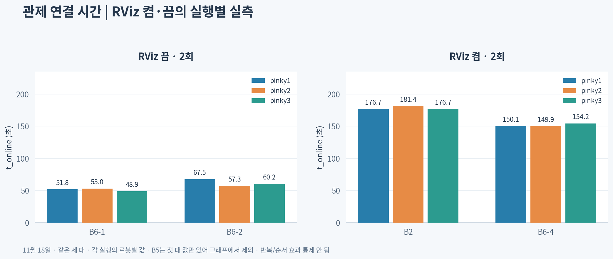

# 실기기 실험 결과 (2026-11-18, 작업 지시서 6)

> 2026-11-19: 11월 16~18일 실행 폴더(`runs/run_2026111[6-8]_*` 등)는 `archive/runs_2026-11-16_18/`로 옮겼습니다. 이 문서의 실행 이름은 그 폴더 아래에 있습니다.

- 날짜: 2026-11-18
- 로봇: pinky1(192.168.0.9), pinky2(192.168.0.29). pinky3은 꺼져 있음
- 코드 상태: `4ab5d33`(커밋하지 않은 변경 있음), `git diff | sha1sum` = `16eae38cff3476208379cbf22d1b7bf1aa100de5`(16:04:13)
- 로봇에 배포한 시각: 16:04:51 ~ 16:10:51(`robot_remote pinky1 pinky2 --deploy`)
- 기록 폴더: `archive/real_test_2026-11-18/`

## 요약

| ID | 시험 | 방법(명령) | 통과 기준 | 결과 | 측정값 | 근거 |
| --- | --- | --- | --- | --- | --- | --- |
| R0-1 | 빌드 | `colcon build --symlink-install --packages-up-to frybot_bringup` | 빌드 성공 | 통과 | 8개 패키지 16.2초 | `r0_build.log` |
| R0-2 | 모의 확인 v001 | `fleet_bench --scenario moves --map-id test_map_v001 --robots 2 --seeds 3 --check` | 기본 조합 통과 | 통과 | 전체 소요 146.7초, 최소 간격 0.156 m, 종료 코드 0 | `r0_bench_test_map_v001.txt` |
| R0-2 | 모의 확인 v002 | 같은 명령, `test_map_v002` | 기본 조합 통과 | 통과 | 전체 소요 147.6초, 최소 간격 0.156 m. 종료 코드 1은 기준선 `independent_astar` 조합의 미완료 1건 때문 | `r0_bench_test_map_v002.txt` |
| R0-3 | 배포 | `robot_remote pinky1 pinky2 --deploy` | 두 대 로봇에서 빌드 성공 | 통과 | pinky1 2분 32초, pinky2 3분 3초 | `r0_deploy.log` "deploy finished" |
| R0-4 | 점검 | `robot_remote pinky1 pinky2 --check` | 두 대 `OK` | 통과 | 두 대 `OK`, domain 73, interfaces up to date. pinky2 실기기 첫 접속 | `r0_check.log` |
| R0-4 | 로봇의 test_map_v002 | - | 로봇에 지도가 있음 | 못 함(점검 명령에 지도 목록이 없음, R4 기동 로그로 확인할 예정이었음) | - | - |
| R0-5 | 측정 스크립트 | `scripts/wobble_metrics.py` 작성 | R1 bag으로 값이 나옴 | 일부(이벤트 지표만 경량 시뮬 기록으로 확인, bag 지표는 R1 bag이 비어 못 함) | 경량 시뮬 `run_20261118_153711`: 구간 12, 27.0초, 구간당 2.32초 | - |
| R1-1 | 기동 | `real.launch.py map_id:=test_map_v001 robots:=pinky1 poses:=pinky1:W1:180` | 로봇 로그가 이어지고 Nav2 active | 실패 | 위치 추정 노드는 active(16:14:21, 기동 21초 뒤). 모터 드라이버와 라이다가 기동 직후 죽음 | `r1_launch.log` 34·36·137·164행 |
| R1-2 | 내장 드라이버 | 런치 로그 | `pinky_driver` 등이 뜸 | 실패(장치 없음) | `/dev/ttyAMA4` 열기 실패(`FileNotFoundError`). 라이다 `sllidar_node` 오류 코드 80008004 | 아래 "찾은 문제" |
| R1-3~R2, R3~R7 | | | | 못 함(로봇 드라이버가 뜨지 않음) | | |

## 단계별 상세

### R0
- 16:04:13 빌드 시작. 16:04:51~16:10:51 배포. 이어서 점검 결과 두 대 모두 `OK`
- 참고: 배포 로그에서 pinky2의 복사 대상 임시 폴더 이름이 `src/pinky1.ubHRbi/`로 찍힘(로봇 이름과 다름). 배포는 성공했음. 원인은 보지 않음

### R1 (run_20261118_161402)
- 16:14:00 기동. pinky1 방향은 사용자 답변에 따라 -x(180°)
- 로봇 쪽에서 `sllidar_node`가 `Error, unexpected error, code: 80008004`로 죽음(16:14:12)
- 이어서 `pinky_driver`가 `could not open port /dev/ttyAMA4: [Errno 2] No such file or directory`로 죽음
- 위치 추정(`lifecycle_manager_localization`)은 active가 됨. 모터 드라이버가 없어 로봇은 움직이지 않았음
- `events.csv`에 AUTO_HOME 등 로봇 관련 이벤트 없음(상태 보고가 오지 않음)
- 16:15경 런치와 bag을 내리고 `robot_remote pinky1 pinky2 --stop`(두 대 done). bag은 메시지 0개
- 배터리: 못 함(드라이버가 뜨지 않아 `/pinky1/battery/percent`를 받지 못함)

## 찾은 문제

1. **[원인 확인, 16:28] frybot_mobile 드라이버 사본의 포트가 로봇과 다름** (고치지 않았음)
   - `drivers:=pinky_pro`(로봇에 설치된 원래 드라이버)로 pinky1 로봇 쪽만 띄움(관제 없이, 로봇은 움직이지 않음, `r1b_pinky_pro.log`)
     - 라이다: "health status : OK", DenseBoost 10 Hz로 정상
     - 모터: "Initial Encoder read: L=39, R=1551. Controller is responsive", "started successfully"
   - 로봇의 `~/pinky_pro/src/pinky_pro/pinky_bringup`은 모터 `/dev/ttyAMA5`, 라이다 `/dev/ttyS0`을 씀(두 대 같음, `port_check.txt`)
   - PC의 `src/pinky_pro`(커밋 014a09f)는 모터 `/dev/ttyAMA4`, 라이다 `/dev/ttyAMA0`. 11-17에 `frybot_mobile/pinky_driver.py`(`SERIAL_PORT_NAME`)와 `robot.launch.py`(라이다 `serial_port`)를 이 버전에서 복사해 로봇과 포트가 달라짐
   - 아래의 "OS 설정이 바뀌었다" 추정은 틀림. config.txt의 `dtoverlay=uart5`(→ `/dev/ttyAMA5`)와 `/dev/ttyS0`가 원래 쓰던 포트임
   - 수정 제안(이번에는 고치지 않음): `pinky_driver.py`의 포트와 `robot.launch.py`의 라이다 포트를 로봇 값(`/dev/ttyAMA5`, `/dev/ttyS0`)으로 맞추고, 가능하면 런치 인자로 받기
   - 실험을 이어 가는 방법: 위 수정, 또는 로봇 등록부의 `launch_args`에 `drivers: pinky_pro`를 넣어 원래 드라이버로 기동

   (아래는 원인을 찾기 전의 기록)
1. **두 로봇 모두 모터·라이다 직렬 포트가 OS에 없음** (고치지 않았음)
   - 증상: `pinky_driver`가 `/dev/ttyAMA4`를 열지 못하고 죽음. 라이다 노드(`serial_port: /dev/ttyAMA0`)가 오류 80008004로 죽음
   - 확인(16:16, `robot_remote`의 SSH 도우미로 조회만 함)
     - pinky1·pinky2 모두 `/dev/ttyAMA5` 하나만 있음. `/dev/ttyAMA0`, `/dev/ttyAMA4`, `/dev/ttyUSB*` 없음
     - 두 로봇 모두 `/boot/firmware/config.txt`에 `enable_uart=1`, `dtoverlay=uart5`만 있고, uart4 등 다른 UART overlay가 없음
     - 두 로봇 모두 13:15에 부팅(가동 3시간 42~44분)
   - 판단: 코드가 아니라 로봇 OS 설정 문제로 보임. 원본 `pinky_bringup`도 같은 포트(`/dev/ttyAMA4`, `/dev/ttyAMA0`)를 쓰므로 `drivers:=pinky_pro`로 바꿔도 같은 결과일 것으로 봄(시도하지 않음)
   - 11-16 실험에서는 pinky1이 같은 포트로 동작했음. 그 뒤 설정이 바뀐 것인지는 확인하지 못함
   - 원본 저장소와 문서에 필요한 UART 설정에 대한 안내가 없음
   - 재현: `ros2 launch frybot_bringup real.launch.py map_id:=test_map_v001 robots:=pinky1 poses:=pinky1:W1:180`
   - 추가 조회(16:18~16:22, 읽기만 함, 쓰기·재부팅·설치 없음). 원본 출력: `archive/real_test_2026-11-18/sys_check.txt`, `svc_check.txt`, `svc_check2.txt`, `hat_check.txt`

     | 항목 | pinky1 | pinky2 | 같은가 |
     | --- | --- | --- | --- |
     | 기종 | Raspberry Pi 4 Model B Rev 1.5 | 같음 | 같음 |
     | 커널 | 6.8.0-1040-raspi | 같음 | 같음 |
     | /boot/firmware 파일 시각 | 2026-08-05 | 2026-11-10 12:13(펌웨어 dtb·bootcode 갱신, 11-16 전) | 다름 |
     | dpkg 최근 기록 | 맞는 줄 없음 | 11-11 freerdp·nfs 갱신, 11-13 `at` 설치(커널·펌웨어 아님) | 다름 |
     | config.txt 수정 시각 | 2026-03-04 15:58:28 | 2026-03-04 15:58:28 | 같음 |
     | config.txt 내용(주석 제외) | UART 관련은 `enable_uart=1`, `dtoverlay=uart5`뿐. uart4·uart0·disable-bt 없음 | 같음(1795바이트) | 같음 |
     | 백업·다른 설정 파일 | 없음(`/boot/config.txt*` 없음) | 없음 | 같음 |
     | 직렬 장치 | `/dev/ttyAMA5`, `/dev/ttyS0` | 같음 | 같음 |
     | 장치 트리의 UART | serial@7e201000(UART0) okay, 7e201800(UART4) disabled, 7e201a00(UART5) okay | 같음 | 같음 |
     | HAT EEPROM(/proc/device-tree/hat) | 없음 | 없음 | 같음 |
     | dmesg | 못 함(권한 없음: Operation not permitted) | 같음 | - |
     | 부팅 이력(last) | 가릴 수 없음(시계가 없어 기록 시각이 10-28로 찍힘) | 11-12·13·14·16 18:02 종료 기록이 있으나 부팅 시각은 10-12로 찍혀 순서를 가릴 수 없음 | - |
     | 가동 시간 | 3시간 44분(오늘 12:33경 부팅으로 보임. 장치 파일 시각 13:15는 시계 동기화 뒤 시각으로 추정) | 3시간 46분 | 같음 |
     | 홈 폴더의 UART 안내·설치 스크립트 | 없음 | 없음 | 같음 |
     | 부팅 서비스 | `pinky-boot.service`(부저 스크립트 `ap/boot.py`, UART와 무관), 실패한 서비스 없음 | 같음 | 같음 |

   - 판정: **설정 파일(config.txt)은 11-16 뒤에 바뀌지 않았다.** 두 로봇 모두 수정 시각이 2026-03-04이고 내용도 같습니다(FAT 파일 시각 기준이라, 복사 도구가 시각을 보존했을 가능성은 남음).
   - 그런데 지금 설정으로는 모터 포트(UART4)가 장치 트리에서 꺼져 있고, 라이다 포트 `/dev/ttyAMA0`도 없습니다. 따라서 11-16에 pinky1이 같은 포트로 동작한 이유를 이 설정 파일로는 설명할 수 없습니다.
   - 원인 추정(확인하지 않음)
     - 11-16에는 부팅 뒤 누군가 실행 중에 overlay를 올렸고(`dtoverlay uart4` 등), 재부팅으로 사라졌을 수 있음
     - 또는 그때는 다른 SD 카드나 부팅 설정을 썼을 수 있음
     - UART0(장치 트리 okay)에 `/dev/ttyAMA0`가 없는 것은 블루투스가 그 UART를 쓰고 있기 때문일 수 있음(Pi 4 기본 동작)
   - 11-16 당시 로봇에서 무엇을 했는지는 기록이 없어 가릴 수 없습니다.

## 확인하지 못한 것과 이유

- R1-3(자동 홈 이동)부터 R7까지 전부: 로봇의 모터·라이다 드라이버가 뜨지 않음
- 배터리 단위(R1-6): 같은 이유
- 로봇의 `test_map_v002` 존재: 점검 명령에 지도 목록이 없음

## B. 기동 지연 수정 확인 (지시서 7, 17:16~17:40)

- 코드: 기획 세션의 T-38 수정 적용(`discovery` 기본 peers, 실측 지도에서 도킹 노드 제외)
- 배포: 세 대 17:16:35~17:18:32. 점검 세 대 `OK`
- 시각은 PC에서 런치 출력의 각 줄에 붙인 도착 시각(`archive/real_test_2026-11-18/stamp.py`) 기준, 런치 시작부터 초. 로봇 로그가 SSH로 몇 초씩 몰려 도착할 수 있음(B1 17:25 실행은 42초에 한꺼번에 도착)

### 기동 시간

| 실행 | discovery | 로봇 | t_launch | t_lidar | t_motor | t_loc | t_nav | t_online | ssh_lost |
| --- | --- | --- | --- | --- | --- | --- | --- | --- | --- |
| 16:42 `r1c`(수정 전) | subnet | pinky1 | 10 | 14 | 28 | 26 | 145 | | 1 |
| 16:42 `r1c`(수정 전) | subnet | pinky2 | 8 | 12 | 20 | 27 | 146 | | 0 |
| B1 17:21 `run_20261118_172112` | peers | pinky1 | 10.9 | 13.1 | 22.4 | 15.7 | 23.5 | 26.1(AUTO_HOME) | 0 |
| B1 17:25 `run_20261118_172512` | peers | pinky1 | 12.2 | 42.2 | 42.3 | 42.4 | 46.5 | - | 0 |
| B1 17:29 `run_20261118_172945` | peers | pinky1 | 10.9 | 25.1 | 25.3 | 26.2 | 30.3 | - | 0 |
| B2 17:34 `run_20261118_173427` | peers | pinky1 | 11 | 12.9 | 20.8 | 20.8 | 22.8 | 176.7 | 0 |
| B2 17:34 `run_20261118_173427` | peers | pinky2 | 11 | 11.9 | 23 | 14 | 23 | 181.4 | 0 |
| B2 17:34 `run_20261118_173427` | peers | pinky3 | 11.3 | 20.2 | 21 | 21 | 23.7 | 176.7 | 0 |

- t_online: `events.csv`의 첫 `ROBOT_ONLINE`/`AUTO_HOME`
  - B1 17:25·17:29 실행: 표에는 비워 둠. 17:25 실행은 `AUTO_HOME`이 기동 약 49초 뒤(1794990360.07)
  - B2: 세 대 모두 Nav2 active(약 23초) 뒤 약 2분 30초가 지나서야 관제와 연결됨(첫 `AUTO_HOME` 1794991042.44)
- controller→planner 구성 구간: B1 2.5~3.0초, B2 1.2~9.5초(수정 전 2대 약 120초)

### 요약

| ID | 시험 | 결과 | 측정값·근거 |
| --- | --- | --- | --- |
| B0-1~3 | 빌드, 세 대 배포, 점검 | 통과 | `b0_build.log`, `b0_deploy.log`, `b0_check.log` |
| B0-4 | ROS_STATIC_PEERS 주소 | 통과 | dry-run 세 대 모두 `ROS_AUTOMATIC_DISCOVERY_RANGE=LOCALHOST`, `ROS_STATIC_PEERS=192.168.0.20` = 관제 PC `wlo1` |
| B0-5 | 로봇 bashrc 탐색 변수 | 통과 | 탐색 변수 없음. `ROS_DOMAIN_ID`만 있음(pinky1 73, pinky2 30, pinky3 99). 기동 스크립트가 그 뒤 73으로 덮어씀 |
| B1-1 | 한 대 기동 시간 | 통과 | t_nav 23.5·46.5·30.3초, ssh_lost 0 |
| B1-2 | 도킹 노드 없음 | 통과 | 로봇 프로세스 13개, `docking_server`·`aruco_dock_detector` 없음 |
| B1-3 | 관제 PC → 로봇 | 통과 | 환경 변수 없는 터미널에서 노드가 보이고 `/pinky1/scan` 10.0 Hz, `/pinky1/odom` 33.2 Hz, `/fleet/robot_status` 10.2 Hz |
| B1-4 | 로봇 → 관제 | 통과 | `AUTO_HOME pinky1 W1 OK`(B1→W1, 5.8초에 도착), `WAIT_FMS` 없음 |
| B1-5 | 이동 | 통과(조건부) | W1→B1 4.8초, B1_B2→W1 13.7초. 찾은 문제 B-1 때문에 재기동하고 명령을 쉬지 않고 이어 보냄 |
| B1-6 | 비상 정지 | 통과 | W1→A4 주행 중(0.08 m/s) `ESTOP`: `cmd_vel` 0까지 +0.04초, odom 정지까지 +0.25초(`run_20261118_172945/bag`). 5초 뒤 `RESUME`으로 `EVT_RESUMED`, 다시 주행. 지시서의 W1→B5는 런치 밖 pinky2(B3_B4)가 막아 W1→A4로 바꿈 |
| B1-7 | 관제 중단 | 통과(사용자 관찰) | A3→A4 주행 중 런치 Ctrl-C, 2초 안에 정지. 로봇 쪽 프로그램은 12.2초 뒤 `robot stack stopped` |
| B1-8 | RViz | 통과(사용자 관찰) | 지도, 코스트맵, 로봇 모델 정상 |
| B2-1 | 세 대 기동 시간 | 통과(기준대로) | t_nav 22.8·23.0·23.7초, ssh_lost 0. 단 관제와 연결(t_online)은 176.7~181.4초 |
| B2-2 | pinky3 첫 기동 | 통과 | 라이다 health OK, 모터 started successfully(`/dev/ttyAMA5`). T-37 포트가 pinky3에도 맞음 |
| B2-3 | 관제가 세 대를 봄 | 통과(늦음) | 처음 약 2분은 PC에서 로봇 노드가 일부(8개)만 보이고 토픽 주기 없음. 기동 약 3분 뒤 세 대 모든 노드가 보이고 세 대 `AUTO_HOME` |
| B2-4 | 로봇끼리 탐색하지 않음 | 못 함 | 로봇에서 같은 환경 변수로 `ros2 node list`를 실행할 조회 방법을 만들지 않음 |
| B2-5 | 자동 홈 이동 | 통과 | 세 대 `AT_HOME off=0.00m`(초기 위치를 출발 노드로 주어 이동 없음) |
| B2-6 | 이동 | 실패 | pinky1·pinky3: 찾은 문제 B-1(충전 오판정)로 거절. pinky2: W2→B3, B3→W2 모두 `NAV2_FAILED` ×2 뒤 보류(찾은 문제 B-4) |
| B2-7 | 비상 정지(세 대 기동) | 못 함 | B2-6에서 주행하는 로봇이 없었음 |
| B2-8 | 종료 | 통과 | Ctrl-C 뒤 `robot stack stopped`: pinky2 11.8초, pinky1 12.9초, pinky3 13.4초 |
| B2-9 | 재기동 | 하지 않음 | 보고 뒤 결정 |

배터리(%): pinky1 78.5(B1 시작) → 68.7(B1 끝) → 69.2(B2), pinky2 77.5(B2), pinky3 60.9(B2)

### 찾은 문제 (고치지 않음)

- **B-1. 충전대가 없는 실측 지도에서 30초 넘게 서 있으면 `CHARGING`(charging=true)으로 보고**
  - 관제는 `IDLE`이 아닌 로봇의 이동 명령을 "로봇이 이동 가능한 대기 상태인지 확인하세요"로 거절함
  - pinky1(B1, B2)과 pinky3(B2)에서 재현. 원인 추정: `mobile_controller._charging_from_battery`(UR-21)가 서 있는 동안 배터리 값의 흔들림을 잔량 상승(`charge_rise_pct` 1.0)으로 판정. 같은 실행에서 pinky1 배터리는 71.1 → 68.7로 내려가는 중이었음
  - 재현: 로봇을 띄우고 30초 넘게 명령 없이 둔 뒤 `MOVE_TO_VERTEX`
- **B-2. 서 있는 동안 `error=SENSOR_ERROR`가 계속 보고됨**(pinky1, B1). 원인 추정: map→base TF가 약 1초 간격으로만 갱신돼 `tf_stale_sec`(1.0)에 걸림
- **B-3. 서 있는 동안 `ROBOT_OFFLINE`**: pinky1, B1에서 0.4~17.6초
- **B-4. 초기 위치와 실제 위치의 차이로 Nav2 실패**
  - B1 17:29: `poses:=pinky1:B1:90`(방향 추측)으로 띄움. 자동 홈 이동과 첫 이동이 `NAV2_FAILED` ×2 뒤 보류됨
  - B2: pinky2가 W2에서 0.31 m 떨어져 있었음(`REJOIN off_node=0.31m`). 이동 두 번이 `NAV2_FAILED`로 보류됨
- **B-5. (정정) 보류된 이동 임무의 재개는 관리자 명령 `RETRY_TASK`였음, 문제 아님**
  - B2 pinky2 M0002가 `TASK_SUSPEND NAV2_FAILED`(1794991124.7)로 보류된 뒤, `ADMIN RETRY_TASK M0002`(1794991156.412)가 들어와 7 ms 뒤 `EVT_RESUMED`(1794991156.419)되고 다시 실패함
  - 처음에는 "관리자 명령 없이 재개"로 적었으나, 같은 `events.csv`의 관리자 명령 줄을 놓친 것임. 자동 재개가 아님
  - 이 시각(08:39:16 UTC)에 시험 스크립트는 `RETRY_TASK`를 보내지 않았음. 관리자 화면에서 보낸 것으로 보이나 사용자 확인 필요
- **B-6. 세 대 peers에서 관제와 로봇이 연결되기까지 약 3분**: Nav2는 23초에 active였는데, 관제 PC에서 로봇 토픽이 보이고 `AUTO_HOME`이 나온 것은 176.7초. 한 대(B1)는 26초. 같은 시간대에 SSH 중계 출력이 끊긴 최댓값(`no output from the robot`)이 pinky1 137초, pinky2 205초, pinky3 134초(SSH 끊김은 0회). 원인은 확인하지 못함

### 확인하지 못한 것
- B2-4(로봇끼리 탐색하지 않음): 조회 방법 없음
- B2-6·B2-7(세 대 기동에서 이동·비상 정지): B-1, B-4
- B2-9(재기동), B3(subnet 비교), B4(CPU·Wi-Fi 측정): 보고 뒤 결정. B5에서 같은 명령으로 다시 띄운 값은 위 B5절

### B5. 충전 오판정 수정(T-39) 뒤 세 대 재시험 (17:47~17:54, `run_20261118_174735`)

- 배포 17:43:47~17:45:42(세 대), 점검 세 대 `OK`. 배치: 사용자가 세 대를 W1·W2·W3 위에 -x(180°)로 놓음
- 기동: t_nav pinky1 21.4초, pinky2 21.7초, pinky3 21초. ssh_lost 0. no_output_max 0·107·47초
- 관제와 연결(첫 `AUTO_HOME`)은 기동 141.5초 뒤. 세 대 `AT_HOME off=0.00m`. B-6이 다시 나타남

| ID | 시험 | 결과 | 측정값·근거 |
| --- | --- | --- | --- |
| B5-1 | 충전 오판정 없음(T-39) | 통과 | 기동 뒤 약 183초 서 있는 동안 세 대 모두 `charging=False`, 상태 `STANDBY`, 오류 `NO_ERROR`(관리자 API `/api/state`, 45초 간격 두 번) |
| B5-2 | 한 대씩 이동 | 통과 | pinky1 W1→B1 7.5초, B1→W1 2.9초. pinky2 W2→B3 20.4초, B3→W2 5.6초. pinky3 W3→B7 7.9초 |
| B5-3 | 두 대 동시 이동 | 통과 | pinky1 A2→W1(15.7초)과 pinky3 B7→W3(3.9초)를 함께 보내 둘 다 `TASK_DONE`. 앞서 보낸 pinky1 W1→A2 15.8초 |
| B5-4 | 비상 정지(세 대 기동, pinky1 W1→A4 주행 중) | 통과 | `cmd_vel` 0까지 +0.06초, odom 정지까지 +0.28초. `EVT_SUSPENDED E_STOP`, 5초 뒤 `RESUME`으로 `EVT_RESUMED`, A4 도착(27.8초). A4→W1 복귀 54.3초 |
| B5-5 | 종료 | 통과 | Ctrl-C 뒤 `robot stack stopped`: pinky1 13.3초, pinky2 13.4초, pinky3 13.5초 |

- 배터리(%): pinky1 60.3 → 53.9, pinky2 70.2 → 64.7, pinky3 55.4 → 53.0(bag)
- 새로 본 것(고치지 않음): **B-7.** 도착 직후 바로 보낸 이동 명령이 한 번 "로봇이 이동 가능한 대기 상태인지 확인하세요"로 거절됨(pinky3 B7 도착 `TASK_DONE` 직후 B7→W3). 도착 직후라 상태 보고가 아직 `IDLE`로 바뀌기 전으로 보임(추정). 몇 초 뒤 같은 명령은 받아들여짐

### 통과 기준 판정(지시서 7의 3.2)
- 세 대 동시 기동에서 t_nav ≤ 60초, ssh_lost 0: **통과**(B2, B5 두 번)
- 관제가 세 대를 보고 이동·비상 정지가 전달됨: **통과(B5)**. 단, 관제와 연결되기까지 기동 뒤 141~181초가 걸림(B-6, 원인 미확인)

### B6. 관제 연결 지연(B-6) 원인 확인: RViz 끔/켬 비교 (18:00~18:06)

각 실행의 로봇별 관제 연결 시간입니다. 두 패널의 세로축을 동일하게 맞췄습니다. B5는 첫 대의 값만 있어 그래프에서 제외했고, 반복·순서 효과가 통제된 실험은 아닙니다.

- 기획 세션 요청, 사용자 결정. 코드·설정 변경 없음. 이동 시험 없음(세 대가 `AUTO_HOME`을 내면 바로 런치를 내림)
- 조건: B5와 같음(`test_map_v001`, `poses:=pinky1:W1:180,pinky2:W2:180,pinky3:W3:180`, bag 기록 같음). 세 대는 W1·W2·W3에 -x(사용자 확인)
- 관제 PC 탐색 모습은 5초마다 `ros2 node list`의 로봇별 노드 수와 `wlo1` 수신·송신 초당 바이트로 남김(`archive/real_test_2026-11-18/b6_N_nodes.txt`). `ros2 node list`는 4초 시간 제한이라 간격이 실제로는 약 6초
- B6-3(bag도 끔)은 B6-1·2가 100초 안이라 하지 않음

| 실행 | rviz | 로봇 | t_nav | t_ready | t_online | ssh_lost | no_output_max |
| --- | --- | --- | --- | --- | --- | --- | --- |
| B2 17:34 `run_20261118_173427` | true | pinky1 | 22.8 | 20.8 | 176.7 | 0 | 137 |
| B2 | true | pinky2 | 23.0 | 23.0 | 181.4 | 0 | 205 |
| B2 | true | pinky3 | 23.7 | 21.0 | 176.7 | 0 | 134 |
| B5 17:47 `run_20261118_174735` | true | pinky1·2·3 | 21.4·21.7·21.0 | 21.4·20.5·20.4 | 141.5(첫 대) | 0 | 0·107·47 |
| B6-1 18:00 `run_20261118_180009` | false | pinky1 | 36.3 | 25.9 | 51.8 | 0 | 0 |
| B6-1 18:00 `run_20261118_180009` | false | pinky2 | 24.1 | 22.3 | 53 | 0 | 0 |
| B6-1 18:00 `run_20261118_180009` | false | pinky3 | 36.8 | 29.7 | 48.9 | 0 | 0 |
| B6-2 18:01 `run_20261118_180127` | false | pinky1 | 47.1 | 47.1 | 67.5 | 0 | 0 |
| B6-2 18:01 `run_20261118_180127` | false | pinky2 | 34.5 | 34.5 | 57.3 | 0 | 0 |
| B6-2 18:01 `run_20261118_180127` | false | pinky3 | 32.5 | 32.2 | 60.2 | 0 | 0 |
| B6-4 18:03 `run_20261118_180304` | true | pinky1 | 139.6 | 139.2 | 150.1 | 1 | 94 |
| B6-4 18:03 `run_20261118_180304` | true | pinky2 | 111.6 | 111.6 | 149.9 | 1 | 91 |
| B6-4 18:03 `run_20261118_180304` | true | pinky3 | 142 | 142 | 154.2 | 1 | 113 |

- 관제 PC에서 보인 로봇 노드 수(로봇당 18개가 전부)
  - RViz 끔: 기동 약 20초에 36~39개, 38초에 세 대 모두 18개(54개)
  - RViz 켬(B6-4): 20초에 38개였다가 90초까지 41~52개로 천천히 늘고, 109초에야 54개
- `wlo1` 수신(초당): RViz 끔 약 0.9~2.3 MB/s, RViz 켬 약 0.3~2.2 MB/s(켬 쪽이 앞 90초 동안 오히려 낮음)
- 배터리(%, 온라인 시점 관리자 API): B6-1 58.5·62.4·47.6, B6-2 55.4·61.5·44.8, B6-4 52.5·57.3·42.1(pinky1·2·3)

#### 판정
- RViz를 끄면 t_online 48.9~67.5초(두 번), 켜면 141.5~181.4초(세 번, 같은 날). **관제 PC의 RViz가 주원인**으로 봄
- B6-4에서는 RViz를 켜자 Nav2 기동(t_nav 111.6~142.0초)까지 늦어지고 세 대 모두 SSH가 한 번씩 끊김. B2·B5에서는 t_nav가 21~24초였으므로, RViz가 로봇 쪽 기동까지 늦출 때와 아닐 때가 있음
- RViz를 꺼도 t_online은 t_nav 뒤 13~25초. 기준 60초를 한 번(B6-2 pinky1 67.5초) 넘음
- 표본이 적음: RViz 끔 2회, 켬 3회. 원인이 RViz의 어떤 구독(코스트맵, TF, 지도)인지는 가리지 않음. RViz가 Wi-Fi를 지나는 데이터량을 늘리는지, 탐색 메시지를 늘리는지도 확인하지 못함(수신량은 오히려 낮았음)
- 끝: 세 회 모두 Ctrl-C 뒤 11.7~13.7초에 `robot stack stopped`. 남은 프로세스 0
