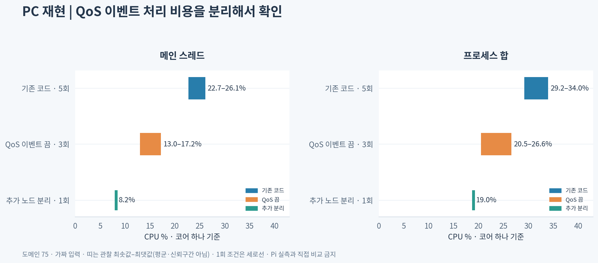

# FryBot 기획안 (2026-11-19): 세 대 기동에서 RViz가 관제 연결을 늦추는 문제

기획 세션이 쓴 기획안입니다. 실험과 기록은 검토 세션(부장)이, 코드 수정은 기획 세션이 합니다. 작업 공간 규칙(CLAUDE.local.md)은 그대로 적용됩니다.
사용자 지시(2026-11-19): "기획 세션이 원하는 방향으로 기획안을 써서 부장에게 넘길 것". 아래의 기준 수치는 모두 제안이며 측정 결과가 아닙니다.

## 1. 결론

- **방향: RViz를 없애지 않고, 로봇이 관제에 연결된 뒤에 띄웁니다.** 기본 명령(`real.launch.py map_id:=...`)은 그대로 두고, 런치가 "세 대 온라인"을 기다렸다가 RViz와 `fleet_rviz`를 시작하게 합니다.
- 코드를 고치기 전에, 같은 동작을 손으로 한 번 해 봅니다(C1). 온라인 뒤에 RViz를 붙였을 때 로봇 상태 보고가 끊기면 이 방향만으로는 부족하기 때문입니다.
- 원인(RViz의 어떤 구독인지)은 실행 2~3회로 좁힙니다(C2). 결과에 따라 RViz 기본 표시를 줄일지 정합니다.
- 순서: C0 준비 → C1 손으로 늦게 띄우기 → C2 원인 좁히기 → (기획 세션) C3 구현 → C4 재시험.

## 2. 근거 (2026-11-18 실기기, `docs/2026-11-18_REAL_TEST.md` B6)

세 대 동시 기동, `discovery:=peers`, `test_map_v001`. 값은 런치 시작부터의 초입니다.

| 실행 | RViz | Nav2 active (`t_nav`) | 관제 연결 (`t_online`) | SSH 끊김 |
| --- | --- | --- | --- | --- |
| B6-1 | 끔 | 24.1~36.8 | 48.9~53.0 | 0 |
| B6-2 | 끔 | 32.5~47.1 | 57.3~67.5 | 0 |
| B2 | 켬 | 22.8~23.7 | 176.7~181.4 | 0 |
| B5 | 켬 | 21.0~21.7 | 141.5(첫 대) | 0 |
| B6-4 | 켬 | 111.6~142.0 | 149.9~154.2 | 각 1회 |

- 관제 PC에서 로봇 노드 54개가 모두 보인 시점: RViz 끔 38초, 켬 109초.
- 표본은 끔 2회, 켬 3회입니다.

확인되지 않은 것:

- `rviz:=false`는 RViz와 `fleet_rviz` 노드를 함께 끕니다. 둘 중 어느 쪽이 원인인지 모릅니다.
- RViz의 어떤 표시(전역 코스트맵 3개, `fleet_rviz`를 거친 지역 코스트맵 3개, 로봇 모델 3개, 지도, TF)인지 모릅니다.
- 온라인 뒤에 RViz를 붙이면 상태 보고가 끊기는지 본 적이 없습니다.
- RViz를 꺼도 `t_nav` 뒤 13~25초가 더 걸리는 이유를 모릅니다.

코드에서 확인한 것(실행해 보지는 않음):

- `fleet_rviz` 노드는 로봇마다 `/pinkyN/tf`, `/pinkyN/tf_static`, `/pinkyN/local_costmap/costmap`, `/pinkyN/local_costmap/published_footprint`를 구독합니다. 모두 Wi-Fi를 건너옵니다.
- `fleet_rviz.launch.py`는 로봇 인자가 없어 `pinky1`·`pinky2`만 보여 줍니다(`fleet.rviz`와 노드 기본값이 두 대용). 세 대를 손으로 띄우려면 4.2절의 명령을 써야 합니다.

## 3. 목표와 통과 기준 (제안)

기본 명령(RViz 켬)으로 세 대를 띄웠을 때, 두 번 연속으로 다음을 만족합니다.

| 항목 | 기준 |
| --- | --- |
| `t_nav` | 세 대 모두 60초 이하 |
| `t_online` | 세 대 모두 90초 이하 (RViz 끔의 실측이 49~67.5초라 60초는 빠듯함) |
| `ssh_lost` | 0 |
| RViz 시작 뒤 60초 | `ROBOT_OFFLINE`, `SENSOR_ERROR`, `WAIT_FMS` 건수가 RViz 시작 전 60초보다 늘지 않음 |
| RViz 화면 | 시작 뒤 30초 안에 세 대의 모델과 코스트맵이 보임(사용자 눈으로 확인) |
| 주행 | RViz가 켜진 상태에서 이동 1회와 비상 정지 통과 |

서 있는 동안의 `ROBOT_OFFLINE`·`SENSOR_ERROR`는 RViz 없이도 나옵니다(B-2, B-3). 그래서 건수 0이 아니라 "RViz 시작 전후 비교"로 봅니다.

## 4. 단계

### 4.1 공통 원칙

- **부장은 코드와 설정 파일을 고치지 않습니다.** 로봇 등록부(`~/.config/frybot/robots.yaml`)도 고치지 않습니다.
- **로봇을 움직이는 명령 전에 사용자에게 알립니다.** C1·C2는 이동 명령이 없지만, 기동 직후 `AUTO_HOME`이 로봇을 출발 노드로 움직일 수 있습니다. 사용자가 세 대를 W1·W2·W3에 놓고 방향을 알려 준 뒤 시작합니다.
- 멈추는 조건은 작업 지시서 7의 1절과 같습니다.
- 조건은 B6과 같게 합니다: `map_id:=test_map_v001 poses:=pinky1:W1:180,pinky2:W2:180,pinky3:W3:180`, bag 기록 같음, `ROS_DOMAIN_ID=73`.
- 로그는 `archive/real_test_2026-11-19/`에 `c<단계>_launch.log`, `c<단계>_nodes.txt`로 남기고, 결과는 `docs/2026-11-19_REAL_TEST.md`에 적습니다.
- 실행마다 배터리를 적습니다. 어제 한 번 기동에 약 3%가 줄었습니다. 예정 실행은 5~6회이므로 세 대 모두 60% 이상에서 시작하고, 40% 아래로 내려가면 멈추고 보고합니다.

### 4.2 C0 준비 (로봇 정지)

1. 배터리 확인, `robot_remote --all --check`.
2. 손으로 띄우는 세 대용 RViz 명령이 관제 PC에서 도는지 로봇 없이 확인합니다.

```bash
# 터미널 A: TF·지역 코스트맵 중계 노드
ros2 run frybot_bringup fleet_rviz --ros-args -p robot_ids:="[pinky1, pinky2, pinky3]"
# 터미널 B: 세 대용 설정으로 RViz
rviz2 -d "$(python3 -c "from frybot_bringup.remote import fleet_rviz_config; print(fleet_rviz_config(['pinky1','pinky2','pinky3']))")"
```

기획 세션이 설정 파일 생성까지는 확인했습니다(전역 코스트맵 3, 2D Pose Estimate 도구 3). RViz 창이 뜨는지는 확인하지 않았습니다.

런치는 관제 노드에 `ROS_STATIC_PEERS=<로봇 주소들>`을 주지만, 따로 연 터미널에는 이 값이 없습니다. 두 터미널에 런치와 같은 값을 넣고 시작하고, 값 없이도 로봇 토픽이 보이는지는 C1 끝에 한 번 확인해 적습니다(확인 필요).

### 4.3 C1 손으로 늦게 띄우기 (세 대, 1회)

구현하려는 동작을 코드 없이 재현합니다.

1. `rviz:=false`로 기동하고 `t_nav`, `t_online`을 잽니다.
2. 세 대가 온라인이 된 뒤 60초를 그대로 둡니다(비교 구간).
3. 4.2절의 두 명령을 실행하고 시각을 적습니다(`t_rviz`).
4. 60초 동안 다음을 봅니다.
   - `runs/<run_id>/events.csv`의 `ROBOT_OFFLINE`, `SENSOR_ERROR` 건수(앞 60초와 비교)
   - 로봇 로그의 `WAIT_FMS` 건수
   - `ros2 topic hz /fleet/robot_status` (세 대 10 Hz이면 약 30 Hz)
   - `wlo1` 수신량, `ssh_lost`, `no_output_max`
   - RViz에 세 대가 보이기까지의 시간(사용자 확인)
5. RViz를 켠 채로 이동 1회와 비상 정지를 합니다(사용자에게 알린 뒤).
6. 가능하면 이 상태에서 로봇 한 대의 CPU 사용량을 남깁니다(작업 지시서 7의 B4 방법).

판정:

- 4번에서 건수가 늘지 않고 5번이 통과하면 "늦게 띄우기"가 유효합니다. C3-1을 그대로 구현합니다.
- 상태 보고가 끊기면 늦게 띄우는 것만으로는 부족합니다. C2의 결과로 RViz 표시를 줄이는 쪽(C3-3)이 필수가 됩니다.

### 4.4 C2 원인 좁히기 (세 대, 2~3회)

`rviz:=false`로 런치를 시작하고, 곧바로 다른 터미널에서 한 가지만 함께 띄웁니다. 세 대가 `AUTO_HOME`을 내면 내립니다(이동 시험 없음).

| 실행 | 함께 띄우는 것 | 보려는 것 |
| --- | --- | --- |
| C2-1 | `fleet_rviz` 노드만 (4.2절 터미널 A) | TF·지역 코스트맵 중계가 원인인가 |
| C2-2 | RViz만 (4.2절 터미널 B) | RViz의 직접 구독(지도, 전역 코스트맵, 로봇 모델)이 원인인가 |
| C2-3 | RViz만, 전역 코스트맵 표시 3개를 끈 설정 | C2-2가 느릴 때만. 전역 코스트맵이 원인인가 |

- 실행마다 `t_nav`, `t_online`, `ssh_lost`, 5초 간격 노드 수(B6과 같은 방법)를 냅니다.
- "느리다"는 `t_online` 100초 초과로 봅니다(RViz 끔 49~67.5초, 켬 141~181초).
- C2-3의 설정은 생성된 `fleet.rviz` 사본에서 전역 코스트맵 표시의 `Enabled`만 `false`로 바꿔 만듭니다. 저장소의 `fleet.rviz`는 고치지 않습니다.
- 두 실행이 모두 빠르면 "둘이 함께일 때만 느림"으로 적고 더 좁히지 않습니다.
- 배터리가 모자라면 C2-3부터 뺍니다. C1이 C2보다 먼저입니다.

### 4.5 C3 구현 (기획 세션, C1·C2 결과를 받은 뒤)

| 번호 | 내용 | 조건 |
| --- | --- | --- |
| C3-1 | `real.launch.py`가 RViz와 `fleet_rviz`를 로봇 온라인 뒤에 시작 | C1에서 상태 보고가 끊기지 않으면 |
| C3-2 | `fleet_rviz.launch.py`에 `robots` 인자 추가(지금은 두 대만 표시) | 항상 |
| C3-3 | 원인으로 밝혀진 표시를 RViz 기본 설정에서 끔(필요할 때 화면에서 켬) | C2에서 한 가지로 좁혀지면 |

C3-1의 설계안:

- `frybot_bringup`에 작은 대기 프로그램을 둡니다. `/fleet/robot_status`만 구독하고, 런치에 든 로봇이 모두 보고하면 끝납니다. 시간 제한(기본 120초)을 넘겨도 끝납니다. 그래야 로봇 한 대가 죽어도 RViz는 뜹니다.
- 런치는 이 프로그램이 끝나는 이벤트(`OnProcessExit`)에 RViz와 `fleet_rviz`를 시작합니다.
- 고정 시간 지연을 쓰지 않는 이유: 기동 시간이 한 대 26초, 세 대 49~67.5초로 달라서, 고정값은 한쪽에서 너무 길거나 짧습니다.
- 인자 `rviz:=true|false`는 그대로 두고, 예전처럼 곧바로 띄우는 선택지(`rviz_wait:=false`, 가칭)를 남깁니다.
- 대기 프로그램도 DDS 참가자 하나입니다. 구독이 하나뿐이라 가볍다고 보지만 C4에서 `t_online`으로 확인합니다(실기기 확인 필요).

기록: `docs/TROUBLESHOOTING.md`에 새 T-번호(증상 → 원인 → 수정 → 검증), `docs/REAL_ROBOT_GUIDE.md`, `src/frybot/README.md`.

구현 결과(2026-11-19, C1·C2 결과를 받은 뒤): C3-1과 C3-2를 구현했고 오프라인 확인까지 했습니다(`docs/TROUBLESHOOTING.md` T-40). 인자 이름은 `rviz_wait`, `rviz_wait_sec`(기본 120)입니다. `rviz_wait`의 기본값은 구현 때 `true`였고 C4 뒤 `false`로 되돌렸습니다(4.7절). C2에서 원인이 한 가지로 좁혀지지 않아 C3-3은 하지 않았습니다. 실측 지도의 로봇은 위치가 잡혀야 상태를 보고하므로, `poses:=`가 없는 로봇이 있으면 기다리지 않고 바로 띄우게 했습니다.

C1의 "건수가 늘지 않음" 기준은 넘지 못했습니다(0 → 5건, 각 1초 미만). 이동과 비상 정지는 통과했으므로 구현은 진행하되, C4에서 주행 중 끊김을 따로 봅니다.

### 4.6 C4 재시험 (세 대, 2회)

- 재시험 전에 관제 PC에서 `colcon build --symlink-install --packages-select frybot_bringup`을 다시 합니다(새 실행 파일 `wait_online`). 로봇 쪽 코드는 바뀌지 않아 배포는 필요 없습니다.
- 런치 로그에서 `wait_online`의 "모든 로봇이 보고함 (N초)"와 `rviz2` 프로세스 시작 시각을 적습니다(`t_wait`, `t_rviz`).
- RViz가 뜬 뒤 60초와 주행 중의 `ROBOT_OFFLINE` 건수·길이를 적습니다. 주행 중 2초를 넘는 끊김이나 로봇이 멈추는 일이 있으면 기준 미달로 봅니다.
- 런치를 Ctrl-C로 내릴 때 `fleet_rviz`와 RViz가 남지 않는지 봅니다.
- 한 번은 `poses:=` 없이(또는 한 대만 빼고) 띄워, RViz가 곧바로 뜨는지 로봇을 움직이지 않고 확인합니다.

- 기본 명령(RViz 켬)으로 두 번 기동해 3장의 기준을 봅니다.
- 두 번째 실행에서 이동 1회, 두 대 동시 이동, 비상 정지를 합니다.
- 기준을 못 넘으면 고치지 않고 수치와 로그를 보고합니다.

### 4.7 C4 결과와 다음 단계 C5 (2026-11-19 추가)

C4 결과(`docs/2026-11-19_REAL_TEST.md` C4절): **기준 미달.**

- 관제 연결은 55.2~73.3초로 줄었습니다.
- RViz가 뜬 직후 세 대의 상태 보고가 세 번 중 두 번 3.7~7.8초 끊겼습니다. 한 번은 로봇이 자동 홈 이동으로 주행 중이었습니다.
- 그래서 `rviz_wait`의 기본값을 `false`(예전처럼 곧바로 띄움)로 되돌렸습니다. 기능은 `rviz_wait:=true`로만 켜집니다.

늦게 띄우는 것만으로는 부족하므로, 어느 구독이 끊김을 만드는지 가립니다. 기동을 반복하지 않고 **한 번 띄운 뒤 서 있는 로봇에 하나씩 붙여 봅니다.**

C5 (세 대, 기동 1~2회, 로봇 이동 없음):

1. 세 대 모두 60% 이상으로 충전한 뒤 시작합니다. pinky3는 점검과 배터리를 먼저 확인합니다.
2. `rviz:=false auto_home:=false`로 띄우고 세 대가 온라인이 되면 60초를 둡니다(비교 구간).
3. 아래를 하나씩 붙입니다. 붙이고 30초 관찰, 끄고 30초 쉽니다. 끊김은 C4와 같은 방법(상태 보고가 끊긴 길이, `ROBOT_OFFLINE`)으로 로봇별로 적습니다.

| 번호 | 붙이는 것 | 보려는 것 |
| --- | --- | --- |
| P1 | `ros2 topic hz /pinky1/tf` (이어서 2·3) | TF 구독만 |
| P2 | `ros2 topic echo --once --qos-durability transient_local --qos-reliability reliable /pinky1/global_costmap/costmap > /dev/null` (이어서 2·3) | 전역 코스트맵 한 장 |
| P3 | 같은 방법으로 `/pinkyN/local_costmap/costmap` | 지역 코스트맵 |
| P4 | `fleet_rviz` 노드만(4.2절 터미널 A) | TF + 지역 코스트맵 + 풋프린트 중계 |
| P5 | RViz만, 코스트맵 표시(전역·지역)를 끈 설정 | 지도 + 로봇 모델 + TF |
| P6 | RViz만, 전체 설정 | P5와의 차이 = 코스트맵 표시 |
| P7 | `fleet_rviz` + RViz 전체 | 지금의 기본 |

4. 배터리가 남으면 끊김이 나온 항목만 한 번 더 합니다. 실행마다 차이가 컸기 때문입니다.
5. 가능하면 끊김이 나는 동안 로봇 한 대의 CPU(`top`)와 Wi-Fi 송신량을 남깁니다.

P2·P3의 명령은 실행해 보지 않았습니다(확인 필요). 옵션이 맞지 않으면 같은 뜻의 명령으로 바꾸고 적어 주세요.

결과에 따른 다음 수정(기획 세션):

- 한 항목으로 좁혀지면 그 표시를 RViz 기본 설정에서 끕니다(C3-3).
- P7에서만 나오면 표시를 로봇별로 시간 간격을 두고 붙이는 방법을 검토합니다.
- 어느 것에서도 나오지 않으면 "붙는 순간의 동시성" 문제로 보고, 표본을 늘립니다.

### 4.8 C5 결과 (2026-11-19 추가)

`docs/2026-11-19_REAL_TEST.md` C5절. 한 가지 구독으로 좁혀지지 않았습니다.

| 붙인 것 | 끊김 (건수 / 최장) | 다시 했을 때 |
| --- | --- | --- |
| 비교 60초 | 0 | |
| P1 TF | 2 / 1.4초 | |
| P2 전역 코스트맵 | 2 / 1.8초 | |
| P3 지역 코스트맵 | 4 / 4.1초 | 2 / 0.3초 |
| P4 `fleet_rviz` | 0 | 1 / 0.9초 |
| P5 RViz, 코스트맵 끔 | 1 / 0.5초 | |
| P6 RViz 전체 | 1 / 2.5초 | |
| P7 `fleet_rviz` + RViz | 6 / 4.4초 | 1 / 1.6초 (무효 회차 5.0초) |

- P7의 유효 두 회차는 최장 4.4초·1.6초입니다(2초 초과 1/2). 무효 회차 5.0초는 판정에서 제외합니다. 표본은 항목당 1~2회여서 특정 구독을 원인으로 확정할 수 없습니다.
- 붙인 직후 pinky3의 CPU 유휴가 1.4%까지 내려갔습니다(무선 드라이버 27.8%, 송신 1.3 MB/s가 약 10초). 붙이기 전에도 유휴는 28~45%였습니다.
- 추정: 특정 표시가 아니라 로봇(Pi 4)의 여유가 적어서, 여러 구독이 한꺼번에 붙으면 포화됩니다. 확인되지 않았습니다.

C3-3(특정 표시 끄기)은 근거가 없어 하지 않았습니다.

### 4.9 사용자 결정과 C6 (2026-11-19 추가)

사용자 결정:

1. 실측 지도의 RViz에서 지도 자체의 코스트맵(전역 코스트맵) 표시는 꺼도 됩니다. → `rviz/fleet.rviz`에서 기본으로 껐습니다(기획 세션, 오프라인 확인). 관제 PC에서 `colcon build --symlink-install --packages-select frybot_bringup` 뒤 적용됩니다.
2. 로봇 CPU가 어디에 쓰이는지 먼저 잽니다(4.8절 뒤 제안 1번).
3. 지금까지 주로 pinky1만 움직였으므로, pinky2와 pinky3도 함께 움직여 봅니다.

부장은 코드와 설정을 고치지 않습니다. 4.1절의 원칙(이동 전 사용자 알림, 멈추는 조건, 배터리)은 그대로입니다. 세 대 모두 60% 이상에서 시작합니다(pinky3 충전 필요).

#### C6-A 로봇 CPU 측정 (세 대, 이동 없음)

1. `rviz:=false auto_home:=false`로 띄우고 세 대가 온라인이 된 뒤 60초를 둡니다.
2. 로봇마다 SSH로 읽기만 합니다: `top -b -n 3 -d 5 -o %CPU | head -40`, `vmstat 5 3`, `uptime`, 온도·전압 제한(`vcgencmd measure_temp`, `get_throttled`). 프로세스별 CPU 상위 10개와 유휴(us/sy/id/wa)를 표로 냅니다.
3. 같은 값을 관제 PC에서도 한 번 냅니다(비교용).
4. 새 기본 설정(전역 코스트맵 끔)으로 `fleet_rviz` + RViz를 붙이고(`ros2 launch frybot_bringup fleet_rviz.launch.py robots:=pinky1,pinky2,pinky3`), 붙인 뒤 30초의 끊김과 CPU를 C5의 P7과 같은 방법으로 두 번 잽니다.
5. RViz가 붙은 정상 상태에서 2번을 한 번 더 합니다.

보려는 것: 평소 유휴 28~45%를 누가 쓰는지(Nav2 어느 노드, AMCL, 드라이버, bag·SSH 중계), 전역 코스트맵을 끈 뒤에도 붙는 순간 2초 넘는 끊김이 나오는지.

#### C6-C 전역 코스트맵 표시 켬/끔 비교 (2026-11-19 사용자 요청, 이동 없음)

사용자가 이 비교 결과로 기본값(끔 유지 / 켬으로 되돌림)을 정합니다. C5의 값은 실행과 조건이 달라 비교에 쓰지 않고, 같은 실행 안에서 번갈아 잽니다.

- "끔" 설정은 지금의 기본입니다. "켬" 설정은 생성된 `fleet.rviz` 사본에서 Global costmap 3개의 `Enabled`·`Value`만 `true`로 바꿔 만듭니다. 저장소 파일은 고치지 않습니다.
- **붙일 때 비교:** C6-A의 4번을 이 비교로 바꿉니다. `rviz:=false auto_home:=false`로 띄운 한 번의 실행에서 `fleet_rviz` + RViz를 켬 → 끔 → 끔 → 켬 → 켬 → 끔 순서로 붙입니다(각 3회, 순서 효과를 줄이려고 섞음). 붙이고 30초 관찰, 끄고 30초 쉽니다.
- 회차마다 적을 것: 로봇별 끊김 건수, 최장 끊김, 2초 넘는 끊김 수, 붙인 뒤 10초의 로봇 CPU 유휴 최저값(한 대 이상), 로봇 송신량 최고값, 붙은 뒤 정상 상태의 CPU 유휴와 송신량.
- **기동 시간 비교:** 배터리가 남으면 기본 명령(RViz 함께)으로 켬 1회, 끔 1회를 띄워 `t_nav`, `t_online`, `ssh_lost`를 냅니다. 끔 쪽은 C6-B의 1단계 기동을 그대로 씁니다. 켬 쪽은 `rviz:=false`로 띄우면서 곧바로 켬 설정의 `fleet_rviz` + RViz를 손으로 함께 띄웁니다.
- 배터리가 모자라면 기동 시간 비교부터 빼고, 붙일 때 비교는 각 2회까지 줄입니다.

기획 세션이 미리 정한 판단 기준(제안): 다음 중 하나면 "차이 있음"으로 봅니다. 표본이 3회씩이라 경향만 말할 수 있습니다.

- 2초 넘는 끊김이 켬에서는 3회 중 2회 이상, 끔에서는 1회 이하
- 최장 끊김의 중앙값이 1초 이상 차이
- `t_online`이 15초 넘게 차이(RViz 없는 실행끼리의 차이가 49~67.5초 범위였음)

#### C6-B 세 대 이동 (RViz 켬, 기본 명령)

단계마다 사용자에게 움직일 로봇과 목적 노드를 알리고 시작합니다. 목적 노드는 사용자와 정합니다. 앞 단계가 통과해야 다음으로 갑니다.

| 단계 | 내용 | 통과 |
| --- | --- | --- |
| 1 | 기본 명령으로 기동(자동 홈 이동 포함). `t_nav`, `t_online`, RViz에 세 대가 보이는지(사용자 확인) | 세 대 온라인, `ssh_lost` 0 |
| 2 | pinky2 혼자 왕복, 주행 중 비상 정지·재개 | 도착, 비상 정지 뒤 정지 |
| 3 | pinky3 혼자 왕복, 주행 중 비상 정지·재개 | 같음 |
| 4 | 세 대를 서로 겹치지 않는 목적지로 동시에 이동, 왕복 | 세 대 도착, 접촉 없음 |
| 5 | 세 대 동시 이동 중 한 대만 비상 정지 | 그 로봇만 서고 나머지는 계속 감 |
| 6 | 동선이 겹치는 목적지로 두 대 이동(양보·대기 확인). 4·5가 통과하고 배터리가 남으면 | 교착 없이 도착 |

- 적을 것: 로봇별 소요 시간, `NAV2_FAILED`·`PLAN_FAIL`·`SUSPENDED`, 주행 중 `ROBOT_OFFLINE`(건수·길이), 최소 로봇 간격(`analyze_run`), 비상 정지부터 속도 0까지의 시간(bag).
- C4에서 pinky1이 B1_B2 근처에서 "collision ahead"로 실패했습니다. 목적지를 정할 때 벽·물건과 가까운 노드는 사용자에게 먼저 확인합니다.
- 4단계 전에 2·3단계에서 비상 정지가 듣지 않으면 멈추고 보고합니다.

### 4.10 C6 결과와 C7 (2026-11-19 추가)

C6 결과(`docs/2026-11-19_REAL_TEST.md` C6절, `docs/TROUBLESHOOTING.md` T-40):

- 전역 코스트맵 표시 켬/끔은 뚜렷한 차이가 없었습니다(끊김 20건 / 17건, 2초 초과 8건 / 7건, 회차별 최장 끊김의 중앙값 3.2초 / 3.9초). 사용자 결정으로 **기본 켜짐으로 되돌렸습니다.**
- 세 대 이동 시험은 모든 단계가 통과했습니다.
- 서 있는 로봇의 CPU는 `mobile_controller`가 56~80%(코어 1개 기준)로 가장 큽니다.

사용자 결정(C7): `mobile_controller`의 CPU 사용을 더 자세히 잽니다. 배터리 때문에 **pinky1과 pinky2만** 씁니다. pinky3에는 나중에 바뀐 코드를 배포합니다. 충전하면서 진행합니다.

코드에서 본 후보(실행으로 확인한 것 아님, `frybot_mobile/mobile_controller.py`):

| 후보 | 근거 |
| --- | --- |
| 파이썬 TF 수신 | `TransformListener`가 `/pinkyN/tf`의 모든 메시지를 파이썬 콜백으로 처리. 20 Hz 타이머(`_tf_pose`)가 변환을 조회 |
| 스레드 6개 실행기 | `MultiThreadedExecutor(num_threads=6)`. C6-A의 문맥 전환 약 3만/초와 맞을 수 있음 |
| 라이다 구독 | `/pinkyN/scan`(10 Hz)을 파이썬으로 받음. 후진할 때가 아니면 콜백은 바로 끝나지만 메시지 변환은 매번 함 |
| 주기 발행 | 상태 10 Hz, 팔 상태 2 Hz, 카메라 대역 1 Hz, 코스트맵 비우기 1 Hz |

#### C7 측정 (pinky1·pinky2, 이동 없음, 읽기만)

부장은 코드와 설정을 고치지 않고, 로봇에 아무것도 설치하지 않습니다.

- **충전 중 안전:** 로봇에 충전 케이블이 꽂혀 있으므로 절대 움직이지 않게 합니다. `robots:=pinky1,pinky2 rviz:=false auto_home:=false`로 띄우고 이동 명령을 보내지 않습니다. `poses:=`는 로봇이 실제로 놓인 자리로 줍니다. 시작 전에 사용자에게 케이블이 당겨져도 괜찮게 놓였는지 확인을 요청합니다.
- 온라인 뒤 60초를 두고 로봇마다 다음을 냅니다.
  1. `mobile_controller`의 스레드별 CPU: `top -H -b -n 3 -d 5 -p <pid>`
  2. 프로세스 전체: `top -b -n 3 -d 5 -o %CPU | head -25`, `vmstat 5 3`
  3. 온도와 제한: `vcgencmd measure_temp`, `vcgencmd get_throttled`, `vcgencmd measure_clock arm`. 충전 중이라 온도가 높을 수 있고, 온도 제한이 걸리면 CPU 수치가 달라지므로 측정마다 함께 적습니다.
  4. 입력 토픽의 주기와 크기(관제 PC에서 10초씩): `ros2 topic hz`와 `ros2 topic bw`로 `/pinkyN/tf`, `/pinkyN/scan`, `/pinkyN/odom`, `/pinkyN/joint_states`. PC에서 잰 값이라 Wi-Fi 손실이 섞인다는 점을 적습니다.
  5. `py-spy`가 이미 깔려 있는지만 확인합니다(`which py-spy`). 있으면 `py-spy dump --pid <pid>`를 5초 간격으로 5번 남깁니다. 없으면 설치하지 않고 없다고 적습니다.
- 2~3분 간격으로 한 번 더 재서 값이 흔들리는 정도를 봅니다.
- 배터리는 측정 시작과 끝에 적습니다(충전 중이라 오르는 것이 정상).

결과를 받으면 기획 세션이 후보를 좁혀 수정안을 냅니다. `frybot_mobile`은 시뮬과 실기기가 같은 코드를 쓰므로, 수정은 시뮬에서도 확인합니다.

### 4.11 C7 결과와 PC 재현 (2026-11-19 추가)



PC의 가짜 입력 재현 결과입니다. 가로 띠는 관찰 최솟값–최댓값이고, 1회 조건은 세로선으로 표시합니다. 평균·신뢰구간이나 Pi에서의 실측 수치가 아닙니다.

C7 결과(`docs/2026-11-19_REAL_TEST.md` C7절, pinky1·pinky2, 충전 중, 이동 없음):

- `mobile_controller`의 CPU는 메인 스레드 하나에 몰려 있습니다(54.5~56.7%, 코어 1개 기준). 콜백을 실행하는 작업 스레드 6개는 각 2.2~2.8%입니다. 프로세스 합은 70.3~73.5%.
- 로봇과 회차 사이의 차이가 거의 없습니다.
- `py-spy`는 로봇에 없어 쓰지 않았습니다.
- PC에서 `ros2 topic hz`·`bw` 8개를 한꺼번에 붙이자 상태 보고가 1.1~8.1초 끊겼습니다. RViz가 아니어도 구독이 한꺼번에 붙으면 같은 일이 납니다.

PC 재현(기획 세션, 로봇 없음, 저장소 코드 수정 없음): 격리한 도메인 75에서 `mobile_controller`를 실기기 파라미터로 띄우고 가짜 입력(TF 초당 60개, 오도메트리 30 Hz, 라이다 10 Hz, 생존 신호 5 Hz)을 넣어 메인 스레드 CPU를 10초씩 쟀습니다. PC가 로봇보다 빨라 값 자체는 작고, 비율만 봅니다.

| 조건 | 메인 스레드 | 프로세스 합 |
| --- | --- | --- |
| 지금 코드 (5회) | 22.7~26.1% | 29.2~34.0% |
| 기본 QoS 이벤트 처리기를 끔 (3회) | 13.0~17.2% | 20.5~26.6% |
| 위 + TF 수신·고주기 구독·타이머를 별도 노드로 (1회) | 8.2% | 19.0% |

- 프로파일(`cProfile`, 메인 스레드): 실행기가 초당 약 142번 돌고, 돌 때마다 대기 목록을 새로 만듭니다. 이 노드에는 대기 대상이 40개 있고 그중 36개가 발행·구독마다 자동으로 붙는 QoS 이벤트 처리기입니다(rclpy 기본 동작). 시간의 대부분이 이 목록을 만드는 데 쓰입니다(`waitable.__add__`, `event_handler.__enter__`).
- 이벤트 처리기를 끄면 대기 대상이 40개에서 4개로 줄고 메인 스레드 CPU가 약 40% 줄었습니다.
- 잃는 것: 발행·구독의 QoS가 맞지 않을 때 나오는 경고 로그.
- 한계: PC에서 가짜 입력으로 잰 값입니다. 로봇(Pi 4)에서 같은 비율로 줄어드는지는 실기기 확인 필요. 실행 간 흔들림이 ±15%쯤 있습니다.

수정안(사용자 결정 대기):

1. `mobile_controller`의 발행·구독을 만들 때 기본 QoS 이벤트 처리기를 끕니다. 동작 로직은 바뀌지 않습니다.
2. 효과가 부족하면 고주기 입력(TF, 오도메트리, 라이다)을 별도 노드·스레드로 옮깁니다. 구조가 바뀌므로 1번을 실기기에서 잰 뒤에 정합니다.
3. 같은 문제가 `pinky_driver`(20~29%)에도 있을 수 있습니다. 1번의 효과를 본 뒤 같은 방법을 적용할지 정합니다.

### 4.12 T-41 구현과 C8 (2026-11-19 추가)

사용자 결정: 중요한 토픽만 남기고 나머지 이벤트 처리기를 끕니다. 기획 세션이 구현했고 PC·시뮬 확인까지 했습니다(`docs/TROUBLESHOOTING.md` T-41). PC 재현에서 메인 스레드 CPU가 약 절반으로 줄었습니다.

#### C8 실기기 확인 (pinky1·pinky2만, pinky3는 나중에 배포)

1. 관제 PC 빌드: `colcon build --symlink-install --packages-select frybot_mobile`
2. 배포: `ros2 run frybot_bringup robot_remote pinky1 pinky2 --deploy` 뒤 `--check`. **pinky3에는 배포하지 않습니다.**
3. **C8-A CPU 재측정(이동 없음, 충전 중 가능):** C7과 같은 조건(`robots:=pinky1,pinky2 rviz:=false auto_home:=false`)과 방법으로 `mobile_controller`의 스레드별 CPU, 프로세스 전체, `vmstat`, 온도·제한을 두 번 잽니다. 비교 대상은 C7(메인 스레드 54.5~56.7%, 프로세스 합 70.3~73.5%, 유휴 36.7~48.2%).
4. **C8-B 붙는 순간의 끊김(이동 없음):** 같은 실행에서 `fleet_rviz.launch.py robots:=pinky1,pinky2`를 붙였다 떼기를 3회. 로봇별 끊김 건수·최장·2초 초과 수와 붙인 직후 CPU 유휴를 적습니다. 두 대 조건의 수정 전 값이 없으므로, 배포 전에 같은 측정을 먼저 한 번(3회) 해 두면 비교가 됩니다. 순서: 배포 전 C8-B → 배포 → C8-A → C8-B.
5. **C8-C 동작 확인(이동 있음, 충전 케이블을 뺀 뒤, 사용자 승인 뒤):** 기본 명령으로 두 대 기동, 한 대씩 왕복, 두 대 동시 이동, 주행 중 비상 정지·재개. 통행 허가와 생존 신호가 전처럼 듣는지 보는 것이 목적입니다. 로봇 로그에 Traceback이 없는지도 봅니다.

판단 기준(제안): 메인 스레드 CPU가 C7보다 15%p 이상 줄면 효과 있음. C8-C가 하나라도 실패하면 pinky3에 배포하지 않고 보고합니다.

### 4.13 완료 결과 연결 (2026-11-20 문서 검토)

4.7~4.12절의 절차와 당시 제안은 이력으로 유지합니다. C8까지의 완료 결과는 [실기기 기록 C7·C8](2026-11-19_REAL_TEST.md)과 [실측과 설정 결정](2026-11-19_TEST_DECISIONS.md)에 있습니다.

- C4: 지연 시작은 기준 미달. `rviz_wait` 기본은 `false`이며 선택 기능으로 남았습니다.
- C6-C: 전역 코스트맵 표시 켬/끔의 뚜렷한 차이를 확인하지 못해 사용자 결정으로 기본 켬으로 복귀했습니다. 기동 시간 비교는 미실시입니다.
- C7·T-41: 사용자 결정 후 기본 QoS 이벤트 처리기를 선택적으로 껐으며 `/fms/heartbeat`·`/fms/traffic_grant`는 유지합니다. 4.11의 수정안은 이후 4.12에서 구현한 이력입니다.
- C8-A: pinky1·pinky2 메인 스레드 CPU 54.5~56.7% → 34.1~39.3%(코어 하나 기준). C7과 같은 두 대·이동 없음 조건입니다.
- C8-B: 두 대에서는 수정 전후 모두 2초 초과 끊김 0건이므로 T-40 해결 여부는 판단하지 못했습니다. pinky3은 미배포이며 세 대 재시험이 남았습니다.
- C8-C: 수정 후 두 대 주행·비상 정지·재개 통과. `cmd_vel` 0까지 0.062~0.076초, odom 정지 0.269~0.351초이며 서로 다른 시험 조건의 단일값입니다.

## 5. 이번 범위가 아닌 것

기동 시간과 따로 다룹니다. 다만 C1·C4에서 다시 보이면 건수를 적습니다.

- B-2: 서 있는 동안 `SENSOR_ERROR`(map→base TF가 약 1초 간격)
- B-3: 서 있는 동안 `ROBOT_OFFLINE`
- B-4: 초기 위치가 0.31 m 어긋났을 때 `NAV2_FAILED`
- B-7: 도착 직후 보낸 이동 명령이 한 번 거절됨
- RViz를 꺼도 남는 `t_nav` 뒤 13~25초. C2에서 bag 기록을 끈 실행(B6-3)을 배터리가 남으면 1회 추가해 비교합니다.
- 작업 지시서 7의 B3(`subnet` 비교), B2-4(로봇끼리 보이지 않는지)

## 6. 부장에게 받을 것

1. C1: `t_nav`·`t_online`·`t_rviz`, RViz 시작 전후 60초의 건수 표, 이동·비상 정지 결과, 터미널에 `ROS_STATIC_PEERS`가 필요했는지
2. C2: 실행별 `t_nav`·`t_online`·`ssh_lost`·노드 수 곡선과 판정
3. 실행별 배터리
4. 지시와 다르게 한 것, 하지 못한 것과 이유
