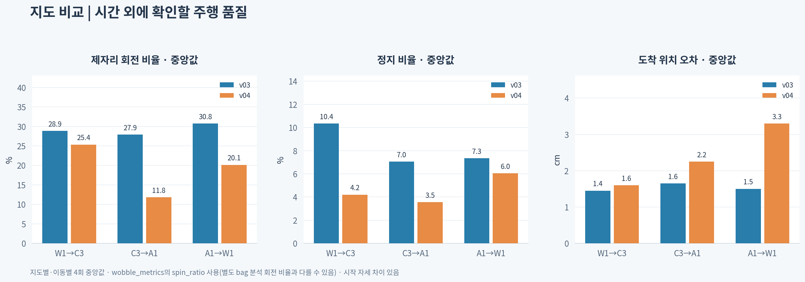
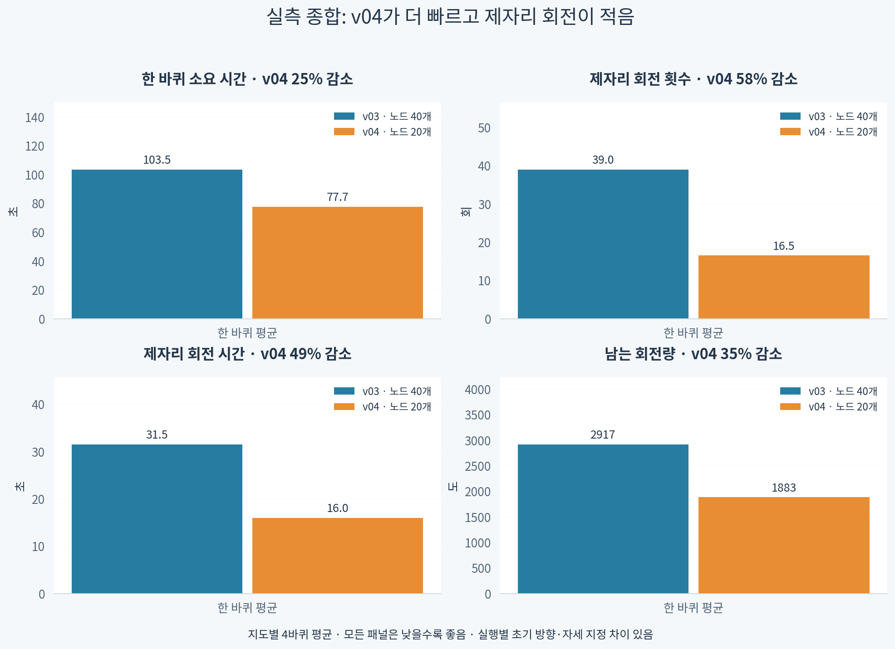
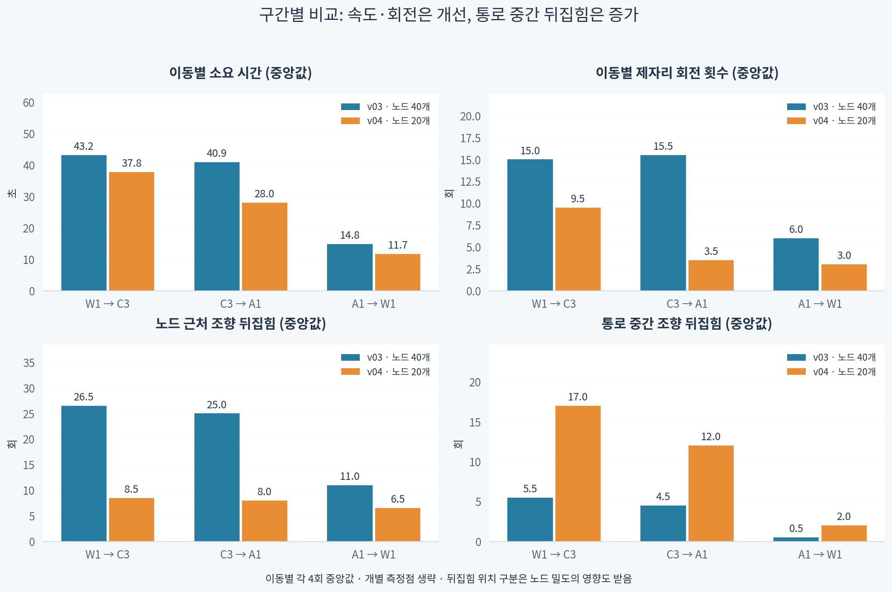

# 기획안 — 2026-11-19: 로드맵 노드 밀도에 따른 주행 차이 (test_map_v03 대 v04, pinky1)

**폴더명 변경 안내(2026-11-20):** 본문의 실험 이름·실행 ID는 당시 기록을 유지합니다. 실제 폴더 위치는 [실행 폴더 대응표](README.md#실행-폴더-대응표-2026-11-20)를 따릅니다. `runs/<run_id>`는 아래 과거 절차의 표기이며, 보관 자료를 읽거나 분석할 때는 대응표의 현재 폴더명을 사용합니다.

기획 세션이 쓴 실기기 실험 기획안입니다. 실험과 기록은 검토 세션(부장)이 합니다. 작업 공간 규칙(CLAUDE.local.md)은 그대로 적용됩니다.

사용자 지시(2026-11-19):

- pinky3는 시간이 필요하므로 지금은 **pinky1 한 대**로, 노드 개수·분포 차이 때문에 주행이 달라지는지 먼저 본다.
- 실험 주행을 할 때는 **카메라 녹화와 RViz 화면 녹화를 함께** 하고, 합친 영상까지 영상 3개를 남긴다.
- 녹화할 때 RViz의 왼쪽 Displays 창은 뺀다. RViz에 로드맵(노드와 통로)을 함께 띄운다.
- **지도는 새로 만든 `test_map_v03`과 `test_map_v04`를 쓴다**(개정). 앞서 `test_map_v001`·`v002`로 한 D1은 저장된 지도와 라이다가 보는 환경이 달라 멈췄고, 사용자 결정으로 문제로 다루지 않으며 비교 자료로도 쓰지 않는다.

1~4.4절의 기준·예상 수치는 제안입니다. 아래 비교 그래프와 4.5절은 완료된 시험의 실측 결과입니다.

## 실측 비교 한눈에 보기



회전·정지 비율과 도착 오차는 실험 기록의 채택된 원값 24행에서 이동별 중앙값을 다시 계산했습니다. 도착 오차 중앙값은 세 이동 모두 v04가 더 크므로, 속도 개선을 정확도 개선으로 해석하지 않습니다. 회전 비율은 wobble_metrics의 spin_ratio이며 4.5절의 별도 bag 분석 정의와 구분합니다.

**이번 시험에서는 v04가 더 빠르고 제자리 회전이 적었습니다.** 한 바퀴 평균 소요는 103.5초 → 77.7초로 **25.8초(약 25%) 단축**, 제자리 회전은 39.0회 → 16.5회로 **약 58% 감소**했습니다. 속도와 불필요한 제자리 회전을 줄이는 목적에서는 v04가 더 유리합니다. 지도 기본값 변경을 결정하거나 적용한 기록은 아닙니다.



기둥과 숫자는 지도별 네 바퀴의 평균입니다. 서로 단위가 다른 지표는 별도 축으로 분리했고, 모든 축은 0에서 시작합니다. 2장의 예상식으로 계산한 값은 포함하지 않았습니다.



이동별 기둥은 각 지도 네 번의 **중앙값**입니다. 위의 한 바퀴 **평균**과 집계 방식이 다르므로 이동별 기둥을 더해 한 바퀴 평균으로 해석하지 않습니다.

| 비교 관점 | 이번 실측의 판단 |
| --- | --- |
| 어느 쪽이 빠른가 | **v04**. 이동별 중앙값 약 12~32% 단축, 각 이동의 v04 네 번 모두 v03 최단 소요보다 빠름 |
| 제자리에서 덜 도는가 | **v04**. 한 바퀴 평균 횟수 58%, 회전 시간 49% 감소. 완전히 없어지지는 않음 |
| 전체 조향이 더 안정적인가 | **단정 어려움**. 노드 근처 뒤집힘은 줄었으나 통로 중간 뒤집힘은 증가. 노드 밀도에 따른 위치 분류 영향도 있음 |
| 실패·도착 정확도는 더 좋은가 | 채택한 24개 이동은 모두 완료, 재시도·NAV2_FAILED·ROBOT_OFFLINE 0건. 문서의 도착 오차 범위만으로 어느 쪽이 더 정확한지 판정하지 않음 |

비교 범위: pinky1 한 대, 지도별 네 바퀴. `e1_v03b`·`e4_v03b`와 `e2_v04`·`e3_v04`만 사용했습니다. 중단된 D1·E1 및 E4 첫 시도는 제외했습니다. 실행별 초기 방향·자세 지정 차이가 있어, 이번 조건에서 관찰된 경향으로 해석합니다. 원값과 계산 방법은 **4.5 결과** 및 [실기기 기록](2026-11-19_REAL_TEST.md)의 E1(재시도)~E4절에 있습니다.


## 1. 두 지도의 차이 (roadmap.json에서 계산)

지도 이미지 설정(크기 41×22칸, 칸당 5 cm, 원점)은 같고 로드맵만 다릅니다. 지도가 말하는 주행 구역 안쪽 크기는 1.90 m × 0.90 m입니다.

| 항목 | test_map_v03 | test_map_v04 |
| --- | --- | --- |
| 노드 | 40 | 20 |
| 통로(간선) | 41 | 21 |
| 통로 길이 최소 / 중앙값 / 최대 | 0.050 / 0.129 / 0.157 m | 0.050 / 0.220 / 0.387 m |
| 통로 길이 합 | 4.99 m | 4.99 m |
| 15.5 cm(`SAFE_DIST`)보다 가까운 노드 쌍 | 40 | 6 |
| 출발 노드 | W1, W2, W3 | 같음 |

- 통로의 모양과 총 길이가 같고, v03은 같은 통로를 더 잘게 나눈 것입니다.
- **이름이 같아도 위치가 다른 노드가 있습니다.** A 통로와 B 통로의 노드 번호가 다릅니다(v03은 A1~A12·B1~B12, v04는 A1~A5·B1~B5). 예를 들어 v03의 `A12`와 v04의 `A5`가 같은 자리입니다. 목적지로는 두 지도에서 이름과 위치가 모두 같은 노드만 씁니다: `W1`, `W2`, `W3`, `A1`, `B1`, `C1`, `C2`, `C3`.
- 두 지도 모두 노드가 지도의 빈칸 위에 있고, 로드맵이 끊긴 곳 없이 이어져 있는 것을 확인했습니다.

## 2. 보려는 것

**목표(2026-11-19 사용자):** 앞서 `test_map_v001`로 주행했을 때, 노드가 촘촘해서인지 로봇이 노드를 찾는 듯이 제자리에서 도는 모습이 많이 나왔다. **노드를 줄이면 이런 모습이 없어지는지** 확인한다. 소요 시간은 그다음이다.

로봇은 허가받은 구간마다 Nav2 목표를 하나씩 받습니다. 구간이 끝나는 노드마다 도착 판정(위치 허용 오차 1.5 cm)과 다음 구간을 향한 방향 맞추기가 들어가므로, 노드가 많으면 이런 동작이 그만큼 자주 나올 수 있습니다(코드에서 본 추정, 확인 필요).

 11-16 실기기 로그에서 맞춘 식(구간마다 2.27초 + 거리 ÷ 0.135 m/s, T-23)대로라면 구간이 적은 v04가 더 빠릅니다.

한 바퀴를 세 번의 이동으로 돕니다. B 통로로 가서 A 통로로 돌아옵니다.

| 이동 | 거리 | v03 구간 수 | v04 구간 수 | 식으로 본 예상 (v03 / v04) |
| --- | --- | --- | --- | --- |
| W1 → C3 (B 통로) | 1.83 m | 14 | 6 | 45.3초 / 27.2초 |
| C3 → A1 (A 통로) | 1.67 m | 13 | 5 | 41.9초 / 23.7초 |
| A1 → W1 | 0.60 m | 5 | 3 | 15.8초 / 11.2초 |
| 한 바퀴 | 4.10 m | 32 | 14 | 103.0초 / 62.1초 |

경로(최단 거리 기준 계산, 관제가 실제로 고른 경로는 로그로 확인):

- W1 → C3: v03 `W1>B1>B2>…>B12>C3_B12>C3`, v04 `W1>B1>B2>B3>B4>B5>C3`
- C3 → A1: v03 `C3>A12_C3>A12>A11>…>A2>A1`, v04 `C3>A5>A4>A3>A2>A1`
- A1 → W1: v03 `A1>A1_C1>C1>C1_B1>B1>W1`, v04 `A1>C1>B1>W1`

확인할 질문(중요한 순서):

1. **제자리 회전이 v04에서 줄어드는가.** 횟수, 시간, 일어나는 자리(노드 근처인지).
2. 구간 경계에서 로봇이 서거나 머뭇거리는가(영상, 속도 0 비율), 좌우로 흔들리는가.
3. 같은 거리를 가는 데 걸리는 시간이 구간 수에 따라 달라지는가. 예상 식과 맞는가.
4. 재시도, `NAV2_FAILED`가 한쪽 지도에서 더 많은가. 도착 위치의 정확도가 달라지는가.
5. (새 지도 확인) RViz에서 라이다가 본 벽과 지도의 벽이 맞는가.

## 3. 원칙

- **부장은 코드와 설정 파일을 고치지 않습니다.** 지도와 로드맵도 고치지 않습니다. 로봇 등록부(`~/.config/frybot/robots.yaml`)도 고치지 않습니다.
- **로봇을 움직이는 명령 전에 사용자에게 알립니다.** 움직일 로봇과 목적 노드를 말하고 시작합니다. 충전 케이블은 뺀 상태여야 합니다.
- 멈추는 조건: 벽·물건과 접촉, 허가받지 않은 구간으로 진행, 비상 정지가 듣지 않음, 런치 Ctrl-C 뒤 2초 넘게 움직임. 나오면 런치를 내리고 `robot_remote pinky1 --stop` 뒤 보고합니다.
- 한 이동이 150초 넘게 끝나지 않으면(D1처럼 실패가 되풀이되면) 녹화를 닫고 런치를 내린 뒤 보고합니다.
- pinky1만 씁니다. pinky2·pinky3는 띄우지 않습니다. 배터리 40% 아래면 중단합니다.

## 4. 절차

### 4.1 E0 준비 (로봇 정지)

1. 관제 PC 빌드: `colcon build --symlink-install --packages-select frybot_bringup frybot_control`. `ros2 run frybot_control fleet_bench --scenario moves --map-id test_map_v03 --robots 1`이 도는지 한 번 봅니다(로드맵을 관제가 읽는지 확인, v04도).
2. **새 지도 배포:** `ros2 run frybot_bringup robot_remote pinky1 --deploy`를 사용자에게 확인받고 합니다. 뒤에 `--check`. 로봇의 `maps/test_map_v03`·`v04` 파일이 PC와 같은지 확인합니다.
3. `robot_remote pinky1 --check`, 배터리 확인.
4. 카메라와 화면 녹화는 D0에서 확인했으므로 다시 하지 않아도 됩니다. 카메라 위치가 바뀌었으면 5초 시험 녹화를 다시 합니다.
5. 사용자가 pinky1을 W1 위에 놓고 방향을 알려 줍니다. 충전 케이블을 뺍니다. 새 지도는 원점이 바뀌었으므로 **W1의 실제 위치를 사용자에게 다시 확인**합니다(지도 좌표 0.091, -0.552).
6. **벽 맞춤 확인(이동 없이):** E1의 런치를 띄운 뒤 로봇이 온라인이 되면, 이동 명령을 보내기 전에 RViz에서 지역 코스트맵(라이다)의 벽이 지도의 벽과 맞는지 사용자와 함께 봅니다. 눈에 띄게 어긋나면 이동하지 말고 화면을 남긴 뒤 보고합니다.

### 4.2 실행 순서

지도 순서 때문에 생기는 차이(배터리, 온도)를 줄이려고 v03 → v04 → v04 → v03 순서로 네 번 띄웁니다.

| 실행 | 지도 | `run_id` |
| --- | --- | --- |
| E1 | test_map_v03 | `e1_v03` |
| E2 | test_map_v04 | `e2_v04` |
| E3 | test_map_v04 | `e3_v04` |
| E4 | test_map_v03 | `e4_v03` |

실행마다 똑같이 합니다.

1. 런치(지도와 `run_id`만 바꿈). 방향은 사용자가 알려 준 값으로 바꿉니다.

   ```bash
   ros2 launch frybot_bringup real.launch.py map_id:=test_map_v03 robots:=pinky1 \
       poses:=pinky1:W1:180 rviz_displays:=false run_id:=e1_v03
   ```

   - RViz는 기본값대로 함께 뜹니다. 네 번 모두 같은 조건입니다.
   - `rviz_displays:=false`는 녹화 화면에 지도만 나오도록 왼쪽 Displays 창 없이 띄우는 인자입니다. 다시 열려면 RViz 메뉴의 Panels > Add New Panel > Displays.
   - RViz에 로드맵이 함께 그려집니다(통로는 선, 노드는 파란 점, 출발 노드는 주황 점, 노드 이름). `map_id`에 맞는 로드맵이 나오는지 확인합니다.
   - RViz 창은 사용자 화면에 뜹니다. **녹화 중에는 창을 옮기거나 다른 창으로 덮지 않도록** 시작 전에 사용자에게 알립니다(화면의 그 영역을 찍는 방식).
2. bag 기록을 앞선 실험과 같은 토픽으로 시작합니다(`cmd_vel`, `odom`, `/fleet/robot_status`, `amcl_pose`, `plan`). `runs/<run_id>/bag`에 둡니다.
3. **녹화 시작(둘 다):**

   ```bash
   python3 scripts/cam_record.py --run-id <run_id> --no-preview &
   python3 scripts/screen_record.py --run-id <run_id> --wait 60 &
   ```

   - 카메라: `runs/<run_id>/camera_HHMMSS.mp4`와 `camera_HHMMSS_frames.csv`
   - RViz: `runs/<run_id>/rviz_HHMMSS.mp4`와 `rviz_HHMMSS_frames.csv`. 시작 줄에 "영역 (…)"이 나오면 창을 찾은 것이고, "화면 전체를 녹화함"이 나오면 못 찾은 것이니 그 사실을 적습니다.
   - 시각은 모두 `events.csv`와 같은 unix 초입니다. 두 녹화를 같은 순간에 시작할 필요는 없습니다.
4. pinky1이 온라인이 되고 `AT_HOME`이 나오면 이동 명령을 순서대로 보냅니다. 앞 명령의 `TASK_DONE` 뒤 5초를 두고 다음을 보냅니다. 한 바퀴를 2회 돕니다.
   - W1 → C3, C3 → A1, A1 → W1
   - W1 → C3, C3 → A1, A1 → W1
5. **녹화 종료와 합치기:** 마지막 `TASK_DONE` 뒤 5초에 두 녹화 프로세스에 SIGINT를 보냅니다. 둘 다 "녹화 끝" 줄을 확인한 뒤 bag과 런치를 내립니다. 그다음 `python3 scripts/merge_videos.py runs/<run_id>`로 합친 영상(`combined_HHMMSS.mp4`, 왼쪽 카메라·오른쪽 RViz)을 만듭니다. 실행 폴더에 영상 3개가 있는지 확인합니다.
6. 배터리, 로봇 온도(`vcgencmd measure_temp`)를 적습니다.

네 번을 마치면 지도마다 이동별 4회(한 바퀴 4회)가 됩니다. E1이 끝나면 결과를 한 번 알려 주고 계속합니다(새 지도의 첫 주행이므로).

### 4.3 측정

이동 명령 하나(`TASK_ASSIGN`부터 `TASK_DONE`까지)마다 다음을 냅니다.

| 값 | 얻는 곳 |
| --- | --- |
| 소요 시간, 구간 수, 구간당 시간 중앙값 | `python3 scripts/wobble_metrics.py runs/<run_id> --map-id <지도> --csv ...` |
| 조향 뒤집힘(`flip_per_m`), 제자리 회전 비율(`spin_ratio`), 정지 비율(`stop_ratio`), 재시도(`route_retry`) | 같은 도구 |
| 관제가 실제로 준 경로와 계획 ETA | `events.csv` |
| `NAV2_FAILED`, `PLAN_FAIL`, `ROBOT_OFFLINE` 건수 | `events.csv` |
| 도착 위치와 목적 노드 좌표의 거리 | 도착 시점의 `/fleet/robot_status` |
| 구간 경계에서 서는 모습 | 영상. 이벤트 시각을 `camera_*_frames.csv`로 프레임에 맞춤 |

제자리 회전은 다음 값으로 봅니다. 앞의 두 값은 `wobble_metrics.py`가 내고, 나머지는 기획 세션이 실행이 끝난 뒤 bag(`cmd_vel`, `odom`)에서 계산합니다. 부장은 bag이 빠짐없이 남는지만 확인하면 됩니다.

| 값 | 뜻 |
| --- | --- |
| `spin_ratio` | 앞으로 가지 않으면서 도는 시간 ÷ 전체 시간 |
| `flip_near_node`, `flip_mid` | 조향 방향이 뒤집힌 자리가 노드 근처인지 통로 중간인지 |
| 제자리 회전 횟수 | 이동 한 번에서 제자리 회전이 0.3초 넘게 이어진 횟수, 그리고 노드 하나당 횟수 |
| 남는 회전량 | 실제로 돈 각도의 합 − 경로 모양상 꼭 돌아야 하는 각도(도) |

영상에서 눈에 띄는 제자리 회전이 있으면 부장이 시각(영상의 시각 표시)과 자리를 함께 적습니다.

`wobble_metrics.py`가 새 지도에서 도는지는 확인하지 않았습니다(확인 필요). 돌지 않으면 고치지 말고 오류를 적어 주세요.

### 4.4 판단 기준 (제안)

- **제자리 회전:** 이동별로 v03과 v04의 제자리 회전 횟수와 `spin_ratio`를 비교합니다. v04의 중앙값이 v03의 절반 이하이고 4회 중 3회 이상이 같은 방향이면 "줄었다"로 봅니다. 노드 하나당 횟수가 두 지도에서 비슷하면 "노드 수에 비례한다"는 뜻이고, v04에서도 통로 중간에서 돈다면 원인이 노드가 아니라는 뜻입니다.
- **소요 시간:** 이동별로 v03과 v04의 소요 시간 중앙값을 비교합니다. **10% 넘게 차이** 나고 4회 중 3회 이상이 같은 방향이면 "차이 있음"으로 봅니다.
- 구간당 추가 시간을 (v03 시간 − v04 시간) ÷ (구간 수 차이)로 내어 T-23의 2.27초와 비교합니다.
- `NAV2_FAILED`나 재시도가 한쪽에서만 나오면 횟수와 위치를 그대로 적습니다.
- 표본이 이동별 4회씩이라 경향만 말할 수 있습니다.

## 4.5 결과 (2026-11-19, E1~E4)

원값은 `docs/2026-11-19_REAL_TEST.md`의 "E1(재시도)~E4"절과 `archive/real_test_2026-11-19/e*_wobble.csv`, 실행별 bag은 `runs/<run_id>/bag`. 제자리 회전 횟수와 남는 회전량은 기획 세션이 bag의 `cmd_vel`·`odom`에서 계산했습니다(제자리 회전 = 전진 속도 0.01 m/s 미만이면서 회전 속도 0.2 rad/s 초과가 0.3초 넘게 이어진 것).

실행: v03은 `e1_v03b`·`e4_v03b`, v04는 `e2_v04`·`e3_v04`. 지도마다 이동별 4회(네 바퀴)이고, 24번의 이동이 모두 재시도·`NAV2_FAILED`·`ROBOT_OFFLINE` 없이 끝났습니다. 도착 오차는 두 지도 모두 0.5~3.8 cm입니다. (`e4_v03` 첫 시도는 W1에서 벽 쪽을 본 채 출발하다 "collision ahead"로 멈춰 뺐습니다.)

이동별 중앙값(4회):

| 이동 | 지도 | 소요(초) | 제자리 회전(회) | 구간당(회) | 회전 시간(초) | 회전 시간 비율 | 남는 회전량(도) | 노드 근처 뒤집힘 | 통로 중간 뒤집힘 |
| --- | --- | --- | --- | --- | --- | --- | --- | --- | --- |
| W1 → C3 | v03 | 43.2 | 15.0 | 1.15 | 12.8 | 0.30 | 1,250 | 26.5 | 5.5 |
| W1 → C3 | v04 | 37.8 | 9.5 | 1.90 | 9.9 | 0.27 | 969 | 8.5 | 17 |
| C3 → A1 | v03 | 40.9 | 15.5 | 1.29 | 11.9 | 0.29 | 1,134 | 25 | 4.5 |
| C3 → A1 | v04 | 28.0 | 3.5 | 0.88 | 3.5 | 0.12 | 560 | 8 | 12 |
| A1 → W1 | v03 | 14.8 | 6.0 | 1.50 | 4.8 | 0.32 | 448 | 11 | 0.5 |
| A1 → W1 | v04 | 11.7 | 3.0 | 1.50 | 2.5 | 0.21 | 320 | 6.5 | 2 |

뒤집힘 두 열은 부장의 `wobble_metrics.py` 값입니다.

한 바퀴(세 이동의 합) 평균: 소요 103.5초 → 77.7초(25% 감소), 제자리 회전 39.0회 → 16.5회(58% 감소), 회전 시간 31.5초 → 16.0초(49% 감소), 남는 회전량 2,917도 → 1,883도(35% 감소).

판단:

- **소요 시간: 차이 있음**(4.4절 기준 충족). 세 이동 모두 v04의 네 번이 v03의 가장 빠른 값보다 빨랐습니다. 차이는 12%, 32%, 21%입니다.
- **제자리 회전 횟수: C3 → A1과 A1 → W1은 절반 이하로 줄었고, W1 → C3은 37% 줄어 기준(절반 이하)에 못 미칩니다.** 회전 시간 비율은 C3 → A1에서만 절반 이하입니다.
- **구간당 횟수는 0.88~1.90회입니다.** 노드 수 감소와 함께 전체 회전 횟수가 줄었지만, W1 → C3은 1.15 → 1.90회로 늘고 C3 → A1은 1.29 → 0.88회로 줄었습니다. 노드 수에 정확히 비례한다고 단정하지 않으며, 시작 방향·자세 차이도 함께 고려합니다.
- **v04에서도 없어지지는 않았습니다.** 한 바퀴에 16.5회, 남는 회전량이 다섯 바퀴(1,883도)쯤 됩니다.
- **통로 중간의 조향 뒤집힘은 v04에서 늘었습니다**(W1 → C3 5.5 → 17, C3 → A1 4.5 → 12). 노드 근처의 뒤집힘이 준 만큼 통로 중간으로 옮겨 간 모습입니다.
- 구간당 추가 시간은 0.67~1.61초로, T-23의 2.27초보다 작습니다.

한계:

- 표본은 지도마다 이동별 4회입니다.
- 실행마다 시작 방향이 달랐습니다(E1 `W1:180`, E2·E3은 띄운 뒤 RViz에서 다시 찍음, E4는 `W1:90`).
- 영상에서 제자리 회전의 시각과 자리는 따로 보지 않았습니다.

## 4.6 실험 종료 (2026-11-20, 사용자 결정)

- **결론:** 이 실험으로 알고 싶었던 것은 노드 수가 주행에 영향을 주는지였고, 영향이 크다는 것을 확인했습니다(한 바퀴 소요 25% 감소, 제자리 회전 58% 감소, 4.5절).
- **남긴 것:** 현재 맵은 완전히 구현되지 않았기 때문에 실측한 맵에도 잘못된 부분이 있습니다. 향후 맵 구성을 끝내고, 추가적인 부분은 재실험을 진행하여 검증합니다.
- 4.5절의 수치는 지금의 `test_map_v03`·`test_map_v04`에서 잰 값입니다. 맵이 바뀌면 그대로 옮겨 쓰지 않습니다.
- v04에 남은 제자리 회전, 통로 중간의 조향 뒤집힘, 통로별 효과 차이의 원인은 이번에 따지지 않았습니다. 재실험 때 함께 봅니다.
- 이 실험은 여기서 끝냅니다.

## 5. 부장에게 받을 것

1. E0: 빌드, 배포, 점검, 배터리, 벽 맞춤 확인 결과(화면 한 장)
2. 실행별·이동별 원값 표(4.3절)와 지도별 요약
3. 실행별 영상 3개의 파일 목록(`camera_*.mp4`, `rviz_*.mp4`, `combined_*.mp4`), 실제 fps, 합칠 때 나온 "프레임 시각 차이 최대"
4. 관제가 준 경로가 2장의 예상 경로와 달랐던 경우
5. 지시와 다르게 한 것, 하지 못한 것과 이유
