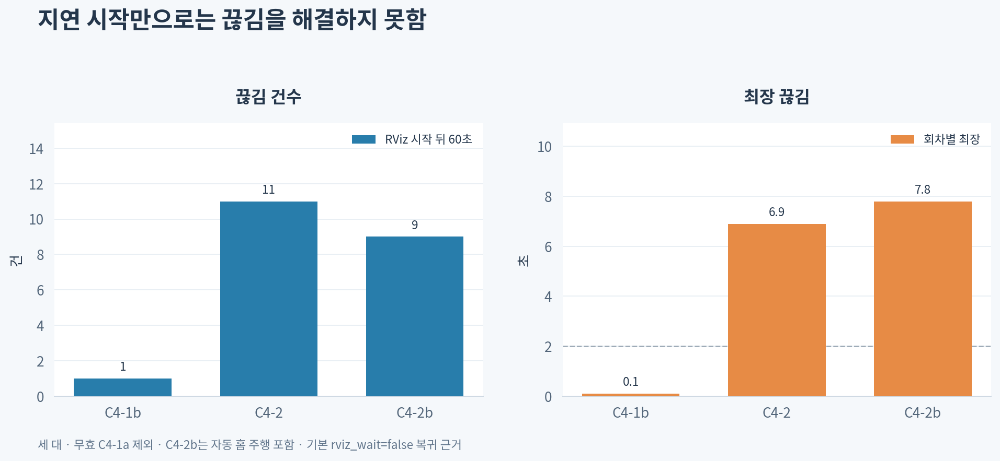
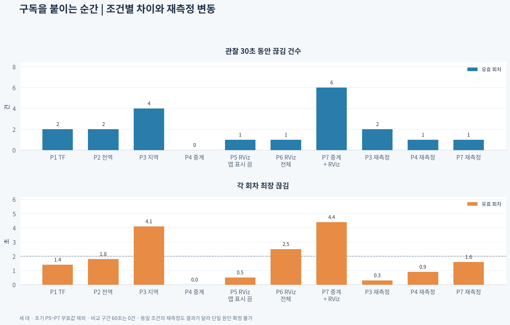
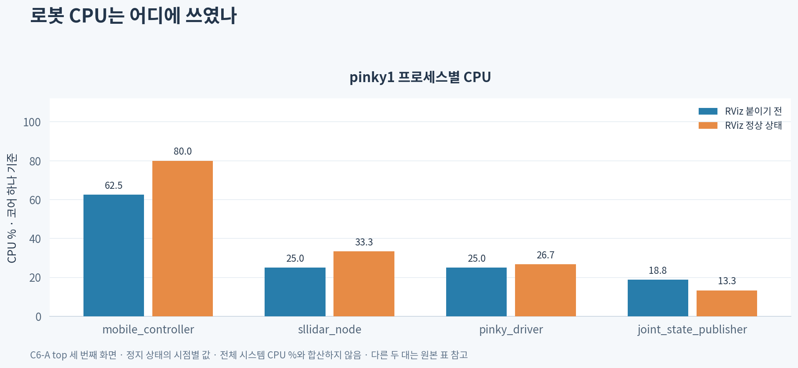
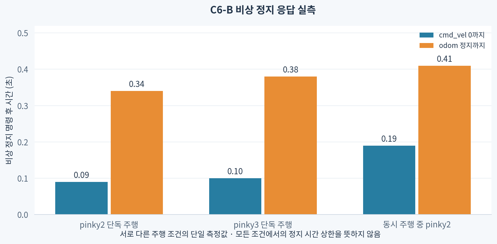
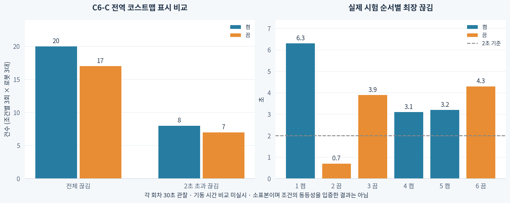
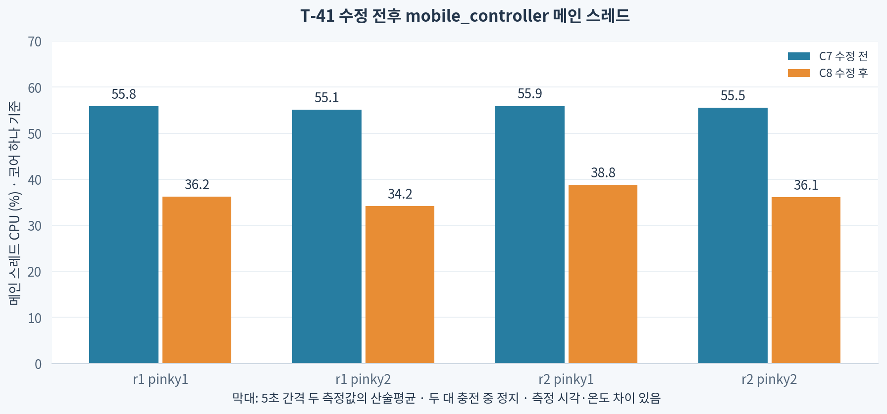
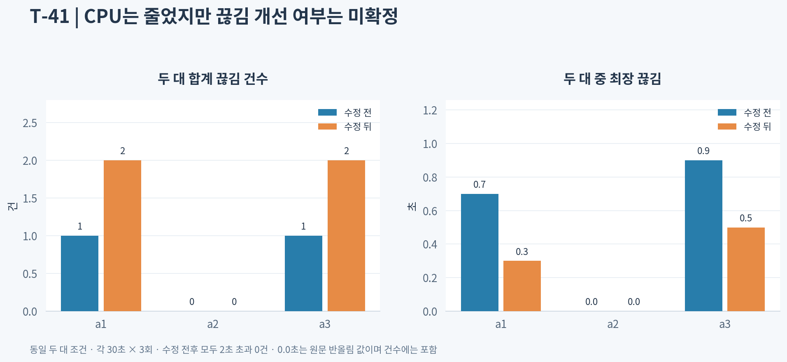
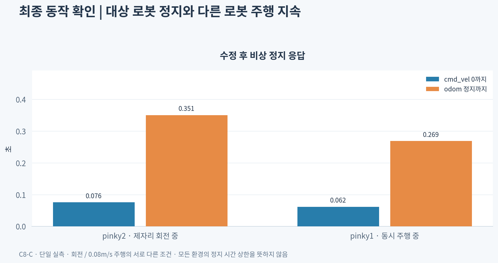

# FryBot 실기기 실험 기록 (2026-11-19)

후속 실험: [2026-11-20 서빙 팔·실측 지도 서빙·2대 회피 기록](2026-11-20_REAL_TEST.md). 날짜별 조건과 실행 ID가 다르므로 별도 기록으로 유지합니다.

**폴더명 변경 안내(2026-11-20):** 본문의 실험 이름·실행 ID는 당시 기록을 유지합니다. 실제 폴더 위치는 [실행 폴더 대응표](README.md#실행-폴더-대응표-2026-11-20)를 따릅니다. `runs/<run_id>`는 아래 과거 절차의 표기이며, 보관 자료를 읽거나 분석할 때는 대응표의 현재 폴더명을 사용합니다.

- 기획안: `docs/2026-11-19_BRINGUP_RVIZ_PLAN.md` (기획 세션 frybot-ws-0d)
- 로봇: pinky1(192.168.0.9), pinky2(.29), pinky3(.28). 지도 `test_map_v001`, `discovery:=peers`, `ROS_DOMAIN_ID=73`
- 배치: 사용자가 세 대를 W1·W2·W3 위에 -x(180°)로 놓음. `poses:=pinky1:W1:180,pinky2:W2:180,pinky3:W3:180`
- 로그: `archive/real_test_2026-11-19/`. 시각은 런치 시작부터의 초(PC 도착 시각 기준, `stamp.py`)
- 코드와 설정은 고치지 않음

## C0 준비 (10:45~10:48)

| 항목 | 결과 |
| --- | --- |
| 점검 `robot_remote pinky1 pinky2 pinky3 --check` | 세 대 `OK`(`c0_check.log`) |
| 배터리(로봇 정지 상태, `pinkylib` 전압) | pinky1 96.0 %, pinky2 96.6 %, pinky3 91.4 %(`c0_battery.txt`) |
| 세 대용 RViz 명령(로봇 없이) | `fleet_rviz`(`robot_ids:=[pinky1, pinky2, pinky3]`)와 `rviz2 -d <fleet_rviz_config 세 대>`가 15초 동안 떠 있음. 설정 파일에 지도 표시 7개, 초기 자세 도구 3개 |

## C1 손으로 늦게 띄우기 (10:49~10:58, `run_20261119_104927`)

`rviz:=false`로 기동 → 세 대 온라인 뒤 60초 → `fleet_rviz`와 RViz를 손으로 시작(`t_rviz` = 97.2초) → 60초 관찰 → pinky1 이동·비상 정지.

| 로봇 | t_nav | t_ready | t_online | ssh_lost |
| --- | --- | --- | --- | --- |
| pinky1 | 34.1 | 29.2 | 36.3 | 0 |
| pinky2 | 31.7 | 22.1 | 34.0 | 0 |
| pinky3 | 33.5 | 23.0 | 33.1 | 0 |

RViz 시작 전후 60초(`events.csv`, 런치 로그):

| 항목 | 전 60초 | 뒤 60초 |
| --- | --- | --- |
| `ROBOT_OFFLINE` | 0 | 5 (pinky1 2, pinky2 3. 각 0.2~0.7초 뒤 `ROBOT_ONLINE`) |
| `SENSOR_ERROR` | 0 | 0 |
| `WAIT_FMS`(로봇 로그) | 0 | 0 |
| `ssh_lost` | 0 | 0 |

- `/fleet/robot_status`(세 대 10 Hz이면 30 Hz): RViz 시작 약 3분 뒤 10초씩 세 번 쟀고 30.0 Hz(`c1_hz_raw.txt`), 23.2 Hz, 22.8 Hz. RViz 전과 관찰 60초 안의 값은 측정 명령 실수로 얻지 못함
- 관제 PC 노드 수: RViz 시작 전 세 대 모두 18개(54개). 시작 뒤 측정 스크립트가 멈춰 `c1_nodes.txt`는 98초까지만 있음
- `wlo1` 수신: RViz 전 약 0.28~0.34 MB/s
- RViz 화면: 사용자가 정확히 확인하지 못함("어제보다 빨리 뜬 것 같음")
- 이동(RViz 켬, pinky1만): W1→A4 주행 중 `ESTOP` → `EVT_SUSPENDED E_STOP`, 5초 뒤 `RESUME` → `EVT_RESUMED`, A4 도착(`TASK_DONE` 30.5초). A4→W1 56.5초. 주행 직전 `ROBOT_OFFLINE` 1회
- 비상 정지 뒤 속도 0까지의 시간은 재지 못함(bag 기록 명령 실수로 bag 없음)
- `ROS_STATIC_PEERS`: 따로 연 터미널에서 값 없이도 `ros2 topic hz /fleet/robot_status`가 값을 받음(23.2 Hz, 값 있음 22.8 Hz). `fleet_rviz`·RViz는 값을 넣고 띄움
- 종료: Ctrl-C 뒤 `robot stack stopped` pinky2 12.1초, pinky1 13.1초, pinky3 15.3초. `fleet_rviz`는 SIGINT로 끝나지 않아 SIGTERM으로 끔
- 배터리(온라인 상태 관리자 API): 끝 pinky1 88.2, pinky2 90.4, pinky3 85.0

판정(기획안 4.3): 상태 보고가 길게 끊기지는 않았지만 `ROBOT_OFFLINE`이 0 → 5건으로 늘어 "건수가 늘지 않음" 기준은 **넘지 못함**. 끊김은 모두 1초 미만이고 이동·비상 정지는 통과

## C2 원인 좁히기 (11:04~11:20)

`rviz:=false`로 런치를 시작하면서 곧바로 한 가지를 함께 띄움. 세 대 `AUTO_HOME` 뒤 내림(이동 없음).

| 실행 | 함께 띄운 것 | 로봇 | t_nav | t_online | ssh_lost | no_output_max |
| --- | --- | --- | --- | --- | --- | --- |
| C2-1a `run_20261119_110451` | `fleet_rviz` | pinky1 | 44.4 | 47.6 | 0 | 247 |
| | | pinky2 | 43.9 | 44.7 | 0 | 247 |
| C2-1b `run_20261119_111643` | `fleet_rviz` | pinky1 | (로그 늦음) | 59.9 | 0 | 0 |
| | | pinky2 | 55.9 | 57.4 | 0 | 0 |
| | | pinky3 | 55.2 | 58.1 | 0 | 0 |
| C2-2 `run_20261119_111826` | RViz | pinky1 | 42.8* | 75.5 | 0 | 0 |
| | | pinky2 | 23.2* | 77.2 | 0 | 49 |
| | | pinky3 | 26.7* | 77.9 | 0 | 41 |

\* C2-2는 로봇 로그가 PC에 오기 전에 런치를 내려, 로봇의 `~/.frybot/robot_launch.log` 시각으로 셈(`c2_2_navtime.txt`, 읽기만)

관제 PC 노드 수(`c2_*_nodes.txt`, 54개가 전부):
- C2-1b(`fleet_rviz`): 21초 37개, 37초 47개, 51초 52개
- C2-2(RViz): 20초 21개, 35~65초 25~28개(pinky1이 3~4개에 머묾), 80초 54개

판정:
- 두 실행 모두 "느림"(100초 초과)이 아님. 기획안 4.4에 따라 "둘이 함께일 때만 느림"으로 적음. C2-3은 하지 않음
- RViz만 함께 띄운 C2-2(75.5~77.9초)가 `fleet_rviz`만(57.4~59.9초)이나 RViz 끔(어제 49~67.5초)보다 늦음. 표본 1회씩

## 배터리 (관리자 API, 온라인 시점)

| 실행 | pinky1 | pinky2 | pinky3 |
| --- | --- | --- | --- |
| C0(정지, 전압) | 96.0 | 96.6 | 91.4 |
| C1 끝 | 88.2 | 90.4 | 85.0 |
| C2-1a | 87.4 | 88.8 | - |
| C2-1b | 84.5 | 87.1 | 68.6 |
| C2-2 | 83.8 | 85.7 | 55.4 |

- pinky3 배터리 값은 85.0 → 68.6 → 55.4로 변함. 기동 중 순간값이라 확인 필요

## 지시와 다르게 한 것, 하지 못한 것
- C1 bag 기록이 실패함(제 측정 스크립트가 토픽 목록을 쉼표로 붙여 넘김). C1의 비상 정지 정지 시간은 `events.csv`로만 확인. C2부터 고침
- C1의 RViz 전 `/fleet/robot_status` 주기는 측정 명령 실수로 못 냄. C1 노드 수 기록은 RViz 시작 뒤 멈춤
- C1 RViz 화면에 세 대가 보인 시간은 사용자가 확인하지 못함
- 로봇 CPU 측정(B4 방법)은 하지 않음
- C2-1은 두 번 실행함(C2-1a·C2-1b). C2-3은 조건(C2-2가 100초 초과)에 해당하지 않아 하지 않음. bag 없는 실행(B6-3)도 하지 않음
- 관제 PC `wlo1`에 실험과 무관해 보이는 수신이 있었음(로봇을 내린 뒤에도 약 0.37 MB/s, C2-1b 시작 때 약 4 MB/s). 원인은 확인하지 않음. 수신량 비교는 이 때문에 믿기 어려움

## C4 재시험 (T-40 구현 뒤, 11:27~11:49)

유효한 세 회차만 표시했습니다(C4-1a 제외). 온라인 시간이 줄어도 RViz 시작 직후 끊김은 남아 있어 지연 시작 기본값을 복귀시킨 근거입니다.

- 관제 PC에서 `colcon build --symlink-install --packages-select frybot_bringup`(통과). 로봇 배포 없음
- 시작 전 점검 세 대 `OK`, 배터리(전압) pinky1 89.4 %, pinky2 85.8 %, pinky3 68.8 %(`c0_battery.py` 재실행)
- 기본 명령(RViz 켬, `rviz_wait` 기본 true). `t_wait`는 `wait_online`의 "모든 로봇이 보고함" 줄, `t_rviz`는 `rviz2` 프로세스 시작 줄
- 끊김은 `events.csv`의 `ROBOT_ONLINE offline=N초`

| 실행 | 배치·poses | t_nav(로봇 로그) | t_wait | t_rviz | t_online | ssh_lost | RViz 뒤 60초 끊김 |
| --- | --- | --- | --- | --- | --- | --- | --- |
| C4-1a `run_20261119_112752` | W1·W2·W3 | 137.7~161.1(PC 로그) | 106.1 | 106.5 | 106.6~109.1 | 1·2·3 | 13건, 최장 4.6초 |
| C4-1b `run_20261119_113213` | W1·W2·W3 | 57.7·65.9·46.1 | 40.9 | 41.8 | 60.0~73.3 | 0 | 1건, 0.1초 |
| C4-2 `run_20261119_113540` | W1·W2·W3 | - | 62.5 | 62.9 | 61.7~65.7 | 0 | 11건, 최장 6.9초(세 대 5.4~6.9초) |
| C4-2b `run_20261119_114621` | B1·B3_B4·B7 → 자동 홈 이동으로 W | - | 53.6 | 54.1 | 55.2~55.9 | 0 | 9건, 최장 7.8초 |

- **C4-1a는 무효:** C2-2의 bag 기록 프로세스가 꺼지지 않고 C4-1a 내내 함께 돌았음(제 측정 스크립트가 bag 종료를 기다리지 않음). 꺼서 확인한 뒤 같은 조건으로 C4-1b를 다시 함. C4부터 bag이 끝날 때까지 기다리고, 30초가 넘으면 SIGTERM으로 끔
- `wait_online`은 `mobile_controller` 준비(`ready at`) 뒤 첫 상태 보고에 끝나므로, Nav2 active보다 먼저 RViz가 뜰 수 있음(C4-1b: `t_wait` 40.9초, Nav2 active 46.1~65.9초)
- `/fleet/robot_status`: C4-1b RViz 뒤 29.9 Hz
- Ctrl-C 뒤 `fleet_rviz`·RViz·`wait_online`은 세 실행 모두 남지 않음. `robot stack stopped` 13.2~17.1초

### C4-2 이동 (RViz 켬)
- pinky1 W1→B1 4.3초 `TASK_DONE`
- pinky1 B1→W1: 실제로는 B1_B2 쪽(노드에서 6~10 cm)에 섰고, 이어 보낸 W1·A2·A4·W1 이동이 모두 `NAV2_FAILED` ×2 뒤 보류됨. 로봇 로그에 `RegulatedPurePursuitController detected collision ahead!` → `Controller patience exceeded`. 사용자 확인: 로봇 앞이 벽·물건에 가까웠음
- 두 대 동시 이동: pinky3 W3→B7(5.0초)·B7→W3(4.1초)는 통과. 짝인 pinky1은 위 이유로 실패
- 비상 정지: pinky1이 보류로 서 있을 때 들어가 **주행 중 비상 정지는 시험되지 않음**(bag: 직전 속도 0). `ESTOP`/`RESUME`은 받아들여짐
- 이동 구간(약 170초)의 끊김 24건, 최장 2.1초(pinky2, 서 있는 중)

### C4-2b 자동 홈 이동 중 끊김
- 세 대가 B1·B3_B4·B7에서 W1·W2·W3로 자동 홈 이동(`TASK_DONE` 21.7·23.4·27.8초)
- RViz 시작(54.1초) 직후 세 대 모두 끊김: pinky3 3.7초, pinky1 4.0초, pinky2 7.8초 → 7.6초
- pinky2의 첫 7.8초 끊김 동안 bag의 `/pinky2/odom`에 0.08 m/s 주행이 있음(허가받은 구간 B3_B4→B3 주행 중). 두 번째 7.6초 동안은 정지(관제가 끊긴 로봇에 다음 허가를 내지 않아 B3에서 기다림). bag에서도 `/pinky2/odom` 간격이 최대 2.98초 벌어짐
- pinky1도 4.0초 끊김 동안 주행 중(최대 0.10 m/s)
- 끝난 뒤 관리자 API 배터리 pinky3 40.3 %로 중단 기준(40 %)에 닿아 이동 시험과 (나) poses 없는 기동을 하지 않음

### 판정 (기획안 3장)

| 항목 | 기준 | 결과 |
| --- | --- | --- |
| t_nav | 60초 이하 | 미달. C4-1b pinky2 65.9초(pinky1 57.7, pinky3 46.1) |
| t_online | 90초 이하 | 통과. 55.2~73.3초(C4-1b·C4-2·C4-2b) |
| ssh_lost | 0 | 통과(C4-1b·C4-2·C4-2b) |
| RViz 시작 뒤 60초 끊김 | 늘지 않음 | **미달**. 3회 중 2회 세 대 모두 4~8초 끊김 |
| 주행 중 2초 넘는 끊김 | 없음 | **미달**. C4-2b pinky2 7.8초, pinky1 4.0초(주행 중) |
| RViz 화면 | 30초 안에 세 대 | 확인 안 함(사용자 관찰 없음) |
| 이동·비상 정지 | 통과 | 부분. 한 대 이동과 pinky3 동시 이동은 통과. pinky1은 벽 근처에서 Nav2 실패, 주행 중 비상 정지는 못 함 |
| poses 없이 RViz 곧바로 | 확인 | 못 함(배터리) |

- 결론: RViz를 온라인 뒤로 늦추면 관제 연결은 90초 안으로 들어오지만, **RViz가 뜬 직후 약 10~20초 동안 세 대의 상태 보고가 4~8초씩 끊김**. 주행 중에도 생김. 늦게 띄우는 것만으로는 부족하고, 기획안 4.3의 판정대로 RViz 표시를 줄이는 쪽(C3-3)이 필요해 보임. 어떤 표시가 원인인지는 가리지 않음
- C1(손으로 늦게 띄움)에서는 끊김이 1초 미만이었고, C4-1b도 0.1초 1건이었음. 같은 동작이 실행마다 크게 다름(표본 C1 1회, C4 3회)

### 배터리 (관리자 API)

| 시점 | pinky1 | pinky2 | pinky3 |
| --- | --- | --- | --- |
| C4 시작 전(전압) | 89.4 | 85.8 | 68.8 |
| C4-1a | 85.0 | 80.8 | 64.0 |
| C4-1b | 84.7 | 77.7 | 65.3 |
| C4-2 끝 | 77.2 | 71.8 | 58.9 |
| C4-2b | 76.4 | 67.4 | 40.3 |

### 정정 (C2)
- C2-2의 bag 기록은 C2-2가 끝난 뒤에도 꺼지지 않고 C4-1a까지 돌았음. C2-2 시작 때는 C2-1b의 bag이 아직 종료 중이었음(시작 직전 확인 1개). C2-2 값도 조건이 조금 다를 수 있음

## C5 어느 구독이 끊김을 만드는가 (12:32~12:51, `run_20261119_123207`)

각 항목의 30초 유효 관찰값과 재측정을 따로 표시했습니다. 무효 P5~P7은 제외했습니다. 비교 구간은 60초로 길이가 달라 같은 건수 그래프에 넣지 않았습니다.

- 사용자 요청으로 진행. 배터리(전압) pinky1 100 %, pinky2 100 %, pinky3 57.8 %(기획안의 60 %에 못 미쳤으나 이동이 없는 실험이라 사용자가 그대로 진행을 결정). 점검 세 대 `OK`. 배치 W1·W2·W3, -x
- `rviz:=false auto_home:=false`로 한 번 기동. 세 대 온라인 59.5초(관리자 API로 확인). 로봇 이동 없음
- 붙이는 터미널에는 `ROS_STATIC_PEERS`(로봇 세 대 주소)를 넣음. 붙이고 30초, 끄고 30초
- 끊김은 `events.csv`의 `ROBOT_ONLINE offline=N초`로 셈. 끊김이 시작된 시각이 붙인 뒤 30초 안이면 그 항목으로 봄. `@+N`은 붙인 뒤 끊김이 시작되기까지의 초
- P2·P3 명령은 기획안대로 돌았음(`--field info`를 붙여 내용은 버림). P2·P3에서 `A message was lost!!!`가 한 번씩 나옴

| 항목 | 끊김 수 | 최장(초) | 로봇:길이@시작 |
| --- | --- | --- | --- |
| 비교 구간(아무것도 안 붙임, 60초) | 0 | 0.0 | - |
| P1 TF 구독(`ros2 topic hz /pinkyN/tf` ×3) | 2 | 1.4 | pinky2:0.1@+4.3 pinky1:1.4@+4.2 |
| P2 전역 코스트맵 한 장(`echo --once` ×3) | 2 | 1.8 | pinky3:0.8@+4.6 pinky2:1.8@+6.3 |
| P3 지역 코스트맵 한 장(`echo --once` ×3) | 4 | 4.1 | pinky3:2.1@+4.5 pinky1:0.3@+7.1 pinky2:4.1@+3.5 pinky3:1.0@+18.0 |
| P4 `fleet_rviz`만 | 0 | 0.0 | - |
| P5 RViz, 코스트맵 표시 끔 | 1 | 0.5 | pinky1:0.5@+4.5 |
| P6 RViz 전체 | 1 | 2.5 | pinky1:2.5@+3.5 |
| P7 `fleet_rviz` + RViz 전체 | 6 | 4.4 | pinky1:1.2@+3.6 pinky2:1.8@+5.4 pinky3:4.4@+5.2 pinky1:2.8@+6.8 pinky2:2.9@+15.2 pinky1:0.9@+20.8 |
| P3 다시 | 2 | 0.3 | pinky1:0.3@+5.5 pinky3:0.0@+6.9 |
| P4 다시 | 1 | 0.9 | pinky1:0.9@+11.9 |
| P7 다시(pinky3 CPU 기록) | 1 | 1.6 | pinky1:1.6@+7.4 |

- **처음 P5~P7은 무효:** 제 종료 명령이 자기 셸을 먼저 끄는 바람에(`pkill -f`의 패턴이 자기 명령 줄과도 맞음), P4의 `fleet_rviz`부터 꺼지지 않고 P5·P6·P7에 쌓였음. 고친 뒤 P5~P7을 다시 했고, 위 표의 P5·P6·P7은 다시 한 값임. 무효였던 값: P5 4건(최장 1.6초), P6 3건(0.2초), P7 6건(5.0초)
- P1의 TF 주기: 세 대 각 약 63 Hz

### pinky3 CPU·무선(P7 다시, `c5_top_*.txt`, SSH로 읽기만)
- 붙이기 전(3회): 유휴 27.6~44.6 %, 무선 송신 약 0.2 MB/s
- 붙이고 약 2초 뒤: 유휴 **1.4 %**, 시스템 55.6 %, 무선 드라이버 작업(`kworker … brcmf_wq`) 27.8 %
- 붙인 뒤 약 10초 동안 무선 송신 약 1.3 MB/s, 그 뒤 약 0.2~0.3 MB/s로 돌아옴
- 이 회차에서 pinky3은 끊기지 않았음(끊김은 pinky1 1.6초 1건). SSH로 `top`을 읽는 것도 로봇에 부하를 더함

### 판정
- 아무것도 안 붙인 60초는 끊김 0건
- **`fleet_rviz` + RViz 전체(P7)의 유효 두 회차는 최장 4.4초·1.6초**이며, 2초 초과는 두 번 중 한 번입니다. 5.0초는 무효 회차이므로 판정 표본에 포함하지 않습니다.
- 하나만 붙였을 때 2초 넘는 끊김은 P3(지역 코스트맵 한 장, 4.1초)와 P6(RViz 전체, 2.5초)에서 한 번씩. 다시 한 P3는 0.3초
- 끊김은 대부분 붙인 뒤 3.5~7초에 시작함. 데이터를 계속 받는 동안보다 **붙는 순간**(탐색과 첫 메시지들, 코스트맵·지도 같은 큰 메시지의 첫 전송)에 몰림
- 붙는 순간 로봇의 CPU가 거의 다 차고 무선 드라이버가 바빠짐(한 번 관찰). 하나의 구독으로 좁혀지지는 않음. 기획안 4.7의 "P7에서만 나오면" 경우에 가까움. 표본은 항목당 1~2회
- 끝: Ctrl-C 뒤 `robot stack stopped` 12.5~13.4초, 남은 프로세스 0
- 배터리(관리자 API): 시작 pinky1 93.9, pinky2 97.9, pinky3 56.9 → 끝 85.9, 92.8, 42.8

## C6 (13:00~13:28, 기획안 4.9절)

- 시작 전 관제 PC에서 `colcon build --symlink-install --packages-select frybot_bringup` 통과(전역 코스트맵 표시 기본 끔). 점검 세 대 `OK`
- 배터리(전압) pinky1 87.4 %, pinky2 94.8 %, pinky3 48.2 %. 기획안의 60 %에 못 미쳤으나 사용자가 그대로 진행을 결정하고 중단 기준을 **20 %**로 정함
- 배치 W1·W2·W3, -x(사용자 확인)

### C6-A 로봇 CPU (`run_20261119_125915`, `rviz:=false auto_home:=false`, 이동 없음)

pinky1의 프로세스별 CPU 두 시점입니다. 각 값은 코어 하나를 100%로 한 측정이며, 전체 4코어 CPU 비율로 해석하지 않습니다. 다른 로봇의 값은 아래 원본 표에 보존합니다.
- 세 대 온라인 53.9초. 온라인 뒤 60초 끊김 0건
- 로봇마다 SSH로 읽기만(`c6_stats.py`: `top -b -n 3 -d 5 -o %CPU`, `vmstat 5 3`, `uptime`, `vcgencmd`). 표의 top은 세 번째 화면, 프로세스 %는 코어 하나 기준(4코어)

| 시점 | 장치 | load | CPU | 상위 프로세스(%) | 온도·제한 |
| --- | --- | --- | --- | --- | --- |
| 붙이기 전 | pinky1 | 3.56, 2.43, 2.32 | 31.2 us, 23.4 sy,  0.0 ni, 43.8 id,  1.6 wa,  0.0 hi,  0.0 si,  0.0 st | mobile_controll 62.5, sllidar_node 25.0, pinky_driver 25.0, top 25.0, joint_state_pub 18.8, plymouthd 6.2, kworker/u8:4-events_unbound 6.2, robot_state_pub 6.2, pinky_battery 6.2, lifecycle_manag 6.2 | temp=70.6'C throttled=0x80000 |
| 붙이기 전 | pinky2 | 3.68, 2.30, 2.13 | 32.8 us, 21.3 sy,  0.0 ni, 45.9 id,  0.0 wa,  0.0 hi,  0.0 si,  0.0 st | mobile_controll 60.0, sllidar_node 33.3, top 26.7, pinky_driver 20.0, joint_state_pub 13.3, plymouthd 6.7, kworker/u8:5-events_unbound 6.7, kworker/u9:2+brcmf_wq/mmc1:0001:1 6.7, systemd 0.0, kthreadd 0.0 | temp=71.1'C throttled=0x0 |
| 붙이기 전 | pinky3 | 3.54, 2.32, 2.26 | 40.3 us, 32.3 sy,  0.0 ni, 21.0 id,  6.5 wa,  0.0 hi,  0.0 si,  0.0 st | mobile_controll 56.2, top 31.2, sllidar_node 25.0, pinky_driver 25.0, joint_state_pub 18.8, kworker/0:0H-mmc_complete 6.2, plymouthd 6.2, kworker/u8:1-events_unbound 6.2, kworker/u9:2-brcmf_wq/mmc1:0001:1 6.2, kworker/u8:4-events_unbound 6.2 | temp=59.9'C throttled=0x0 |
| RViz 붙은 뒤 | pinky1 | 2.91, 2.91, 2.55 | 36.1 us, 29.5 sy,  0.0 ni, 34.4 id,  0.0 wa,  0.0 hi,  0.0 si,  0.0 st | mobile_controll 80.0, sllidar_node 33.3, pinky_driver 26.7, top 26.7, robot_state_pub 13.3, joint_state_pub 13.3, bt_navigator 13.3, kworker/u8:3-events_unbound 6.7, kworker/u9:2-brcmf_wq/mmc1:0001:1 6.7, kworker/u8:4-events_unbound 6.7 | temp=74.0'C throttled=0x80000 |
| RViz 붙은 뒤 | pinky2 | 5.09, 3.37, 2.55 | 36.8 us, 19.3 sy,  0.0 ni, 43.9 id,  0.0 wa,  0.0 hi,  0.0 si,  0.0 st | mobile_controll 78.6, sllidar_node 35.7, top 35.7, pinky_driver 28.6, joint_state_pub 14.3, kworker/u9:2-brcmf_wq/mmc1:0001:1 7.1, kworker/u8:0-events_unbound 7.1, robot_state_pub 7.1, controller_serv 7.1, bt_navigator 7.1 | temp=74.5'C throttled=0x0 |
| RViz 붙은 뒤 | pinky3 | 4.08, 3.56, 2.79 | 38.6 us, 19.3 sy,  0.0 ni, 42.1 id,  0.0 wa,  0.0 hi,  0.0 si,  0.0 st | mobile_controll 64.3, top 28.6, joint_state_pub 21.4, sllidar_node 21.4, pinky_driver 21.4, python3 7.1, kworker/u8:4-events_unbound 7.1, amcl 7.1, controller_serv 7.1, bt_navigator 7.1 | temp=60.8'C throttled=0x0 |
| 붙이기 전 | 관제 PC | 0.96, 0.99, 1.91 | 24.1 us,  6.0 sy,  0.0 ni, 55.6 id, 14.3 wa,  0.0 hi,  0.0 si,  0.0 st | codex 9.1, codex 9.1, task_manager 9.1, ros2 9.1, top 9.1, systemd 0.0, kthreadd 0.0, pool_workqueue_release 0.0, kworker/R-rcu_gp 0.0, kworker/R-sync_wq 0.0 | |
| RViz 붙은 뒤 | 관제 PC | 1.46, 1.22, 1.84 | 36.7 us,  9.4 sy,  0.0 ni, 39.1 id, 14.1 wa,  0.0 hi,  0.8 si,  0.0 st | fleet_rviz 36.4, rviz2 36.4, Xorg 18.2, register-python 18.2, gnome-remote-de 9.1, claude 9.1, ghostty 9.1, ros2 9.1, top 9.1, register-python 9.1 | |

- 로봇에서 가장 많이 쓰는 것은 `mobile_controller`(56~80 %), 다음이 `sllidar_node`(21~36 %), `pinky_driver`(20~29 %), `joint_state_publisher`(13~21 %). Nav2 노드(`controller_server`, `bt_navigator`, `amcl`)는 서 있을 때 각 7 % 안팎
- vmstat 문맥 전환 초당 약 2.9만~3.1만(세 대 비슷)
- pinky1은 `throttled=0x80000`(부팅 뒤 온도 제한에 걸린 적 있음), 온도 70.6~74.0 °C. pinky2 71.1~74.5 °C, pinky3 59.9~60.8 °C
- 새 기본 설정(전역 코스트맵 끔)으로 `fleet_rviz.launch.py robots:=pinky1,pinky2,pinky3`를 붙였을 때:

| 회차 | 끊김 수 | 최장(초) | 로봇:길이@시작 |
| --- | --- | --- | --- |
| A1 | 7 | 5.5 | pinky1:1.1@+5.2 pinky3:2.5@+6.9 pinky1:4.6@+8.7 pinky3:2.2@+11.5 pinky2:5.5@+9.7 pinky3:1.1@+15.8 pinky1:0.0@+19.2 |
| A2 | 4 | 2.7 | pinky3:2.7@+3.3 pinky2:1.2@+5.7 pinky3:0.2@+7.9 pinky2:0.9@+16.8 |

- 붙이고 약 2초 뒤 pinky3 유휴 8.2 %·10.1 %(평소 28~46 %), 붙인 뒤 약 25초 동안 송신 약 1.2 MB/s(`c6a_top_attach*.txt`)
- RViz가 붙은 정상 상태(약 45초 뒤)에는 끊김 0건, 유휴 34~44 %로 붙이기 전과 비슷

### C6-B 세 대 이동 (`run_20261119_130630`, 기본 명령, RViz 켬)

단일 시험별 응답 시간이며, 주행 속도와 조건이 다릅니다. 원본 값과 조건은 아래 표를 참고합니다.

| 단계 | 내용 | 결과 |
| --- | --- | --- |
| 1 | 기동 | 세 대 온라인 82.9초, 자동 홈 이동 세 대 `AT_HOME off=0.00m`. pinky1 SSH 끊김 1회(기준 `ssh_lost` 0 미달). RViz 시작 1.1초(기본 곧바로). 기동~30초 뒤 끊김 0건. RViz에 세 대 모델·지역 코스트맵이 보임(사용자 확인). **사용자 결정으로 2단계 진행** |
| 2 | pinky2 W2→C2→W2, 가는 길에 비상 정지 | 통과. B3 부근 주행 중 `ESTOP`: `cmd_vel` 0까지 +0.09초, odom 정지 +0.34초(가속 중 0.04 m/s). 5초 뒤 `RESUME`, C2 도착 23.1초, 복귀 21.6초. 끊김 1건 0.2초 |
| 3 | pinky3 W3→C3→W3, 비상 정지 | 통과. B7 부근 0.08 m/s 주행 중 `ESTOP`: `cmd_vel` 0까지 +0.10초, odom 정지 +0.38초. C3 도착 17.0초, 복귀 12.3초 |
| 4 | 세 대 동시 C1·C2·C3, 동시 복귀 | 통과. 가는 길 7.3·17.7·10.2초, 복귀 8.1·22.2·9.3초(pinky1·2·3). `NAV2_FAILED`·`SUSPEND` 없음. 끊김 1건 0.2초. pinky1–pinky2 최소 간격 0.508 m(4~5단계, amcl_pose) |
| 5 | 4와 같은 동시 이동 중 pinky2만 비상 정지 | 통과. pinky2 `cmd_vel` 0까지 +0.19초, odom 정지 +0.41초. 그동안 pinky1·pinky3은 계속 가서 C1·C3 도착(정지 1.2초·3.6초 뒤). 끊김 0건 |
| 6 | 동선이 겹치는 두 대: pinky1 W1→B4, pinky2 W2→B2, 그 뒤 서로 복귀 | 교착 없이 도착. 가는 길: pinky2는 pinky1을 13.2초 기다리는 계획(`PLAN_WAIT`), pinky1은 서 있는 pinky2를 피해 우회(`YIELD_SKIP`, 54.0초). 복귀: pinky2가 pinky1에게 길을 비켜 C1로 물러남(`RETREAT`), 이어 `NAV2_FAILED` 1회 재시도 뒤 15구간 우회로 W2 도착(98.9초). pinky1 복귀 28.1초. 최소 간격 0.186 m(기준 0.155 m). 끊김 1건 0.6초 |

- `analyze_run`: 임무 완료 20, 중단 3(비상 정지 3회), 재계획 7, 비켜서기 1, 계획 실패 0
- 끝: Ctrl-C 뒤 13초 안에 세 대 `robot stack stopped`, RViz·`fleet_rviz` 남지 않음
- 배터리(관리자 API): 시작 83.7 / 90.2 / 30.0 → 끝 80.5 / 85.2 / 26.3

### C6-C 전역 코스트맵 표시 켬/끔 비교 (`run_20261119_131751`, `rviz:=false auto_home:=false`, 이동 없음)

왼쪽은 조건별 세 회차의 세 로봇 합계, 오른쪽은 각 회차에서 관찰된 최장 끊김입니다. 기동 시간은 비교하지 않았습니다.
- 기획 세션 추가 요청. C6-A의 4번은 이미 한 뒤였으므로 C6-C는 따로 한 번 더 기동해서 함(온라인 45.0초)
- "켬" 설정은 생성된 설정 사본에서 Global costmap 3개의 `Enabled`·`Value`만 true로 바꿈(`c6c_rviz_global_on.rviz`, 저장소 파일은 그대로). "끔"은 생성된 설정 그대로(`c6c_rviz_global_off.rviz`)
- 붙이는 것: `fleet_rviz` 노드 + `rviz2 -d <설정>`. 순서 켬→끔→끔→켬→켬→끔, 붙이고 30초 / 쉬고 30초
- CPU·송신: 세 대 모두 붙이기 2초 전부터 `c5_top.py`(SSH, 3초 간격 5회)로 읽음. 붙이는 동안 SSH 응답이 늦어 두 번째 값이 붙인 뒤 15~32초에야 옴. 그래서 "붙인 뒤 10초 유휴 최저"는 사실상 붙인 뒤 1.4~3.2초의 한 값이고, "송신 최고"는 그 긴 간격의 평균임. SSH 읽기 자체도 로봇에 부하를 더함
- 기동 시간 비교(켬 1회)는 하지 않음(배터리)

| 회차 | 로봇 | 끊김 수 | 최장(초) | 2초 초과 | 붙인 직후 유휴(%) | 송신 최고(MB/s) | 정상 유휴(%) | 정상 송신(MB/s) |
| --- | --- | --- | --- | --- | --- | --- | --- | --- |
| 1_on | pinky1 | 1 | 6.3 | 1 | 9.5 | 1.12 | 43.7 | 0.51 |
| 1_on | pinky2 | 2 | 1.2 | 0 | 28.8 | 1.53 | 40.9 | 0.61 |
| 1_on | pinky3 | 3 | 5.0 | 1 | 13.9 | 1.02 | 42.4 | 0.48 |
| 2_off | pinky1 | 0 | 0.0 | 0 | 42.1 | 1.26 | 44.6 | 0.41 |
| 2_off | pinky2 | 2 | 0.7 | 0 | 18 | 1.18 | 41.9 | 0.53 |
| 2_off | pinky3 | 1 | 0.7 | 0 | 11.3 | 1.30 | 46.1 | 0.57 |
| 3_off | pinky1 | 2 | 3.9 | 2 | 11.7 | 1.43 | 42.1 | 0.59 |
| 3_off | pinky2 | 5 | 2.2 | 1 | 1.3 | 1.64 | 38.5 | 0.75 |
| 3_off | pinky3 | 1 | 3.0 | 1 | 9.2 | 1.60 | 37.3 | 0.74 |
| 4_on | pinky1 | 4 | 3.1 | 1 | 4.3 | 1.49 | 41.9 | 0.60 |
| 4_on | pinky2 | 2 | 3.1 | 1 | 11.3 | 1.51 | 41.0 | 0.61 |
| 4_on | pinky3 | 3 | 2.2 | 1 | 6.3 | 1.38 | 44.2 | 0.58 |
| 5_on | pinky1 | 1 | 2.7 | 1 | 11.5 | 1.29 | 40.6 | 0.55 |
| 5_on | pinky2 | 2 | 2.8 | 1 | 18.3 | 1.17 | 44.6 | 0.52 |
| 5_on | pinky3 | 2 | 3.2 | 1 | 6 | 1.17 | 36.8 | 0.52 |
| 6_off | pinky1 | 1 | 4.3 | 1 | 8.7 | 1.47 | 38.3 | 0.70 |
| 6_off | pinky2 | 2 | 4.0 | 1 | 6.9 | 1.61 | 42.8 | 0.74 |
| 6_off | pinky3 | 3 | 3.7 | 1 | 17.6 | 1.44 | 46.1 | 0.87 |

- 합계: 켬 3회 끊김 20건, 2초 초과 8건, 최장 6.3초 / 끔 3회 끊김 17건, 2초 초과 7건, 최장 4.3초
- 2초 초과가 없던 회차는 끔 1회(2_off)뿐. 나머지 다섯 회차는 모두 2초 넘는 끊김이 있음
- 붙인 직후 유휴는 켬 4.3~28.8 %, 끔 1.3~42.1 %. 정상 상태 유휴 36.8~46.1 %, 송신 0.41~0.87 MB/s로 둘 사이에 뚜렷한 차이가 보이지 않음
- 표본은 각 3회(로봇별 9개)
- 끝: Ctrl-C 뒤 12.2~12.5초에 `robot stack stopped`, 남은 프로세스 0. 배터리(관리자 API) 끝: pinky1 77.1, pinky2 80.0, pinky3 23.7

## C7 mobile_controller CPU 자세히 (14:19~14:26, `run_20261119_141938`)

- 사용자 결정: pinky1·pinky2만, 충전 케이블을 꽂은 채. 사용자 확인: W1·W2, -x, 케이블이 당겨져도 괜찮게 놓임
- `robots:=pinky1,pinky2 poses:=pinky1:W1:180,pinky2:W2:180 rviz:=false auto_home:=false`. 이동 명령 없음(`TASK_ASSIGN`·`ZONE_ENTER` 0건). bag 기록 안 함
- 두 대 온라인 24.9초. 배터리(관리자 API) 시작·끝 모두 100.0(충전 중)
- 로봇에는 아무것도 설치하지 않음. `c7_stats.py`로 SSH 읽기만: `top -H -b -n 3 -d 5 -p <mobile_controller pid>`, `top -b -n 3 -d 5 -o %CPU | head -25`, `vmstat 5 3`, `vcgencmd measure_temp / get_throttled / measure_clock arm`, `which py-spy`
- **py-spy: 두 대 모두 없음**(`no-py-spy`). 설치하지 않았고 dump는 하지 않음
- 1차는 온라인 60초 뒤, 2차는 1차 끝나고 약 2분 30초 뒤

### 로봇 측정값
스레드 %는 코어 하나 기준, top -H의 2·3번째 화면(5초 간격) 값. `메인`은 프로세스의 첫 스레드(PID와 같은 TID)

| 회차·로봇 | 스레드 수 | 메인 스레드 % | 스레드 합 % | 전체 CPU(top 첫 화면) | 상위 프로세스(top 첫 화면) | vmstat(5초 평균 2회) | 온도·제한·클럭 |
| --- | --- | --- | --- | --- | --- | --- | --- |
| r1 pinky1 | 23 | 56.7/54.9 | 73.5/71.5 | 33.9 us, 27.1 sy,  0.0 ni, 39.0 id,  0.0 wa,  0.0 hi,  0.0 si,  0.0 st | mobile_controll 66.7, pinky_driver 26.7, top 26.7, sllidar_node 20.0, joint_state_pub 13.3, kworker/u8:3-events_unbound 6.7, controller_serv 6.7, planner_server 6.7 | us33 sy16 id50 in25158 cs29044 / us33 sy17 id50 in24870 cs28926 | temp=70.6'C throttled=0x80000 1500 MHz |
| r1 pinky2 | 23 | 54.7/55.5 | 71.3/71.9 | 30.4 us, 21.4 sy,  0.0 ni, 48.2 id,  0.0 wa,  0.0 hi,  0.0 si,  0.0 st | mobile_controll 78.6, sllidar_node 28.6, pinky_driver 28.6, top 28.6, joint_state_pub 21.4, amcl 14.3, controller_serv 14.3, kworker/u9:2-brcmf_wq/mmc1:0001:1 7.1 | us34 sy15 id51 in24882 cs28999 / us33 sy16 id51 in24832 cs29213 | temp=72.0'C throttled=0x0 1800 MHz |
| r2 pinky1 | 23 | 56.1/55.7 | 72.3/72.3 | 33.3 us, 30.0 sy,  0.0 ni, 36.7 id,  0.0 wa,  0.0 hi,  0.0 si,  0.0 st | mobile_controll 62.5, top 31.2, sllidar_node 25.0, joint_state_pub 18.8, pinky_driver 18.8, amcl 12.5, systemd 6.2, plymouthd 6.2 | us33 sy16 id50 in24967 cs28586 / us33 sy17 id50 in24897 cs28128 | temp=73.0'C throttled=0x80000 1400 MHz |
| r2 pinky2 | 23 | 54.5/56.5 | 70.3/72.7 | 32.7 us, 20.0 sy,  0.0 ni, 47.3 id,  0.0 wa,  0.0 hi,  0.0 si,  0.0 st | mobile_controll 73.3, sllidar_node 26.7, pinky_driver 20.0, top 20.0, joint_state_pub 13.3, plymouthd 6.7, kworker/u8:1-events_unbound 6.7, amcl 6.7 | us34 sy15 id49 in25061 cs28896 / us34 sy15 id51 in25189 cs29114 | temp=75.4'C throttled=0x0 1600 MHz |

- `mobile_controller`의 스레드는 23개: 메인 1, 실행기 작업 6, DDS(`dds.*`) 8, 기타. **CPU 대부분이 메인 스레드 하나(54.5~56.7 %)에 몰림.** 실행기 작업 스레드 6개는 각 2.2~2.8 %, DDS 스레드는 각 2.4 % 이하
- 메인 스레드 값은 두 대, 두 회차 모두 54.5~56.7 %로 거의 같음(흔들림 작음). 프로세스 전체(스레드 합)는 70.3~73.5 %
- 시스템: 인터럽트 초당 약 2.5만, 문맥 전환 초당 약 2.9만(두 대 비슷, C6-A와 같음)
- 온도: pinky1 70.6~73.0 °C, pinky2 72.0~75.4 °C(충전 중). pinky1은 `throttled=0x80000`(부팅 뒤 온도 제한에 걸린 적 있음, 지금 제한 중인 비트는 아님). 클럭은 측정 순간 값이라 부하에 따라 바뀜(pinky1 1500·1400 MHz, pinky2 1800·1600 MHz)

### 입력 토픽 주기·크기 (관제 PC, 10초씩)
`ros2 topic hz`, `ros2 topic bw`를 로봇마다 4개 토픽 × 2개 = 8개 동시 실행(`ROS_STATIC_PEERS` 넣음). 값은 `hz / bw / 평균 크기`

| 회차·로봇 | tf | scan | odom | joint_states |
| --- | --- | --- | --- | --- |
| r1 pinky1 | 5.660Hz 131 B/s from 2 messages Message size mean: 8 B | none none | 3.502Hz 2.92 KB/s from 23 messages Message size mean: 0.72 KB | 5.983Hz 4.80 KB/s from 4 messages Message size mean: 0.12 KB |
| r1 pinky2 | 40.111Hz 4.10 KB/s from 100 messages Message size mean: 0.12 KB | 7.722Hz 49.02 KB/s from 42 messages Message size mean: 5.83 KB | 22.316Hz 15.81 KB/s from 49 messages Message size mean: 0.72 KB | 24.403Hz 2.46 KB/s from 45 messages Message size mean: 0.12 KB |
| r2 pinky1 | 10.632Hz 3.24 KB/s from 21 messages Message size mean: 0.27 KB | none none | none none | 6.059Hz none |
| r2 pinky2 | 26.600Hz 5.47 KB/s from 100 messages Message size mean: 0.15 KB | none 41.72 KB/s from 37 messages Message size mean: 5.83 KB | 28.374Hz 16.51 KB/s from 13 messages Message size mean: 0.72 KB | 27.417Hz 2.32 KB/s from 52 messages Message size mean: 0.15 KB |

- **이 값은 믿기 어려움:** 10초 안에 탐색이 다 끝나지 않아 `none`(메시지 못 받음)이 많고, 받은 값도 실제보다 낮음(C5에서 tf는 약 63 Hz). Wi-Fi 손실도 섞임
- **이 측정 동안 상태 보고가 끊김:** 1차 토픽 측정(관제 PC 8개 프로세스 시작) 중 pinky1 8.1초·7.2초, pinky2 6.6초·3.0초. 2차 중 pinky1 3.1·1.3초, pinky2 2.5·4.0·1.1초. 로봇 SSH 측정 중과 그 밖의 시간에는 끊김 0건. C5·C6에서 본 "구독자가 새로 붙는 순간의 끊김"과 같은 모습으로 보임(확인 필요)
- 끝: Ctrl-C 뒤 `robot stack stopped` pinky2 13.2초, pinky1 14.1초. 남은 프로세스 0

## C8 T-41 수정 확인 (14:57~15:28, 기획안 4.12절)

- pinky1·pinky2만. **pinky3에는 배포하지 않음**(pinky3은 수정 전 코드 그대로, md5 `32e6f8aa…`)
- 사용자 승인: pinky1·pinky2 배포. C8-A·B는 충전 중(W1·W2, -x, 케이블 확인), C8-C는 사용자가 케이블을 뺀 뒤 승인
- 순서: 배포 전 C8-B → 빌드·배포 → C8-A → C8-B → C8-C

### 배포
- 관제 PC `colcon build --symlink-install --packages-select frybot_mobile` 통과
- `robot_remote pinky1 pinky2 --deploy` 15:02:41~15:04:19, 종료 코드 0, 두 대 `deploy finished`. `--check` 두 대 `OK`
- 배포된 `mobile_controller.py`의 md5가 관제 PC와 같음(`5c55f4a2…`, `EVENT_TOPICS` 5곳). 로봇 쪽 설치본도 15:03·15:04에 다시 만들어짐(`c8_verify.txt`)
- 참고: 원본은 pinky1 `~/frybot_robot_ws/src/pinky1.Ka5EgR/`, pinky2 `~/frybot_robot_ws/src/pinky1.ubHRbi/`에 들어감(배포 도구가 패키지가 이미 있는 폴더를 고름). pinky3은 `src/frybot/`. 이런 이름의 폴더가 언제 생겼는지는 확인 필요

### C8-A CPU 재측정 (`run_20261119_150631`, 이동 없음, 충전 중)

막대와 상단 숫자는 각 회차에서 5초 간격으로 측정한 두 값의 산술평균입니다. 개별 측정값은 아래 표에 보존합니다. CPU %는 코어 하나 기준이며 전체 4코어 사용률과 다릅니다.
- C7과 같은 조건(`robots:=pinky1,pinky2 rviz:=false auto_home:=false`, bag 없음)과 방법(`c7_stats.py`). 온라인 25.2초. 1차는 온라인 60초 뒤, 2차는 약 2분 30초 뒤

| 회차·로봇 | 메인 스레드 % | 스레드 합 % | 전체 CPU(top 첫 화면) | 상위 프로세스 | vmstat(5초 평균 2회) | 온도·제한·클럭 |
| --- | --- | --- | --- | --- | --- | --- |
| C7 r1 pinky1 | 56.7/54.9 | 73.5/71.5 | 33.9 us, 27.1 sy,  0.0 ni, 39.0 id,  0.0 wa,  0.0 hi,  0.0 si,  0.0 st | (C7절 참고) | us33 sy16 id50 in25158 cs29044 / us33 sy17 id50 in24870 cs28926 | temp=70.6'C throttled=0x80000 1500 MHz |
| C7 r1 pinky2 | 54.7/55.5 | 71.3/71.9 | 30.4 us, 21.4 sy,  0.0 ni, 48.2 id,  0.0 wa,  0.0 hi,  0.0 si,  0.0 st | (C7절 참고) | us34 sy15 id51 in24882 cs28999 / us33 sy16 id51 in24832 cs29213 | temp=72.0'C throttled=0x0 1800 MHz |
| C7 r2 pinky1 | 56.1/55.7 | 72.3/72.3 | 33.3 us, 30.0 sy,  0.0 ni, 36.7 id,  0.0 wa,  0.0 hi,  0.0 si,  0.0 st | (C7절 참고) | us33 sy16 id50 in24967 cs28586 / us33 sy17 id50 in24897 cs28128 | temp=73.0'C throttled=0x80000 1400 MHz |
| C7 r2 pinky2 | 54.5/56.5 | 70.3/72.7 | 32.7 us, 20.0 sy,  0.0 ni, 47.3 id,  0.0 wa,  0.0 hi,  0.0 si,  0.0 st | (C7절 참고) | us34 sy15 id49 in25061 cs28896 / us34 sy15 id51 in25189 cs29114 | temp=75.4'C throttled=0x0 1600 MHz |
| C8 r1 pinky1 | 35.5/36.9 | 53.7/55.1 | 32.2 us, 23.7 sy,  0.0 ni, 44.1 id,  0.0 wa,  0.0 hi,  0.0 si,  0.0 st | mobile_controll 60.0, sllidar_node 26.7, pinky_driver 26.7, top 26.7, joint_state_pub 20.0, plymouthd 6.7 | us31 sy16 id52 in24541 cs27625 / us31 sy16 id53 in23965 cs27763 | temp=71.5'C throttled=0x80000 1600 MHz |
| C8 r1 pinky2 | 34.1/34.3 | 50.7/51.5 | 32.8 us, 22.4 sy,  0.0 ni, 43.1 id,  0.0 wa,  0.0 hi,  1.7 si,  0.0 st | mobile_controll 53.3, sllidar_node 26.7, top 26.7, pinky_driver 20.0, joint_state_pub 13.3, plymouthd 6.7 | us30 sy16 id54 in25400 cs29335 / us30 sy16 id54 in24838 cs29157 | temp=73.5'C throttled=0x0 1500 MHz |
| C8 r2 pinky1 | 38.3/39.3 | 56.7/57.7 | 27.1 us, 22.0 sy,  0.0 ni, 49.2 id,  0.0 wa,  0.0 hi,  1.7 si,  0.0 st | mobile_controll 60.0, sllidar_node 33.3, pinky_driver 33.3, top 33.3, joint_state_pub 20.0, plymouthd 13.3 | us30 sy16 id53 in24095 cs27659 / us30 sy17 id52 in24803 cs28042 | temp=71.5'C throttled=0x80000 1500 MHz |
| C8 r2 pinky2 | 36.7/35.5 | 54.3/53.1 | 30.5 us, 23.7 sy,  0.0 ni, 44.1 id,  0.0 wa,  0.0 hi,  1.7 si,  0.0 st | mobile_controll 50.0, sllidar_node 28.6, pinky_driver 21.4, top 21.4, robot_state_pub 14.3, joint_state_pub 14.3 | us30 sy16 id55 in24242 cs28539 / us29 sy16 id55 in24475 cs28756 | temp=76.9'C throttled=0x0 1700 MHz |

- **메인 스레드 54.5~56.7 % → 34.1~39.3 %**(약 16~22 %p 감소). 기획안의 판단 기준(15 %p 이상)을 넘음
- 프로세스 합 70.3~73.5 % → 50.7~57.7 %. 실행기 작업 스레드·DDS 스레드는 전과 비슷
- vmstat 유휴 49~55 % → 52~55 %. 문맥 전환 초당 약 2.8만~2.9만으로 큰 차이 없음
- 수정 전후 사이 차이: 측정 시각과 충전 상태가 다름(둘 다 충전 중, 온도 71.5~76.9 °C)

### C8-B 붙는 순간의 끊김 (두 대, `fleet_rviz.launch.py robots:=pinky1,pinky2` 붙이고 30초 / 쉬고 30초 ×3)

각 30초 회차의 두 대 합계 건수와 최장 끊김입니다. 수정 전후 모두 2초 초과 끊김이 없어 T-41의 끊김 개선 효과는 판단할 수 없습니다.
- 수정 전은 배포 전에 같은 방법으로 잼(`run_20261119_145720`, 온라인 24.9초, 온라인 뒤 30초 끊김 0건)

| 회차 | 로봇 | 끊김 수 | 최장(초) | 2초 초과 | 붙인 직후 유휴(%) | 끊김(길이@시작) |
| --- | --- | --- | --- | --- | --- | --- |
| 수정 전 a1 | pinky1 | 0 | 0.0 | 0 | 48.3 (+2.1초) | - |
| 수정 전 a1 | pinky2 | 1 | 0.7 | 0 | 44.8 (+2.1초) | 0.7@+21.0 |
| 수정 전 a2 | pinky1 | 0 | 0.0 | 0 | 19.4 (+2.1초) | - |
| 수정 전 a2 | pinky2 | 0 | 0.0 | 0 | 6.3 (+2.1초) | - |
| 수정 전 a3 | pinky1 | 1 | 0.9 | 0 | 33.9 (+2.1초) | 0.9@+8.5 |
| 수정 전 a3 | pinky2 | 0 | 0.0 | 0 | 44.8 (+2.1초) | - |
| 수정 뒤 a1 | pinky1 | 1 | 0.3 | 0 | 45 (+2.9초) | 0.3@+10.7 |
| 수정 뒤 a1 | pinky2 | 1 | 0.0 | 0 | 52.6 (+2.8초) | 0.0@+8.8 |
| 수정 뒤 a2 | pinky1 | 0 | 0.0 | 0 | 47.5 (+2.4초) | - |
| 수정 뒤 a2 | pinky2 | 0 | 0.0 | 0 | 50 (+2.3초) | - |
| 수정 뒤 a3 | pinky1 | 1 | 0.5 | 0 | 40 (+1.5초) | 0.5@+3.7 |
| 수정 뒤 a3 | pinky2 | 1 | 0.5 | 0 | 1.6 (+1.4초) | 0.5@+19.3 |

- 두 대일 때는 **수정 전에도 2초 넘는 끊김이 없었음**(세 대일 때와 다름). 그래서 이 측정으로는 T-41이 끊김을 줄이는지 판단할 수 없음. 수정 뒤에도 2초 초과 0건, 최장 0.5초
- 붙인 직후 유휴는 수정 전 6.3~48.3 %, 수정 뒤 1.6~52.6 %(한 값씩, SSH 응답 지연으로 2~3초 뒤 한 번만 읽힘)
- C8-A·B 동안 Traceback 0건. 종료 12.1·14.2초, 남은 프로세스 0

### C8-C 동작 확인 (`run_20261119_152320`, 기본 명령, RViz 켬, 케이블 뺌)

수정 뒤 최종 시험에서 측정한 명령 0 전환과 실제 odom 정지 시각입니다. 서로 다른 주행 조건의 단일값이며 모든 환경의 상한이 아닙니다.
- 두 대 온라인 36.6초, 자동 홈 이동 두 대 `AT_HOME off=0.00m`

| 시험 | 결과 |
| --- | --- |
| pinky1 W1→C1→W1 | 통과. 11.5초, 9.7초 |
| pinky2 W2→C2→W2, 가는 길에 비상 정지·재개 | 통과. 비상 정지 때 제자리 회전 중(`wz` -1.5): `cmd_vel` 0까지 +0.076초, odom 정지 +0.351초. 재개 뒤 C2 도착 25.2초, 복귀 17.5초 |
| 두 대 동시 C1·C2 왕복 | 통과. 9.3·16.7초, 복귀 7.8·18.6초 |
| 동시 이동 중 pinky1만 비상 정지·재개 | 통과. 0.08 m/s 주행 중: `cmd_vel` 0까지 +0.062초, odom 정지 +0.269초. 그동안 pinky2는 계속 가서 B3_B4·B4로 진입(정지 1.1·4.2초 뒤). C1·C2 도착 16.6·16.5초, 복귀 8.4·19.5초 |
| 통행 허가·생존 신호 | 모든 이동이 허가를 받아 진행. `WAIT_FMS` 없음. `NAV2_FAILED`·`PLAN_FAIL`·비상 정지 외 `SUSPEND` 0건 |
| 로그 | 런치 로그(로봇 출력 포함)에 `Traceback`·`Exception` 0건 |

- 이동 구간 끊김 4건(pinky1), 최장 0.4초. 두 대 최소 간격 0.469 m(amcl_pose)
- 끝: Ctrl-C 뒤 `robot stack stopped` pinky2 11.9초, pinky1 12.9초. RViz·`fleet_rviz` 남지 않음
- 배터리(관리자 API): 시작 99.0 / 96.3 → 끝 90.0 / 94.5

### 판정
- C8-A: 효과 있음(메인 스레드 약 16~22 %p 감소)
- C8-B: 판단 불가. 두 대 조건에서는 수정 전에도 2초 넘는 끊김이 없었음. 세 대(pinky3 배포 뒤)에서 다시 봐야 함
- C8-C: 모두 통과

## D 지도 비교 (test_map_v001 대 v002, pinky1, 기획안 `docs/2026-11-19_MAP_COMPARE_PLAN.md`)

### D0 준비 (15:59~16:09, 로봇 정지)
- `robot_remote pinky1 --check` `OK`. 배터리 8.125 V(100 %, 충전기가 꽂힌 상태로 보였음)
- 지도: 로봇의 `src/pinky1.Ka5EgR/frybot_control/frybot_control/maps/test_map_v001·v002/roadmap.json` md5가 관제 PC와 같음(`b8f29f5b…`, `ddcfa4d9…`, `d0_maps.py`)
- 카메라 시험: `runs/cam_test/camera_155935.mp4` 1280×720, 5.0초 152프레임(실제 30.3 fps), 6.7 MB. 위에서 주행 구역 전체가 보임(`d0_cam_frame.png`)
- 화면 녹화 시험(`--full`, 화면 전체 1920×1080): 따로 찍은 카메라 영상과는 겹치는 구간이 없어 합치지 못했음("두 영상이 함께 찍힌 구간이 없음"). 동시에 다시 찍은 `runs/cam_test2/`에서 합친 영상 생성, 프레임 시각 차이 최대 66 ms(기준 100 ms 안)
- 기획 세션 요청으로 한 번 보류했다가 RViz 켬 조건으로 고친 기획안으로 진행. 사용자 확인: 케이블 뺌, W1·-x, B·A 통로 비어 있음, 녹화 중 RViz 창 건드리지 않음

### D1 `d1_v001` (16:16~16:24, test_map_v001, RViz 켬) — 중간에 멈춤
- `AUTO_HOME pinky1 W1 AT_HOME off=0.00m`
- 관제가 준 경로는 기획안 1장의 예상과 같음(B7행 `len=12`, 11구간, 계획 ETA 23.1초)

| 이동 | 결과 | 소요(초) | NAV2_FAILED |
| --- | --- | --- | --- |
| M0001 W1→B7 | 도착 | 69.9 | 1 |
| M0002 B7→W1 | 도착 | 55.6 | 0 |
| M0003 W1→B7 | 도착 | 38.0 | 0 |
| M0004 B7→W1 | 150초 넘게 끝나지 않아 멈춤 | - | 4 |

- M0004: B2_B3→B2 구간에서 `RegulatedPurePursuitController detected collision ahead!` → `Controller patience exceeded` → `NAV2_FAILED`. 관제가 C2·A 통로로 우회 경로를 줬으나 A4→A3에서 같은 실패, 다시 B 통로로 돌아와 B2에서 실패하며 맴돎. 그 사이 `ROBOT_OFFLINE` 1건(0.9초)
- 런치를 내릴 때 상태 `MOVING`. Ctrl-C 뒤 12.4초에 `robot stack stopped`. 로봇은 B2 근처 탁자 옆에 섬
- W1↔A5 이동은 하지 않음
- 영상 3개(`runs/20261119_17_d1_v001/`):
  - `camera_161612.mp4`: 368.3초, 11048프레임, 실제 30.0 fps, 491 MB. 끝에 "프레임 읽기 실패, 녹화를 끝냄"이 찍혔으나 SIGINT를 보낸 시각과 같아 영상은 끝까지 남음
  - `rviz_161612.mp4`: RViz 창을 찾음(영역 (102, 70, 1370, 936)), 368.9초, 실제 15.0 fps, 85 MB. 한 프레임을 열어 RViz가 제대로 찍힌 것을 확인함
  - `combined_161612.mp4`: 368.2초, 15 fps, 295 MB, 프레임 시각 차이 최대 81 ms
- 배터리(관리자 API) 끝 91.3
- 화면 캡처: `archive/real_test_2026-11-19/d1_fail_b2.png`(카메라, 실패 순간), `d1_rviz.png`(RViz 16:20:09)
- 원인(사용자 판단과 RViz 영상): 라이다로 만든 지역 코스트맵이 지도와 어긋남. 아래쪽 벽이 지도 밖에 기울어진 띠로, 왼쪽 탁자 장애물이 통로 쪽으로 찍힘. 기획 세션 분석은 기획안 4.5절(벽이 네 방향 모두 지도 바깥, AMCL 표준편차 위치 4~15 cm·방향 5~11도, 지도 안쪽 1.90 × 0.95 m). 실제 치수는 재지 않음(확인 필요)
- D2~D4: 사용자 결정 전까지 보류
- 사용자 결정(2026-11-19): 저장된 지도와 라이다가 보는 주행 구역이 달라서 생긴 결과이므로 문제로 삼지 않음(트러블슈팅·찾은 문제로 올리지 않음). 지도를 맞춘 뒤 D1부터 다시 함. 이 절은 기록용으로 남김

## E 지도 비교 (test_map_v03 대 v04, pinky1)

### E0 준비 (16:59~17:03)
- 관제 PC `colcon build --symlink-install --packages-select frybot_bringup frybot_control` 통과
- `fleet_bench --scenario moves --map-id test_map_v03 / v04 --robots 1` 둘 다 종료 코드 0(관제가 두 로드맵을 읽음)
- 사용자 승인 뒤 `robot_remote pinky1 --deploy` 17:02:12~17:02:52, `deploy finished`. `--check` `OK`
- 로봇의 `maps/test_map_v03·v04/roadmap.json` md5가 PC와 같음(`68d18ee0…`, `54c03507…`, `e0_maps.py`). 원본은 여전히 `src/pinky1.Ka5EgR/`
- 배터리(전압) 86.96 %(케이블 뺌). 사용자 확인: W1, -x
- 카메라·화면 녹화는 D0에서 확인해 다시 하지 않음

### E1 `e1_v03` (17:03~17:07) — 벽 맞춤 확인에서 멈춤, 이동 없음
- `real.launch.py map_id:=test_map_v03 robots:=pinky1 poses:=pinky1:W1:180 rviz_displays:=false run_id:=e1_v03`
- 온라인 28.8초, `AUTO_HOME pinky1 W1 AT_HOME off=0.00m`. RViz에 로드맵(노드·통로·이름, 출발 노드 주황)이 그려지고 Displays 창 없음
- 벽 맞춤 확인 화면: `archive/real_test_2026-11-19/e1_v03_wallcheck.png`
  - 제 관찰: 왼쪽 탁자 장애물은 지도와 맞음. 왼쪽·아래쪽 벽은 라이다 띠가 지도 벽보다 약 한 칸(5 cm) 바깥까지 찍힘. D1처럼 기울거나 통로로 나오지는 않음
  - **사용자 판단: 어긋남. 이동하지 않고 멈춤**(기획안 4.1-6)
- 이동 0건(`TASK_ASSIGN`·`ZONE_ENTER` 0). Ctrl-C 뒤 12.4초에 `robot stack stopped`, 남은 프로세스 0
- 영상 3개(`runs/e1_v03/`): `camera_170341.mp4` 159.6초·실제 30.0 fps, `rviz_170340.mp4` RViz 창 영역 (102, 70, 1370, 936)·15 fps(`screen_record` 로그에 "녹화 끝" 줄이 남지 않았으나 합치기는 됨), `combined_170341.mp4` 159.6초·프레임 시각 차이 최대 87 ms
- 배터리(관리자 API) 80.8
- E2~E4: 보류(아래 "E1(재시도)~E4"에서 이어서 함)

### E1(재시도)~E4 (17:13~17:52)

#### 준비 다시 하기
- 사용자 지시 "다시 시작". 사용자는 지도를 그림판으로 고쳤다고 함. PC의 `test_map_v03.pgm`(16:48)·`test_map_v04.pgm`(16:52)이 마지막 저장본이고, 17:02 배포 때 이미 같은 내용이 들어가 있었음(md5 `14c90aa1…`)
- 사용자 승인으로 pinky1의 `~/frybot_robot_ws/src/pinky1.Ka5EgR`와 frybot 패키지 4개(`frybot_interfaces`, `frybot_control`, `frybot_description`, `frybot_mobile`)의 `build`·`install`을 지움(`e0_clean.py`, 다른 패키지와 `~/pinky_pro`는 그대로). 그 뒤 `robot_remote pinky1 --deploy` 17:13:48~17:17:12. 원본은 이제 `src/frybot/`. `--check` `OK`, `roadmap.json`·`.pgm` md5가 PC와 같음
- 첫 시도 폴더 `runs/e1_v03`(이동 0)과 섞이지 않게 E1은 `e1_v03b`로 함. E4는 첫 시도가 실패해 `e4_v03b`로 다시 함

#### 초기 자세와 벽 맞춤
| 실행 | 런치 `poses` | 벽 맞춤(사용자) | 다시 찍은 자세(2D Pose Estimate) |
| --- | --- | --- | --- |
| E1 `e1_v03b` | `W1:180` | 맞음 | 없음 |
| E2 `e2_v04` | `W1:180` | 처음엔 크게 어긋남(B1→B2 통로 위에 비스듬한 띠) | (0.095, -0.538, -90°) 뒤 맞음 |
| E3 `e3_v04` | `W1:-90`(사용자 결정) | 처음엔 30° 안팎 어긋남 | (0.083, -0.534, -62°) 뒤 맞음 |
| E4 첫 시도 `e4_v03` | `W1:-90` | 다시 찍은 뒤 맞음 | (0.090, -0.533, -63°) |
| E4 `e4_v03b` | `W1:90`(사용자가 B1 쪽을 보게 놓음) | 맞음 | 없음 |

- 앞 실행이 끝났을 때 로봇이 W1에서 비스듬히(-62°쯤) 서 있어, 런치에 준 방향과 달랐음. 실행마다 시작 방향이 일정하지 않음
- E4 첫 시도(`e4_v03`): W1→C3의 첫 동작(W1 정렬)에서 `collision ahead` → `Controller patience exceeded` → `NAV2_FAILED` ×2 → `TASK_SUSPEND`. 이동 0.04 m. 로봇이 W1에서 아래쪽 벽을 보고 서 있었던 것으로 보임(확인 필요). 영상 3개(49.3초) 남음
- 화면 녹화: E1 재시도 때 `screen_record.py`가 창이 다 커지기 전 크기(400×286)를 잡음. 녹화만 다시 시작했고 잘못 찍힌 파일은 `runs/20261119_18_e1_v03b/rviz_small_region/`으로 옮김. E2부터는 로봇 온라인 뒤에 화면 녹화를 시작함(기획 세션이 스크립트도 고침)

#### 이동별 원값 (`wobble_metrics.py`, 도착 오차는 `TASK_DONE` 1초 뒤 `/fleet/robot_status` 좌표와 노드 좌표의 거리)
| 실행 | 지도 | task | 목적지 | 소요(초) | 구간 수 | 구간 시간 중앙값 | 거리(odom, m) | flip_per_m | spin_ratio | stop_ratio | flip_near_node | flip_mid | 도착 오차 |
| --- | --- | --- | --- | --- | --- | --- | --- | --- | --- | --- | --- | --- | --- |
| E1 `e1_v03b` | v03 | M0001 | C3 | 42.6 | 14 | 2.84 | 2.248 | 12.46 | 0.246 | 0.138 | 22 | 6 | 1.0cm |
| E1 `e1_v03b` | v03 | M0002 | A1 | 41.1 | 13 | 2.9 | 2.127 | 15.51 | 0.276 | 0.091 | 29 | 4 | 0.8cm |
| E1 `e1_v03b` | v03 | M0003 | W1 | 14.7 | 5 | 2.97 | 0.711 | 11.25 | 0.297 | 0.081 | 7 | 1 | 1.4cm |
| E1 `e1_v03b` | v03 | M0004 | C3 | 60.2 | 14 | 2.81 | 2.818 | 14.55 | 0.329 | 0.184 | 28 | 13 | 1.9cm |
| E1 `e1_v03b` | v03 | M0005 | A1 | 39.7 | 13 | 3.21 | 1.949 | 13.85 | 0.275 | 0.076 | 26 | 1 | 2.9cm |
| E1 `e1_v03b` | v03 | M0006 | W1 | 18.5 | 5 | 3.74 | 1.022 | 11.74 | 0.388 | 0.065 | 10 | 2 | 2.2cm |
| E2 `e2_v04` | v04 | M0001 | C3 | 37.5 | 6 | 6.25 | 2.25 | 11.11 | 0.242 | 0.045 | 8 | 17 | 1.4cm |
| E2 `e2_v04` | v04 | M0002 | A1 | 28.5 | 5 | 5.67 | 1.77 | 10.17 | 0.123 | 0.035 | 6 | 12 | 2.7cm |
| E2 `e2_v04` | v04 | M0003 | W1 | 11.4 | 3 | 3.51 | 0.69 | 13.04 | 0.166 | 0.067 | 8 | 1 | 3.6cm |
| E2 `e2_v04` | v04 | M0004 | C3 | 34.3 | 6 | 5.6 | 2.231 | 11.65 | 0.186 | 0.042 | 9 | 17 | 3.1cm |
| E2 `e2_v04` | v04 | M0005 | A1 | 27.5 | 5 | 5.64 | 1.782 | 12.35 | 0.113 | 0.036 | 8 | 14 | 1.7cm |
| E2 `e2_v04` | v04 | M0006 | W1 | 11.2 | 3 | 3.65 | 0.67 | 13.43 | 0.194 | 0.061 | 7 | 2 | 3.8cm |
| E3 `e3_v04` | v04 | M0001 | C3 | 40.3 | 6 | 6.06 | 2.371 | 12.23 | 0.286 | 0.036 | 10 | 19 | 0.5cm |
| E3 `e3_v04` | v04 | M0002 | A1 | 27.4 | 5 | 5.7 | 1.745 | 9.17 | 0.111 | 0.041 | 8 | 8 | 2.0cm |
| E3 `e3_v04` | v04 | M0003 | W1 | 12.0 | 3 | 4.07 | 0.694 | 11.53 | 0.233 | 0.051 | 6 | 2 | 3.0cm |
| E3 `e3_v04` | v04 | M0004 | C3 | 38.1 | 6 | 5.95 | 2.337 | 10.27 | 0.265 | 0.042 | 7 | 17 | 1.8cm |
| E3 `e3_v04` | v04 | M0005 | A1 | 30.5 | 5 | 5.92 | 1.887 | 13.25 | 0.166 | 0.035 | 13 | 12 | 2.5cm |
| E3 `e3_v04` | v04 | M0006 | W1 | 12.2 | 3 | 4.26 | 0.704 | 14.2 | 0.209 | 0.06 | 5 | 5 | 2.9cm |
| E4 `e4_v03b` | v03 | M0001 | C3 | 43.7 | 14 | 3.04 | 2.323 | 12.91 | 0.299 | 0.069 | 25 | 5 | 1.0cm |
| E4 `e4_v03b` | v03 | M0002 | A1 | 40.7 | 13 | 2.89 | 2.154 | 13.46 | 0.291 | 0.065 | 24 | 5 | 1.3cm |
| E4 `e4_v03b` | v03 | M0003 | W1 | 15.0 | 5 | 3.09 | 0.723 | 17.98 | 0.318 | 0.076 | 13 | 0 | 1.1cm |
| E4 `e4_v03b` | v03 | M0004 | C3 | 41.7 | 14 | 2.75 | 2.36 | 14.41 | 0.278 | 0.069 | 29 | 5 | 3.5cm |
| E4 `e4_v03b` | v03 | M0005 | A1 | 41.3 | 13 | 2.93 | 2.126 | 15.05 | 0.282 | 0.064 | 24 | 8 | 2.0cm |
| E4 `e4_v03b` | v03 | M0006 | W1 | 14.7 | 5 | 2.94 | 0.731 | 16.42 | 0.289 | 0.071 | 12 | 0 | 1.6cm |

- 네 실행 모두 `NAV2_FAILED`·재시도·`PLAN_FAIL`·`ROBOT_OFFLINE` 0건(E4 첫 시도 제외)
- 관제가 준 경로는 기획안 2장의 예상과 같음(v03: C3 `len=15`·A1 `len=14`·W1 `len=6`, v04: 7·6·4, ETA 25.4·23.2·8.3초)
- `wobble_metrics.py`는 v03·v04 모두 오류 없이 돎. 원값 CSV: `archive/real_test_2026-11-19/e*_wobble.csv`

#### 지도별 요약 (이동별 4회의 중앙값, v03 / v04)
| 목적지 | v03 소요 | v04 소요 | 차이 | v04가 v03 최솟값보다 빠른 횟수 | 구간당 추가 시간(초) | spin_ratio | stop_ratio | flip_near_node | flip_mid | flip_per_m |
| --- | --- | --- | --- | --- | --- | --- | --- | --- | --- | --- |
| C3 | 43.2 | 37.8 | -12 % | 4/4 | 0.67 | 0.288 / 0.254 | 0.104 / 0.042 | 26.5 / 8.5 | 5.5 / 17 | 13.7 / 11.4 |
| A1 | 40.9 | 28.0 | -32 % | 4/4 | 1.61 | 0.279 / 0.118 | 0.071 / 0.036 | 25 / 8 | 4.5 / 12 | 14.4 / 11.3 |
| W1 | 14.8 | 11.7 | -21 % | 4/4 | 1.58 | 0.307 / 0.202 | 0.073 / 0.060 | 11 / 6.5 | 0.5 / 2 | 14.1 / 13.2 |

- 소요 시간: 세 이동 모두 v04가 10 % 넘게 빠르고, v04의 네 번이 모두 v03의 가장 빠른 값보다 빠름 → 기획안 4.4의 "차이 있음"
- 구간당 추가 시간 0.67~1.61초로 T-23의 2.27초보다 작음
- 제자리 회전 비율(`spin_ratio`)과 정지 비율이 v04에서 낮음(특히 C3→A1 0.279 → 0.118)
- 조향 뒤집힘은 1 m당 횟수(`flip_per_m`)가 비슷하고, 노드 근처(`flip_near_node`)에서 구간 가운데(`flip_mid`)로 옮겨 감(노드가 적어 노드 근처 구간이 줄어든 영향도 있음)
- 도착 오차는 두 지도 모두 0.5~3.8 cm
- 표본이 이동별 4회이고, 실행마다 시작 방향과 사용자 자세 지정이 달랐음. 경향으로만 봄
- 제자리 회전 횟수와 남는 회전량은 기획 세션이 bag으로 계산하기로 함. 영상에서 회전 장면의 시각·위치는 아직 보지 않음

#### 영상과 상태
| 실행 | 카메라 | RViz | 합친 영상 | 시각 차이 최대 | 종료 | 배터리 끝 |
| --- | --- | --- | --- | --- | --- | --- |
| E1 `e1_v03b` | `camera_171754.mp4` | `rviz_171836.mp4` | `combined_171754.mp4` 279.5초 | 81 ms | 13.4초 | 74.9 |
| E2 `e2_v04` | `camera_172618.mp4` | `rviz_172651.mp4` | `combined_172618.mp4` 282.8초 | 73 ms | 15.5초 | 72.4 |
| E3 `e3_v04` | `camera_173445.mp4` | `rviz_173515.mp4` | `combined_173445.mp4` 239.5초 | 59 ms | 12.4초 | 71.1 |
| E4 첫 시도 `e4_v03` | `camera_174137.mp4` | `rviz_174205.mp4` | `combined_174137.mp4` 49.3초 | 77 ms | 13.5초 | 68.9 |
| E4 `e4_v03b` | `camera_174532.mp4` | `rviz_174602.mp4` | `combined_174532.mp4` 250.2초 | 66 ms | 12.4초 | 66.6 |

- 카메라 30 fps, RViz 15 fps(창 영역 1268×866). 실행마다 bag 남음(9개 토픽). 남은 프로세스 0
