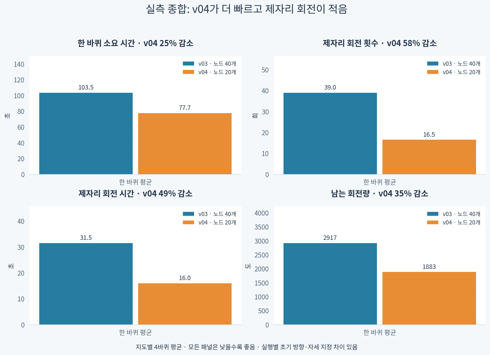
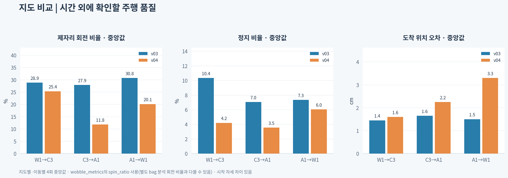
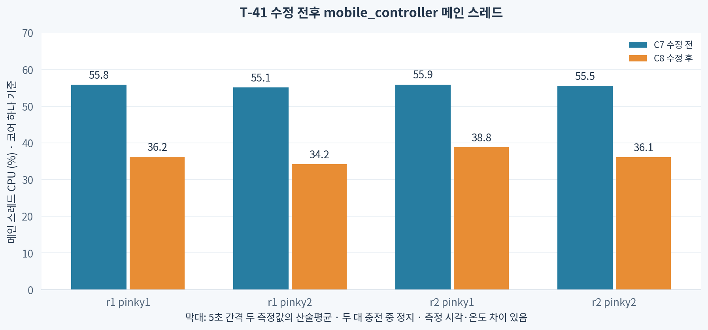
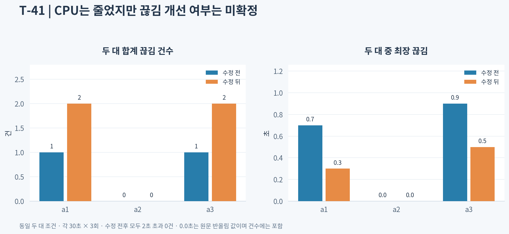
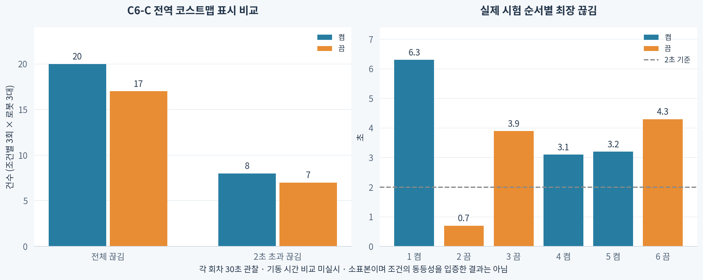
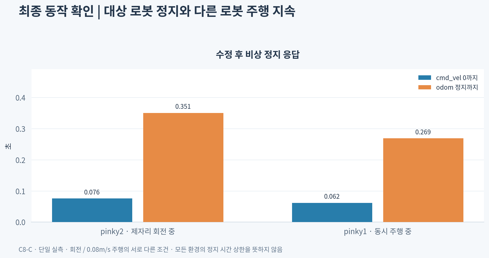

# 실험 결과 시각화 — 2026-11-19 실측・2026-11-20 종료 결정 반영

2026-11-19 실기기 결과와 앞선 비교 근거를 모았습니다. **측정 → 해석 → 설정 결정** 순서로 읽습니다. 원값 표와 실행 ID는 원본 문서에 유지했으며, 그래프를 위해 새 실험을 하지는 않았습니다.

## 1. 지도 비교: 종료, 맵 완성 뒤 재실험

**상태: 이번 실험 종료, 맵 완성 뒤 재실험(2026-11-20 사용자 결정).** 노드 수의 영향이 크다는 것을 확인해 이번 실험을 마쳤습니다. 현재 맵은 구현이 끝나지 않았고 실측 맵에도 잘못된 부분이 있어, 맵 구성을 완료한 뒤 추가 사항과 남은 회전·조향 문제를 재실험으로 검증합니다. 아래 수치는 당시 `test_map_v03`·`test_map_v04`의 결과이며 변경된 맵에 그대로 적용하지 않습니다. [종료 결정 원문](2026-11-19_MAP_COMPARE_PLAN.md#46-실험-종료-2026-11-20-사용자-결정).



v04는 한 바퀴 평균 25.8초(25%) 단축, 제자리 회전 횟수 58% 감소입니다. 다만 통로 중간 조향 뒤집힘과 이동별 도착 오차 중앙값은 증가했습니다. 한 대·지도별 네 바퀴에서의 경향이고 시작 방향과 초기 자세 지정이 달랐습니다. 이 결과 정리만으로 기본 지도를 변경하지 않았습니다.



위 품질 그래프는 실기기 표의 원값에서 계산한 이동별 중앙값입니다. `spin_ratio`는 wobble_metrics의 정의를 따르며 별도의 bag 회전 분석과 섞지 않습니다. [비교 조건·이동별 그래프·판정](2026-11-19_MAP_COMPARE_PLAN.md).

## 2. T-41: CPU는 감소, 끊김 해결은 아직 미확정



메인 스레드는 54.5~56.7%에서 34.1~39.3%로 줄었습니다. 각 기둥은 5초 간격 두 측정값의 평균이며, 코어 하나 기준입니다. pinky1·pinky2 배포 후 결과이며 pinky3은 이 시험에서 수정 전 코드였습니다.



두 대 조건은 수정 전후 모두 2초 초과 끊김이 없었습니다. 따라서 CPU 감소는 확인했지만 세 대에서의 끊김 해결까지 확인한 것은 아닙니다. [원본 C7·C8](2026-11-19_REAL_TEST.md).

## 3. 전역 코스트맵 표시: 기본 켬으로 복귀



표시를 꺼도 긴 끊김이 남았습니다. 각 조건 세 회차 비교에서 뚜렷한 차이를 확인하지 못해 사용자 결정으로 기본 켬으로 복귀했습니다. RViz의 표시 설정이며 Nav2 계산 설정과는 다릅니다. 켬/끔 기동 시간 비교는 배터리 때문에 하지 않았습니다. [결정 이력](2026-11-19_TEST_DECISIONS.md).

## 4. 수정 후 최종 동작: 비상 정지 응답 확인



제자리 회전 중 pinky2의 odom 정지까지 0.351초, 동시 주행 중 pinky1은 0.269초였습니다. 다른 로봇의 주행 지속도 확인했습니다. 서로 다른 조건의 단일 시험 결과로, 모든 환경의 정지 시간 상한은 아닙니다. [C8-C 조건과 동작 결과](2026-11-19_REAL_TEST.md).

## 전체 그래프 안내

| 분류 | 그래프 | 근거 / 해석 범위 |
| --- | --- | --- |
| 16일 모의 | [양보 전후 경로 길이](images/2026-11-19/yield_paths_1116.png) | 모의 경로 거리. 짧은 경로가 빠른 도착을 보장하지 않음 |
| 18일 실기기 | [RViz 켬/끔 관제 연결 시간](images/2026-11-19/boot_rviz_1118.png) | 실행·로봇별 t_online. B5 첫 대 값은 제외 |
| 18일 모의 | [ETA 보정과 전체 시간·점유 대기](images/2026-11-19/simulation_calibration.png) | W10 정정 표, 흔들림 0, 조건별 씨앗 30개. 실기기 결과 아님 |
| 19일 C4 | [지연 시작 뒤 끊김](images/2026-11-19/c4_delayed_start.png) | 무효 C4-1a 제외, 유효 회차별 비교 |
| 19일 C5 | [구독 조건별 끊김](images/2026-11-19/c5_subscriptions.png) | 무효 P5~P7 제외, 재측정 별도 표시 |
| 19일 C6-A | [주요 프로세스 CPU](images/2026-11-19/c6_process_cpu.png) | pinky1 두 시점, 코어 하나 기준 |
| 19일 C6-B | [수정 전 비상 정지 응답](images/2026-11-19/c6_estop_latency.png) | 시험별 단일값, 주행 조건 다름 |
| 19일 C6-C | [전역 코스트맵 표시 비교](images/2026-11-19/c6_costmap_comparison.png) | 조건별 세 회차, 끊김과 최장 비교 |
| 19일 PC 재현 | [QoS 이벤트 비용 관찰 범위](images/2026-11-19/pc_qos_ranges.png) | 가짜 입력, 최솟값–최댓값. Pi 실측과 직접 비교하지 않음 |
| 19일 C8-A | [메인 스레드 CPU 수정 전후](images/2026-11-19/c8_cpu_before_after.png) | 회차별 두 값 평균, 측정 시각·온도 차이 |
| 19일 C8-B | [두 대 연결 시 끊김 수정 전후](images/2026-11-19/c8_attach_comparison.png) | 동일 두 대 조건, 수정 전후 모두 2초 초과 0건 |
| 19일 C8-C | [수정 후 비상 정지 응답](images/2026-11-19/c8_estop_latency.png) | 회전과 동시 주행의 서로 다른 조건 |
| 19일 지도 비교 | [한 바퀴 평균](images/2026-11-19/map_compare_lap.png) | 지도별 네 바퀴 평균 |
| 19일 지도 비교 | [이동별 시간·회전·뒤집힘](images/2026-11-19/map_compare_routes.png) | 이동별 네 번의 중앙값 |
| 19일 지도 비교 | [회전·정지 비율과 도착 오차](images/2026-11-19/map_quality.png) | 채택된 24개 이동 원값에서 계산한 중앙값 |

## 문서 확인과 표기 원칙

- 변경 기록·실기기 기록·실험 기획안의 수치 중 비교의 의미가 있는 항목을 그래프로 옮겼습니다. 단순 빌드·배포 시간과 배터리 순간값을 성능 우열로 비교하지 않았습니다.
- 명령 모음·작업 지시·리뷰 체크리스트·알고리즘 설명의 목표값과 설계 파라미터는 실측 성과 그래프에 포함하지 않았습니다. `algorithm-study/`의 기존 원리 도해는 유지했습니다.
- 기둥 위 숫자, 각 패널 범례, 단위와 집계 방식(단일값·평균·중앙값·최솟값–최댓값)을 명시했습니다. 혼동을 주던 개별 측정 점은 사용하지 않았습니다.
- 원본 표와 실행 ID·로그 경로는 보존했습니다. 무효 표본이 포함됐던 C5 판정을 유효 두 회차 기준으로 정정했습니다.
- 전역 코스트맵 표시 기본 켬, T-41 배포 범위와 지도 비교 결과를 설정 결정 요약에 반영했습니다. `TROUBLESHOOTING.md`는 수정하지 않았습니다.

재생성(관제 PC, 프로젝트 루트):

```bash
PYTHONNOUSERSITE=1 python3 scripts/plot_test_results.py
PYTHONNOUSERSITE=1 python3 scripts/plot_map_comparison.py
PYTHONNOUSERSITE=1 python3 scripts/plot_docs_metrics.py
```

스크립트는 문서의 측정 표를 읽어 그림만 생성합니다. 새 측정값은 원본 표를 먼저 갱신한 뒤 재생성합니다. 시스템 matplotlib를 사용하며 로봇 환경이나 패키지 버전은 변경하지 않습니다.
