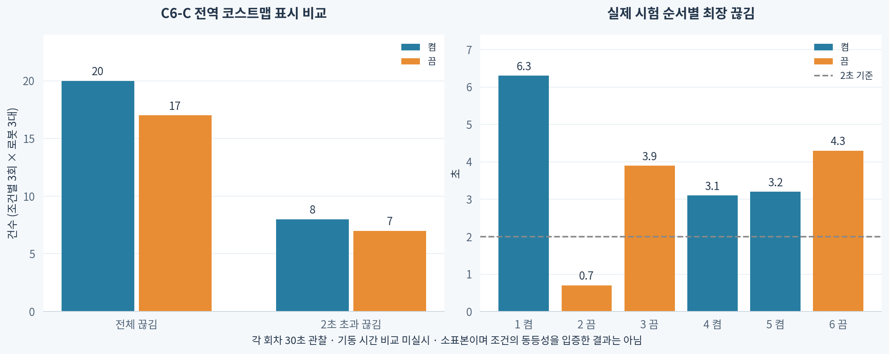
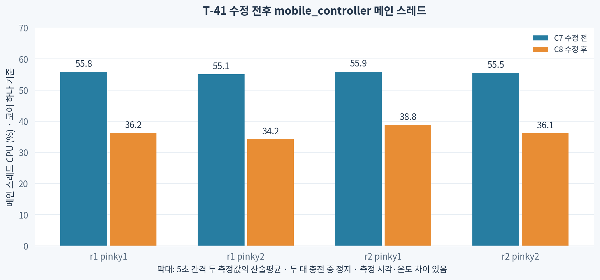
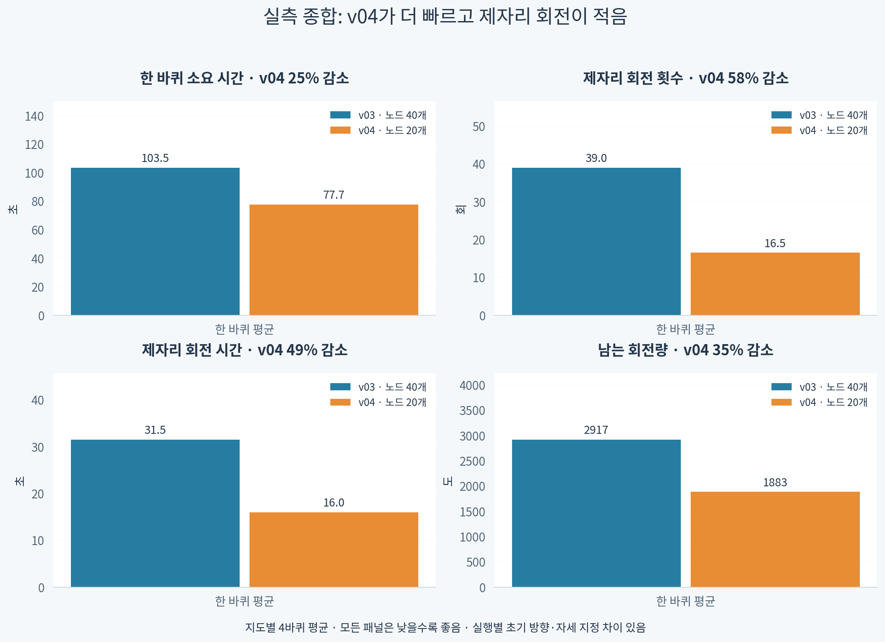

# 실측과 설정 결정 — 2026-11-19

**폴더명 변경 안내(2026-11-20):** 본문의 실험 이름·실행 ID는 당시 기록을 유지합니다. 실제 폴더 위치는 [실행 폴더 대응표](README.md#실행-폴더-대응표-2026-11-20)를 따릅니다. `runs/<run_id>`는 아래 과거 절차의 표기이며, 보관 자료를 읽거나 분석할 때는 대응표의 현재 폴더명을 사용합니다.

실측 원본: [당일 실험 기록](2026-11-19_REAL_TEST.md). 실험 절차와 당시 제안: [기획안](2026-11-19_BRINGUP_RVIZ_PLAN.md). 이 문서는 실측 → 판단 → 설정 결정의 연결을 찾기 위한 요약이며 원본 측정 표와 무효 사유는 실험 기록에 보존합니다.

## 전역 코스트맵 표시 켬/끔 — C6-C

- 실행: `run_20261119_131751`, 세 대 정지, `rviz:=false auto_home:=false`. 같은 실행에서 `fleet_rviz` + RViz를 켬→끔→끔→켬→켬→끔 순서로 붙임. 각 30초 관찰, 30초 휴식. 각 조건 3회.
- 대상은 **RViz의 전역 코스트맵 표시**이며 Nav2 전역 코스트맵 계산 자체를 끈 실험이 아님.

| 측정 항목 | 표시 켬 | 표시 끔 |
| --- | --- | --- |
| 끊김 합계 | 20건 | 17건 |
| 2초 초과 끊김 | 8건 | 7건 |
| 최장 끊김 | 6.3초 | 4.3초 |
| 회차별 최장 끊김 | 6.3 / 3.1 / 3.2초 | 0.7 / 3.9 / 4.3초 |
| 회차별 최장의 중앙값(위 값에서 계산) | 3.2초 | 3.9초 |
| 2초 초과 끊김이 있었던 회차 | 3/3 | 2/3 |

판단: 끔에서도 긴 끊김이 반복됐으며 정상 상태 CPU·송신량에 뚜렷한 차이는 관찰되지 않음. 기획안의 차이 기준인 중앙값 1초 이상 차이는 충족하지 않음(0.7초). 소표본이므로 두 조건의 동등성을 입증한 것은 아님.

측정 한계: **켬/끔 기동 시간 비교는 배터리 때문에 미실시**. RViz 창 표시 속도에 차이가 없다고 결론 낼 자료는 없음. SSH 지연 때문에 CPU 값은 붙인 뒤 10초 최저를 온전히 측정한 값이 아니며 송신 최고도 긴 구간의 평균임.

결정 이력: C6 이전에는 사용자 허용으로 표시 기본을 끔으로 변경했습니다. C6-C 비교에서 뚜렷한 차이가 확인되지 않아 **사용자 결정으로 기본 켬으로 복귀**했습니다(기획안 4.10 및 현재 `rviz/fleet.rviz`의 결정 주석 확인). 이는 RViz 표시 설정이며 Nav2 코스트맵 계산 설정과 다릅니다.

## RViz 지연 시작 — C1·C4

- C1: RViz 시작 전 60초 끊김 0건 → 뒤 60초 5건(각 0.2~0.7초). 이동·비상 정지는 통과했지만 끊김 건수 기준 미달.
- C4 유효 실행: 온라인 55.2~73.3초. RViz 시작 직후 최대 7.8초 끊김, 자동 홈 주행 중에도 끊김 확인. C4-1a는 남아 있던 bag 기록 때문에 무효이며 정상 표본으로 합산하지 않음.
- 결정: 지연 시작만으로 기준을 충족하지 못해 `rviz_wait` 기본을 true에서 **false로 복귀**. 기능은 `rviz_wait:=true`로 선택 가능(기획안 4.7).

## CPU 부하와 원인 판단 — C5·C6-A

- C5: 붙인 직후 pinky3 CPU 유휴 1.4%, 무선 드라이버 27.8%, 송신 약 1.3 MB/s. 특정 구독 하나로 원인을 좁히지 못함.
- C6-A: 전역 코스트맵 표시를 꺼도 붙이는 순간 최장 끊김 5.5초/2.7초. 정상 상태에서는 끊김 0건, CPU 유휴 34~44%.
- 결정: 특정 표시를 끄면 해결된다고 단정하지 않음. 로봇 자원 포화는 추정이며 확인된 원인과 구분함.

## 주행·비상 정지 — C6-B

- pinky2 비상 정지: cmd_vel 0까지 0.09초, odom 정지 0.34초. pinky3: 0.10초 / 0.38초. 동시 이동 중 pinky2만 정지: 0.19초 / 0.41초, 나머지 두 대는 주행 지속.
- 세 대 동시 왕복 통과. 교차 동선 최소 간격 0.186m(기준 0.155m), 복귀 중 NAV2_FAILED 1회 재시도 후 도착.
- 기동 시 pinky1 SSH 끊김 1회로 기동 기준 미달이나 사용자 결정으로 이동 시험 진행. 주행 성공을 전체 기동 기준 통과로 바꾸지 않음.

## T-41 CPU 수정과 실기기 재확인 — C7·C8

- 근거: PC에서 기본 QoS 이벤트 처리 비용을 분리해 재현한 뒤 사용자 결정에 따라 수정. pinky1·pinky2에 배포했고 pinky3에는 미배포.
- 메인 스레드 CPU는 54.5~56.7% → 34.1~39.3%로 감소(코어 하나 기준). 그래프 기둥은 5초 간격 두 값의 평균입니다.
- 두 대의 RViz 연결 시험은 수정 전후 모두 2초 초과 끊김 0건. CPU 감소를 세 대에서의 끊김 해결 근거로 사용하지 않습니다.
- 수정 뒤 두 대 주행·비상 정지 시험 통과. 동시 주행 중 정지 대상만 멈추고 다른 로봇은 주행 지속.

## 지도 노드 수 비교 — E1(재시도)~E4 — 종료, 맵 완성 뒤 재실험

- 2026-11-20 사용자 결정: 노드 수의 영향이 크다는 것을 확인했으므로 **이번 실험은 종료**합니다. 현재 맵은 미완성이며 실측 맵에도 잘못된 부분이 있어, **맵 구성 완료 뒤 추가 사항을 재실험으로 검증**합니다([기획안 4.6](2026-11-19_MAP_COMPARE_PLAN.md#46-실험-종료-2026-11-20-사용자-결정)). v04에 남은 회전·조향 뒤집힘·통로별 효과 차이도 재실험에서 확인하며, 기존 수치를 변경된 맵에 그대로 적용하지 않습니다.
- v03 40개 / v04 20개 노드, 동일 통로 총 길이 4.99m. 지도별 네 바퀴의 유효 결과를 비교했습니다.
- 한 바퀴 평균 소요 103.5초 → 77.7초(25% 단축), 제자리 회전 39.0회 → 16.5회(58% 감소).
- v04의 통로 중간 조향 뒤집힘과 이동별 도착 오차 중앙값은 증가했습니다. 빠르고 덜 돈다는 결과를 정확도·모든 조향 품질의 개선으로 넓히지 않습니다.
- 기본 지도를 변경하는 결정은 이 정리에서 하지 않았습니다. 시작 방향·사용자 자세 지정 차이가 있으며, 중단한 시험은 제외했습니다.

상세: [지도 비교 결과와 그래프](2026-11-19_MAP_COMPARE_PLAN.md). 전체 그래프 안내: [실험 결과 시각화](2026-11-19_RESULTS_OVERVIEW.md).
