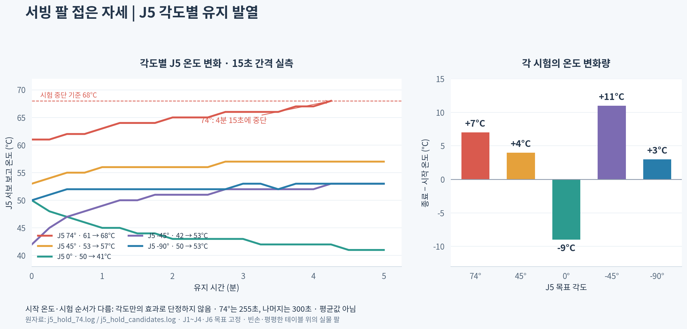

# 서빙 팔 주행용 접은 자세(rest) 측정 기록 (2026-11-20)

시나리오에서 AMR 이동 중 서빙 팔(jetcobot1)이 접고 있을 자세(rest)를 정하려고, 접은 자세·이동 속도·유지 발열을 실물에서 측정한 기록입니다. 측정은 기획 패널이 SSH로 팔 Pi에 들어가 pymycobot으로 직접 명령했고(ROS 구동부를 거치지 않음), 사용자가 현장에서 지켜봤습니다.

- 대상: jetcobot1(서빙 팔, 팔 Pi 192.168.0.37, 실물은 평평한 테이블 위·시나리오상 pinky1 탑재), 비교용 jetcobot2(조리 구역 웍 팔, 192.168.0.21)
- 환경: pymycobot 3.9.2(`~/venv/jetcobot`), 직렬 포트 `/dev/ttyJETCOBOT` 1000000, 펌웨어 `get_system_version` 6.5, 관제 PC 192.168.0.20
- 시각: 16:25~18:20 (KST)
- 원자료: `runs/20261120_10_serving_arm_rest_pose/` (4~6절의 로그·스크립트). 1~3절은 대화 중 읽은 값을 옮겨 적은 것이며 파일로 남지 않았습니다
- 각도는 도(deg), J1~J6 순서. 그리퍼 값은 0(닫힘)~100(열림). 온도는 `get_servo_temps`의 정수값(도)

## 전제와 판단 기준 (2026-11-21 정정)

처음에는 "AMR 이동 중 팔을 작게 접어 충돌과 이동 저항을 줄인다"를 목적으로 적었으나, 사용자 결정(2026-11-21)으로 전제를 아래와 같이 바꿉니다.

- 시나리오에서는 팔이 AMR 위에 있지만, Pinky(11×12 cm)와 팔의 크기 차이 때문에 실물 팔은 평평한 테이블 위에서 동작합니다.
- 그래서 이 자세는 **시나리오의 "주행 중 팔을 접는다"를 나타내는 자세**이고, 값은 **평지에 놓인 실물 팔**에서 잰 아래 기준으로 정했습니다.
- AMR 위에 올렸을 때의 주행 안정성(넘어짐, 흔들림, 차체 밖으로 나오는 정도)은 **검증 대상이 아닙니다**. Pinky나 팔의 크기를 바꿔 가정한 계산은 실물로 확인할 수 없어 근거로 쓰지 않습니다.

| 기준 | 내용 | 근거 |
| --- | --- | --- |
| 유지 발열 | 접은 채 오래 서 있어도 서보 온도가 오르지 않는가 | 6절, 7절 (J5 0도, 10분 유지) |
| 재현성 | 매번 같은 자세로 돌아오는가 | 3절, 7.1절 (목표 초과 0.0도) |
| 왕복 시간 | 접고 펴는 데 걸리는 시간 | 4절, 7.1절 (속도 60에서 약 2초) |
| 자기 간섭 | 접을 때 몸체끼리 닿지 않는가 | 3절 (사용자 육안) |
| 접힌 모양 | 시나리오의 접는 동작으로 보이는가 | 2절 (사용자가 손으로 접은 모양) |

참고(근거로 쓰지 않음): URDF 메시 부피로 추정하면(밀도 균일 가정, 그리퍼·받침판 제외, 관절 부호를 실물과 대조하지 않음) 0도 자세에서 접은 자세로 갈 때 전체 높이가 약 437 → 185 mm, 무게 중심 높이가 약 217 → 112 mm로 줄고, 무게 중심이 한쪽으로 약 48 mm 치우칩니다. 팔을 테이블에 고정하지 않고 그냥 놓아 쓴다면 이 치우침은 확인이 필요합니다(9절).

## 결론

| 항목 | 값 | 근거 |
| --- | --- | --- |
| 주행용 접은 자세(rest) | `[0, 122, -148, 143, 0, 60]` | 3절(모양·재현), 5~7절(J5 발열) |
| 주행 중 그리퍼 | 0 (닫힘) | 사용자 결정 |
| 이동 속도 | 60 | 4절(읽은 값으로는 70까지 차이 없음), 7.1절(70은 육안으로 흔들림이 보여 사용자가 60으로 결정) |

- 처음 정한 자세 `[0, 122, -148, 143, 74, 60]`(J5 74도)는 유지하면 J5 서보가 4분 15초에 61 → 68도로 계속 올라 쓸 수 없습니다(6절).
- J5를 0도로 바꾼 자세는 10분 유지 동안 J5 49도에서 변화가 없었습니다(7절). 모양은 사용자가 현장에서 보고 괜찮다고 판단했습니다.
- 아직 확인하지 못한 것은 9절에 있습니다.
- **확정(2026-11-23, 사용자 결정):** 대기 자세는 위 값(J5 0도인 `[0, 122, -148, 143, 0, 60]`)으로 확정합니다. 실물 팔은 Pinky 위가 아니라 테이블에 설치하므로, 이 자세와 이 문서의 측정은 "AMR 탑재 주행까지 고려했다"는 것을 보여 주는 용도입니다. 자세를 더 다듬거나 9절의 남은 항목을 추가로 검증하지는 않는 것으로 이해했습니다(뒤 문장은 기획 패널의 해석). 설정 파일(`serving_arm.yaml`)은 이미 이 값이라 코드 변경은 없습니다.

## 1. 두 팔 비교 (jetcobot1, jetcobot2)

같은 관절값을 두 팔에 보냈을 때 같은 동작을 하는지 본 것입니다. 속도 15, 자세마다 도달 뒤 1.5초 기다려 읽음.

| 보낸 자세 | jetcobot1 읽은 값 | jetcobot2 읽은 값 | 도달 시간 (1 / 2) |
| --- | --- | --- | --- |
| `[0,0,0,0,0,0]` | -0.7, 0.26, -0.7, -1.66, 0.79, 0.87 | -0.26, -0.43, -0.43, -1.23, -0.7, -0.79 | 0.2초 / 이미 그 자세 |
| `[30,0,0,0,0,0]` | 29.26, 0.26, -0.7, -1.66, 0.79, 0.87 | 29.26, -0.43, -0.43, -1.23, -0.7, -0.79 | 0.2초 / 0.6초 |
| `[0,-20,-30,0,30,0]` | 0.61, -20.83, -30.58, -1.66, 28.82, 0.79 | 0.7, -20.56, -30.58, -1.31, 28.74, -0.79 | 0.2초 / 0.6초 |
| `[0,0,0,0,0,0]` | 0.96, -0.7, -0.7, -1.66, 0.79, 0.79 | 0.7, -0.52, -0.61, -1.23, 0.52, -0.79 | 0.2초 / 0.6초 |

| 그리퍼 명령 | jetcobot1 | jetcobot2 |
| --- | --- | --- |
| 100 | 100 | 99 |
| 50 | 49 | 50 |
| 0 | 0 | 0 |

| 항목 | jetcobot1 | jetcobot2 |
| --- | --- | --- |
| pymycobot / 펌웨어 | 3.9.2 / 6.5 | 3.9.2 / 6.5 |
| 관절 한계(J1~J6) | ±168, ±135, ±150, ±145, ±165, ±180 | 같음 |
| `get_fresh_mode` | 1 | 0 |
| J1 30도에서 인코더 | 1715 | 1715 |

- 같은 목표에서 두 팔의 읽은 값 차이는 관절별 최대 1.7도(J6)였습니다.
- 도달 시간은 확인 주기 0.2초로 잰 값이라 정밀하지 않습니다. 빠르기 차이가 `fresh_mode` 때문인지는 확인하지 못했습니다.
- 읽은 값은 각 팔이 자기 영점 기준으로 보고한 값입니다. 실제 자세(영점 표시, 팔 끝 위치, 그리퍼 폭)가 같은지는 측정하지 않았습니다.
- jetcobot1은 Pi를 껐다 켠 뒤 0도 근처에서 `[-3.95, 12.91, -19.95, -32.69, 14.85, 35.85]`로 읽혔습니다(끄는 사이 처진 것으로 보임).
- jetcobot2는 이 비교 뒤 사용자가 종료했고, 이후 측정은 모두 jetcobot1입니다. jetcobot2 Pi에는 `~/frybot_robot_ws`가 없었습니다.

## 2. 접은 자세 정하기 (손으로 접어 읽음)

서보를 풀고(`release_all_servos`) 사용자가 손으로 접은 뒤 관절값을 읽었습니다.

| | J1 | J2 | J3 | J4 | J5 | J6 |
| --- | --- | --- | --- | --- | --- | --- |
| 손으로 접은 값 | -1.66 | 121.99 | -155.21 | 151.08 | 73.74 | 60.38 |
| pymycobot 명령 한계 | ±168 | ±135 | ±150 | ±145 | ±165 | ±180 |
| 1차 자세(한계에서 2도 여유) | 0 | 122 | -148 | 143 | 74 | 60 |

- J3(-155.21)과 J4(151.08)는 명령 한계를 넘어 `send_angles`가 거부했습니다(`MyCobot280DataException`). 그래서 손으로 접은 모양보다 J3 약 7도, J4 약 6도 덜 접힌 자세입니다.

## 3. 접기·펴기 재현 (1차 자세, J5 74도)

| 시험 | 방식 | 접은 뒤 읽은 값 |
| --- | --- | --- |
| 처음 잠갔을 때 | 손으로 접은 자리에서 한계 안으로 이동 | -1.66, 122.43, -148.44, 144.84, 75.76, 59.76 |
| 단계별 왕복 | 24단계로 나눠 속도 10 | -0.61, 121.64, -147.21, 143.96, 74.88, 59.76 |
| 한 번에 왕복, 속도 10 | `send_angles` 한 번 | -0.61, 121.64, -147.21, 143.96, 75.14, 59.32 |
| 한 번에 왕복, 속도 20 | 같음 | -0.61, 121.64, -147.3, 143.96, 75.23, 59.32 |
| 한 번에 왕복, 속도 40 | 같음 | -0.52, 121.64, -147.3, 144.05, 75.32, 59.32 |
| 한 번에 왕복, 속도 60 | 같음 | -0.52, 121.64, -147.39, 144.05, 75.58, 59.32 |

- 단계별 왕복은 `send_angles` 한 번이 약 1.6초씩 돌아오지 않아 끊기듯 움직였습니다. 실제 운용 방식(자세 하나를 명령 한 번)에서는 끊기지 않았습니다.
- 한 번에 보내면 여섯 관절이 같은 비율로 함께 움직였습니다(속도 10의 중간 읽기값 기준).
- 사용자가 지켜본 범위에서 몸체 간섭은 없었습니다. 그리퍼를 닫은(0) 채로도 같은 결과였습니다.

## 4. 속도별 측정 (1차 자세, 속도마다 접기·펴기 3회)

원자료: `speed_sweep.log`, `speed_sweep_raw.csv`(읽기 주기 약 20~55 Hz), 스크립트 `speed_sweep.py`. 시작 전 0도 자세로 60초 식힘. 중단 조건(오류, 6도 초과, 68도 이상)에 걸린 것은 없었습니다.

| 속도 | 접기 시간 | 펴기 시간 | 목표 초과(최대) | 정착 시간(접기 / 펴기) | 측정 전 온도 → 후 온도 (J4, J5) |
| --- | --- | --- | --- | --- | --- |
| 20 | 5.12초 | 5.07초 | 0.00도 | 0.17 / 0.23초 | 42 → 43, 57 → 58 |
| 30 | 3.49초 | 3.76초 | 0.00도 | 0.21 / 0.07초 | 43 → 44, 58 → 58 |
| 40 | 2.72초 | 2.74초 | 0.00도 | 0.16 / 0.30초 | 44 → 45, 58 → 58 |
| 50 | 2.38초 | 2.32초 | 0.00도 | 0.12 / 0.22초 | 45 → 46, 58 → 58 |
| 60 | 2.06초 | 2.14초 | 0.09도 | 0.11 / 0.06초 | 46 → 46, 58 → 57 |
| 70 | 1.68초 | 1.70초 | 0.09도 | 0.14 / 0.19초 | 46 → 47, 57 → 57 |
| 80 | 1.60초 이하 | 1.60초 이하 | 볼 수 없음 | 볼 수 없음 | 47 → 47, 57 → 57 |
| 90 | 1.62초 이하 | 1.59초 이하 | 볼 수 없음 | 볼 수 없음 | 47 → 47, 57 → 57 |
| 100 | 1.60초 이하 | 1.58초 이하 | 볼 수 없음 | 볼 수 없음 | 48 → 48, 57 → 57 |

- 시간: 명령을 보낸 때부터 모든 관절이 목표 3도 안에 들어올 때까지(3회 평균). 속도 10은 3절의 단발 측정에서 약 10초였습니다.
- 목표 초과: 멈춘 위치를 진행 방향으로 지나친 최대 각도. 0.09도는 읽기 눈금 한 칸입니다.
- 정착 시간: 목표 3도 안에 들어온 뒤 최종값 0.3도 안에 머물기 시작할 때까지.
- **측정 한계:** 이 팔은 이동 명령을 보낸 뒤 약 1.57~1.60초 동안 관절값을 읽을 수 없습니다(응답을 기다리지 않는 `_mesg` 호출로 보내도 같음). 속도 80 이상은 그 안에 동작이 끝나 실제 시간과 움직이는 도중의 흔들림을 재지 못했습니다. 도착 뒤 자세와 오류 코드 0만 확인했습니다. 20~70에서도 처음 1.6초 구간은 보지 못했습니다.
- 온도: 약 5분, 54회 연속 동작 동안 J1~J3은 33~36도로 변화가 없었고, J4는 42 → 48도로 서서히 올랐다가 멈춘 뒤 44도로 내려갔습니다. J5는 57~58도로 속도와 무관했습니다.
- 모든 속도에서 최종 자세가 같았습니다(목표 대비 최대 1.67도).
- Pinky 몸체의 흔들림은 측정하지 않았습니다(사용자 결정: 고려하지 않음).

속도 50은 따로 한 번 더 쟀습니다: 펴기 약 2.4초, 접기 약 2.2초. 도달 뒤 4초 동안의 변동폭은 펴기 J1 0.35도·J4 0.53도, 접기 J3 2.02도·J4 2.73도(접근 구간 포함)였고 마지막 1초는 0이었습니다.

## 5. J5 각도 훑기 (접은 자세에서 J5만 바꿈)

속도 10으로 15도씩 옮기며 멈춘 뒤 읽었습니다(파일 없음, 대화 중 읽은 값).

| J5 목표 | 읽은 값 | J5 오차 | J4 오차 |
| --- | --- | --- | --- |
| 60 | 62.13 | +2.13 | +1.05 |
| 45 | 46.84 | +1.84 | +1.05 |
| 30 | 31.55 | +1.55 | +1.05 |
| 15 | 16.43 | +1.43 | +1.05 |
| 0 | 0.79 | +0.79 | +1.93 |
| -15 | -15.64 | -0.64 | +1.93 |
| -30 | -30.93 | -0.93 | +1.84 |
| -45 | -45.96 | -0.96 | +1.84 |
| -60 | -60.99 | -0.99 | +1.84 |
| -75 | -75.93 | -0.93 | +1.84 |
| -90 | -90.87 | -0.87 | +1.84 |
| 90 | 82.35 | -7.65 (막힘) | -0.97 |

- J5는 약 82도에서 물리적으로 막혔습니다. 1차 자세(74도, 실제 75~76도)는 그 지점에서 8도 안쪽입니다.
- 아래쪽은 -90도까지 막힘이 없었습니다. 105도 이상은 보내지 않았습니다.
- J5 오차의 부호가 0도와 -15도 사이에서 바뀝니다.
- 위 표에서 -90도 뒤 74도·90도로 돌아갈 때 처음 나온 "막힘" 판정 두 건은 이동이 끝나기 전에 읽은 스크립트 오류였고, 멈출 때까지 기다리게 고쳐 다시 잰 값이 표의 90도 행입니다.

## 6. J5 각도별 유지 발열

원자료: `j5_hold_74.log`, `j5_hold_candidates.log`, 스크립트 `j5_hold_candidates.py`. 접은 자세 `[0, 122, -148, 143, J5, 60]`을 유지하며 15초마다 온도를 읽었습니다. 68도에서 자동 중단.

| J5 | 유지 시간 | J5 온도 | 변화 | J5 버팀 오차 | 같은 시간 J4 / J6 |
| --- | --- | --- | --- | --- | --- |
| 74 (1차 자세) | 255초, 68도에서 중단 | 61 → 68 | +7 | +2.37 | 45 → 42 / 38 → 36 |
| 45 | 300초 | 53 → 57 | +4 | +1.05 | 40 → 40 / 46 → 40 |
| 0 | 300초 | 50 → 41 | -9 | 0.00 | 40 → 41 / 47 → 40 |
| -45 | 300초 | 42 → 53 | +11 | -1.05 | 41 → 40 / 40 → 40 |
| -90 | 300초 | 50 → 53 | +3 | -0.96 | 40 → 39 / 43 → 39 |

- 시작 온도가 서로 다릅니다. 후보 사이에 0도 자세(팔을 편 상태)로 최대 10분 식혔지만 J5는 51~53도까지만 내려갔습니다(45도와 0도 후보는 10분을 다 채움). 그래서 변화량끼리의 엄밀한 비교는 아닙니다.
- 온도가 내려간 각도는 0도 하나입니다. 이때만 버팀 오차가 0.00이었습니다.
- 74도의 상승률은 약 1.6도/분이고 멈추는 기미가 없었습니다. 4절 측정 뒤 접은 채 90초 둔 구간에서도 57 → 60도로 올랐습니다.
- 0도 후보의 시작 행에 J1 40도가 한 번 찍혔습니다(앞뒤는 34도). 읽기 오류로 보이며 확인하지 않았습니다.
- 0도와 -15도 사이는 따로 재지 않았습니다.

### 각도별 온도 그래프



왼쪽은 원자료의 15초 간격 온도, 오른쪽은 각 시험의 종료 온도에서 시작 온도를 뺀 값입니다. **74°는 255초에 68°C로 중단했고 나머지는 300초 측정**했습니다. 시작 온도와 시험 순서가 달라 변화량만으로 각도의 발열 효과를 단정하지 않습니다. 7절의 별도 10분 유지 시험은 이 비교에 합산하지 않았습니다.

재생성: `PYTHONNOUSERSITE=1 python3 scripts/plot_serving_arm_temperature.py`(프로젝트 루트).

### 6.1 서보 온도 제한 설정값 (2026-11-23 추가)

jetcobot1의 서보 내부 설정에서 온도 상한을 읽었습니다. 팔은 0도 자세로 세워 둔 채 움직이지 않고 값만 읽었습니다. 원자료: `runs/20261120_10_serving_arm_rest_pose/servo_limits_20261123.log`

| 서보 | 온도 상한 설정 | 읽을 때 온도 |
| --- | --- | --- |
| J1 | 70도 | 33도 |
| J2 | 70도 | 32도 |
| J3 | 70도 | 34도 |
| J4 | 70도 | 37도 |
| J5 | 70도 | 33도 |
| J6 | 70도 | 47도 |
| 그리퍼 | 80도 | 32도 |

- 읽은 방법: pymycobot `get_servo_data(서보 번호, 13)`. 서보 번호는 관절 1~6, 그리퍼 7입니다.
- 주소의 뜻은 이 계열(Feetech ST/STS 버스 서보)의 메모리 표를 따랐습니다. 표에서 13번은 "최대 온도 제한, 기본값 70, 범위 0~100, 단위 1도"이고, STS3215 사양서에는 70도를 넘으면 토크 출력을 끈다고 적혀 있습니다(Waveshare "ST Servo - Memory Table Explanation" 등).
- 측정 온도와의 여유: J5 74도 자세는 68도에서 중단했으므로 상한까지 2도 남은 상태였습니다(위 표). 분당 약 1.6도로 오르던 추세라 그대로 두면 1~2분 안에 상한에 닿았을 것으로 추정합니다. J5 0도 자세의 49도(7절)는 여유가 21도입니다.
- 확인하지 못한 것
  - Elephant Robotics 문서에서는 이 주소 표를 찾지 못했습니다. JetCobot 280의 서보가 위 메모리 표를 그대로 따른다는 근거는, 읽은 값 70이 표의 기본값과 같고 같은 표의 63번 주소(현재 온도)가 `get_servo_temps` 값과 일치한 것뿐입니다.
  - 상한을 넘으면 실제로 그 서보가 힘을 푸는지는 걸리게 해서 확인하지 않았습니다. 힘이 풀리면 그 관절에서 팔이 처질 수 있습니다.
  - 0도 자세에서 J6만 47도로 높은 원인(11-20 측정의 식히는 구간에서도 46~47도)

## 7. 새 자세 10분 유지

원자료: `hold10_j5_0.log`. 자세 `[0, 122, -148, 143, 0, 60]`, 그리퍼 0, 30초마다 읽음.

| 관절 | 시작 | 10분 뒤 | 변화 |
| --- | --- | --- | --- |
| J1 | 34 | 34 | 0 |
| J2 | 34 | 34 | 0 |
| J3 | 36 | 37 | +1 |
| J4 | 40 | 41 | +1 |
| J5 | 49 | 49 | 0 |
| J6 | 43 | 40 | -3 |

- 읽은 자세는 `[-0.61, 121.64, -147.04~-147.12, 144.14, -0.87, 59.23]`로 10분 동안 0.08도 안에서 그대로였고, 오류 코드는 0이었습니다.
- 6절의 5분 시험에서는 같은 자세에서 50 → 41도로 식었는데 이번에는 49도에 머물렀습니다. 그때는 J5가 0.00도, 이번에는 -0.87도로 섰습니다. 차이의 원인은 확인하지 못했습니다.
- 접기는 속도 20으로 0도 자세에서 한 번에 보냈고 6.7초(안정 대기 포함) 걸렸습니다.

### 7.1 새 자세에서 속도 70·60 왕복

새 자세 `[0, 122, -148, 143, 0, 60]`(그리퍼 0)을 0도 자세와 한 번씩 왕복했습니다(파일 없음, 대화 중 읽은 값). pymycobot 직접 명령이며 구동부를 거치지 않았습니다.

| 속도 | 펴기 시간 | 접기 시간 | 목표 초과 | 접은 뒤 읽은 값 | 사용자 육안 |
| --- | --- | --- | --- | --- | --- |
| 70 | 1.70초 | 1.71초 | 0.0도 | -0.52, 121.81, -147.21, 144.14, -0.52, 59.32 | 흔들림이 조금 보임 |
| 60 | 1.94초 | 2.40초 | 0.0도 | -0.52, 121.81, -147.21, 144.14, -0.79, 59.32 | 좋음("60이 좋다") |

- 읽은 관절값으로는 두 속도 모두 초과가 없었습니다. 70에서 보인 흔들림은 관절값 읽기(명령 뒤 약 1.6초는 읽지 못함)로는 잡히지 않았습니다.
- 사용자 결정(2026-11-20): "70으로 해도 큰 차이는 없었지만 육안으로 흔들림이 좀 보여" 기본 속도를 60으로 정함.
- 각 1회 측정입니다. 60의 접기 2.40초는 4절의 1차 자세 값(2.06초)보다 깁니다. 원인은 확인하지 않았습니다.

## 8. 최적 자세 판단

**`[0, 122, -148, 143, 0, 60]`, 그리퍼 0, 속도 60**을 시나리오의 주행 중 접은 자세(rest)로 판단합니다. 판단 기준은 평지에 놓인 실물 팔의 유지 발열·재현성·왕복 시간·자기 간섭이며("전제와 판단 기준" 절), AMR 위에서의 주행 안정성을 근거로 한 판단이 아닙니다.

- J2·J3·J4는 사용자가 손으로 접은 모양을 명령 한계 안에서 가장 가깝게 옮긴 값입니다(한계에서 2도 여유).
- J5는 측정한 다섯 각도 중 0도만 유지 중 온도가 오르지 않았습니다. 74도는 막히는 지점(약 82도) 가까이에서 서보가 계속 힘을 쓰는 자세였습니다.
- J6(60도)과 J1(0도)은 손으로 접은 값을 반올림한 것이며 따로 비교하지 않았습니다.
- 속도는 60입니다. 읽은 값으로는 70까지 초과(0.09도 이하)와 정착(0.3초 이하)에 차이가 없었지만, 새 자세를 70으로 왕복했을 때 사용자가 육안으로 흔들림을 확인해 60으로 낮췄습니다(7.1절). 80 이상은 측정으로 볼 수 없었습니다.

이 판단의 범위: 빈손, 그리퍼 닫힘, 팔이 놓인 곳이 움직이지 않는 조건(AMR 주행 없음), 10분 유지까지입니다.

## 9. 확인하지 못한 것

- 10분보다 긴 유지에서의 온도, J5 0도와 -15도 사이의 더 나은 각도
- 새 자세(J5 0도)에서의 속도별 반복 측정(4절은 1차 자세 기준). 새 자세로는 속도 20 접기 한 번, 속도 70·60 왕복 각 한 번만 했습니다(7.1절)
- 속도 80 이상과 모든 속도의 처음 1.6초 구간에서 움직이는 도중의 흔들림
- 구동부(`serving_arm_driver`)의 ROS 액션을 거친 동작(HOME, LOAD·UNLOAD 뒤 rest 로 끝나는지, 그리퍼가 닫히기 전에 관절이 움직여도 되는지) 사용자 결정(2026-11-20): 이 실물 액션 검증은 하지 않고 마무리함
- AMR 주행 중 흔들림, 라이다 스캔 높이 간섭, Pinky 윤곽 밖으로 나오는 정도. 사용자 결정(2026-11-21): 실물 팔은 평지 위에서 동작하므로 검증 대상에서 뺌
- 팔을 테이블에 고정(흡착판·클램프)하는지. 고정하지 않으면 접은 자세에서 무게 중심이 받침 가장자리 쪽으로 치우치는 것(추정)을 실물에서 확인해야 함
- 음식을 든 상태의 자세와 속도
- jetcobot2 등 다른 팔에서 같은 값이 같은 모양·같은 발열인지

## 10. 설정 변경 기록

| 항목 | 기존값 | 변경값 | 근거 | 결정 | 적용·검증 상태 |
| --- | --- | --- | --- | --- | --- |
| `serving_arm.yaml` `rest` | `[0, 0, 0, 0, 0, 0]` | `[0, 122, -148, 143, 74, 60]` | 2·3절 | 사용자("문제 없었어") | 부장이 코드 반영·팔 Pi 배포(단위 시험 19건 통과). 6절 결과로 폐기 |
| `rest` (재변경) | `[0, 122, -148, 143, 74, 60]` | `[0, 122, -148, 143, 0, 60]` | 5~7절 | 사용자(모양 "괜찮아", 수정 지시 승인) | 부장이 코드 반영·팔 Pi 배포(2026-11-20, 단위 시험 통과, md5 일치). 실물 액션 검증 전 |
| `rest_gripper` | 없음 | `0` | 사용자 요구(주행 중 닫음) | 사용자 | 코드 반영·팔 Pi 배포됨. 실물 액션 검증 전 |
| 구동부 `speed` 기본값 | 20 | 10 | 3절(첫 시험 속도) | 사용자("속도 10으로 보내") | 코드 반영됨. 아래 행으로 대체 |
| `speed` (재변경) | 10 | 70 | 4절 | 기획 권고, 사용자가 수정 지시 승인(사용자: "10·20은 너무 오래 걸린다, 흔들림·온도 문제 없으면 빠를수록 좋다") | 부장이 구동부·런치·예시 등록부에 반영, 팔 Pi 배포(2026-11-20, 단위 시험 통과). 실물 액션 검증 전 |
| `speed` (3차 변경) | 70 | 60 | 7.1절 | 사용자(70에서 육안 흔들림) | 부장이 구동부·런치·예시 등록부에 반영, 팔 Pi 배포(2026-11-20, 단위 시험 통과, md5 일치). 실물 액션 검증 전 |
| 구동부 `move_timeout` 기본값 | 20초 | 30초 | 속도 10에서 148도 이동 약 10초 | 기획 | 코드 반영됨 |
| 모든 작업을 `rest`로 마침 | 없음 | 구동부가 마지막에 `rest`를 덧붙임 | 주행 전 접힘 보장 | 기획 권고, 사용자 승인 | 코드 반영됨(가짜 팔 시험). 실물 액션 검증 전 |

`serving_arm.yaml`의 값 변화:

```yaml
# 측정 전
rest: [0, 0, 0, 0, 0, 0]

# 1차 반영(부장, 2026-11-20). J5 발열로 폐기
rest: [0, 122, -148, 143, 74, 60]
rest_gripper: 0

# 수정 지시한 값
rest: [0, 122, -148, 143, 0, 60]
rest_gripper: 0
```
