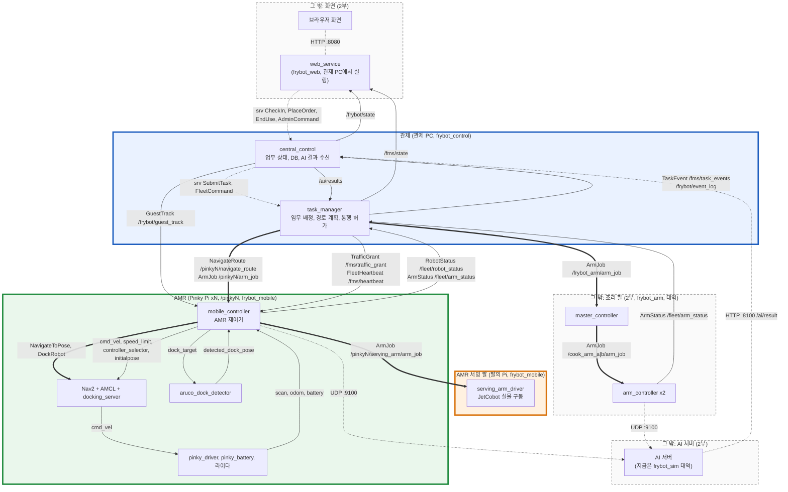
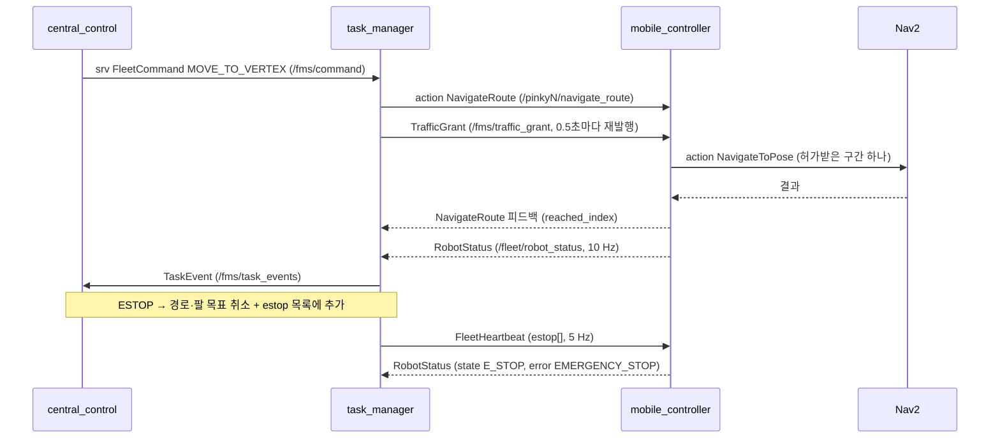
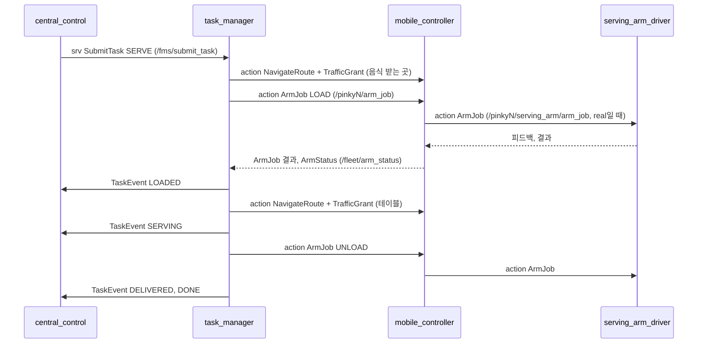
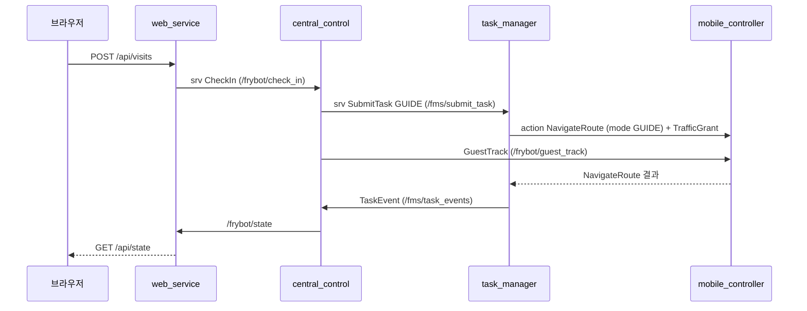
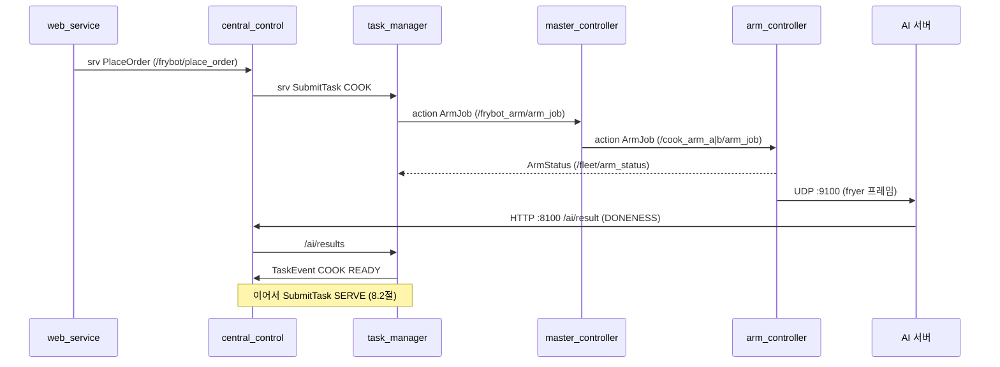
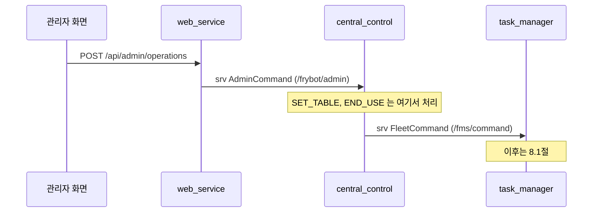

# FryBot 인터페이스 연결 구조 (구버전)

> 2026-11-27: 이 문서와 같은 이름의 PDF는 구버전입니다(파일 이름을 `INTERFACES.md`·`INTERFACES.pdf`에서 `2026-11-23_INTERFACES_OLD.*`로 바꿈). 2026-11-23 코드 기준이며 이후 변경(서빙 팔 자세 연동, 후진 도킹, test_map_v06 등)은 반영되지 않았습니다. 인터페이스의 최종 기준은 Confluence I/F v0.3 최종 판(I/F 목록과 개별 정의서)이고, 코드 기준 개요는 `src/frybot/README.md`의 "인터페이스" 절입니다.

작성: 2026-11-23 (같은 날 개정 2회: 시뮬 전용 분리와 기능 설명 추가, 관제·AMR·AMR 서빙 팔을 1부로 재구성). 대상은 `src/frybot`의 패키지 7개(`frybot_interfaces`, `frybot_control`, `frybot_web`, `frybot_mobile`, `frybot_arm`, `frybot_sim`, `frybot_bringup`)입니다.

- 근거: 코드의 `create_publisher`, `create_subscription`, `create_service`, `create_client`, `ActionServer`, `ActionClient` 호출을 전부 찾아 정리했습니다. 파일 경로는 `src/frybot/` 기준이고 줄 번호는 작성 시점 값입니다.
- 2026-11-25: 웹 HTTP 경로 3개도 v0.2 에 맞췄습니다(`POST /api/checkin` → `/api/visits`, `/api/order` → `/api/orders`, `/api/admin` → `/api/admin/operations`, 손님 시뮬레이터 UI 의 `/api/order` 도 `/api/orders`). 요청·응답 JSON, 인증(X-Admin-Token), `/api/end_use`·GET 경로·화면 주소는 그대로입니다.
- 2026-11-25: 통합 I/F 정의서 v0.2 에 맞춰 이름 8개를 바꿨습니다(CheckIn → RegisterVisit `/frybot/central/register_visit`, PlaceOrder → SubmitOrder `/frybot/central/submit_order`, EndUse → EndVisit `/frybot/central/end_visit`, AdminCommand → RequestAdminOperation `/frybot/central/request_admin_operation`, `/fms/submit_task` → `/frybot/tasks/submit`, FleetCommand → ControlTask `/frybot/tasks/control`, `/frybot/state` → `/frybot/central/view_state`, TaskEvent → TaskProgress `/frybot/tasks/progress`). 필드·QoS·HTTP 경로는 그대로이고, 바뀐 행의 줄 번호도 다시 맞췄습니다. `INTERFACES.pdf`는 다시 만들지 않아 옛 이름이 남아 있습니다.
- 2026-11-26: Confluence I/F v0.3 최종 판 기준으로 위 8개 이름을 되돌렸습니다(RegisterVisit → CheckIn `/frybot/check_in`, SubmitOrder → PlaceOrder `/frybot/place_order`, EndVisit → EndUse `/frybot/end_use`, RequestAdminOperation → AdminCommand `/frybot/admin`, `/frybot/tasks/submit` → `/fms/submit_task`, ControlTask → FleetCommand `/fms/command`, `/frybot/central/view_state` → `/frybot/state`, TaskProgress → TaskEvent `/fms/task_events`). 필드·QoS·HTTP 경로는 그대로이고, 표의 코드 줄 번호는 다시 맞추지 않았습니다(확인 필요).
- 확인 범위: 코드 읽기만 했습니다. 실행 중인 그래프(`ros2 topic info`, `ros2 node info`)와 대조하지 않았고, 실기기 동작은 확인 필요입니다.
- Nav2·라이다·Gazebo 같은 외부 패키지 쪽 연결은 FryBot 설정 파일(`nav2_store.yaml`, `segment_bt.xml`, 런치)에 적힌 범위만 적었습니다.
- 표기: `{pinky}`는 `pinky1..N`, `{arm}`은 `cook_arm_a`·`cook_arm_b`입니다. "보내는 쪽 → 받는 쪽"에서 토픽은 발행 → 구독, 서비스는 요청(클라이언트) → 처리(서버), 액션은 목표를 보내는 쪽(클라이언트) → 수행하는 쪽(서버)입니다.

구성:

| 구분 | 절 | 내용 |
| --- | --- | --- |
| 전체 그림 | 1 | 관제, AMR, AMR 서빙 팔과 그 밖을 상자로 나눈 연결 그림 |
| 1부 | 2~8 | 관제(`central_control`, `task_manager`), AMR(`mobile_controller`, Nav2, 드라이버), AMR에 붙는 서빙 팔(`serving_arm_driver`) |
| 2부 | 9~14 | 화면과 `web_service`, 조리 팔, AI 서버, RViz 표시 |
| 3부 | 15 | 시뮬에서만 쓰는 인터페이스 |
| 부록 | 16~18 | QoS, 코드에서 확인된 주의점, 확인하지 못한 것 |

## 1. 전체 연결 그림

굵은 테두리 상자 세 개가 1부의 범위입니다: 파란 상자 = 관제, 초록 상자 = AMR, 주황 상자 = AMR 서빙 팔. 회색 점선 상자는 2부의 범위입니다. 실선은 토픽, 점선은 서비스와 ROS 밖 통신(HTTP, UDP), 굵은 선은 액션입니다.

# 1부. 관제 · AMR · AMR 서빙 팔

## 2. 1부의 노드와 실행 위치

| 구분 | 노드 | 패키지 / 파일 | 하는 일 | 실행 위치 | 네임스페이스 | 띄우는 런치 |
| --- | --- | --- | --- | --- | --- | --- |
| 관제 | `central_control` | `frybot_control` / `central_control_node.py` | 식당 업무 상태(테이블·방문·주문), DB와 실행 로그, AI 결과 수신 | 관제 PC | 없음 | `sim.launch.py`, `real.launch.py` |
| 관제 | `task_manager` | `frybot_control` / `task_manager_node.py` (판단은 `fleet_core.py`) | 임무 배정, 경로 계획, 통행 허가, 조리 셀 조율 | 관제 PC | 없음 | `sim.launch.py`, `real.launch.py` |
| 관제 | `ceiling_locator` (2026-11-23, T-55) | `frybot_control` / `ceiling_locator_node.py` (계산은 `ceiling_view.py`) | 천장 카메라로 '후보 자리에 로봇이 있는가'를 답함(로봇 자동 위치 추정이 모호할 때). 빈 바닥 기준 화면 자동 갱신 | 관제 PC (천장 USB 카메라) | 없음 | `real.launch.py` (`ceiling_camera:=true`가 기본) |
| AMR | `mobile_controller` | `frybot_mobile` / `mobile_controller.py` (+ `auto_localize.py`) | AMR 한 대의 제어기. 허가받은 구간까지 주행, 서빙 팔 작업 전달, 상태 보고 | Pinky Pi | `/{pinky}` | `robot.launch.py` |
| AMR | `pinky_driver` | `frybot_mobile` / `pinky_driver.py` | 바퀴 모터 구동, 오도메트리 | Pinky Pi | `/{pinky}` | `robot.launch.py` |
| AMR | `pinky_battery` | `frybot_mobile` / `pinky_battery.py` | 배터리 잔량·전압 읽기 | Pinky Pi | `/{pinky}` | `robot.launch.py` |
| AMR | `aruco_dock_detector` | `frybot_mobile` / `aruco_dock_detector.py` | 카메라 영상의 ArUco 마커로 도크 자세 계산 | Pinky Pi | `/{pinky}` | `navigator.py` (마커 도크가 있을 때만) |
| AMR | Nav2 (`map_server`, `amcl`, `controller_server`, `planner_server`, `bt_navigator`, `docking_server`) | 외부(nav2, opennav_docking). 구성은 `frybot_mobile/navigator.py` | 위치 추정, 구간 경로 계산·추종, 정밀 도킹 | Pinky Pi | `/{pinky}` | `robot.launch.py` |
| AMR 서빙 팔 | `serving_arm_driver` | `frybot_mobile` / `serving_arm_driver.py` | 서빙 팔(JetCobot) 실물 구동 | 서빙 팔의 Pi | 없음 (이름을 `/{pinky}/serving_arm/...`로 직접 씀) | `serving_arm.launch.py` |

실기기 로봇의 `/tf`, `/tf_static`은 런치에서 `/{pinky}/tf`, `/{pinky}/tf_static`으로 리맵됩니다(`robot.launch.py:128, 139`, `navigator.py:92`).

## 3. 관제 ↔ AMR

모두 `frybot_interfaces`의 정의를 씁니다.

### 3.1 토픽

| 타입 | 기능 | 토픽 | 보내는 쪽 (패키지 / 파일:줄) | 받는 쪽 (패키지 / 파일:줄 → 처리 함수) | QoS | 주기 |
| --- | --- | --- | --- | --- | --- | --- |
| `TrafficGrant` | 통행 허가. 로봇이 지금 경로의 몇 번째 노드까지 가도 되는지 알림. 로봇은 허가받은 구간까지만 감 | `/fms/traffic_grant` | `frybot_control` / `task_manager_node.py:76` (`grant()`, `_regrant()`) | `frybot_mobile` / `mobile_controller.py:283` → `_grant` | EVENT | 허가가 바뀔 때 + 0.5초마다 재발행 |
| `FleetHeartbeat` | 관제 생존 신호와 비상 정지 채널. 끊기면 로봇이 서고, `estop[]`에 든 로봇은 주행과 팔을 멈춤. `session`으로 관제 재시작을 알림 | `/fms/heartbeat` | `frybot_control` / `task_manager_node.py:75` (`_heartbeat()`) | `frybot_mobile` / `mobile_controller.py:285` → `_heartbeat` | DEFAULT 10 | 0.2초 (5 Hz) |
| `RobotStatus` | AMR 한 대의 상태 보고(자세, 상태, 배터리, 오류). 관제가 배정·노드 점유·허가 판단에 쓰고, 1초(2026-11-24, 이전 2초) 넘게 끊기면 새 허가를 내지 않음 | `/fleet/robot_status` | `frybot_mobile` / `mobile_controller.py:277` (`_publish()`) | `frybot_control` / `task_manager_node.py:81` → `_status` → `fleet_core.on_robot_status` (그 밖의 구독자는 12절, 15.5절) | DEFAULT 50 | 0.1초 (10 Hz) |
| `GuestTrack` | 안내 중인 손님의 동행 상태(보이는지, 거리). 손님이 안 보이거나 멀면 로봇이 멈춰 기다림 | `/frybot/guest_track` | `frybot_control` / `central_control_node.py:95` (`_ai_result()`, AI 결과 `GUEST_TRACK`을 옮겨 실음) | `frybot_mobile` / `mobile_controller.py:290` → `_guest_track` | DEFAULT 10 | AI 결과가 올 때 |

### 3.2 액션

| 타입 | 기능 | 액션 이름 | 목표를 보내는 쪽 (패키지 / 파일:줄) | 수행하는 쪽 (패키지 / 파일:줄 → 함수) | 비고 |
| --- | --- | --- | --- | --- | --- |
| `NavigateRoute` | 경로 실행. 관제가 정한 노드 순서를 로봇이 허가받은 만큼씩 주행. `mode` = NORMAL(일반) / GUIDE(손님 안내, 후진) / YIELD(양보해 비켜 섬) | `/{pinky}/navigate_route` | `frybot_control` / `task_manager_node.py:62` (`send_route()`, 취소는 `cancel_route()`) | `frybot_mobile` / `mobile_controller.py:362` → `_navigate` | 피드백 → `fleet_core.on_route_progress`, 결과 → `on_route_result` |

`Waypoint`는 토픽 없이 `NavigateRoute` 목표의 `route[]` 원소로만 쓰입니다(`send_route()`가 채우고 `_navigate`가 읽음).

### 3.3 서비스 (2026-11-23, T-55)

| 타입 | 기능 | 서비스 | 부르는 쪽 (패키지 / 파일:줄) | 답하는 쪽 (패키지 / 파일:줄 → 함수) | 비고 |
| --- | --- | --- | --- | --- | --- |
| `SpotCheck` | 기동 때 라이다 위치 추정이 모호하면 후보 위치들을 보내고, 자리마다 천장 카메라 화면이 빈 바닥 기준 화면과 다른 비율(로봇이 있는가)을 받음 | `/frybot/spot_check` | `frybot_mobile` / `auto_localize.py:111` (`_ask_camera()`, `scan_match.localize`의 `chooser`) | `frybot_control` / `ceiling_locator_node.py:78` → `_check` | 발견·응답을 로봇 노드가 뜬 뒤 `localize_camera_wait_sec`(35초)까지 기다리고, 응답이 `localize_camera_timeout_sec`(3초) 안에 없으면 다시 요청(2026-11-23, T-57: 세 대 동시 기동에서 발견에 20~28초). 없거나 `ok=false`면 예전 규칙(저장 자세 → 홈). 고르면 상태 `OK_CAMERA`. 실기기 확인 필요 |

`ceiling_locator`는 위치가 잡힌 다른 로봇을 알려고 `/fleet/robot_status`도 구독합니다(`ceiling_locator_node.py:76`). 카메라는 요청 때만 짧게 열고, `scripts/cam_record.py`가 녹화 중이면 그것이 남기는 `~/.frybot/ceiling/latest.jpg`(2초 안)를 씁니다(ROS 밖).

## 4. 관제 ↔ AMR 서빙 팔

관제는 서빙 팔과 직접 연결되지 않고, 로봇의 `mobile_controller`를 거칩니다.

| 타입 | 종류 | 기능 | 이름 | 보내는 쪽 (패키지 / 파일:줄) | 받는 쪽 (패키지 / 파일:줄 → 함수) | 비고 |
| --- | --- | --- | --- | --- | --- | --- |
| `ArmJob` | 액션 | 서빙 팔 작업 하나(LOAD, UNLOAD, COLLECT_DISHES, RETURN_DISHES) | `/{pinky}/arm_job` | `frybot_control` / `task_manager_node.py:66` (`arm_job()`, 취소는 `cancel_arm()`) | `frybot_mobile` / `mobile_controller.py:366` → `_arm_job` | 기본은 대역(시간만 지나면 성공) |
| `ArmJob` | 액션 | 위 작업을 서빙 팔 실물 구동부로 넘김(피드백·결과·취소 그대로, 비상 정지 때 취소) | `/{pinky}/serving_arm/arm_job` | `frybot_mobile` / `mobile_controller.py:371` (`serving_arm:=real`일 때만) | `frybot_mobile` / `serving_arm_driver.py:140` → `_job` | 팔 구동부가 없으면 2초 뒤 `ARM_OFFLINE`, 거절하면 `REJECTED`. `REST`(접은 자세)·`HOME`(0도 자세, 2026-11-26 이름 통일) 작업은 이 구동부만 받음. `mobile_controller`가 주행 전 `REST`, 자기 충전소 도착 1초 뒤 `HOME`을 보냄(2026-11-26) |
| `ArmStatus` | 토픽 | 서빙 팔의 상태 보고. 관제가 보낸 작업 기준으로 `mobile_controller`가 냄(`arm_id` = 로봇 이름) | `/fleet/arm_status` | `frybot_mobile` / `mobile_controller.py:293` (`_publish_arm()`, 0.5초마다) | `frybot_control` / `task_manager_node.py:84` → `fleet_core.on_arm_status` | DEFAULT 20. 조리 팔도 같은 토픽에 보고(10절) |
| `sensor_msgs/JointState` | 토픽 | 서빙 팔 실물 관절값 | `/{pinky}/serving_arm/joint_states` | `frybot_mobile` / `serving_arm_driver.py:137` (0.2초마다) | FryBot 코드에는 구독자 없음 | 실물 팔 |
| `sensor_msgs/JointState` | 토픽 | 서빙 팔 대역 자세(RViz 모델용). 실물 자세가 아님 | `/{pinky}/arm/joint_states` | `frybot_mobile` / `mobile_controller.py:279` | `robot_state_publisher`(`/{pinky}/arm`) | - |

## 5. 관제 안 (`central_control` ↔ `task_manager`)

| 타입 | 종류 | 기능 | 이름 | 보내는(요청하는) 쪽 | 받는(처리하는) 쪽 | QoS / 주기 |
| --- | --- | --- | --- | --- | --- | --- |
| `SubmitTask` | 서비스 | 임무 접수(GUIDE, SERVE, COLLECT, COOK). 관제가 임무 번호를 붙여 배정 대기열에 넣음 | `/fms/submit_task` | `central_control_node.py:95` (`submit_task()`, `_flush()`) | `task_manager_node.py:98` → `_submit` → `fleet_core.submit_task` | - |
| `FleetCommand` | 서비스 | 관제 명령(PAUSE, ESTOP, RESUME, RETRY_TASK, REASSIGN, CANCEL_TASK, SET_SCHEDULER, SET_PLANNER, SET_STANDBY, MOVE_TO_VERTEX, GO_HOME) | `/fms/command` | `central_control_node.py:97` (`fleet_command()`) | `task_manager_node.py:99` → `_command` → `fleet_core.command` | - |
| `TaskEvent` | 토픽 | 임무 상태 변화 알림(배정, 도착, 적재, 전달, 보류, 취소 등). 업무 쪽이 테이블·주문 상태를 바꾸고 기록함 | `/fms/task_events` | `task_manager_node.py:83` (`task_event()`, 내용은 `fleet_core.py`가 만듦) | `central_control_node.py:113` → `_task_event` | EVENT, 상태가 바뀔 때 |
| `std_msgs/String` | 토픽 | 관제의 판단·이벤트 기록(계획, 양보, 거절 등). 실행 로그 `events.csv`에 남김 | `/frybot/event_log` | `task_manager_node.py:79` (`log()`) | `central_control_node.py:89` → `_fleet_log` | EVENT, 이벤트마다 |
| `std_msgs/String` (JSON) | 토픽 | 튀김 익힘 판정(`DONENESS`) 전달. 관제가 튀김을 건질지 더 튀길지 정함(조리 팔 쪽 판단, 10절) | `/ai/results` | `central_control_node.py:93` | `task_manager_node.py:82` → `_ai` | DEFAULT 50, AI 결과가 올 때 |

두 노드 모두 `frybot_control` 패키지입니다. 화면으로 나가는 `/frybot/state`, `/fms/state`와 화면에서 들어오는 서비스는 9절에 있습니다.

## 6. AMR 안 (`/{pinky}/...`)

### 6.1 토픽

| 토픽 | 타입 | 기능 | 보내는 쪽 | 받는 쪽 | 조건 |
| --- | --- | --- | --- | --- | --- |
| `cmd_vel` | `geometry_msgs/Twist` | 바퀴 속도 명령. 0.5초 넘게 끊기면 드라이버가 모터를 세움 | `frybot_mobile` / `mobile_controller.py:281` (방향 전환, 양보 후진, 정지), Nav2 `controller_server`, `docking_server` | `frybot_mobile` / `pinky_driver.py:134` | - |
| `odom` | `nav_msgs/Odometry` | 바퀴 오도메트리. 주행 제어와 무진행 감시에 씀 | `frybot_mobile` / `pinky_driver.py:132` | `mobile_controller.py:360`, Nav2(`nav2_store.yaml`의 `odom_topic`), `aruco_dock_detector.py:141` | 제어기는 `drive`가 `cmd_vel`·`nav2`일 때 |
| `scan` | `sensor_msgs/LaserScan` | 라이다 스캔. 장애물 회피, 위치 추정, 후진·도킹 때 앞뒤 거리 검사, 기동 때 자세 찾기 | `sllidar_ros2` (라이다 드라이버) | `mobile_controller.py:288` → `_scan`, `auto_localize.py:96`, Nav2 costmap·AMCL(`nav2_store.yaml:190, 385`) | SENSOR QoS. 제어기는 `drive != kinematic`일 때 |
| `map` | `nav_msgs/OccupancyGrid` | 실측 지도. 위치 추정과 전역 costmap에 씀 | Nav2 `map_server` | AMCL, Nav2 전역 costmap (`navigator.py`의 `__MAPTOPIC__`) | 실기기 |
| `battery/percent` | `std_msgs/Float32` | 배터리 잔량(%). 상태 보고에 실음 | `frybot_mobile` / `pinky_battery.py:25` | `mobile_controller.py:356` → `_battery` | `battery_topic` 지정 |
| `battery/voltage` | `std_msgs/Float32` | 배터리 전압. 저전압 경고 | `frybot_mobile` / `pinky_battery.py:32` | `pinky_driver.py:139` | - |
| `joint_states` | `sensor_msgs/JointState` | 바퀴 관절값(로봇 모델 표시) | `frybot_mobile` / `pinky_driver.py:133` | `joint_state_publisher` → `robot_state_publisher` | - |
| `speed_limit` | `nav2_msgs/SpeedLimit` | 손님 안내 구간의 속도 제한 | `mobile_controller.py:327` | Nav2 `controller_server` | `drive == nav2` |
| `controller_selector` | `std_msgs/String` | 구간에 쓸 제어기 선택(`FollowPath` 전진 / `FollowPathReverse` 후진) | `mobile_controller.py:330` | Nav2 `bt_navigator`의 `ControllerSelector`(`segment_bt.xml`) | LATCHED, `drive == nav2` |
| `initialpose` | `geometry_msgs/PoseWithCovarianceStamped` | AMCL 초기 자세 지정과 서 있을 때의 자세 보정 | `mobile_controller.py:350` (`_initial_pose`, `auto_localize.py:248`) | AMCL | `pose_source == tf` |
| `dock_target` | `std_msgs/Int32` | 지금 찾을 도크 마커 번호(-1 = 없음). 검출기가 필요할 때만 영상을 구독함 | `mobile_controller.py:320` (0.5초마다) | `frybot_mobile` / `aruco_dock_detector.py:120` | `drive == nav2` |
| `detected_dock_pose` | `geometry_msgs/PoseStamped` | 마커에서 계산한 도크 자세 | `aruco_dock_detector.py:119` | `mobile_controller.py:322` → `_detected`, Nav2 `docking_server`(`nav2_store.yaml:302`) | 마커 도크 |
| `camera/image_raw`, `camera/camera_info` | `sensor_msgs/Image`, `CameraInfo` | 앞 카메라 영상과 보정값(마커 검출용) | 카메라 노드(실기기는 확인 필요) | `aruco_dock_detector.py:121, 140` | 도킹 중에만 영상 구독 |
| `tf`, `tf_static` | `tf2_msgs/TFMessage` | 로봇의 좌표 변환(map → odom → base 등). 로봇마다 따로 | 로봇의 TF 발행자(`pinky_driver`, AMCL, `robot_state_publisher`) | 로봇 안 노드(관제 PC의 RViz 표시는 12절) | `/{pinky}/tf`로 리맵 |

### 6.2 Nav2 액션과 서비스

| 이름 | 타입 | 기능 | 요청하는 쪽 | 처리하는 쪽 |
| --- | --- | --- | --- | --- |
| `/{pinky}/navigate_to_pose` (액션) | `nav2_msgs/NavigateToPose` | 허가받은 구간 하나를 Nav2로 주행 | `frybot_mobile` / `mobile_controller.py:325` | Nav2 `bt_navigator` (`segment_bt.xml`) |
| `/{pinky}/dock_robot` (액션) | `nav2_msgs/DockRobot` | 도크 노드로 끝나는 마지막 구간의 정밀 도킹 | `frybot_mobile` / `mobile_controller.py:318` | `docking_server` (opennav_docking) |
| `/{pinky}/local_costmap/clear_entirely_local_costmap` (서비스) | `nav2_msgs/ClearEntireCostmap` | 지역 costmap을 비우고 최신 스캔으로 다시 채움 | `frybot_mobile` / `mobile_controller.py:336` (`_refresh_costmap`) | Nav2 지역 costmap |

## 7. 1부 인터페이스의 내용 (필드)

### 7.1 메시지

| 타입 | 필드 |
| --- | --- |
| `TrafficGrant` | `robot_id`, `task_id`(기록용), `plan_version`, `granted_index` |
| `FleetHeartbeat` | `stamp`, `session`(관제 기동 시각, 재시작 감지), `estop[]`(멈춰야 하는 로봇 목록) |
| `RobotStatus` | `stamp`, `robot_id`, `state`, `x`, `y`, `yaw`, `battery`, `charging`, `task_id`, `plan_version`, `reached_index`, `node_id`, `arm_state`, `error` |
| `ArmStatus` | `stamp`, `arm_id`, `state`, `job`, `task_id`, `error` |
| `GuestTrack` | `stamp`, `robot_id`, `visit_id`, `visible`, `distance` |
| `Waypoint` | `node_id`, `x`, `y`, `not_before`(참고용, 로봇은 기다리지 않음) |
| `TaskEvent` | `stamp`, `task_id`, `task_type`(GUIDE·SERVE·COLLECT·COOK·MOVE), `state`, `robot_id`, `visit_id`, `order_id`, `item_id`, `table_id`, `plan_version`, `reason` |

### 7.2 액션

| 타입 | Goal | Result | Feedback |
| --- | --- | --- | --- |
| `NavigateRoute` | `task_id`, `robot_id`, `plan_version`, `mode`, `visit_id`, `route[]`(`Waypoint`) | `success`, `plan_version`, `reached_index`, `reason`(OK, PREEMPTED, CANCELED, GUEST_LOST, NAV2_FAILED, E_STOP, FMS_RESTART, NO_PROGRESS) | `plan_version`, `reached_index`, `state` |
| `ArmJob` | `task_id`, `arm_id`, `job`, `duration`, `params_json` | `success`, `reason`(OK, CANCELED, E_STOP, ARM_OFFLINE, REJECTED, NO_POSE, ARM_TIMEOUT) | `phase`, `progress` |

### 7.3 서비스

| 타입 | 요청 | 응답 |
| --- | --- | --- |
| `SubmitTask` | `task_type`, `visit_id`, `order_id`, `item_id`, `table_id`, `menu`, `priority` | `accepted`, `task_id`, `message` |
| `FleetCommand` | `command`, `target`, `arg` | `ok`, `message` |
| `SpotCheck` (2026-11-23) | `robot_id`, `x[]`, `y[]` (후보 위치, m) | `ok`, `score[]` (자리마다 바뀐 화소 비율 0~1, 다른 로봇이 설명하면 −1), `reason` (`OK ...` 또는 `BAD_REQUEST`·`NO_REFERENCE`·`CAMERA_BUSY`·`CAMERA_FAIL`·`SCENE_CHANGED`) |

## 8. 1부의 흐름과 요약

### 8.1 이동과 통행 허가, 비상 정지

`mobile_controller`는 `/fms/heartbeat`가 `fms_timeout`(기본 1초, 2026-11-24에 2초에서 줄임) 넘게 끊겨도 섭니다(`WAIT_FMS`).

### 8.2 서빙 (AMR 주행 + 서빙 팔)

### 8.3 1부의 입출력 요약

| 패키지 (노드) | 내보내는 것 | 받는 것 |
| --- | --- | --- |
| `frybot_control` (`central_control`) | 토픽 `/frybot/guest_track`, `/ai/results`. 서비스 요청 `/fms/submit_task`, `/fms/command` | 토픽 `/fms/task_events`, `/frybot/event_log` |
| `frybot_control` (`task_manager`) | 토픽 `/fms/heartbeat`, `/fms/traffic_grant`, `/fms/task_events`, `/frybot/event_log`. 액션 목표 `/{pinky}/navigate_route`, `/{pinky}/arm_job` | 토픽 `/fleet/robot_status`, `/fleet/arm_status`, `/ai/results`. 서비스 처리 `/fms/submit_task`, `/fms/command` |
| `frybot_mobile` (`mobile_controller`) | 토픽 `/fleet/robot_status`, `/fleet/arm_status`, `/{pinky}/cmd_vel`, `arm/joint_states`, `speed_limit`, `controller_selector`, `initialpose`, `dock_target`. 액션 목표 `navigate_to_pose`, `dock_robot`, `serving_arm/arm_job` | 토픽 `/fms/traffic_grant`, `/fms/heartbeat`, `/frybot/guest_track`, `/{pinky}/scan`, `odom`, `battery/percent`, `detected_dock_pose`. 액션 수행 `/{pinky}/navigate_route`, `/{pinky}/arm_job` |
| `frybot_mobile` (`pinky_driver`, `pinky_battery`, `aruco_dock_detector`) | `odom`, `joint_states`, TF, `battery/percent`, `battery/voltage`, `detected_dock_pose` | `cmd_vel`, `battery/voltage`, `dock_target`, `camera/*`, `odom` |
| `frybot_mobile` (`serving_arm_driver`) | 토픽 `/{pinky}/serving_arm/joint_states` | 액션 수행 `/{pinky}/serving_arm/arm_job` |

화면·조리 팔·AI 서버 쪽 입출력은 14절에 있습니다.

# 2부. 그 밖 (화면 · 조리 팔 · AI 서버 · RViz)

## 9. 화면과 `web_service`

| 노드 | 패키지 / 파일 | 하는 일 | 실행 위치 | 띄우는 런치 |
| --- | --- | --- | --- | --- |
| `web_service` | `frybot_web` / `web_service_node.py`, `httpd.py` | 브라우저 화면의 HTTP 요청을 ROS 서비스로 바꾸고 상태를 화면에 내줌(업무 상태는 갖지 않음) | 관제 PC | `sim.launch.py`, `real.launch.py` |

### 9.1 서비스 (`web_service` → `central_control`)

| 타입 | 기능 | 서비스 이름 | 요청하는 쪽 (패키지 / 파일:줄) | 처리하는 쪽 (패키지 / 파일:줄 → 함수) | 요청 → 응답 |
| --- | --- | --- | --- | --- | --- |
| `CheckIn` | 입장 접수. 인원에 맞는 빈 테이블을 배정하고 안내(GUIDE) 임무를 요청 | `/frybot/check_in` | `frybot_web` / `web_service_node.py:104` (HTTP `POST /api/visits`) | `frybot_control` / `central_control_node.py:100` → `_check_in` → `restaurant.py` | `party_size` → `accepted`, `visit_id`, `table_id`, `message` |
| `PlaceOrder` | 주문 접수. 음식 한 접시마다 조리(COOK) 임무를 요청 | `/frybot/place_order` | `frybot_web` / `web_service_node.py:106` (`POST /api/orders`) | `frybot_control` / `central_control_node.py:103` → `_place_order` | `table_id`, `menu_codes[]`, `quantities[]` → `accepted`, `order_id`, `message` |
| `EndUse` | 테이블 이용 종료(태블릿·QR·관리자). 식기 회수로 이어짐 | `/frybot/end_use` | `frybot_web` / `web_service_node.py:108` (`POST /api/end_use`) | `frybot_control` / `central_control_node.py:106` → `_end_use` | `table_id`, `source` → `accepted`, `message` |
| `AdminCommand` | 관리자 명령. `SET_TABLE`·`END_USE`는 여기서 처리하고, 로봇·임무 명령은 `/fms/command`(5절)로 넘김 | `/frybot/admin` | `frybot_web` / `web_service_node.py:110` (`POST /api/admin/operations`) | `frybot_control` / `central_control_node.py:109` → `_admin` | `command`, `target`, `arg` → `ok`, `message` |

### 9.2 토픽 (관제 → `web_service`)

| 토픽 | 타입 | 기능 | 보내는 쪽 | 받는 쪽 | QoS | 주기 |
| --- | --- | --- | --- | --- | --- | --- |
| `/frybot/state` | `std_msgs/String` (JSON) | 식당 업무 상태 전체(테이블, 방문, 주문). 화면 표시용 | `frybot_control` / `central_control_node.py:118` (`_tick`) | `frybot_web` / `web_service_node.py:119` | DEFAULT 10 | 0.25초 |
| `/fms/state` | `std_msgs/String` (JSON) | 관제 상태 전체(로봇, 임무, 경로, 조리 셀). 화면 표시용 | `frybot_control` / `task_manager_node.py:78` (`_publish_state`) | `frybot_web` / `web_service_node.py:95` | DEFAULT 10 | 0.25초 |

### 9.3 HTTP (브라우저 ↔ `web_service`)

| 구간 | 방식 | 기능 | 보내는 쪽 | 받는 쪽 | 내용 |
| --- | --- | --- | --- | --- | --- |
| 브라우저 → `web_service` | HTTP :8080 | 관리자·접수·테이블 화면의 조회와 요청 | `frybot_web/static/*.html` | `frybot_web` / `web_service_node.py:133~144` | `GET /api/state, /api/layout, /api/maps, /api/map, /api/events`, `POST /api/visits, /api/orders, /api/end_use, /api/admin/operations` |

## 10. 조리 팔 (`frybot_arm`)

| 노드 | 패키지 / 파일 | 하는 일 | 실행 위치 | 네임스페이스 | 띄우는 런치 |
| --- | --- | --- | --- | --- | --- |
| `master_controller` | `frybot_arm` / `master_controller.py` | 조리 팔 작업을 받아 팔별 제어기로 나눔 | 조리 팔 쪽 (지금은 PC) | 없음 | `cooking.launch.py`, `sim.launch.py` |
| `arm_controller` ×2 | `frybot_arm` / `arm_controller.py` | 조리 팔 한 대의 제어기(지금은 대역: 관절 애니메이션, 가상 튀김기) | 조리 팔 쪽 (지금은 PC) | `/{arm}` | `cooking.launch.py`, `sim.launch.py` |

| 타입 | 종류 | 기능 | 이름 | 보내는 쪽 (패키지 / 파일:줄) | 받는 쪽 (패키지 / 파일:줄 → 함수) | 비고 |
| --- | --- | --- | --- | --- | --- | --- |
| `ArmJob` | 액션 | 조리 팔 작업의 공통 입구(LOAD_BASKET, DROP_IN_FRYER, LIFT_DRAIN, PLATE, PLACE_HANDOFF, TO_WOK, ADD_SAUCE, ADD_INGREDIENTS, STIR_FRY) | `/frybot_arm/arm_job` | `frybot_control` / `task_manager_node.py:68` (`cook_arm_a`·`cook_arm_b` 작업이 모두 이 클라이언트로 감) | `frybot_arm` / `master_controller.py:51` → `_execute` | 이름은 `frybot_arm/__init__.py:13`의 `MASTER_ACTION` |
| `ArmJob` | 액션 | 조리 팔 한 대가 실제로 수행하는 작업 | `/{arm}/arm_job` | `frybot_arm` / `master_controller.py:47` (목표의 `arm_id`로 팔을 고름) | `frybot_arm` / `arm_controller.py:51` → `_job` | 대역. 취소는 받지 않음 |
| `ArmStatus` | 토픽 | 조리 팔의 상태·오류 보고. 3초 넘게 끊기면 관제가 그 팔을 OFFLINE으로 표시 | `/fleet/arm_status` | `frybot_arm` / `arm_controller.py:61` (0.5초마다) | `frybot_control` / `task_manager_node.py:84` → `fleet_core.on_arm_status` | DEFAULT 20 |
| `sensor_msgs/JointState` | 토픽 | 조리 팔 관절값(대역의 애니메이션 자세, RViz 모델용) | `/{arm}/joint_states` | `frybot_arm` / `arm_controller.py:48` | `robot_state_publisher`(`/{arm}`) | - |

## 11. AI 서버와 ROS 밖 통신

AI 서버는 아키텍처에 있는 구성 요소이고, 지금 구현은 `frybot_sim/ai_server.py` 대역입니다(15절).

| 구간 | 방식 | 기능 | 보내는 쪽 | 받는 쪽 | 내용 |
| --- | --- | --- | --- | --- | --- |
| 카메라 → AI 서버 | UDP :9100 (JSON 프레임) | 영상 대신 작은 JSON 프레임을 보냄(대역). 영상은 ROS로 보내지 않음 | `frybot_mobile` / `arm_common.py`의 `CameraStreamer`, `frybot_arm` / `camera_streamer.py` | AI 서버 | 아래 프레임 표 |
| AI 서버 → `central_control` | HTTP :8100 `POST /ai/result` | 판정 결과 전달 | AI 서버 | `frybot_control` / `central_control_node.py` `_serve_ai` → `_ai_result` | `kind`: `SEAT_QR`, `DONENESS`, `GUEST_TRACK` |

UDP 프레임(`kind`)과 그 결과가 가는 곳:

| 프레임 `kind` | 기능 | 보내는 코드 | AI 서버 결과 | `central_control`의 처리 |
| --- | --- | --- | --- | --- |
| `fryer` | 튀김기 카메라. 튀김 색(황금색 비율)으로 익힘 판정 | `frybot_arm` / `arm_controller.py:114` | `DONENESS` | `/ai/results`로 발행 → `task_manager._ai` |
| `amr` | AMR 앞 카메라 프레임(로봇 위치) | `frybot_mobile` / `mobile_controller.py:382` (1초마다) | 없음 (대역이 처리하지 않음) | - |
| `idle` | 조리 팔이 튀기지 않을 때의 프레임 | `frybot_arm` / `arm_controller.py:117` | 없음 (대역이 처리하지 않음) | - |

AI 결과 중 `GUEST_TRACK`은 `GuestTrack`으로 `/frybot/guest_track`(3.1절)에 실리고, `SEAT_QR`은 `restaurant.on_seat_qr`(빈자리 판단)로 갑니다. 이 둘의 입력 프레임(`guide`, `ceiling`)은 지금 시뮬에서만 나옵니다(15.4절). 실기기의 손님 추적 입력은 아직 없습니다.

## 12. RViz 표시 (`frybot_bringup`)

| 노드 | 패키지 / 파일 | 하는 일 | 실행 위치 | 띄우는 런치 |
| --- | --- | --- | --- | --- |
| `fleet_rviz` | `frybot_bringup` / `fleet_rviz.py` | 로봇마다 따로인 TF·코스트맵을 모아 RViz 한 화면에 그림 | 관제 PC | `real.launch.py`, `fleet_rviz.launch.py` |
| `wait_online` | `frybot_bringup` / `wait_online.py` | 로봇이 모두 상태를 보고할 때까지 기다렸다가 RViz를 띄움 | 관제 PC | `real.launch.py` (`rviz_wait:=true`) |

| 토픽 | 타입 | 기능 | 보내는 쪽 | 받는 쪽 |
| --- | --- | --- | --- | --- |
| `/fleet/robot_status` | `RobotStatus` | 3.1절의 토픽을 표시·대기용으로 더 받음 | `mobile_controller` | `frybot_bringup` / `fleet_rviz.py:102` (로봇 마커), `wait_online.py:28` |
| `/{pinky}/tf`, `/{pinky}/tf_static` | `tf2_msgs/TFMessage` | 로봇별 TF를 가져옴 | 로봇의 TF 발행자 | `fleet_rviz.py:136, 138` |
| `/{pinky}/local_costmap/costmap`, `/{pinky}/local_costmap/published_footprint` | `nav_msgs/OccupancyGrid`, `geometry_msgs/PolygonStamped` | 지역 costmap과 로봇 외곽선을 가져옴 | Nav2 `controller_server`의 지역 costmap | `fleet_rviz.py:140, 142` |
| `/fleet_rviz/robots` | `visualization_msgs/MarkerArray` | 로봇 위치·이름 마커 | `fleet_rviz.py:101` | RViz (`rviz/fleet.rviz`) |
| `/fleet_rviz/roadmap`, `/fleet_rviz/roadmap_names` | `MarkerArray` (LATCHED) | 로드맵의 노드·통로·이름 | `fleet_rviz.py:110, 112` | RViz |
| `/fleet_rviz/{pinky}/local_costmap`, `/fleet_rviz/{pinky}/footprint` | `OccupancyGrid`, `PolygonStamped` | 로봇별 지역 costmap과 외곽선을 공용 좌표계로 옮긴 것 | `fleet_rviz.py:133, 134` | RViz |
| `/tf`, `/tf_static` | `TFMessage` | 각 로봇의 `/{pinky}/tf`를 모아 한 TF 트리로 다시 냄 | `fleet_rviz.py` | RViz |

## 13. 2부의 흐름

### 13.1 접수 → 손님 안내

### 13.2 주문 → 조리

### 13.3 관리자 명령

## 14. 2부의 입출력 요약

| 패키지 (노드) | 내보내는 것 | 받는 것 |
| --- | --- | --- |
| `frybot_interfaces` | 정의만 있음: msg 7, srv 6, action 2 | - |
| `frybot_web` (`web_service`) | 서비스 요청 `/frybot/check_in`, `place_order`, `end_use`, `admin` | 토픽 `/frybot/state`, `/fms/state`. HTTP :8080 |
| `frybot_control` (`central_control`, 화면·AI 쪽) | 토픽 `/frybot/state` | 서비스 처리 `/frybot/check_in`, `place_order`, `end_use`, `admin`. HTTP :8100 |
| `frybot_control` (`task_manager`, 화면·조리 팔 쪽) | 토픽 `/fms/state`. 액션 목표 `/frybot_arm/arm_job` | 토픽 `/fleet/arm_status`(조리 팔) |
| `frybot_arm` | `arm_controller`: `/fleet/arm_status`, `/{arm}/joint_states`, UDP :9100. `master_controller`: 액션 목표 `/{arm}/arm_job` | `master_controller`: 액션 수행 `/frybot_arm/arm_job`. `arm_controller`: 액션 수행 `/{arm}/arm_job` |
| `frybot_mobile` (`mobile_controller`, AI 쪽) | UDP :9100 (`amr`) | - |
| `frybot_bringup` | `fleet_rviz`: `/fleet_rviz/*`, `/tf`, `/tf_static` | `fleet_rviz`: `/fleet/robot_status`, `/{pinky}/tf`, `tf_static`, `local_costmap/*`. `wait_online`: `/fleet/robot_status` |

# 3부. 시뮬 전용

## 15. 시뮬에서만 쓰는 인터페이스

경량 시뮬(`sim.launch.py`)과 Gazebo(`gazebo.launch.py`)에서만 뜨는 노드와, 그 노드들이 쓰는 토픽·서비스·통신입니다. 실기기 런치(`real.launch.py`, `robot.launch.py`)에서는 뜨지 않습니다. `frybot_interfaces`의 msg·srv·action 중 시뮬 전용인 것은 없고, 아래는 모두 표준 메시지와 HTTP·UDP입니다.

### 15.1 시뮬 전용 노드

| 노드 | 패키지 / 파일 | 하는 일 | 띄우는 런치 |
| --- | --- | --- | --- |
| `world` | `frybot_sim` / `world_node.py` | 가상 매장. 점유 지도와 RViz 마커를 내고, 손님을 움직이고, 천장 카메라(의자 QR) 프레임을 보냄 | `sim.launch.py` (가상 매장) |
| `customer_ui` | `frybot_sim` / `customer_ui_node.py` | 손님 시뮬레이터 화면(:8090). 손님 입장·주문·퇴장을 `web_service`의 HTTP로 넘기고, 손님 동작 명령을 매장에 보냄 | `sim.launch.py` (가상 매장) |
| `ai_server` | `frybot_sim` / `ai_server.py` (ROS 노드 아님) | AI 서버 대역. UDP 프레임을 임계값으로 판정해 `central_control`에 HTTP로 보냄 | `sim.launch.py` (가상 매장) |
| `scenario` | `frybot_sim` / `scenario_runner.py` (ROS 노드 아님) | 자동 시나리오. 손님 시뮬레이터의 HTTP를 순서대로 호출 | 직접 실행 (`ros2 run frybot_sim scenario`) |
| `nav2_watchdog` | `frybot_sim` / `nav2_watchdog.py` | Nav2 기동 감시. lifecycle 관리자가 켜지 못한 Nav2 노드를 직접 configure → activate | `gazebo.launch.py` |
| `sim_backend` (노드가 아니라 `mobile_controller`에 붙는 모듈) | `frybot_mobile` / `sim_backend.py` | 시뮬 값(`drive=kinematic` 또는 `pose_source`가 `tf`가 아님)일 때만 붙음. Gazebo 참값 자세, 가짜 배터리, 가짜 바퀴 관절값, map → base TF, 손님 좌표와 안내 카메라 프레임 | `sim.launch.py`의 `mobile_controller` |
| `ros_gz_bridge` (`parameter_bridge`) | 외부 | Gazebo와 ROS 사이의 토픽 연결 | `gazebo.launch.py` |
| `map_server`, `global_costmap` | 외부(nav2) | 실측 지도를 시뮬로 볼 때 `/map`과 전역 costmap을 RViz에 표시 | `sim.launch.py` (실측 지도) |

### 15.2 시뮬 전용 토픽

| 토픽 | 타입 | 기능 | 보내는 쪽 | 받는 쪽 |
| --- | --- | --- | --- | --- |
| `/sim/world_state` | `std_msgs/String` (JSON) | 가상 매장의 손님 위치·상태. 화면에 손님을 그리고, 로봇이 안내 중인 손님과의 거리를 계산하는 데 씀 | `frybot_sim` / `world_node.py:49` (0.1초마다) | `frybot_mobile` / `sim_backend.py:61`, `frybot_web` / `web_service_node.py:99` (`sim_world`가 참일 때) |
| `/sim/customer_cmd` | `std_msgs/String` (JSON) | 손님 동작 명령. `straggle`(안내 중 멈춰 서기·다시 따라가기), `walkout`(버튼 없이 나감) | `frybot_sim` / `customer_ui_node.py:28` | `frybot_sim` / `world_node.py:53` → `_cmd` |
| `/map` | `nav_msgs/OccupancyGrid` (LATCHED) | 가상 매장 점유 지도(RViz 표시, Gazebo의 Nav2 전역 costmap) | `frybot_sim` / `world_node.py:46`. 실측 지도 시뮬은 `map_server` | RViz, Gazebo의 Nav2 |
| `/frybot/markers_static` | `visualization_msgs/MarkerArray` (LATCHED) | 매장의 고정 물체(테이블, 벽, 조리 구역 등) 표시 | `frybot_sim` / `world_node.py:47` | RViz (`rviz/sim_store.rviz`) |
| `/frybot/markers` | `MarkerArray` | 움직이는 것(손님, 로봇 이름, 음식 등) 표시 | `frybot_sim` / `world_node.py:48` (0.2초마다) | RViz |
| `/gz/model_poses` | `tf2_msgs/TFMessage` | Gazebo의 모델 참값 자세. AMCL 대신 이 값으로 map → odom을 보정 | `ros_gz_bridge` (`gazebo.launch.py:75, 95`) | `frybot_mobile` / `sim_backend.py:65` → `_gz_pose` |
| `/{pinky}/joint_states` | `sensor_msgs/JointState` | 가짜 바퀴 관절값(RViz 모델의 바퀴 회전). 실기기에서는 `pinky_driver`가 냄 | `frybot_mobile` / `sim_backend.py:58` | `robot_state_publisher` |
| `/clock` | `rosgraph_msgs/Clock` | Gazebo 시뮬 시계(`use_sim_time`) | `ros_gz_bridge` (`gazebo.launch.py:72`) | 시뮬 시계를 쓰는 노드 전부 |
| `/tf` | `tf2_msgs/TFMessage` | Gazebo가 내는 TF(Nav2 주행일 때). 시뮬은 로봇별 TF가 아니라 공용 `/tf`를 씀 | `ros_gz_bridge` (`gazebo.launch.py:74`), `sim_backend`(map → odom / base) | Nav2, RViz |
| `/{pinky}/cmd_vel` | `geometry_msgs/Twist` | 6.1절과 같은 토픽. 받는 쪽이 `pinky_driver` 대신 Gazebo | `mobile_controller`, Nav2 | `ros_gz_bridge` → Gazebo (`gazebo.launch.py:91`) |
| `/{pinky}/odom`, `/{pinky}/scan` | `Odometry`, `LaserScan` | 6.1절과 같은 토픽. 보내는 쪽이 드라이버·라이다 대신 Gazebo | Gazebo → `ros_gz_bridge` (`gazebo.launch.py:92, 93`) | `mobile_controller`, Nav2 |
| `/{pinky}/camera/image_raw` | `sensor_msgs/Image` | Gazebo 앞 카메라 영상(마커 도킹). 검출기가 들을 때만 렌더링 | Gazebo → `ros_gz_bridge` (`gazebo.launch.py:102`, lazy) | `aruco_dock_detector` |

### 15.3 시뮬 전용 서비스

| 이름 | 타입 | 기능 | 요청하는 쪽 | 처리하는 쪽 |
| --- | --- | --- | --- | --- |
| `/{pinky}/<Nav2 노드>/get_state` | `lifecycle_msgs/GetState` | Nav2 노드가 active 인지 확인 | `frybot_sim` / `nav2_watchdog.py:32` | Nav2 lifecycle 노드 |
| `/{pinky}/<Nav2 노드>/change_state` | `lifecycle_msgs/ChangeState` | active 가 아닌 노드를 configure → activate | `frybot_sim` / `nav2_watchdog.py:33` | Nav2 lifecycle 노드 |

### 15.4 시뮬 전용 ROS 밖 통신

| 구간 | 방식 | 기능 | 보내는 쪽 | 받는 쪽 | 내용 |
| --- | --- | --- | --- | --- | --- |
| 손님 시뮬레이터 화면 → `customer_ui` | HTTP :8090 | 가상 손님을 조작하는 시험용 화면 | `frybot_sim/static/customer.html`, `scenario_runner.py` | `frybot_sim` / `customer_ui_node.py:33~40` | `GET /api/state, /api/layout`, `POST /api/enter, /api/orders, /api/leave, /api/straggle` |
| `customer_ui` → `web_service` | HTTP :8080 | 가상 손님의 입장·주문·이용 종료를 실제 접수 경로로 넣음 | `frybot_sim` / `customer_ui_node.py:44, 48` | `frybot_web` / `web_service_node.py` | `/api/visits, /api/orders, /api/end_use, /api/state, /api/layout` |
| `sim_backend` → AI 서버 | UDP :9100, `kind` = `guide` | 안내 중 AMR 카메라 프레임 대역(손님이 보이는지, 거리). 결과 `GUEST_TRACK` → `/frybot/guest_track` | `frybot_mobile` / `sim_backend.py:92` (0.2초마다) | `frybot_sim` / `ai_server.py` | 손님 좌표는 `/sim/world_state`에서 얻음 |
| `world` → AI 서버 | UDP :9100, `kind` = `ceiling` | 천장 카메라 프레임 대역(테이블별 보이는 의자 QR 수). 결과 `SEAT_QR` → 빈자리 판단 | `frybot_sim` / `world_node.py:156` (1초마다) | `frybot_sim` / `ai_server.py` | - |
| `ai_server` → `central_control` | HTTP :8100 `POST /ai/result` | 11절과 같은 경로. 보내는 쪽이 대역 | `frybot_sim` / `ai_server.py:78` | `frybot_control` / `central_control_node.py` | `DONENESS`, `GUEST_TRACK`, `SEAT_QR` |

### 15.5 기존 인터페이스를 시뮬에서 더 받는 곳

1부·2부의 토픽을 시뮬 전용 노드가 추가로 구독하는 경우입니다.

| 토픽 | 타입 | 받는 쪽 | 쓰는 곳 |
| --- | --- | --- | --- |
| `/fleet/robot_status` | `RobotStatus` | `frybot_sim` / `world_node.py:54` → `_robot` | 손님이 안내 로봇을 따라가게 하고 로봇 마커를 그림 |
| `/frybot/state` | `std_msgs/String` (JSON) | `frybot_sim` / `world_node.py:54` | 방문 상태에 따라 손님을 움직임(입구 대기, 안내, 착석) |
| `/fms/state` | `std_msgs/String` (JSON) | `frybot_sim` / `world_node.py:52` | 임무·조리 상태를 마커로 그림 |

### 15.6 시뮬 전용 입출력 요약

| 패키지 (노드) | 내보내는 것 | 받는 것 |
| --- | --- | --- |
| `frybot_sim` (`world`) | `/map`, `/frybot/markers_static`, `/frybot/markers`, `/sim/world_state`, UDP :9100 (`ceiling`) | `/frybot/state`, `/fms/state`, `/sim/customer_cmd`, `/fleet/robot_status` |
| `frybot_sim` (`customer_ui`) | `/sim/customer_cmd`, HTTP → :8080 | HTTP :8090 |
| `frybot_sim` (`ai_server`) | HTTP → :8100 | UDP :9100 |
| `frybot_sim` (`nav2_watchdog`) | 서비스 요청 `get_state`, `change_state` | - |
| `frybot_mobile` (`sim_backend`) | `/{pinky}/joint_states`, TF, UDP :9100 (`guide`) | `/sim/world_state`, `/gz/model_poses` |
| `frybot_web` (`web_service`) | - | `/sim/world_state` (`sim_world`가 참일 때) |

# 부록

## 16. QoS

| 이름 | 신뢰성 | 지속성 | 깊이 | 코드 |
| --- | --- | --- | --- | --- |
| EVENT | reliable | volatile | 100 | 각 노드의 `QOS` 상수 (`task_manager_node.py:20`, `central_control_node.py:35`, `mobile_controller.py:73`) |
| DEFAULT n | reliable | volatile | n | 깊이 숫자만 넘김 |
| SENSOR | best_effort | volatile | 5 | `qos_profile_sensor_data` |
| LATCHED | reliable | transient_local | 1 | `controller_selector`, `/fleet_rviz/roadmap*`, (시뮬) `/map`, `/frybot/markers_static` |

## 17. 코드에서 확인된 주의점

- `RobotStatus`의 `task_id`, `plan_version`, `reached_index`, `node_id`, `arm_state`와 `NavigateRoute` 목표의 `robot_id`, `ArmJob` 피드백의 `phase`·`progress`는 FryBot 코드 안에서 읽는 곳이 없습니다(`CODE_REVIEW_CHECKLIST.md` D-22).
- `ArmStatus.error`는 조리 팔 대역과 서빙 팔 모두 항상 비어 있습니다. 실물 팔의 오류는 `ArmJob` 결과로만 전달됩니다.
- 조리 팔 `arm_controller`는 `ArmJob` 취소를 받지 않습니다(R0-7).
- UDP 프레임 `amr`, `idle`은 보내기만 하고 대역 AI 서버가 처리하지 않습니다(D-19).
- `/{pinky}/serving_arm/joint_states`는 FryBot 코드에 구독자가 없습니다.

## 18. 확인하지 못한 것

- 실행 중인 그래프와의 대조(`ros2 node info`, `ros2 topic info -v`)는 하지 않았습니다.
- Nav2·opennav_docking·sllidar_ros2·ros_gz_bridge 내부의 발행·구독은 설정 파일에 적힌 이름만 적었습니다.
- 실기기 카메라 토픽(`camera/image_raw`, `camera/camera_info`)을 어느 노드가 내는지 확인하지 못했습니다. 실기기 확인 필요입니다.
- `robot.launch.py`의 `mode:=pinky_pro`(외부 `pinky_bringup` 사용) 경로의 토픽은 대조하지 않았습니다.
- `/frybot/markers`, `/fms/state`를 `world`가 어떤 항목까지 그리는지는 콜백 이름과 주석 수준으로만 확인했습니다.
