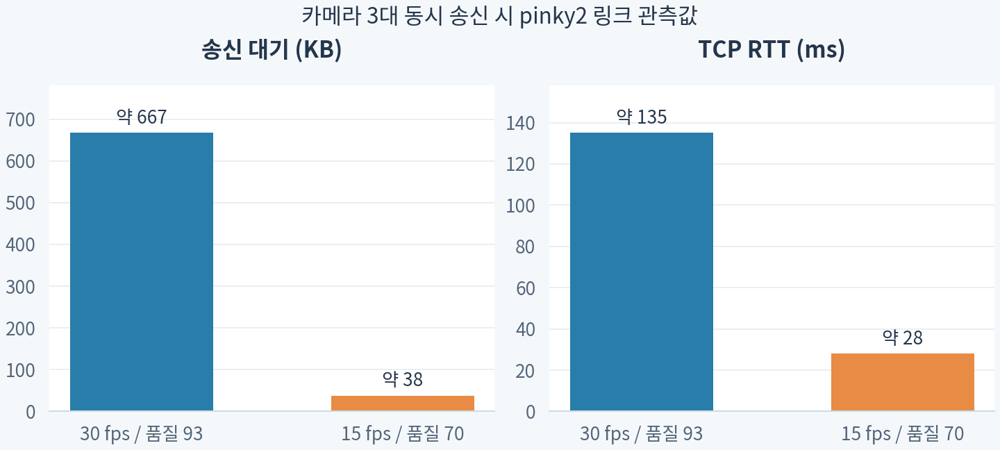
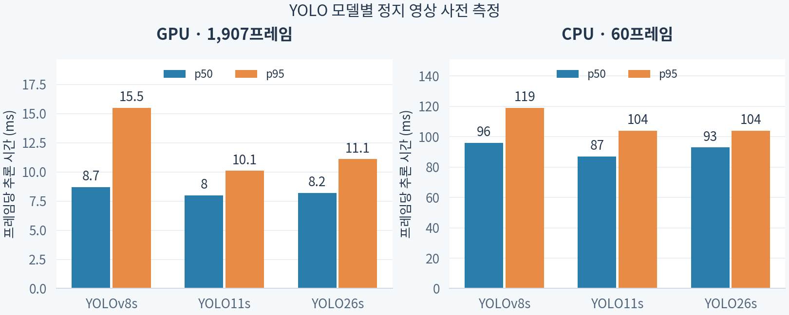

# 손님 추적(GUEST_TRACK) YOLO 적용과 모델 비교 시험 기획

작성: 2026-11-24. 대상: `frybot_ai/guest_tracker`(새 패키지), `frybot_mobile/launch/camera_streamer.launch.py`, `central_control`의 GUEST_TRACK 처리.
상태: 노드와 관제 연결, 손님 고정(R3)은 구현·PC 확인 완료(2026-11-24). pinky1·2·3 공통. 안내 후진 주행(R1·R2)과 고정의 방해 시험(C)은 실기기 확인 필요.

## 1. 목적

손님 안내(GUIDE) 때 로봇은 손님을 바라보며 후진합니다. `mobile_controller`는 `/frybot/guest_track`을 받아 손님이 안 보이거나 `follow_pause_dist`(0.30 m)보다 멀면 멈추고(PAUSED_GUEST), `follow_resume_dist`(0.22 m) 안으로 오면 다시 갑니다. 20초(`guest_timeout`)를 넘으면 GUEST_LOST로 끝냅니다. 지금까지 이 값을 내는 실제 AI가 없었고(`frybot_sim/ai_server`는 시뮬 좌표로 만든 대역), 이번에 Pinky 카메라 + YOLO로 만듭니다.

사용자 요구(2026-11-24):

| # | 요구 |
| --- | --- |
| R1 | 후진 안내 중 사람으로 인식한 손님이 계속 보이는지 |
| R2 | 그 손님과의 거리가 일정하게 유지되는지 |
| R3 | 처음 인식한 사람을 다른 사람이 방해(가로지름·가림·옆에 섬)해도 계속 그 사람을 인식 |
| R4 | 모델 비교: YOLOv8, YOLO11, YOLO26 |

## 2. 구성 (구현, 2026-11-24)

```
Pinky Pi ×3: camera_streamer.launch.py (rpicam-vid, ov5647, 640x480 MJPEG 15 fps·품질 70, TCP :8554)
   │  영상은 ROS로 보내지 않음. AI 서버가 로봇에 직접 붙음
   ▼
관제 PC(노트북, RTX 2060): frybot_ai guest_tracker (~/venv/yolo 의 Python)
   수신(최신 프레임 1장만) → 180° 회전 → YOLO(person) → 손님 선택 → 거리 추정
   │  HTTP POST :8100 /ai/result  {kind: GUEST_TRACK, robot_id, visible, distance, ...}  로봇마다 5 Hz
   ▼
central_control: visit_id 채움(그 로봇의 ASSIGNED·GUIDING 방문) → /frybot/guest_track
   ▼
mobile_controller: _guest_away → PAUSED_GUEST / GUEST_LOST
```

- 손님 선택: 안내 중이 아니면 상자 높이가 가장 큰 사람, 안내 중이면 안내 시작 때 고정한 사람(4장).
- 카메라 목록: 런치 기본값은 로봇 등록부의 모든 로봇. 회전은 로봇마다(`camera_rotate`, 기본 180°). pinky1·2·3 모두 180°로 화면이 바로 섬(사용자 확인, 2026-11-24).
- 대역(2026-11-24): 세 대를 30 fps·품질 93으로 함께 보내자 pinky2 링크(약 2.7 Mbps, RTT 135 ms)에 송신 대기 약 667 KB(약 5 s 지연)가 쌓임. 15 fps·품질 70으로 낮춘 뒤 대기 38 KB, RTT 28 ms(프레임 한 장 수준). 노트북 수신 대기는 세 대 모두 0(추론 병목 아님). pinky3은 장면이 촘촘해(망사 의자) 프레임이 커서 약 1.06 MB/s
- 거리: `초점거리(px) × 인형 키 / 상자 높이`. 인형 키 0.17 m·화각 53.5°는 보정 전 값입니다. 상자가 영상 위·아래에 닿으면 `truncated: true`이고 거리가 크게 나옵니다.
- 새 프레임이 없으면(카메라 끊김) 보내지 않습니다. 로봇이 1.5 s(`guest_track_stale`) 뒤 놓침으로 판단합니다.



위에 기록된 pinky2 관측값을 비교했습니다. 재생성 명령은 3절과 같습니다.

central_control 변경(`central_control_node.py` `_ai_result`):

```python
# 전
self.pub_track.publish(GuestTrack(..., robot_id=str(d['robot_id']), visit_id=int(d['visit_id']), ...))
# 후
rid = str(d['robot_id'])
if 'visit_id' in d:
    vid = int(d['visit_id'])          # 대역 ai_server 는 그대로
else:
    with self.lock:
        vid = self.rest.guiding_visit(rid)   # 새 함수, restaurant.py
if vid:
    self.pub_track.publish(GuestTrack(..., robot_id=rid, visit_id=vid, ...))
```

PC 확인(2026-11-24, 도메인 74, `central_control` 단독 + 실제 pinky1 영상):

| 확인 | 결과 |
| --- | --- |
| 빌드 `frybot_interfaces frybot_ai frybot_control frybot_mobile` | 통과 |
| pytest `frybot_ai/test`, `frybot_control/test` | 40 passed (새 시험 `test_guest_tracker.py` 6, `test_guiding_visit.py` 1 포함) |
| 안내 중 방문 없음 → `/frybot/guest_track` | 4 s 동안 0건 (내지 않음) |
| 접수(visit 1) + GUIDE ASSIGNED(pinky1) 이벤트 주입 → `/frybot/guest_track` | `robot_id pinky1, visit_id 1, visible true, distance 0.297`, 4.5 Hz |

확인하지 않은 것: `camera_streamer.launch.py`를 Pinky에서 띄우는 것(배포 전, 같은 `rpicam-vid` 명령을 SSH로 직접 실행해 확인), 로봇의 PAUSED_GUEST 동작, 거리의 실제 정확도.

## 3. 모델 선정 이유

세 모델 모두 Ultralytics 계열의 **s(small) 크기**로 맞춥니다. 같은 학습 데이터(COCO), 같은 API·추적기·내보내기 경로를 써서 모델만 바꿔 비교할 수 있고, s는 RTX 2060에서 프레임당 10 ms 안팎이라 30 fps 카메라를 따라가면서 n보다 작은 물체(먼 인형) 검출에 여유가 있습니다.

| 모델 | 고른 이유 | 비교에서 보려는 것 |
| --- | --- | --- |
| **YOLOv8s** (2023) | 현재 가장 널리 배포된 기준선. 자료·사례·내보내기 지원이 가장 많음 | 기준점 |
| **YOLO11s** (2024) | v8의 후속. 같은 크기에서 파라미터를 줄이고 정확도를 높였다고 발표됨(Ultralytics) | v8 대비 실제 이득이 있는지 |
| **YOLO26s** (2026-01, ultralytics 8.4) | 최신. NMS 없이 끝단 출력(end-to-end), 작은 물체·엣지(CPU) 추론 개선을 내세움. 같은 계열에 ReID 가중치(`yolo26s-reid`)가 있어 R3에 유리할 수 있음 | 작은·먼 인형, 지연 안정성, CPU(로봇 쪽 추론 가능성) |

발표된 정확도·속도 수치는 COCO 기준이라 이 매장(작은 인형, 낮은 카메라, 후진 주행)과 다릅니다. 판단은 아래 시험 결과로 합니다.

### 사전 측정 (2026-11-24, 같은 녹화 1,907프레임, 정지 장면)

pinky1 정지, 장면에 인형 1·사람 사진 판 1·사람 몸 일부(화면 오른쪽). 정답 라벨이 없어 정확도가 아니라 **경향만** 봅니다.



아래 표의 추론 시간 집계값으로 그린 그래프입니다. 재생성은 프로젝트 루트에서 `PYTHONNOUSERSITE=1 python3 scripts/plot_guest_tracker_benchmark.py`를 실행합니다.

| 모델 | GPU 추론 p50 / p95 (ms) | CPU 추론 p50 / p95 (ms, 60프레임) | GPU 최대 메모리 | 사람 수(conf ≥ 0.4) 분포 | 상위 3개 conf 평균 |
| --- | --- | --- | --- | --- | --- |
| YOLOv8s | 8.7 / 15.5 | 96 / 119 | 70 MB | 2명 1527, 3명 368, 4명 12 | 0.875, 0.823, 0.362 |
| YOLO11s | 8.0 / 10.1 | 87 / 104 | 124 MB | 2명 954, 3명 941, 4명 12 | 0.913, 0.836, 0.420 |
| YOLO26s | 8.2 / 11.1 | 93 / 104 | 87 MB | 1명 5, 2명 816, 3명 1025, 4명 61 | 0.805, 0.692, 0.458 |

- 세 모델 모두 GPU에서 30 fps를 충분히 따라갑니다. 지연 꼬리(p95)는 v8이 가장 깁니다.
- 같은 정지 장면인데 사람 수가 프레임마다 2~4명으로 흔들립니다(세 번째 대상인 화면 끝의 몸 일부). conf 값은 모델마다 보정이 달라(YOLO26은 전반적으로 낮음) 같은 임계값으로 비교하면 안 됩니다 → 시험에서 임계값을 바꿔 가며 비교(5장).
- CPU는 약 90~100 ms로 노트북 CPU에서도 10 fps 정도입니다. Pinky Pi에서의 값은 측정하지 않았습니다.

## 4. 손님 고정 (R3, 구현 2026-11-24, PC 확인)

사용자 결정(2026-11-24): **안내 시작 때 로봇 앞에 있는 손님으로 고정하고, 자리까지 안내를 마치면 푼다.** pinky1·2·3 어느 로봇이 안내를 맡아도 같은 동작.

```
central_control ──POST :8095/guides {"guides": {"pinky1": 3, "pinky3": 7}}──▶ guest_tracker
   안내 중인 (로봇 → 방문) 목록. 바뀌면 바로, 아니면 1초마다(AI 서버가 다시 떠도 이어짐)
```

| 시점 (GUIDE 임무 이벤트 → 방문 상태) | 목록 | guest_tracker |
| --- | --- | --- |
| `ASSIGNED` (로봇이 입구로 가는 중) | 없음 | 고정 안 함(가장 앞 사람을 손님으로 봄) |
| `AT_START` → GUIDING (안내 시작) | 들어감 | 다음 프레임에서 **가장 앞(상자가 가장 큰) 사람의 추적 번호로 고정** |
| 안내 중 | 유지 | 고정 번호의 사람만 손님. 다른 사람이 더 가까이 와도 무시. 고정한 사람이 안 보이면 `visible: false`(로봇은 멈춰 기다림, 20 s 뒤 GUEST_LOST). 다른 사람으로 넘어가지 않음 |
| `SUSPENDED` → GUIDE_FAILED (보류) | 유지 | 고정 유지(RESUMED로 같은 손님을 이어서 안내) |
| `ARRIVED` → SEATED (자리 안내 완료), `CANCELED`, `REASSIGNED` | 빠짐 | 고정 해제 |

- 추적: ultralytics `model.track`, 기본 BoT-SORT + ReID(`--tracker botsort_reid`), 움직이는 카메라 보정(`gmc_method: sparseOptFlow`), 놓친 추적 유지 90프레임(`--track-buffer`). 로봇마다 모델·추적기를 따로 둠.
- 고정 중에는 GUEST_TRACK에 `visit_id`(고정한 방문), `track_id`, `locked`가 붙습니다.
- 한계: 고정한 사람이 `track_buffer`보다 오래 가려져 추적 번호가 바뀌면 다시 붙이지 않습니다(그 사람이 돌아와도 `visible: false` 유지 → GUEST_LOST). ReID 점수로 새 번호를 이어 붙이는 것은 시험 C 결과를 보고 정합니다. 안내 시작 순간 손님이 아닌 사람이 가장 앞에 있으면 그 사람이 고정됩니다.

PC 확인(도메인 74, central_control + guest_tracker + 실제 pinky1 영상, GUIDE 이벤트 주입):

| 확인 | 결과 |
| --- | --- |
| `ASSIGNED` | 고정 안 함 |
| `AT_START` | 가장 앞 사람(상자 높이 319 px, 추적 번호 1)으로 고정, 3 s 동안 유지, `/frybot/guest_track` `visit_id: 1` |
| `ARRIVED` | 해제 |
| AI 서버를 안내 도중 늦게 띄움 | 1 s 주기 재전송으로 고정됨 |
| AI 서버 꺼짐 | central_control 경고 1회(반복 로그 없음) |
| 단위 시험 | `select_guest`(끼어듦·가림에도 고정 유지), `guiding_visits`, 추적기 설정, 등록부 카메라 목록 |

확인하지 않은 것: 실제로 다른 사람이 끼어드는 장면(시험 C), pinky2·3의 고정 동작(같은 코드, 미실행).

### 거리 추정 방법과 개선안

지금은 **카메라 한 대의 상자 높이**로 거리를 계산합니다: `거리 = 초점거리(px) × 인형 키(m) / 상자 높이(px)`. 키 0.17 m는 가정값, 초점거리는 화각 53.5°(명목값)로 계산한 약 635 px입니다.

| 한계 | 영향 |
| --- | --- |
| 키를 가정 | 인형·사람마다 키가 다르면 그 비율만큼 거리가 틀림(키 20% 차이 → 거리 20%) |
| 상자가 잘림 | 가까우면(약 0.25 m 안) 머리나 발이 화면 밖 → 상자가 작아져 거리가 **멀게** 나옴(`truncated: true`) → 가까운데 멈출 수 있음 |
| 상자 흔들림 | 상자 높이 ±5%가 거리 ±5%. 0.30 m 기준 ±1.5 cm |
| 자세 | 앉거나 숙이면 상자가 낮아져 멀게 나옴 |

개선안(시험 0·A·D에서 비교):

| 안 | 방법 | 장점 | 단점 |
| --- | --- | --- | --- |
| 1. 보정 | 시험 0에서 초점거리·인형 키 실측 | 바로 적용 | 위 한계 그대로 |
| 2. 바닥 접점 | 상자 아래 끝(발)의 영상 높이 + 카메라 높이·기울기로 바닥 위 거리 계산 | 키 가정이 필요 없음 | 발이 보여야 함, 카메라 장착 높이·각도 실측 필요 |
| 3. **라이다 결합 (권장 검토)** | AI 서버는 손님의 **방향(각도)**만 내고, 로봇이 그 방향의 라이다 거리로 거리를 잼 | cm 단위 정확도, 키·자세·잘림과 무관 | GuestTrack에 각도 필드 추가(→ central_control·mobile_controller 함께 수정), 라이다 평면이 인형 높이에 닿는지 확인 필요 |

## 5. 시험 기획

공통: 같은 입력으로 비교하기 위해 **먼저 녹화하고(`record:=`), 녹화를 세 모델에 똑같이 다시 넣어** 비교합니다(시험 A·C). 실시간 시험(B·D)만 모델별로 따로 돌립니다. 주행 시험(D)은 천장 카메라 녹화(`scripts/cam_record.py --run-id <실행>`)를 함께 합니다. conf 임계값은 0.25~0.6을 0.05 단위로 바꿔 가며 보고, 각 모델의 최적 임계값에서 비교합니다.

### 시험 0. 보정 (먼저)

| 항목 | 방법 | 결과물 |
| --- | --- | --- |
| 화각·초점거리 | 체커보드로 `cv2.calibrateCamera` (640×480, 회전 전) | `--hfov-deg` 대신 쓸 초점거리 |
| 인형(손님) 키 | 자로 측정. 실제 손님 역할 인형마다 | `--person-height` |
| 거리 기준값 | 바닥에 0.15~1.2 m 눈금 테이프. 주행 시험은 천장 카메라(`ceiling_view`, 바닥 ArUco)로 로봇·인형 위치 | 정답 거리 |

### 시험 A. 정지 탐지 정확도 (R4)

로봇 정지, 장면별 10초 녹화 → 프레임 일부(초당 2장)에 정답 상자 라벨.

| 장면 | 조건 |
| --- | --- |
| A1 거리 | 인형 1개, 0.15 / 0.22 / 0.30 / 0.45 / 0.60 / 0.90 / 1.20 m |
| A2 자세 | 정면·옆·뒷모습, 카메라 중앙·가장자리 |
| A3 잘림 | 0.15 m 이하에서 머리·발이 화면 밖(`truncated`) |
| A4 여럿 | 인형 2~3개, 겹침 |
| A5 조명 | 매장 조명 / 어둡게 / 역광 |
| A6 없음 | 사람·인형 없는 장면(오탐 확인), 사람 사진·포스터 |

지표: 거리 구간별 재현율·정밀도(IoU 0.5), 거리 추정 오차(평균·표준편차, 잘림 제외/포함), 오탐 수/분.

### 시험 B. 실시간 성능 (R4)

`guest_tracker`를 모델별로 10분씩. 지표: 추론 p50/p95/p99, 프레임 수신→POST 지연(`latency_ms`), 처리 fps, GPU 메모리, CPU만 썼을 때 같은 값. 판정 기준(제안): p95 지연 100 ms 이하, 처리 25 fps 이상.

### 시험 C. 손님 고정 (R3)

녹화한 방해 장면을 (모델 3) × (추적기: ByteTrack / BoT-SORT / BoT-SORT+ReID) 9조합에 다시 넣습니다.

| 장면 | 방해 |
| --- | --- |
| C1 가로지름 | 다른 인형(사람)이 로봇과 손님 사이를 지나감 (1회, 3회 연속) |
| C2 나란히 | 다른 인형이 손님 옆에 붙어 섬, 더 가까이 섬 |
| C3 완전 가림 | 손님이 0.5 / 1 / 3 s 가려졌다 나타남 |
| C4 닮은 대상 | 같은 모양 인형 2개가 엇갈림 |
| C5 이동 중 | 로봇 후진(0.05 m/s) 중 C1~C3 |

지표: **잘못 고정 수**(손님이 아닌 대상으로 넘어간 횟수, 가장 중요: 엉뚱한 사람을 따라감), 고정 유지율(손님이 보이는 프레임 중 고정 id로 잡힌 비율), id 바뀜 수, 가려진 뒤 다시 잡기까지의 시간. 판정 기준(제안): 잘못 고정 0회, 3 s 가림 뒤 1 s 안에 재고정.

### 시험 D. 후진 안내 주행 (R1·R2)

전제: 실측 지도에서는 아직 접수·안내를 지원하지 않습니다(README). 그래서 두 단계로 나눕니다.

| 단계 | 방법 | 비고 |
| --- | --- | --- |
| D1 | 로봇을 0.05 m/s로 직선 후진(1 m, 수동 `cmd_vel`. 실측 지도의 관리자 이동 명령은 Nav2 전진 전용이라 쓰지 않음). 사람이 인형을 손으로 옮기며 따라감: 일정 거리 / 멈췄다 따라감 / 멀어짐 | `guest_tracker`만으로 R1·R2 지표 측정. 로봇 판단과는 무관 |
| D2 | 실측 지도 안내 지원(별도 작업) 뒤 GUIDE 임무로 같은 조건 | PAUSED_GUEST·재출발·GUEST_LOST까지 확인 |

지표:
- R1 보임: 안내 구간 중 `visible` 비율, 최장 끊김(1.5 s `guest_track_stale`를 넘으면 로봇이 멈춤), 잘못 멈춤(손님이 0.30 m 안에 있는데 멈춘 횟수), 놓친 멈춤(손님이 0.30 m 넘게 떨어졌는데 진행).
- R2 거리: 추정 거리와 천장 카메라 정답 거리의 차이(평균·표준편차), 손님이 0.22~0.30 m 안에 있던 시간 비율, 멈춤·재출발 횟수/분.
- 지금 로봇은 속도를 조절하지 않고 "멈춤·재출발"로만 거리를 지킵니다. D 결과로 멈춤이 잦으면 속도 조절(거리 비례)을 별도로 검토합니다.

### 시험 E. 끊김·오류 처리

카메라 송신 중단, Wi-Fi 끊김, `guest_tracker` 종료, central_control 재기동 때: 로봇이 PAUSED_GUEST → 20 s 뒤 GUEST_LOST로 가는지, 재연결 뒤 자동으로 이어지는지.

## 6. 순서와 결정할 것

1. 시험 0(보정) → A·B(지금 구현으로 가능) → 모델 1차 선정
2. 시험 C(손님 고정, 4장 구현 완료)
3. D1 → (실측 지도 안내 지원 뒤) D2 → E

결정 필요: 거리 추정 방법(4장 개선안 1~3), 시험에 쓸 손님 역할(인형 크기·개수, 실제 사람 포함 여부), 판정 기준 수치.
