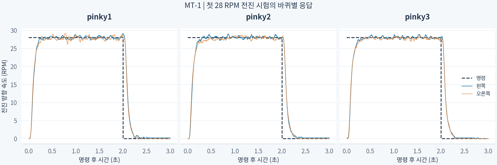
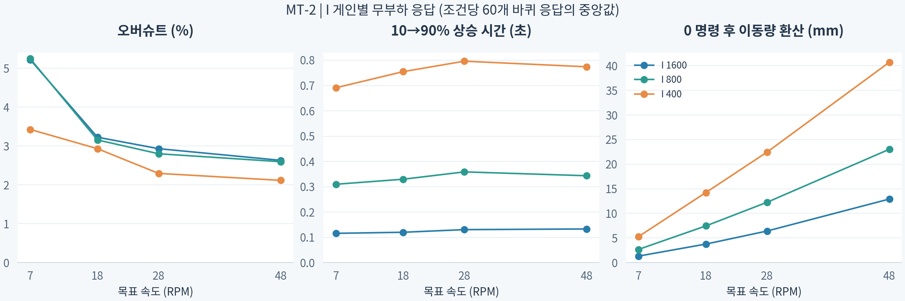
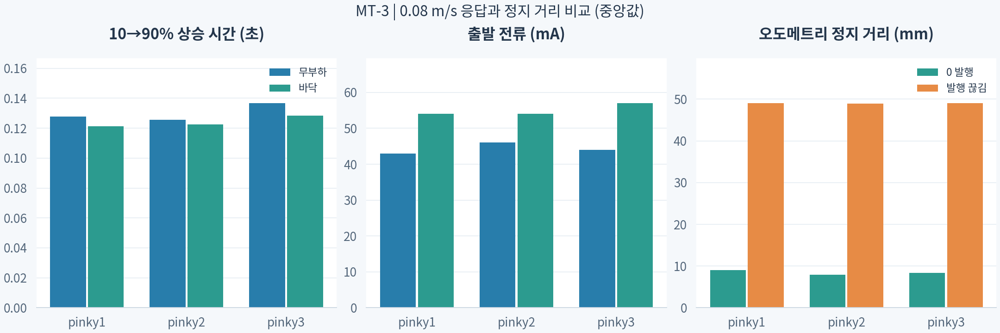
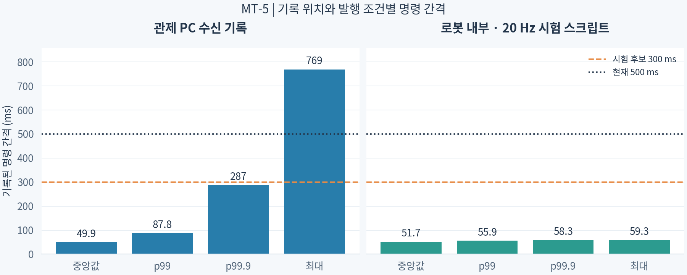
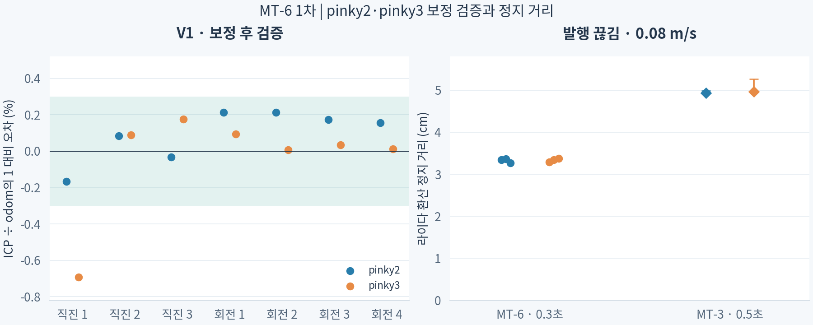

# 모터 속도 루프(PID) 검사 기록 (2026-11-24)

바퀴 모터(다이나믹셀)의 속도 루프를 튜닝해야 하는지 pinky1·2·3 세 대에서 측정한 기록입니다. 측정 지시는 기획 패널이 쓰고, 실행과 분석은 부장(Opus 5.5)이 했습니다.

- 2026-11-26 추가: 사흘간의 결과를 발표·보고서용으로 정리한 문서는 [Pinky Pro 하드웨어 검증 결과](2026-11-26_HW_VERIFICATION_REPORT.md)입니다. 아래 머리말은 2026-11-24 시점의 요약이고, 바퀴 값과 설정 변경 등 그 뒤의 결과는 12장과 결과 문서가 우선합니다.
- 결론: 세 대 모두 모터 PID 튜닝은 필요하지 않다고 판단했습니다. I 게인을 낮추는 실험에서도 오버슈트는 거의 줄지 않고 응답·정지만 느려져 기본값을 유지합니다. 바닥 주행 검사(8장)에서도 응답이 무부하와 같아 판단은 그대로입니다.
- 바닥 검사에서 새로 나온 것: pinky3 바퀴 반지름 +2.4%, 세 대 바퀴 간격 ±1% 차이, 정지 거리 0.08 m/s에서 약 1 cm(명령이 끊기면 약 5 cm). 바퀴 치수는 로봇별 값을 줄 수 있게 코드를 고쳤고(9장, 실기기 미검증), 정지 여유 설정은 바꾸지 않았습니다(11장).
- 코드와 설정은 바꾸지 않았습니다. 모터에 쓴 값은 RAM 영역뿐이며 전원을 끄면 사라집니다.
- 이 문서의 "기준"은 기획 패널이 잡은 잠정값이며 팀이 정한 값이 아닙니다(5장).
- 관련: [주행 튜닝 기획안](2026-11-20_DRIVING_TUNING_PLAN.md)의 전제 "모터 속도 루프는 튜닝이 끝났다고 봄"을 이번에 처음 측정으로 확인한 것입니다. [TROUBLESHOOTING](TROUBLESHOOTING.md) T-23·T-42·T-46·T-50.

## 1. 왜 측정했는가

### 1.1 코드에 PID가 없음

`src/frybot`과 `src/pinky_pro`를 조사한 결과 PID 제어 구현은 없었습니다. 속도를 정하는 루프는 세 곳입니다.

| 루프 | 위치 | 조정할 수 있는 값 |
| --- | --- | --- |
| 모터 속도 루프 | 다이나믹셀 펌웨어 내부 | Velocity P·I Gain(코드는 읽지도 쓰지도 않음) |
| 방향 P 제어 | `mobile_controller.py`의 `_rotate`, `_step_toward` | 게인 2.5/2.0, ±1.5 rad/s 제한, 최소 0.4 rad/s |
| 경로 추종·도킹 | Nav2(`nav2_store.yaml`) | Regulated Pure Pursuit, 도킹 `k_phi` 8.0·`k_delta` 4.0 |

`dynamixel_driver.py`가 모터에 쓰는 것은 동작 모드 1(속도), Profile Acceleration 200, 토크, 목표 속도뿐입니다.

### 1.2 주행 문제의 원인 후보가 세 루프에 걸쳐 있음

기록된 문제(T-42: 제자리 회전 오도메트리 -424도 대 AMCL -367도, T-50: AMCL 방향 25도 틀어짐, T-23: 구간마다 2.27초 지연)는 위 세 루프 어디에서든 생길 수 있습니다. 원인이 아닌 루프의 게인을 바꾸면 문제는 남고 정상이던 응답만 달라지므로, 먼저 모터 루프가 정상인지 가리기로 했습니다.

### 1.3 기존 자료의 빈 곳

11-19 bag 5개에서 `cmd_vel`과 `odom`을 비교한 값은 정상으로 보였습니다(정상상태 비율 0.99, 0 → 0.08 m/s의 90% 도달 0.20초, 오버슈트 3~8%, 정지 0.2~0.25초, 지연 약 100 ms). 다만 다음은 알 수 없었습니다.

- 좌우 바퀴 차이: `odom`은 두 바퀴를 합친 값입니다.
- 저속과 각속도 계단: 표본이 없었습니다.
- 로봇 간 차이와 모터에 실제로 들어 있는 게인 값.

### 1.4 검사 순서(기획안)

1. 모터 레지스터 읽기 2. 바퀴 띄운 계단 응답 3. 바닥 직진 4. 제자리 360도 회전 5. `_rotate` 90도 응답 6. 구간 시간 분해.

이번에 한 것은 1·2단계(작업 지시 MT-1), I 게인 변경 실험(MT-2, 7장), 바닥에서의 3·4단계와 정지 거리(MT-3, 8장)입니다. 5·6단계는 하지 않았습니다.

## 2. 조건

| 항목 | 값 |
| --- | --- |
| 대상 | pinky1, pinky2, pinky3 (모터 ID 1 = 왼쪽, 2 = 오른쪽) |
| 자세 | 로봇을 눕혀 바퀴를 띄움. 무부하 |
| 포트·통신 | `/dev/ttyAMA5`, 1,000,000 bps (`pinky_driver.py` 상수) |
| 방식 | 각 Pi에서 dynamixel_sdk 직접 사용(ROS 없음). 로봇 노드는 내린 상태 |
| 모터 설정 | 속도 모드, Profile Acceleration 200(드라이버와 같음), 게인 기본값 |
| 쓴 레지스터 | 64(토크), 104(목표 속도), 108(Profile Acceleration). EEPROM 영역과 게인에는 쓰지 않음(MT-1) |
| 안전 | 상한 50 RPM, 사용자에게 바퀴가 떠 있는지 확인받은 뒤 토크 on. 사전 점검(7 RPM 1초)으로 닿음 확인 |
| 결과 폴더 | `runs/20261124_01_motor_check_3robots/` (보고서 `report.md`, 스크립트 `scripts/`) |

카메라 녹화는 하지 않았습니다(주행 없음).

## 3. MT-1 1단계: 레지스터 읽기

원자료: `registers.csv`. 쓰기 없이 읽기만 했습니다.

| 항목(주소) | pinky1 | pinky2 | pinky3 |
| --- | --- | --- | --- |
| 모델 번호(0) | 1200 = XL330-M288-T | 같음 | 같음 |
| 펌웨어(6) | 53 | 52 | 52 |
| Operating Mode(11) | 1(속도) | 1 | 1 |
| Velocity I Gain(76) / P Gain(78) | 1600 / 180 | 같음 | 같음 |
| PWM Limit(36) / Velocity Limit(44) | 885 / 445(101.9 RPM) | 같음 | 같음 |
| Current Limit | 1750 mA | 같음 | 같음 |
| Return Delay(9) | 250(500 µs) | 같음 | 같음 |
| Hardware Error(70) | 0 | 0 | 0 |
| Profile Acceleration(108) | 200 | 0 | 0 |
| 전압 / 온도 | 4.9~5.0 V / 28~31 °C | 같은 범위 | 같은 범위 |

- 좌우 모터 6개 모두 통신 정상입니다.
- 게인과 한계값은 e-manual 초기값과 같습니다. 대조는 웹 요약본으로 했습니다(원문 숫자 재확인 필요).
- `dynamixel_driver.py` 주석의 "정확한 모델은 확인 필요"는 XL330-M288-T로 확인됐고, 코드의 주소(11, 64, 65, 104, 108, 128, 132)는 이 모델의 표와 맞습니다.
- Profile Acceleration은 목표 속도를 올리고 내리는 기울기 제한입니다. 0은 제한 없음입니다. pinky1의 200은 전원을 켠 뒤 드라이버가 기동한 흔적이고, pinky2·3의 0은 기본값입니다. 측정 때는 세 대 모두 200으로 맞췄습니다.

## 4. MT-1 2단계: 계단 응답

원자료: `steps_<robot>.csv`(약 530 Hz), 구간별 요약 `summary.csv`(432줄), 좌우 비교 `left_right.csv`, 시각 비교 `timing.csv`.

패턴: 목표 7·18·28·48 RPM(바닥 속도로 약 0.02, 0.05, 0.08, 0.135 m/s) × 3회 × 8가지(좌 ±, 우 ±, 전진, 후진, 제자리 좌·우회전). 구간마다 2초 구동, 1초 정지. 전체 289초. 세 대를 동시에 돌렸습니다.

### 4.1 사전 점검 (7 RPM 1초, 눕힌 자세에서 닿음 확인)

| 로봇 | 좌 속도 / 전류 / PWM | 우 속도 / 전류 / PWM |
| --- | --- | --- |
| pinky1 | 7.23 RPM / 13.5 mA / 62 | 7.15 / 13.4 / 62 |
| pinky2 | 7.19 / 14.5 / 62 | 7.24 / 11.1 / 61 |
| pinky3 | 7.26 / 14.3 / 60 | 7.24 / 15.0 / 62 |

### 4.2 응답 (로봇·바퀴를 합친 중앙값 범위)



각 로봇의 첫 28 RPM 전진 시험을 명령 시각에 맞춰 그렸습니다. 오른쪽 바퀴의 부호는 전진 방향이 양수가 되도록 바꿨습니다.

| 목표 RPM | 정상상태 비율 | 10→90% 상승 | 오버슈트 | 정착(±5%) | 정지 | 흔들림 |
| --- | --- | --- | --- | --- | --- | --- |
| 7 | 0.99~1.00 | 0.06~0.13 s | 5~8% | 0.2~1.8 s | 0.18~0.26 s | 1.6~2.5% |
| 18 | 1.00~1.01 | 0.11~0.13 s | 3~5% | 0.19~0.25 s | 0.20~0.25 s | 1.1~1.6% |
| 28 | 0.99~1.00 | 0.11~0.14 s | 2~4% | 0.20~0.24 s | 0.20~0.23 s | 0.9~1.6% |
| 48 | 1.00 | 0.12~0.14 s | 2~3% | 0.23~0.24 s | 0.22~0.25 s | 0.7~1.4% |

- 속도 단위 1이 0.229 RPM이라 7 RPM에서는 분해능이 3.3%입니다. 7 RPM의 정착 시간이 길게 나온 것은 ±5% 띠가 ±1.5 단위라 1단위 흔들림으로도 벗어나기 때문입니다.
- 예외: pinky1 오른쪽 바퀴는 좌우 동시 구동의 18·28 RPM에서 정착이 0.87·0.83초였습니다. 흔들림은 1.4% 이하입니다.
- 위치 증분으로 계산한 속도와 Present Velocity는 18 RPM 이상에서 최대 1.8%, 중앙값 0.5% 이하로 일치했습니다.
- 상승 시간(0.11~0.14초)은 Profile Acceleration 200이 허용하는 가속(약 715 RPM/s, 48 RPM까지 67 ms)보다 느립니다. 가속을 정하는 것은 속도 루프 쪽으로 보입니다.

### 4.3 로봇별 최악값과 판정

| 로봇 | 정상상태 오차 | 오버슈트 | 흔들림(18 RPM 이상) | 좌우 속도 차(중앙값) | 판정 |
| --- | --- | --- | --- | --- | --- |
| pinky1 | ≤3.7% (18 RPM 이상 ≤1.4%) | ≤11.7% (≤7.3%) | ≤2.0% | ≤0.6% | 튜닝 불필요(무부하) |
| pinky2 | ≤3.6% (≤1.5%) | ≤11.5% (≤6.1%) | ≤1.9% | ≤1.1% | 튜닝 불필요(무부하) |
| pinky3 | ≤3.8% (≤1.4%) | ≤11.9% (≤4.4%) | ≤1.7% | ≤0.6% | 튜닝 불필요(무부하) |

- 좌우 차이: 단독 구동 ≤0.6%, 동시 구동 중앙값 ≤1.1%. 7 RPM 동시 구동에서 구간 하나씩 3.7~4.4%가 나왔고 분해능 안의 차이로 봤습니다(같은 조건 중앙값 0.1~0.8%).
- 좌우 전류 차이: pinky2 7 RPM 26%(14.6 / 11.2 mA), 18 RPM 9%, 48 RPM −7%. pinky1 ≤2%, pinky3 3~7%.
- 48 RPM 전류: pinky1 36~37 mA, pinky2 40~44 mA, pinky3 39~40 mA. pinky2가 조금 큽니다(무부하 마찰 차이로 추정, 확인 필요).

### 4.4 pinky2가 늦게 도는 것처럼 보인 점

측정 중 사용자가 본 것: pinky2가 pinky1·3보다 늦게 돌기 시작하고 늦게 멈추며, 도는 시간은 같음.

| 로봇 | 명령 → 속도 변화 시작(중앙값 / 최대) | 정지(중앙값 / 최대) | PC 기준 시작 시각 | 실제 돈 시간(중앙값) |
| --- | --- | --- | --- | --- |
| pinky1 | 34.6 / 50.0 ms | 28.7 / 45.5 ms | pinky2보다 61 ms 늦음 | 1.998 s |
| pinky2 | 34.2 / 62.7 ms | 28.6 / 40.3 ms | 가장 빠름 | 1.995 s |
| pinky3 | 32.8 / 44.0 ms | 27.3 / 44.0 ms | pinky2보다 220 ms 늦음 | 1.996 s |

- 모터 엔코더 기준으로 pinky2는 반응 지연도 시작 시각도 늦지 않았습니다. 기획 패널이 처음 추정한 "pinky2 스크립트가 늦게 시작됨"은 측정으로 부정됐습니다.
- 사용자의 관찰은 이 기록으로 설명되지 않습니다. 엔코더는 모터 축을 재므로 축과 바퀴 사이의 유격은 기록에 나타나지 않습니다. 바퀴에 표시를 하고 촬영해 대조해야 합니다(확인 필요, 미실시).
- PC↔Pi 시계 차이는 측정 직후 SSH 왕복 표본으로 쟀습니다(pinky1 −7 ms, pinky2 +11 ms, pinky3 +14 ms).
- **사용자 추가 관찰(2026-11-24 오후, Wi-Fi 시험 중):** pinky1·3은 5 GHz, pinky2만 2.4 GHz Wi-Fi에 붙어 있었다고 합니다. 기획 패널이 15:38에 세 대에서 `iw dev wlan0 link`로 읽었을 때는 세 대 모두 5580 MHz였습니다(신호 −67 / −70 / −66 dBm, 공유기까지 ping 평균 11.8 / 18.8 / 24.9 ms, 5회). 사용자 확인: Wi-Fi 시험 중 pinky2를 5 GHz로 옮겼고(이 읽기 직전), 오전 MT-1~MT-3 때는 2.4 GHz였습니다(당시 값을 읽은 기록은 없음).
  - 이 측정(MT-1)과는 맞지 않는 점: 계단 명령은 각 로봇 안의 스크립트가 직렬 포트로 직접 냈고 Wi-Fi는 시작 신호(SSH)에만 쓰였습니다. Wi-Fi가 느렸다면 PC 기준 시작 시각이 늦어야 하는데 위 표에서 pinky2가 가장 빨랐습니다. 다만 시계 차이를 SSH 왕복으로 쟀으므로 왕복 지연이 크거나 비대칭이면 이 보정 자체가 틀릴 수 있습니다(왕복 시간은 기록하지 않음).
  - 맞을 수 있는 곳: 관제를 거치는 평소 주행(통행 허가, 생존 신호, 이동 명령, 상태 보고)은 Wi-Fi를 지나므로 대역 차이가 반응 차이로 보일 수 있습니다. MT-6(세 대 모두 5 GHz)에서 pinky2가 여전히 늦게 보이는지로 가립니다.

### 4.5 한계

- 눕힌 자세의 무부하 결과입니다. 로봇 무게, 바닥 마찰, 가감속 부하가 걸리면 오차·오버슈트·좌우 차이가 달라질 수 있습니다.
- 반복은 조건마다 3회입니다.
- 모터 축 엔코더만 봤습니다. 바퀴의 실제 회전과 미끄러짐은 재지 않았습니다.

## 5. 판정 기준과 그 검토

### 5.1 MT-1에 쓴 잠정 기준

정상상태 오차 5%, 오버슈트 15%, 18 RPM 이상 흔들림 5%, 좌우 정상상태 차 3%. 프로젝트 파라미터에서 계산한 값이 아니라 기획 패널의 경험칙입니다.

### 5.2 프로젝트 수치에 비춰 본 크기

| 항목 | 측정 최악값(18 RPM 이상) | 프로젝트에서의 크기 |
| --- | --- | --- |
| 정상상태 오차 | 1.5% | 0.08 m/s에서 약 0.001 m/s. 관제의 계획 속도 여유 10%(×0.9) 안 |
| 오버슈트 | 7.3% | 약 0.1초간 넘치므로 거리 1 mm 미만. `xy_goal_tolerance` 1.5 cm보다 한 자릿수 작음 |
| 흔들림 | 2.0% | 속도 눈금 1~2칸 |
| 좌우 속도 차 | 중앙값 1.1%(pinky2) | 바퀴 간격 9.61 cm에서 보정 없이 직진하면 30 cm에 약 2도, 1 m에 약 6.5도 |

좌우 차 기준 3%는 30 cm에 약 5도, 1 m에 약 18도에 해당해 느슨했습니다. 좌우 차이는 엔코더에 그대로 잡혀 오도메트리에 반영되므로 Nav2가 고치는 외란이지만, Nav2를 거치지 않는 직접 주행 구간(막다른 노드 출발, 도킹 접근)에는 더 직접적입니다.

### 5.3 사람이 다니는 매장 기준으로 본 검토 (사용자 요청)

잠정 기준은 "모터 게인을 손볼지" 거르는 용도이고, 매장 합격 기준으로는 부족하다고 판단했습니다. 빠진 항목은 다음과 같습니다.

- 정지 거리: 기준에 없었고 측정한 적도 없습니다. 어림 계산(실측 아님): 0.08 m/s에서 반응 지연 0.03초에 약 2 mm, 감속 0.22초에 약 9 mm, 라이다 주기를 10 Hz로 가정하면 최대 8 mm로 합 약 1.9 cm. 직접 주행의 앞 정지 여유는 앞끝에서 2.1 cm입니다(`front_stop_dist` 0.10, T-46).
- 정지 명령 전달 시간: `pinky_driver`는 `cmd_vel`이 0.5초 끊겨야 모터를 세웁니다(0.08 m/s에서 4 cm). 모터 지연 30 ms보다 큽니다.
- 부하 조건, 최악값 판정과 반복 수, 0.05 m/s 안내 후진 구간의 정밀 측정.

매장 기준 제안값(기획 패널 제안, 미결정):

| 항목 | 제안 | 근거 |
| --- | --- | --- |
| 정지 거리(0.08 m/s, 바닥, 최악값) | 1 cm 이하 | 앞 정지 여유 2.1 cm의 절반 |
| 정지 때 역방향 밀림 | 없음 | 사람·테이블 앞 정차 |
| 좌우 속도 차(최악값) | 1% 이하 | 30 cm 구간 방향 오차 약 2도 |
| 정속 흔들림 | 3% 이하 | 경험칙 |
| 정상상태 오차 | 5% 유지 | 계획 여유 10% 안 |

이 제안으로 보면 pinky2의 좌우 차 중앙값 1.1%는 1%를 넘습니다. 모터 PID가 불필요하다는 판단은 바뀌지 않습니다(좌우 마찰 차이는 게인으로 줄지 않음).

### 5.4 정지 여유에 대한 사용자 요청 (미결정, 미적용)

사용자 요청: "정지 거리는 좀 더 여유를 두고 멈췄으면 좋겠다."

지금 설정:

| 상황 | 값 | 남는 여유(어림) |
| --- | --- | --- |
| 일반 주행(Nav2) | `max_allowed_time_to_collision_up_to_carrot: 0.3` | 0.08 m/s에서 2.4 cm 앞까지 예측, 정지 뒤 약 0.5~1.5 cm |
| 직접 주행(도킹 접근, 막다른 곳 출발) | `front_stop_dist: 0.10`(라이다 기준) | 앞끝에서 2.1 cm, 정지 뒤 거의 0 |

기획 패널 제안: 목표를 "앞끝에서 최소 5 cm를 남기고 정지"로 하고, `front_stop_dist` 0.10 → 0.14 후보, 일반 주행은 충돌 예측 시간 조정과 `use_cost_regulated_linear_velocity_scaling`(지금 false) 검토. 걸리는 점은 D1_STOP 도킹(벽 앞에서 앞이 막히면 도착으로 치는 규칙이라 정차 위치가 뒤로 물러남)과 좁은 통로에서의 멈칫·`NAV2_FAILED` 증가 가능성입니다. 정지 거리를 바닥에서 실측한 뒤 수치를 정하기로 했고, 목표 여유와 도킹 예외 여부는 사용자 결정 대기입니다.

## 6. 오버슈트와 게인의 관계

사용자 질문: 오버슈트는 PID로 바꿀 수 없는가.

바꿀 수 있습니다. 이 모터의 속도 제어는 P(180)·I(1600) 두 게인의 PI 제어입니다(e-manual 환산식으로 KVp = 180/128 = 1.41, KVi = 1600/65536 = 0.024).

| 방법 | 효과 | 대가 |
| --- | --- | --- |
| I 게인을 낮춤 | 적분항이 쌓여 넘치는 양이 줄어 오버슈트 감소 | 부하가 걸렸을 때 목표 속도로 복귀가 느려짐 |
| P 게인을 올림 | 감쇠가 좋아져 오버슈트 감소 | 속도 눈금 잡음에 반응해 떨림·소음 가능 |
| Profile Acceleration을 낮춤 | 목표가 완만하게 올라 오버슈트·적재물 흔들림 감소 | 출발·정지가 느려지고 정지 거리 증가 |

지금 권하지 않은 이유: 주행 속도 구간의 오버슈트가 2~7%(거리 1 mm 미만)로 작고, 줄이는 쪽은 응답이 느려져 "여유 있게 멈춤"과 방향이 반대이며, 무부하 수치에 맞추면 바닥에서 굼떠질 수 있고, 게인이 RAM 영역이라 적용하려면 `dynamixel_driver.py`가 기동 때마다 쓰도록 고쳐 세 대에 배포해야 합니다.

## 7. MT-2: I 게인 변경 실험

원자료와 보고서: `runs/20261124_02_motor_igain_3robots/`(`report.md`, `steps_<robot>.csv`, `summary.csv`, `summary_by_gain_target.csv`, `summary_by_gain_target_robot.csv`, `repro_vs_mt1.csv`, `verify_after.txt`, `scripts/`).

### 7.1 목적과 조건

6장의 "I 게인을 낮추면 오버슈트가 준다"를 수치로 확인하려는 실험입니다(사용자 지시). 적용이 아니며 끝난 뒤 기본값으로 되돌렸습니다.

| 항목 | 값 |
| --- | --- |
| 자세 | MT-1과 같음(눕힘, 무부하). 시작 전 사용자에게 다시 확인받고 사전 점검(7 RPM 1초) 통과 |
| 바꾼 값 | Velocity I Gain(76, RAM): 1600(기준 재측정) → 800 → 400. 쓴 뒤 읽어 확인 |
| 고정 | P Gain 180, Profile Acceleration 200, 속도 모드 |
| 패턴 | 목표 7·18·28·48 RPM × 좌우 동시 전진·후진 × 5회, 2초 구동 + 1초 정지. 총 364초, 세 대 동시 |
| 표본 | 게인·목표마다 60구간(로봇 3 × 바퀴 2 × 방향 2 × 5회), 약 535 Hz |

### 7.2 결과 (세 대·좌우를 합친 중앙값 / 최악값)



그래프는 조건당 60개 바퀴 응답의 중앙값입니다. 이동량은 0 명령 후 관측 구간의 엔코더 증분을 거리로 환산한 값입니다. I 400은 관측이 끝날 때도 회전 중인 경우가 많았습니다(7.3절).

그래프는 프로젝트 루트에서 `PYTHONNOUSERSITE=1 python3 scripts/plot_motor_pid_check.py`로 다시 만들 수 있습니다.

| I | 목표 RPM | 오버슈트 % | 10→90% 상승 s | 정지 s | 0 명령 뒤 더 간 거리 mm(바닥 환산) | 출발 0.3초 전류 최대 mA |
| --- | --- | --- | --- | --- | --- | --- |
| 1600 | 7 | 5.22 / 9.43 | 0.116 / 0.19 | 0.211 / 0.992 | 1.3 / 1.6 | 16 / 20 |
| 1600 | 18 | 3.23 / 5.59 | 0.12 / 0.15 | 0.225 / 0.333 | 3.8 / 4.1 | 28 / 31 |
| 1600 | 28 | 2.93 / 6.32 | 0.13 / 0.148 | 0.214 / 0.243 | 6.4 / 6.7 | 44 / 47 |
| 1600 | 48 | 2.63 / 4.56 | 0.133 / 0.153 | 0.236 / 0.253 | 12.9 / 14.0 | 85 / 93 |
| 800 | 7 | 5.25 / 11.34 | 0.31 / 0.394 | 0.541 / 1 | 2.7 / 2.9 | 15 / 17 |
| 800 | 18 | 3.15 / 5.36 | 0.33 / 0.367 | 0.577 / 0.969 | 7.5 / 8.4 | 21 / 24 |
| 800 | 28 | 2.80 / 5.64 | 0.359 / 0.384 | 0.5 / 0.545 | 12.3 / 12.6 | 30 / 32 |
| 800 | 48 | 2.60 / 5.30 | 0.343 / 0.378 | 0.524 / 0.556 | 23.0 / 24.5 | 54 / 58 |
| 400 | 7 | 3.42 / 8.60 | 0.691 / 0.8 | 0.951 / 1.001 | 5.3 / 5.8 | 14 / 17 |
| 400 | 18 | 2.93 / 5.78 | 0.755 / 0.813 | 1 / 1.001 | 14.2 / 15.5 | 18 / 19 |
| 400 | 28 | 2.29 / 4.13 | 0.796 / 0.873 | 1 / 1.001 | 22.4 / 23.7 | 23.5 / 26 |
| 400 | 48 | 2.12 / 4.02 | 0.774 / 0.889 | 1 / 1.123 | 40.7 / 44.4 | 37 / 41 |

- 정상상태 비율은 세 게인 모두 0.99~1.01, 정속 흔들림은 중앙값 0.95~1.96%로 차이가 없었습니다.
- 정지 때 역방향으로 넘어간 속도는 모든 게인에서 최대 0.46 RPM(2단위, 잡음 수준)입니다.
- 바닥 거리는 0 명령 시점부터 1초 동안의 위치 증분에 바퀴 반지름 0.027 m를 곱한 값이며, 미끄러짐이 없다는 가정입니다.
- 로봇별·바퀴별 값은 `summary_by_gain_target_robot.csv`, `summary_by_gain_target_robot_wheel.csv`에 있습니다. 세 대의 경향은 같았습니다.

### 7.3 I 400 값의 한계

I 400에서는 240구간 중 192구간이 정지 구간(1초) 안에 목표의 5% 아래로 내려오지 못했습니다. pinky1의 48 RPM에서 0 명령 뒤 남은 속도(0.25 / 0.5 / 0.75 / 0.95초 시점):

| I | 남은 속도 RPM |
| --- | --- |
| 1600 | 1.4 / 0.2 / 0.1 / 0.1 |
| 800 | 11.7 / 2.5 / 0.5 / 0.2 |
| 400 | 21.1 / 10.8 / 5.5 / 3.3 |

그래서 I 400의 정지 시간은 "1초 이상", 더 간 거리는 하한값이며, 다음 구간(반대 방향)이 회전 중에 시작돼 상승·오버슈트 값도 정지 상태 출발이 아닙니다. I 1600·800에서 같은 경우는 각 1구간입니다.

### 7.4 재현성

I 1600 재측정은 MT-1의 같은 패턴(전진·후진)과 18 RPM 이상에서 정상상태 비율·상승·정지·흔들림이 ±0.01초, ±0.2%p 안으로 같았습니다. 오버슈트는 7·18 RPM에서 1~3%p 다른 경우가 있었고(pinky1 7 RPM 8.3 → 5.3%, pinky2 18 RPM 4.4 → 3.1%), 표본 수(MT-1 6구간, MT-2 10구간)와 저속 분해능 안의 차이로 봤습니다. 표는 `repro_vs_mt1.csv`.

### 7.5 판단

- I를 절반·4분의 1로 낮춰도 오버슈트는 18 RPM 이상에서 0.1~0.6%p만 줄었습니다. 6장의 예상(I를 낮추면 오버슈트가 준다)은 이 모터의 기본값 근처에서는 맞지 않았습니다.
- 대가는 큽니다. 상승 시간이 약 2.6배(800), 약 6배(400)로 늘고, 0.08 m/s에 해당하는 28 RPM의 정지 뒤 이동 거리가 6.4 → 12.3 → 22.4 mm 이상으로 늘었습니다.
- 해석(기획 패널, 추정): 응답 속도가 I 게인에 거의 비례해 느려진 것으로 보아 이 루프의 응답은 I 항이 주로 만들고 있고, 남은 2~3%의 오버슈트는 적분 누적 때문이 아닌 것으로 보입니다.
- 결론: 기본값 I 1600을 유지합니다(무부하 기준). I 게인의 본래 역할인 부하·마찰 변화에서의 속도 유지는 이 실험으로 평가되지 않았습니다(바닥 주행 확인 필요).

### 7.6 정지 거리에 대해 새로 알게 된 것

5.3절의 어림(감속 중 약 9 mm)은 실측이 아니었습니다. 무부하 실측으로는 기본 게인에서 0 명령 뒤 더 간 거리가 18 RPM(약 0.05 m/s) 3.8 mm, 28 RPM(약 0.08 m/s) 6.4 mm(최악 6.7 mm), 48 RPM(약 0.135 m/s) 12.9 mm(최악 14.0 mm)입니다. 이 값은 명령이 모터에 도착한 뒤의 거리만이며, 라이다 주기와 제어기 주기의 지연, 바닥의 관성·미끄러짐은 들어 있지 않습니다(바닥 실측 필요).

### 7.7 복원 확인

측정 뒤 다시 읽은 값(`verify_after.txt`): 6개 모터 모두 Velocity I Gain 1600, P Gain 180, 토크 0, Hardware Error 0. 세 대 모두 `/dev/ttyAMA5`를 잡은 프로세스 없음. Profile Acceleration 200은 RAM에 남아 있고 전원을 끄면 0이 됩니다. 로봇 노드는 내린 상태입니다.

### 7.8 실행 명령

```bash
ros2 run frybot_bringup robot_remote --all --stop        # 직렬 포트를 잡은 로봇 노드를 내림
S=runs/20261124_02_motor_igain_3robots/scripts
for r in pinky1 pinky2 pinky3; do                         # 실제로는 세 대를 병렬로 실행
  python3 $S/rr.py $r put $S/mt2_steps.py /tmp/mt2_steps.py
  python3 $S/rr.py $r run "python3 /tmp/mt2_steps.py $r /tmp/mt2_pre.csv --pre && cat /tmp/mt2_pre.csv" 60
  python3 $S/rr.py $r run "python3 /tmp/mt2_steps.py $r /tmp/mt2_steps_$r.csv" 520
  python3 $S/rr.py $r get /tmp/mt2_steps_$r.csv runs/20261124_02_motor_igain_3robots/steps_$r.csv
done
python3 $S/analyze.py runs/20261124_02_motor_igain_3robots
```

MT-1도 같은 방식이며 스크립트는 `runs/20261124_01_motor_check_3robots/scripts/`(`mt1_regs.py` 레지스터 읽기, `mt1_steps.py` 사전 점검·본 측정, `clock.py` 시계 차이, `analyze.py`)입니다. 측정 스크립트는 종료·예외·신호·읽기 실패 때 0 RPM → (MT-2는 I 1600 복원) → 토크 off → 포트 닫기를 하고, 총 실행 시간 제한이 있습니다.

## 8. MT-3: 바닥 주행 검사

원자료와 보고서: `runs/20261124_03_motor_floor_3robots/`(`report.md`, `summary_A_straight.csv`, `summary_B_turn.csv`, `summary_B_wheelbase.csv`, `summary_C_stop.csv`, `compare_floor_vs_noload.csv`, 구간 표 `*_segments.csv`, 원자료 `*_motor.csv`·`*_scans.jsonl`·`*_events.csv`, `C_bags/`, `logs/`, `scripts/`, `verify_after.txt`). 실행 명령과 csv 열 설명은 `report.md` 9장, 실제로 돌린 명령과 출력은 `logs/pc_commands.log`에 있습니다.

### 8.1 목적과 조건

무부하에서 정상이던 모터 응답이 바닥에서도 같은지, 회전각 오차(T-42·T-50)와 정지 거리가 실제로 얼마인지 쟀습니다(사용자 지시). 측정만 했고 게인·설정·코드는 바꾸지 않았습니다.

| 항목 | 값 |
| --- | --- |
| 배치 | test_map_v05의 W1·W2·W3에 한 대씩, 위쪽(+y로 추정)을 봄(사용자 배치). 앞 여유 라이다 실측 0.56~0.63 m |
| 진행 | 한 번에 한 대(사용자 결정). Nav2·관제 없음(개루프) |
| A 직진 | dynamixel_sdk 직접 구동, 약 500 Hz 기록. 0.05·0.08·0.135 m/s 전진 각 5회, 0.05 m/s 후진 15회(전진마다 복귀). 엔코더 0.30 m에서 0 명령 |
| B 제자리 회전 | 같은 방식. 0.4·1.0·1.5 rad/s, 좌·우 각 3회(로봇당 18회). 엔코더 360도에서 0 명령 |
| C 실제 정지 경로 | `pinky_driver`(`cmd_vel_timeout` 0.5) + 라이다 + rosbag. `cmd_vel` 20 Hz, 0.08 m/s. 0 발행(zero)과 발행 끊김(cut) |
| 실제 기준값 | 정지 상태 라이다 스캔 묶음 사이의 점-선 ICP. 반복 오차: 위치 ≤0.5 mm, 방향 ≤0.07도, 앞벽 거리 ±1 mm(로봇마다 정지 10회). 같은 구간 반복 비율 편차 ±0.2% 이내 |
| 안전 | 구간 전 진행 방향 여유(계획 거리 + 20 cm)·옆 여유 확인, 주행 중 앞 15 cm·옆 4 cm 안이면 0 명령, 회전 중 중심 14 cm 안이면 정지. 안전 정지 0회 |

지시와 달라진 조건:

| 항목 | 지시 | 실제 | 이유 |
| --- | --- | --- | --- |
| B 회전 둘레 기준 | 15 cm(기획 잠정) | 10 cm(기획 결정) | 실제 여유 pinky1 12.8 cm, pinky2 13.2 cm, pinky3 18.7 cm. 0.4 rad/s 1회로 중심 이동을 먼저 확인(0.6~1.2 mm) |
| C 이동 거리 | 0.30 m | pinky1 zero 0.28 m, cut 0.28 m 1회 + 0.25 m 4회. pinky2·3 0.30 m | pinky1 앞 여유 0.499 m(필요 0.50 m에 1 mm 부족) |
| C cut 횟수 | 3회 | pinky1 5회, pinky2·3 3회 | 8.6절 3·4번 |
| 0.05 m/s 정지 | 지시 없음 | C의 복귀 후진(0 발행) 20회를 추가 분석 | 0.05 m/s 정지 거리 |

### 8.2 A: 바닥 계단 응답 (무부하와 비교)



왼쪽 두 패널은 A의 바닥 시험과 무부하 기준을 비교합니다. 오른쪽은 C에서 마지막 비영점 명령부터 정지 후 스캔까지의 오도메트리 이동량 중앙값입니다(8.5절).

| 로봇 | 속도 | 정상상태 비율 바닥 / 무부하 | 오버슈트 % | 상승 s | 정지 s | 출발 전류 mA | 정속 전류 mA |
| --- | --- | --- | --- | --- | --- | --- | --- |
| pinky1 | 0.05 m/s | 0.996 / 1.006 | 5.2 / 3.3 | 0.121 / 0.123 | 0.210 / 0.221 | 33 / 27 | 25.2 / 19.1 |
| pinky1 | 0.08 m/s | 1.002 / 0.997 | 3.6 / 3.7 | 0.121 / 0.128 | 0.203 / 0.205 | 54 / 43 | 33.2 / 25.2 |
| pinky1 | 0.135 m/s | 0.998 / 1.002 | 3.2 / 3.4 | 0.129 / 0.130 | 0.214 / 0.224 | 103 / 84 | 49.5 / 36.9 |
| pinky2 | 0.05 m/s | 0.996 / 1.010 | 5.6 / 3.1 | 0.128 / 0.118 | 0.217 / 0.228 | 33 / 29 | 22.9 / 20.0 |
| pinky2 | 0.08 m/s | 1.004 / 0.999 | 4.4 / 3.3 | 0.122 / 0.126 | 0.208 / 0.214 | 54 / 46 | 32.3 / 26.8 |
| pinky2 | 0.135 m/s | 0.997 / 1.002 | 4.0 / 2.8 | 0.133 / 0.128 | 0.228 / 0.238 | 104 / 91 | 50.0 / 42.3 |
| pinky3 | 0.05 m/s | 0.992 / 1.004 | 4.4 / 3.2 | 0.132 / 0.128 | 0.225 / 0.241 | 34 / 28 | 26.9 / 20.8 |
| pinky3 | 0.08 m/s | 1.002 / 0.998 | 4.7 / 2.8 | 0.128 / 0.137 | 0.219 / 0.224 | 57 / 44 | 35.4 / 27.1 |
| pinky3 | 0.135 m/s | 0.998 / 1.002 | 3.4 / 2.5 | 0.132 / 0.137 | 0.229 / 0.242 | 106 / 85 | 52.8 / 39.9 |

- 값은 전진 5회의 중앙값입니다. 무부하 값은 같은 바퀴 RPM에 가장 가까운 MT-1·MT-2(I 1600)의 좌우 동시 구동입니다.
- 응답 모양(정상상태, 상승, 정지)은 바닥과 무부하가 반복 오차 수준으로 같습니다. 오버슈트는 0.05·0.08 m/s에서 1~2%p 크고 최악값은 8.3%입니다.
- 달라진 것은 전류입니다(출발 +15~25%, 정속 +15~30%). 출발 최대 113 mA, 정속 최대 53 mA로 Current Limit 1750 mA에 크게 못 미칩니다.
- 정속 흔들림은 직진 최악 2.3%입니다. 0.4 rad/s 회전(바퀴 6.8 RPM)은 중앙 2.2~3.0%이며 속도 1단위가 3.4%인 분해능 한계로 판정에서 뺐습니다.
- 좌우 바퀴 속도 차(직진): 중앙값 0.2~1.7%, 최악 2.3%(pinky1 0.08 m/s). 전진은 왼쪽, 후진은 오른쪽이 빠르게 나와 부호가 바뀝니다. 모터가 양(+)으로 돌 때 1~2% 빠른 방향 비대칭으로 보입니다(부장 추정, 확인 필요). 회전에서는 최악 1.3%입니다.

판정 (a): 바닥에서도 세 대 모두 모터 PID 튜닝은 필요하지 않습니다.

### 8.3 A: 직진 거리와 방향 (바퀴 반지름)

| 로봇 | 라이다 ÷ 엔코더 거리(30구간 중앙) | 유효 반지름 | 코드 값 0.027 대비 | 0.3 m당 방향 변화(라이다 최악) | 옆 이동(전진 중앙) |
| --- | --- | --- | --- | --- | --- |
| pinky1 | 1.0022 | 0.02706 m | +0.2% | 0.88도 | 8.7~9.4 mm |
| pinky2 | 0.9945 | 0.02685 m | −0.6% | 0.69도 | 13.5~14.4 mm |
| pinky3 | 1.0235 | 0.02763 m | +2.4% | 1.00도 | 9.8~10.8 mm |

- 같은 로봇 안의 반복 편차는 ±0.2%입니다. pinky3은 C에서도 라이다 이동이 odom보다 2.3~2.7% 길어 일관됩니다.
- 옆 이동은 전진 +9~15 mm, 후진 −5~−15 mm로 부호가 반대입니다. 라이다 장착 각도 오차(약 1.5~2.5도로 계산됨)가 섞였을 가능성이 커서 순수한 옆 밀림과 분리하지 못했습니다(확인 필요).
- 앞벽 거리 차로 계산한 비율은 ICP보다 1~2% 크게 나왔습니다. 앞벽이 고르지 않거나 비스듬할 가능성이 있어(확인 필요) 판정에는 장면 전체를 쓰는 ICP 값을 썼습니다.

### 8.4 B: 제자리 회전 (바퀴 간격)

| 로봇 | 실제 ÷ 엔코더 회전각(18회 중앙, 최소~최대) | 유효 바퀴 간격(간격만 보정) | 코드 값 0.0961 대비 | 반지름도 함께 보정할 때의 간격 | 회전 중심 이동(최악) |
| --- | --- | --- | --- | --- | --- |
| pinky1 | 1.0104 (1.0100~1.0115) | 0.0951 m | −1.0% | 0.0953 m | 1.4 mm |
| pinky2 | 0.9951 (0.9943~0.9961) | 0.0966 m | +0.5% | 0.0960 m | 1.4 mm |
| pinky3 | 0.9916 (0.9912~0.9919) | 0.0969 m | +0.8% | 0.0992 m | 0.9 mm |

- 로봇마다 비율이 다르지만, 각 로봇 안에서는 속도(0.4~1.5 rad/s)와 방향에 상관없이 ±0.1%로 일정합니다. 속도에 따라 변하는 미끄러짐이 아니라 로봇별 기하 차이로 보입니다.
- 360도 대칭 모호성은 없었습니다(모든 회전에서 ICP 결과가 엔코더와 4도 안, rms 2.3~3.4 mm).
- 0 명령 뒤 더 돈 각도(엔코더): 0.4 / 1.0 / 1.5 rad/s에서 약 1.6 / 4.4 / 6.9도.
- T-42와의 관계: T-42는 odom −424도 대 AMCL −367도(약 15%)였습니다. 이번 실측 오차는 ±1%라 바퀴 기하로는 설명되지 않습니다. 원인이 AMCL·스캔 쪽에 있을 가능성이 큽니다(추정, 확인 필요).

판정 (b): pinky3의 바퀴 반지름은 보정이 필요합니다(+2.4%). 바퀴 간격은 세 대 모두 ±1% 안의 작은 보정 후보입니다. 지금 코드는 세 대가 같은 값(`wheel_radius` 0.027, `wheel_separation` 0.0961)을 씁니다. 보정은 적용하지 않았습니다.

### 8.5 C: 실제 정지 경로 (`pinky_driver` + `cmd_vel`)

정지 거리는 마지막 0이 아닌 `cmd_vel` 시각부터 odom 속도 0까지의 거리(bag)이고, 라이다 환산은 전후 정지 스캔의 ICP 이동에서 마지막 명령까지의 이동을 뺀 값입니다.

| 로봇 | 방식 | 횟수 | 정지 거리 mm, odom 중앙 / 최악 | 라이다 환산 중앙 / 최악 | 정지 시간 s 중앙 / 최악 |
| --- | --- | --- | --- | --- | --- |
| pinky1 | 0.08 m/s, 0 발행 | 3 | 9.0 / 9.5 | 10.6 / 11.2 | 0.208 / 0.219 |
| pinky2 | 0.08 m/s, 0 발행 | 3 | 7.9 / 8.8 | 8.2 / 9.2 | 0.223 / 0.228 |
| pinky3 | 0.08 m/s, 0 발행 | 3 | 8.3 / 9.7 | 9.6 / 11.1 | 0.222 / 0.239 |
| pinky1 | 0.08 m/s, 발행 끊김 | 5 | 49.0 / 51.5 | 50.6 / 53.4 | 0.724 / 0.737 |
| pinky2 | 0.08 m/s, 발행 끊김 | 3 | 48.9 / 49.0 | 49.3 / 49.9 | 0.723 / 0.724 |
| pinky3 | 0.08 m/s, 발행 끊김 | 3 | 49.0 / 51.8 | 49.6 / 52.6 | 0.723 / 0.734 |
| pinky1 | 0.05 m/s 후진, 0 발행 | 8 | 5.1 / 5.8 | 6.8 / 8.6 | 0.178 / 0.192 |
| pinky2 | 0.05 m/s 후진, 0 발행 | 6 | 4.5 / 5.4 | 4.7 / 5.9 | 0.191 / 0.195 |
| pinky3 | 0.05 m/s 후진, 0 발행 | 6 | 4.4 / 4.6 | 4.5 / 5.3 | 0.193 / 0.197 |

- 0 발행: 마지막 명령 뒤 0.21~0.24초에 섰고 역방향 넘김은 없었습니다(최소 vx −0.001 m/s).
- 발행 끊김: 마지막 명령 뒤 0.55~0.60초에 감속을 시작해 0.70~0.74초에 섰습니다. 4.9~5.3 cm = 0.5초 × 8 cm/s(4.0 cm) + 감속 약 0.9 cm입니다. `cmd_vel_timeout` 0.5초가 11회 모두 동작했습니다.
- `cmd_vel_timeout` 근거: 소스 기본값 0.5(`pinky_driver.py`), 기동 명령에 `-p cmd_vel_timeout:=0.5` 명시, 위 실측. `ros2 param get`은 `Node not found`였습니다(LOCALHOST 탐색 지연으로 추정, 확인 필요).
- 5.3절의 잠정 기준 "0.08 m/s 최악 1 cm 이하"로는 경계입니다. odom 기준 최악 0.88~0.97 cm는 통과, 라이다 환산 최악은 pinky1 1.12 cm·pinky3 1.11 cm로 넘습니다.

판정 (c): "앞끝에서 5 cm를 남기고 정지"에 필요한 정지 시작 거리(부장 계산, 추정)

| 경우 | 계산 | 앞끝 기준 | 라이다 기준(앞끝은 라이다에서 0.079 m) |
| --- | --- | --- | --- |
| 0.08 m/s | 5 + 정지 1.1 + 감지 지연 1.2 cm | 약 7.3~7.5 cm | 약 0.155 m |
| 0.05 m/s | 5 + 0.9 + 0.75 cm | 약 6.6 cm | 약 0.145 m |
| 0.08 m/s, 통신 끊김 | 위 값 + 5 cm | 약 12.5 cm | - |

- 감지 지연 0.15초(라이다 10 Hz 한 바퀴 0.1초 + 처리 약 0.05초)는 가정입니다. `mobile_controller`가 실제로 세우는 경로(0 발행, Nav2 취소, 도킹 취소)에 따라 지연이 다릅니다(실기기 확인 필요).
- 지금 `front_stop_dist` 0.10 m(앞끝 2.1 cm)는 0.08 m/s로 접근하면 정지 거리 1.1 cm + 지연 1.2 cm로 앞끝 여유가 거의 0이 됩니다(계산).
- 사용자 결정(2026-11-24): 정지 여유 목표는 5 cm. 도킹에서의 여유는 미결정입니다. 설정은 아직 바꾸지 않았습니다.

### 8.6 진행 중 생긴 일

1. 라이다 노드 잔류: 처음 스크립트가 `ros2 run` 래퍼만 끊어 `sllidar_node`가 남았습니다(pinky1 최대 5개). pinky1 A·pinky2 A 동안 남은 노드가 같은 토픽에 스캔을 함께 냈을 수 있으나 스캔 품질(ICP rms, 반복 오차)은 정상이었습니다. pinky1 B 첫 시도는 직렬 포트 충돌로 토크를 켜기 전에 끝났고, 정리 뒤 다시 했습니다(`logs/lidar_leftover_processes.log`).
2. 회전 둘레 기준에 걸려 pinky1·pinky2의 B 첫 시도가 토크 전에 건너뛰어졌습니다. pinky2는 기준 완화가 pinky1에만 허락된 상태라 약 26분 멈춰 있었고, 사용자가 로봇이 움직이지 않는다고 알려 와 확인했습니다. 기획 패널이 세 대 모두 10 cm 기준을 적용하도록 결정했습니다.
3. pinky1 C 2차 중단: 부장이 cut 전에 멈추려고 보낸 SIGINT가 cut 첫 회 출발 약 1초 뒤에 도착해 스크립트의 0 발행이 실패했습니다. 로봇은 `cmd_vel_timeout`으로 마지막 명령 뒤 0.84초에 4.9 cm를 더 가서 섰고, 벽 접촉은 없었습니다(사용자 관찰). 이 회는 결과에서 뺐습니다. 스크립트가 신호를 직접 처리해 0을 발행하도록 고치고, 끊은 뒤 1.5초 안에 서지 않으면 0 발행 후 드라이버를 내리는 보호를 넣었습니다(`logs/pinky1_C_incident.md`).
4. pinky1 C 복귀 부족: cut은 약 5 cm를 더 가는데 복귀 후진은 명령 거리만큼만 해서 매회 약 5 cm씩 앞으로 밀려 앞 여유 검사에 걸렸습니다. 복귀를 실제 odom 이동만큼 하도록 고친 뒤 3회를 채웠습니다.
5. 카메라 장치 오류: 녹화 기본 장치 `/dev/video0`이 이 PC에서는 노트북 내장 웹캠이었고, 관제(천장) USB 카메라는 `/dev/video2`로 잡혀 있었습니다. 12:01~12:50의 녹화 세 건이 웹캠으로 찍혔고, 사용자가 알려 와 중지했습니다. 해당 파일 여섯 개와 `~/.frybot/ceiling/latest.jpg`는 사용자 지시로 기획 패널이 삭제했습니다(내용은 열지 않음). 이후 장치를 이름 기준 경로(`/dev/v4l/by-id/usb-LKZC_USB_Camera_200901010001-video-index0`)로 지정하고 프레임을 열어 확인한 뒤 다시 녹화했습니다.
   - 관제 카메라 영상: `camera_125442.mp4`(12:54:42~13:21:25, 프레임 시각 `camera_125442_frames.csv`), 시험 `camera_125423.mp4`(5초).
   - 영상이 있는 구간: pinky3 A·B, 세 대의 C. 영상이 없는 구간: 라이다 정지 반복, pinky1 A·B, pinky2 A·B. 재주행은 하지 않기로 했습니다(사용자 결정). 측정 데이터와 로그는 모든 구간에 있습니다.
6. 자동 알림 오탐: 부장의 알림이 실행 인자의 `skip_first` 글자를 건너뜀으로 잡아 정상 종료를 "멈춤/건너뜀"으로 세 번 알렸습니다. 고쳤습니다.

### 8.7 로그

사용자 요청으로 MT-3부터 로그를 파일로 남겼습니다(`logs/`). 로봇 쪽 스크립트 출력(`<robot>_A.log`, `_B.log`, `_C.log`: 시작·종료 시각, 종료 코드), 라이다·드라이버·rosbag 출력, PC에서 실행한 명령과 출력(`pc_commands.log`)이 있습니다. 로그가 없는 것: pinky1 A의 로봇 쪽 로그(도입 전이라 PC가 받은 출력만 있음), 라이다 정지 반복 단계의 pinky1 라이다 노드 로그(덮어씀). MT-1·MT-2 폴더에는 콘솔 로그 파일이 없고, 출력은 보고서와 csv에만 있습니다.

### 8.8 한계

- 바닥 한 곳(W1~W3 앞 통로), 한 번에 한 대, 0.3 m 직진입니다. 긴 거리 누적, 다른 바닥재, 적재 상태는 하지 않았습니다.
- 라이다 거리 배율과 장착 각도 오차를 따로 보정하지 않아 옆 이동과 벽 거리 비율에 섞여 있을 수 있습니다.
- 0.05 m/s 정지는 후진 복귀 구간으로만 쟀습니다. 0.135 m/s와 회전의 `cmd_vel` 정지(C)는 하지 않았습니다.
- 조건마다 3~5회(후진 15회, 회전 18회)입니다.

## 9. MT-4: 로봇별 바퀴 치수 보정 (코드 수정, 실기기 미검증)

사용자 지시(2026-11-24)로 8.3·8.4절의 실측값을 로봇별로 줄 수 있게 했습니다. 수정과 검증은 부장이 했고, 상세(증상 → 원인 → 수정 → 검증, 전/후 코드)는 [TROUBLESHOOTING](TROUBLESHOOTING.md) T-58, 사용법은 [COMMANDS](COMMANDS.md)의 "로봇별 바퀴 치수" 절에 있습니다. 로봇이 충전 중이라 바퀴는 돌리지 않았습니다.

| 로봇 | `wheel_radius` | `wheel_separation` | 계산 |
| --- | --- | --- | --- |
| pinky1 | 0.02706 | 0.0953 | 반지름 = 0.027 × 직진 비, 간격 = 0.0961 × 직진 비 ÷ 회전 비 |
| pinky2 | 0.02685 | 0.0960 | 같음 |
| pinky3 | 0.02763 | 0.0992 | 같음 |

8.4절 표의 "간격만 보정" 값(0.0951 / 0.0966 / 0.0969)은 반지름을 그대로 둘 때의 값이라 쓰지 않습니다.

- 전달 경로: 등록부(`~/.config/frybot/robots.yaml`)의 로봇 항목 선택 키 `wheel_radius`·`wheel_separation` → `robot_remote`(`real.launch.py` 원격 기동 포함) → `robot.launch.py` 인자 → `pinky_driver` 파라미터. `pinky_driver`는 속도 명령 → RPM과 오도메트리에 같은 두 파라미터를 씁니다.
- 값이 없으면 예전과 같습니다(0.027, 0.0961). 실제 등록부(키 없음)로 만든 세 대의 기동 명령이 수정 전과 바이트 단위로 같았습니다.
- 숫자가 아니거나 명목값에서 ±10%를 벗어나면 런치가 멈춥니다(경고 후 기본값이 아니라 멈춤: 틀린 오도메트리로 주행하는 것을 막으려는 부장 선택).
- 그대로 둔 것: `mobile_controller.py`의 바퀴 각 표시용 0.028 m, Gazebo URDF 값(시뮬·표시용), 드라이버만 띄우는 `bringup.launch.py`(명목값 사용, 인자를 넣을지는 미결정).

검증(바퀴를 돌리지 않는 범위):

| 항목 | 결과 |
| --- | --- |
| 빌드 `colcon build --symlink-install --packages-select frybot_mobile frybot_bringup` | 성공 |
| 전달(시험 등록부 dry-run, 런치 구성 검사) | 세 대 값이 기동 명령과 `pinky_driver` 파라미터까지 전달. 잘못된 값은 멈춤 |
| 단위 시험 `test_wheel_geometry.py` 6건 | 통과. 보정값이 MT-3 직진 비(±0.05%)·회전 비(±0.1%)를 재현, 속도 명령과 오도메트리가 0.2% 안에서 일치 |
| 기존 pytest | frybot_mobile 43, frybot_control 31 통과 |
| `fleet_bench --scenario rush --check` | 기본 조합(min_cost_eta_rh + sipp) 통과. cooperative_astar 3조합은 "의도된 대기 20초 1"로 실패(관제 코드는 바꾸지 않음, 이전부터인지 확인 필요) |
| 로봇 배포 `robot_remote --all --deploy` | 세 대 성공(모터 명령 없음). 드라이버 기동은 하지 않음 |
| 실제 등록부에 값 입력 | 적용(2026-11-24, 사용자 지시로 기획 패널이 입력. 부장 쪽에서는 권한 거부였음). 백업 `~/.config/frybot/robots.yaml.bak_20261124_mt4`(권한 600), 세 로봇에 두 키씩 6줄만 추가하고 나머지가 같은 것을 yaml 비교로 확인. `robot_remote <로봇> --map-id test_map_v05 --discovery subnet --dry-run`에서 세 대의 기동 명령에 값이 들어가는 것 확인 |
| 실기기 주행 검증(보정 뒤 직진·회전에서 라이다 ÷ odom = 1.000 ± 0.003) | **미실시, 실기기 확인 필요** |

## 10. MT-5: cmd_vel 명령 간격 분석 (`cmd_vel_timeout`을 줄여도 되는지)

원자료와 보고서: `runs/20261124_04_cmdvel_gap_analysis/`(`report.md`, `pc_bags/`, `robot_bags/`, `scripts/cmdvel_gaps.py`·`gap_odom_check.py`·`gap_context.py`). 사용자 지시로 한 분석이며, 로봇은 띄우지 않았고 코드·설정은 바꾸지 않았습니다.

### 10.1 배경

`pinky_driver`는 0이 아닌 속도 명령을 받은 뒤 새 명령이 `cmd_vel_timeout`(0.5초) 동안 없으면 모터를 0으로 세웁니다. 30 Hz 타이머에서 판정하므로 실제 발동은 마지막 수신 + 0.5초 + 0~33 ms입니다. 이 장치는 명령을 내는 프로그램이 멈춘 경우의 것이고, 속도 명령은 로봇 안에서만 오가므로 관제 PC와의 Wi-Fi 끊김과는 직접 관련이 없습니다. 8.5절에서 이 경우 0.08 m/s로 4.9~5.3 cm를 더 가는 것이 실측됐고, 값을 줄일 수 있는지 보려고 기존 주행 기록의 명령 간격을 분석했습니다.

### 10.2 자료

| 자료 | 기록 위치 | 발행 주체 | 주행 시간 | 한계 |
| --- | --- | --- | --- | --- |
| 11-18(`archive/runs_2026-11-16_18/`)·11-19(`runs/20261119_*`) bag | 관제 PC(Wi-Fi 너머 수신 시각) | Nav2, `mobile_controller` | 1,738초(29분), 간격 35,368개 | 망 지연이 섞여 드라이버가 본 간격이 아님 |
| 오늘 MT-3 `C_bags` | 로봇 안 | 시험 스크립트(20 Hz) | 207초, 간격 4,015개 | Nav2·`mobile_controller`가 아님 |

11-20·11-23 주행은 bag이 없습니다. 로봇 안에서 Nav2·`mobile_controller`의 명령 간격을 잰 자료는 없습니다.

### 10.3 간격 분포



두 패널은 기록 위치와 명령 발행 조건이 다릅니다. 점선은 현재 설정과 시험 후보의 간격을 표시합니다.

| 자료 | 중앙 | p99 | p99.9 | 최대 | 0.2초 초과 | 0.25초 초과 | 0.3초 초과 | 0.5초 초과 |
| --- | --- | --- | --- | --- | --- | --- | --- | --- |
| PC 기록 | 49.9 ms | 87.8 ms | 287 ms | 769 ms | 60회 | 41회 | 35회 | 13회 |
| 로봇 안 기록 | 51.7 ms | 55.9 ms | 58.3 ms | 59.3 ms | 0회 | 0회 | 0회 | 0회 |

PC 기록에서 0.2초를 넘은 60회의 분류(부장 추정):

| 원인 | 횟수 |
| --- | --- |
| 같은 때 같은 로봇의 odom도 끊김(망·PC 수신 지연) | 50 |
| 간격 뒤 메시지가 5 ms 안에 몰려 도착(전달 지연) | 3 |
| 움직이던 명령 뒤 0 명령이 0.52~0.77초 늦게 옴(동작 끝) | 3 |
| 원인 불명(odom은 이어짐) | 4 |

- 망 지연을 가린 기준(odom 최대 간격 ≥ 0.6 × cmd 간격)은 임의값입니다.
- "동작 끝 0 늦음" 3회(11-18 pinky1 0.769·0.522초, 11-19 pinky1 0.611초)는 `mobile_controller` 루프가 잠시 멈춘 경우로 보입니다(확인 필요). 로봇에서 실제로 그랬는지는 PC 자료로 단정할 수 없습니다.
- 발행 주기(코드): Nav2 `controller_frequency` 20 Hz, 도킹 서버 20 Hz, `mobile_controller` 직접 주행은 루프마다 한 번 발행 후 `time.sleep(0.05)`.

### 10.4 과거 발동 흔적

- 11-23 실행 로그 7개(`runs/20261123_02`~`08`의 `launch.log`, `pinky_driver` 출력 포함)에서 `cmd_vel silent` 경고는 0회입니다.
- 11-18·19·20은 로봇 로그가 남아 있지 않습니다(로그 없음).
- 오늘 MT-3의 12회는 모두 일부러 끊은 시험입니다(cut 11회 + pinky1 중단 1회).

### 10.5 후보값별 계산

오발동 가능 횟수(주행 시간당)와 발행이 끊겼을 때 더 가는 거리(계산: 속도 × (T + 0.04초) + 0 명령 정지 거리):

| `cmd_vel_timeout` | PC 자료 전체(상한) | 망 지연 제외 | 그중 움직이는 중간 | 로봇 안 기록 | 0.05 m/s | 0.08 m/s | 0.135 m/s(추정) |
| --- | --- | --- | --- | --- | --- | --- | --- |
| 0.5초(지금) | 27회/h | 10.4회/h | 4.1회/h | 0회 | 3.4 cm | 5.2 cm | 9.0 cm |
| 0.3초 | 72회/h | 16.6회/h | 10.4회/h | 0회 | 2.3 cm | 3.6 cm | 6.3 cm |
| 0.25초 | 85회/h | 18.6회/h | 12.4회/h | 0회 | 2.1 cm | 3.2 cm | 5.6 cm |
| 0.2초 | 124회/h | 20.7회/h | 14.5회/h | 0회 | 1.9 cm | 2.8 cm | 4.9 cm |

- PC 자료는 Wi-Fi 너머 수신 시각이라 실제보다 길게 나오는 쪽이므로 상한으로 봅니다. 지금 0.5초에서도 PC 기준으로는 넘은 적이 있지만, 그 날짜의 로봇 로그가 없어 실제 발동 여부는 확인하지 못했습니다.
- 움직이는 중간의 오발동은 한 번 섰다가 다음 명령에 다시 출발하는 덜컥임으로 나타납니다.

### 10.6 판단

- 부장 권고: 근거가 있는 상한은 0.3초(잠정). 20 Hz 발행의 6주기이고 로봇 안에서 잰 최대 간격 59 ms의 5배입니다. 0.25·0.2초는 로봇 안 기록 없이는 판단할 수 없습니다.
- 확정에 필요한 측정(실기기, 미실시): 평소 주행 10~20분 동안 각 로봇 안에서 `cmd_vel`·`odom`을 bag으로 기록해 같은 스크립트로 분석, 같은 주행에서 `cmd_vel silent` 경고 수 확인, 가능하면 0.3초로 한 번 더 주행해 경고 수와 덜컥임 확인. `cmd_vel_timeout`은 `pinky_driver` 파라미터이지만 `robot.launch.py` 인자로 노출돼 있지 않아 런치 인자 추가(코드 수정) 또는 수동 기동이 필요합니다.
- 결정 상태: 기본값 0.5초는 바꾸지 않았습니다. 사용자 결정(2026-11-24): 충전 뒤 바퀴 치수 보정 검증, 로봇 안 명령 기록, 0.3초 시험 주행을 한 번에 진행.

### 10.7 MT-6 준비 (충전 중, 실기기 미실시)

- 코드: `robot.launch.py`에 인자 `cmd_vel_timeout` 추가(부장). 비우면 파라미터를 넘기지 않아 노드 기본 0.5초 그대로이고, 세 대의 기동 명령이 수정 전과 바이트 단위로 같습니다. 숫자가 아니거나 2.0초를 넘으면 런치가 멈추고, 0 이하는 감시가 꺼진다는 경고를 남깁니다. 기동 로그에 적용값 한 줄(`cmd_vel_timeout 0.3 s (launch arg)` 또는 `0.5 s (node default)`). `robot_remote --arg cmd_vel_timeout:=0.3`과 등록부 `launch_args`로 전달됩니다. `real.launch.py`에는 이 인자가 없습니다.
- 검증: 빌드 성공, frybot_mobile pytest 43건 통과, 런치 구성 검사, 세 대 배포 뒤 로봇에 설치된 런치로 인자 전달 확인(드라이버 기동 없음). 사용법은 [COMMANDS](COMMANDS.md)의 "cmd_vel 감시 시간" 절.
- 충전 뒤 할 시험(절차서와 스크립트 `archive/mt6_prep_2026-11-24/`, 예상 약 85분): V1 바퀴 치수 보정 검증(0.3 m 직진 3회, 360도 좌·우 각 2회, ICP ÷ odom = 1.000 ± 0.003), V2 평소 주행 중 로봇 안 `cmd_vel`·`odom` 기록과 `cmd_vel silent` 경고 수(0.5초), V3 같은 주행을 0.3초로 한 번 더 + 발행 끊김 정지 거리. 전 구간 관제 카메라 녹화.

### 10.8 MT-6 실행 1차: pinky2·pinky3 (V1, 0.3초 발행 끊김 정지 거리)

2026-11-24 15:52~16:10. pinky1은 사전 점검에서 배터리 6.80 V·1.16%(저전압 경고 기준 6.8 V)로 충전되지 않은 것이 확인돼 사용자 결정으로 다시 충전하고, 세 대 동시 주행(V2·V3)은 그 뒤로 미뤘습니다. 실행 폴더 `runs/20261124_05_mt6_v1_wheel_calib`(사전 점검·V1·녹화), `runs/20261124_06_mt6_cut_t03`(정지 거리).

**사전 점검(바퀴 안 돎):** 세 대 모두 Wi-Fi 5580 MHz(신호 −68 / −67 / −63 dBm, 공유기 ping 손실 0%, 평균 4.4 / 5.5 / 4.9 ms). 배터리 pinky2 7.32 V·64.7%, pinky3 7.49 V·85.9%.

**V1 바퀴 치수 보정 검증** (정지 스캔 ICP ÷ odom, 판정 |비율 − 1| ≤ 0.003)



왼쪽의 음영은 V1 판정 범위입니다. 오른쪽은 MT-6의 반복별 환산값과 MT-3 집계표의 중앙값(마름모)·최댓값(윗눈금)입니다. 두 시험은 감시 시간과 바퀴 치수 설정이 모두 다릅니다.

| 로봇 | 직진 3회 | 회전 4회(좌·우 각 2) | 판정 | 보정 전(MT-3) 직진 / 회전 |
| --- | --- | --- | --- | --- |
| pinky2 | 0.9983 · 1.0008 · 0.9997 | 1.0021 · 1.0021 · 1.0017 · 1.0016 | 7/7 합격 | 0.9945 / 0.9951 |
| pinky3 | **0.9931** · 1.0009 · 1.0018 | 1.0009 · 1.0001 · 1.0004 · 1.0001 | 6/7 | 1.0235 / 0.9916 |
| pinky1 | 미실시(충전) | | | 1.0022 / 1.0104 |

- 드라이버 기동 로그에서 등록부 값 적용을 확인했습니다(pinky2 0.02685·0.096, pinky3 0.02763·0.0992).
- pinky3 첫 직진(0.9931)만 기준 밖입니다. 원인은 확인하지 못했습니다(부장 추정: 출발 자세 약 5° 기울기, 첫 출발의 바퀴·캐스터 자리잡기. 확인 필요). pinky2도 첫 회가 세 번 중 가장 낮았습니다(0.9983, 중단된 첫 시도 0.9982). 등록부는 고치지 않았습니다.
- pinky2 회전은 네 번 모두 약 +0.2%로 한쪽에 치우쳐 있습니다(기준 안).

**발행 끊김 정지 거리, `cmd_vel_timeout` 0.3초** (0.08 m/s, 3회씩)

| 로봇 | 정지 거리(lidar) | 끊긴 뒤 감속 시작 | 정지 | 드라이버 경고 | 0.5초 때(MT-3) |
| --- | --- | --- | --- | --- | --- |
| pinky2 | 3.35 · 3.37 · 3.27 cm | 0.36~0.39 s | 0.52~0.53 s | `cmd_vel silent for 0.32 s` ×3 | 4.93~4.99 cm |
| pinky3 | 3.29 · 3.34 · 3.38 cm | 0.38~0.39 s | 0.55~0.56 s | 0.31~0.32 s ×3 | 4.96~5.26 cm |

- 0.5초 대비 약 1.6~1.9 cm, 0.2초 짧아졌습니다. 계산 기대값 3.6 cm(10.5절)와 비슷합니다.
- 줄여도 주행 중 덜컥임이 없는지는 V2·V3(미실시)에서 봅니다.

**진행 중 생긴 일**

- 카메라 화면에서 pinky3이 돌아가 보여 두 번 멈췄습니다. 정지 라이다 스캔(앞 0.83 m·오른쪽 0.29 m·뒤 0.19 m, 지도 W3 +y 기대 앞 0.825·오른쪽 0.28)으로 위쪽(약 5° 차이)임을 확인했습니다. 광각 가장자리 원근으로 기울어 보인 것이며, 기획 패널이 화면만 보고 "옆으로 돌아가 있다"고 사용자에게 전한 것은 틀린 판단이었습니다. 방향은 화면이 아니라 라이다로 확인해야 합니다.
- pinky2 V1 첫 시도는 첫 직진 뒤 복귀 검사(뒤 여유 0.421 m < 0.311 + 0.20 m)에 걸려 중단됐습니다(15:57:18, 접촉 없음). W 자리는 뒤 벽까지 약 0.11 m라 기존 기준으로는 제자리 복귀가 불가능했습니다(스크립트 설계 결함). 복귀 거리를 min(전진한 odom 거리, 뒤 여유 − 0.22 m)로 바꿨고(전진·회전·주행 중 정지 기준은 그대로), 이후 로봇은 W 자리보다 0.07~0.10 m 앞에 있습니다.
- 종료 때 로봇 안 bag 프로세스가 남아 손으로 내렸습니다(자료 보존). 종료 처리를 INT → TERM → KILL 단계와 남은 프로세스 확인으로 고쳤습니다. 수정은 측정 스크립트(`archive/mt6_prep_2026-11-24/scripts`)뿐이고 원본은 `*.bak_20261124_mt6run`입니다.
- 정지 거리 시험의 드라이버 로그 끝에 `RCLError: rcl_shutdown already called`가 남았습니다(INT 뒤 TERM, 모터 정지 뒤의 종료 경로).

**녹화:** 관제 카메라(by-id 장치) `camera_155549.mp4` 15:55:49~16:10:28, pinky2·3의 V1과 정지 거리 전부 포함. 시험 프레임으로 매장 바닥임을 확인한 뒤 시작했습니다.

**미실시:** pinky1의 V1·정지 거리, V2(0.5초)·V3(0.3초) 세 대 동시 주행, 명령 → 출발 지연의 로봇별 비교(4.4절 Wi-Fi 대조), 모터 토크·게인 최종 확인.

### 10.9 MT-6 실행 2차: pinky1 단독 시험과 세 대 주행 (2026-11-25)

11:56~12:47. 실행 폴더 `runs/20261125_01_mt6_v1_cut_pinky1`(사전 점검·녹화·pinky1 V1·정지 거리), `runs/20261125_02_mt6_v2_cmdvel_onboard_t05`(V2), `runs/20261125_03_mt6_v3_cmdvel_t03`(V3·정리). 부장 보고서는 각 폴더의 `report.md`.

**사전 점검:** 배터리 7.61 V·100% / 7.61 V·100% / 7.55 V·94%, 세 대 Wi-Fi 5580 MHz(−63 / −65 / −66 dBm, ping 손실 0%). 위치·방향은 카메라 화면이 아니라 정지 라이다 스캔을 지도에 맞춰 확인했습니다(`mt6_pose.py`, 기준 앞뒤 12 cm·좌우 3 cm·±10°).

**pinky1 V1** (등록부 값 0.02706·0.0953 적용 확인)

| 항목 | ICP ÷ odom | 판정 | 보정 전(MT-3) |
| --- | --- | --- | --- |
| 직진 3회 | 1.0096 · 1.0115 · 1.0102 | 3/3 불합격 | 1.0022 |
| 회전 4회 | 1.0008 · 1.0001 · 1.0002 · 1.0004 | 4/4 합격 | 1.0104 |

- 직진은 세 번 모두 라이다가 odom보다 약 3 mm(0.31 m의 1.0%) 더 갔다고 봤습니다. 직진의 ICP rms가 6.7~7.6 mm로 회전(2.7~3.7 mm)보다 큽니다.
- 원인은 확인하지 못했습니다. 기획 패널의 추정: 아래 정지 거리 시험에서도 pinky1만 라이다가 odom보다 3~4 mm 길어(3.3 cm의 약 11%. 부장 보고서의 "약 1.01"은 계산 착오), 거리에 비례하는 오차(반지름)보다 **이동마다 붙는 고정 3~4 mm**일 가능성이 있습니다(유격·미끄러짐, 정지 때 몸체 기울기에 따른 라이다 거리 변화, 스캔 맞춤). 거리를 바꾼 직진(0.15·0.3·0.6 m)이나 줄자 실측으로 가려야 합니다(확인 필요, 미실시). 등록부는 고치지 않았습니다.

**발행 끊김 정지 거리 0.3초 — 세 대 정리** (0.08 m/s, 3회씩)

| 로봇 | lidar | odom | 정지 | 0.5초 때(MT-3, lidar) |
| --- | --- | --- | --- | --- |
| pinky1 | 3.65~3.74 cm | 3.32~3.34 cm | 0.51~0.53 s | 5.06~5.34 cm |
| pinky2 | 3.27~3.37 cm | 3.29~3.32 cm | 0.52~0.53 s | 4.93~4.99 cm |
| pinky3 | 3.29~3.38 cm | 3.29~3.30 cm | 0.55~0.56 s | 4.96~5.26 cm |

**V2(0.5초)·V3(0.3초): 세 대 동시 20회 왕복, 로봇 안 기록** (pinky1 W1↔C1, pinky2 W2↔C2, pinky3 W3↔B4)

| 항목 | V2 (0.5초) | V3 (0.3초) |
| --- | --- | --- |
| `cmd_vel silent`(감시 발동) | 0 | 0 |
| 0이 아닌 명령 뒤 간격 > 0.3초 / > 0.5초 | 0 / 0 | 0 / 0 |
| 간격 > 0.1초 | 0 | 0 |
| 간격 중앙 / p99 / p99.9 / 최대 | 50.1 / 55.3 / 60.3 / 67.3 ms | 50.1 / 55.5 / 60.2 / 64.2 ms |
| 간격 수, 주행 시간 | 25,083개, 1,243 s | 23,390개, 1,159 s |
| odom 정지(이동 명령 중 0.1초 넘게) | 0 | 1 (pinky1 0.13 s) |
| 접촉·비상 정지·SUSPENDED | 없음 | 없음 |

- 로봇 안에서 본 명령 간격은 최대 67 ms로, 10.3절의 PC 기록(Wi-Fi 너머, 0.5초 초과 다수)과 다릅니다. PC 자료의 긴 간격은 망 지연이었고 드라이버가 실제로 본 간격이 아니었습니다. 0.3초는 최대 간격의 4배 넘는 여유입니다.
- 0.3초에서 감시가 잘못 발동한 일은 없었습니다. V3의 odom 정지 1건(0.13초)은 `cmd_vel silent`가 없으므로 감시 때문이 아닙니다(원인 확인 필요).
- 한계: 각 약 20분 한 번의 표본이라 시간당 1회 미만의 드문 끊김은 말할 수 없습니다. V2는 12회째에 측정 스크립트 문제로 한 번 끊겼다가 이어서 했습니다(아래).

**명령 → 출발 지연** (PC가 이동 명령을 보낸 시각 → 로봇 안 odom이 움직이기 시작한 시각, 시계 차 보정 ±5 ms)

| 로봇 | V2 중앙 / 최대 | V3 중앙 / 최대 |
| --- | --- | --- |
| pinky1 | 0.203 / 0.407 s | 0.221 / 0.377 s |
| pinky2 | 0.220 / 0.327 s | 0.205 / 0.316 s |
| pinky3 | 0.201 / 0.362 s | 0.205 / 1.200 s(기동 직후 첫 명령 1건, 그 밖 0.38 s 이하) |

- 세 대가 모두 5 GHz인 상태에서 로봇 간 차이는 중앙값 0.02초 안입니다. pinky2가 늦지 않습니다. 4.4절의 "pinky2가 늦게 보임"이 2.4 GHz 때문이었다는 것과 어긋나지 않지만, 2.4 GHz 상태의 같은 측정이 없어 원인으로 확정하지는 못합니다.

**진행 중 생긴 일**

- 관제 카메라가 PC에 꽂혀 있지 않아 사전 점검에서 멈췄고, 사용자가 연결한 뒤 진행했습니다(내장 웹캠은 쓰지 않음).
- pinky1이 V1·정지 거리 뒤 W1 앞 16.7 cm에 서서 멈췄고, 사람이 다시 놓은 뒤 pinky2가 옆으로 5.0 cm 벗어나 한 번 더 멈췄습니다. 복귀 규칙(뒤 여유 22 cm 남김) 때문에 단독 시험 뒤에는 로봇을 다시 놓아야 합니다.
- V2 12회째: pinky3이 B4 도착 직후 아직 `MOVING`으로 보고하는 동안 다음 이동 명령이 가서 거절됐고, 시나리오 스크립트가 재전송 없이 120초 기다리다 멈췄습니다. 측정 스크립트에 대기·재전송을 넣고 이어서 했습니다. 이런 거절은 V2 2건, V3 2건입니다(관제 동작은 그대로).
- 정리 때 pinky2의 모터 토크가 스택 종료 뒤에도 켜져 있어 레지스터로 껐습니다. 스택 종료 때 토크가 꺼지지 않는 경우가 있습니다(원인 확인 필요, 수정 후보).
- V2·V3 런치는 녹화가 관제 카메라를 쓰므로 `ceiling_camera:=false`, 그리고 `rviz:=false`로 띄웠습니다. V3는 V2 마지막 도착 자세(W에서 5~7 cm 벗어남, 아래쪽 방향)에서 시작했습니다.
- 시험 전 pinky1의 주소가 192.168.0.9에서 192.168.0.21로 바뀌어(공유기 DHCP) 접속이 끊겼습니다. 기획 패널이 pinky1에 192.168.0.9를 고정하려다 그 주소를 다른 기기가 쓰고 있어 pinky1이 망에서 떨어졌고, 사용자가 로봇에서 자동 할당으로 되돌렸습니다. 등록부의 pinky1 주소를 192.168.0.21로 바꾸고 jetcobot2는 주소를 비워 `enabled: false`로 두었습니다(백업 `~/.config/frybot/robots.yaml.bak_20261125_ip`). 공유기 예약이 없어 다시 바뀔 수 있습니다.

**녹화:** 관제 카메라 `runs/20261125_01_mt6_v1_cut_pinky1/camera_115937.mp4`, 11:59:37~12:47:29(2,871초), pinky1 단독 시험·재배치·V2·V3가 한 파일에 있습니다.

**정리 상태:** 스택·기록 프로세스 없음, 세 대 토크 off, 게인 I 1600 / P 180, Hardware Error 0. 로봇의 `~/frybot_bags`는 회수 뒤 지우지 않았습니다. 프로젝트 코드·`nav2_store.yaml`은 바꾸지 않았고, 측정 스크립트(`archive/mt6_prep_2026-11-24/scripts`)만 고쳤습니다.

### 10.10 MT-7: 기본값 0.3초 적용, 토크 잔류 조사 (2026-11-25)

기록 폴더 `runs/20261125_04_mt7_ab`.

**A. `cmd_vel_timeout` 기본값 0.5 → 0.3초 (사용자 결정, 적용·배포 완료)**

- `pinky_driver.py`의 노드 기본값을 상수 `CMD_VEL_TIMEOUT_DEFAULT = 0.3`으로 바꿨습니다(부장). 런치 인자를 비우면 노드 기본값을 쓰는 구조는 그대로이고, 예전 값은 `--arg cmd_vel_timeout:=0.5`나 등록부 `launch_args`로 줄 수 있습니다.

```python
# 전 (pinky_driver.py)
        self.cmd_timeout = self.declare_parameter(
            'cmd_vel_timeout', 0.5).value
# 후
CMD_VEL_TIMEOUT_DEFAULT = 0.3  # s
...
        self.cmd_timeout = self.declare_parameter(
            'cmd_vel_timeout', CMD_VEL_TIMEOUT_DEFAULT).value
```

- 함께 바뀐 파일: `robot.launch.py`(기동 로그의 "(node default)" 값을 상수로), `src/frybot/README.md`, `docs/COMMANDS.md`, `test/test_cmd_vel_timeout.py`(신규 5건), `test/test_wheel_geometry.py`.
- 검증: 빌드 성공, frybot_mobile pytest 48건 통과, 세 대 배포. pinky2 실기기 기동 로그 `cmd_vel_timeout 0.3 s (node default)`, 파라미터 값 0.3(인자 0.5를 주면 0.5). 0이 아닌 명령에서 0.3초에 서는지는 실주행 확인 필요(MT-7 C에서 예정).

**B. 스택 종료 뒤 모터 토크가 켜진 채 남는 문제 (조사만, 코드 미수정)**

| 종료 방법(pinky2, 바퀴 안 돎) | 횟수 | 토크 남음 |
| --- | --- | --- |
| 드라이버 단독 SIGINT / SIGTERM / INT 직후 TERM | 각 3 | 0 |
| 단독 SIGINT 두 번(0.05~0.3초 간격) | 12 | 0 |
| 단독 SIGKILL | 3 | 3 |
| 전체 스택을 `robot_remote --stop`으로 종료 | 3 | 3 |

- 확인된 것: 전체 스택 종료 3회 모두 드라이버가 `terminate()` 안의 `time.sleep`에서 `KeyboardInterrupt`로 죽었습니다(로봇 런치 로그). `stop_script()`가 런치와 드라이버에 각각 SIGINT를 보내고 런치도 자식에게 SIGINT를 보내므로 드라이버는 SIGINT를 두 번 받습니다. 4초 안에 죽어 SIGKILL은 원인이 아니었습니다. `terminate()`는 토크 off 쓰기 결과를 검사하지 않습니다.
- 추정: 종료 중에 온 두 번째 SIGINT가 정리 코드를 끊습니다. 단독 실행에서는 두 번 보내도 재현되지 않아 정확한 조건은 확인하지 못했습니다.
- 영향: 토크가 남으면 바퀴가 잠기고(손으로 밀기 어려움) 모터가 계속 전류를 써 발열·배터리 소모가 있습니다. 다음 기동 때 모터를 재부팅하므로 주행에는 영향이 없습니다. 평소 종료 방법(`robot_remote --stop`, Ctrl-C)에서 3/3으로 재현됐으므로 지금까지도 자주 남았을 가능성이 있습니다(확인 필요).
- 수정안(미적용, 사용자 결정 대기): ① `pinky_driver.main()`의 정리 구간에서 SIGINT·SIGTERM을 무시하고 `try_shutdown` 사용 ② `dynamixel_driver.terminate()`가 토크 off 결과를 검사해 실패하면 재시도·로그 ③(선택) `stop_script()`의 중복 SIGINT 제거나 대기 시간 연장. 적용하면 T-번호로 기록하고 같은 재현으로 확인합니다.

## 11. 정리 상태와 남은 일

- 모터: MT-1·MT-2·MT-3 뒤 각각 다시 읽어 세 대 모두 토크 off, 포트 닫힘, 게인 기본값(I 1600 / P 180), Hardware Error 0을 확인했습니다. 로봇 노드는 내린 상태이고 녹화는 종료했습니다.
- 코드·설정 변경: 없음.
- 유격: 사용자가 손으로 확인한 결과 세 대가 비슷하다고 했습니다(2026-11-24). pinky2만의 결함으로 보지 않습니다. 4.4절의 "늦게 도는 것처럼 보임"은 측정으로 설명되지 않은 채 남아 있습니다. 사용자가 찾은 후보: 당시 pinky2만 2.4 GHz Wi-Fi(4.4절 추가 관찰, 확인 필요, MT-6에서 대조).

| 남은 일 | 상태 |
| --- | --- |
| 정지 여유 5 cm 적용(`front_stop_dist` 0.10 → 약 0.155 후보, 일반 주행 설정) | 목표는 사용자 결정, 수치·적용은 미결정 |
| 도킹(D1_STOP 등 벽 앞)에서의 여유 | 사용자 미결정. 기획 제안: 도킹은 지금처럼 붙이고, 지도상 벽보다 뚜렷하게 가까운 것이 보일 때만 5 cm 적용(코드 수정 필요) |
| 발행 끊김 때 5 cm를 더 가는 문제(`cmd_vel_timeout` 0.5초, 10장) | 기존 자료 분석 완료(0.3초 잠정 상한). 런치 인자 추가·배포 완료. 측정 완료(10.8·10.9절): 0.3초 정지 거리 3.3~3.7 cm, 로봇 안 명령 간격 최대 67 ms, 0.3초 주행 20회에서 감시 발동 0. 사용자 결정으로 기본값을 0.3초로 변경·배포(10.10절, 2026-11-25). 실주행에서 0.3초 정지 확인 남음 |
| 로봇별 바퀴 치수 보정(9장, T-58) | 코드 반영·배포·등록부 값 입력 완료. V1 검증(10.8·10.9절): 회전은 세 대 모두 합격. 직진은 pinky2 3/3, pinky3 2/3(첫 회 0.9931), pinky1 0/3(약 +1.0%, 고정 3~4 mm 오차 의심). pinky1 직진 원인 확인 필요 |
| 좌우 바퀴 속도 차의 방향 비대칭(최악 2.3%) 원인 | 확인 필요 |
| T-42의 15% 회전각 차이 원인(AMCL·스캔 쪽) | 확인 필요 |
| `mobile_controller`·Nav2 경로의 실제 정지 지연 | 실기기 확인 필요 |
| 카메라 장치를 `/dev/video0`으로 고정한 문서·기본값(`COMMANDS.md`, `cam_record.py`, `real.launch.py`의 `ceiling_device`) | 수정 후보(이번에 고치지 않음) |
| e-manual 원문과 주소·초기값 숫자 대조 | 확인 필요 |
| 스택 종료 뒤 모터 토크가 켜진 채 남는 경우(10.9·10.10절) | 재현 완료(`robot_remote --stop` 3/3). 수정안 있음, 적용은 사용자 결정 대기 |
| 도착 직후 `MOVING` 보고 중 이동 명령 거절(V2·V3 각 2건, 10.9절) | 관제 동작 그대로. 연속 명령을 보내는 쪽에서 재전송 필요. 고칠지 미결정 |
| 로봇 주소가 DHCP로 바뀜(pinky1 192.168.0.21, jetcobot2 주소 비움) | 공유기 예약 필요(사용자), jetcobot2 새 주소 확인 뒤 등록부 채움 |

## 12. HW 검증 체크리스트 (2026-11-25 재작성)

사용자 목표: "이번 테스트 결과로 로봇 내부 파라미터를 재조정했고, Pinky Pro 하드웨어 자체는 문제가 없다"를 확실히 말할 수 있게 하는 것.

- 이 장은 2026-11-25 14:10 기준으로 다시 썼습니다(MT-7 C·C2·D와 마무리 시험 T0~T2, 2026-11-26 바퀴 값 재보정 반영. 14:45 사용자 결정으로 마무리 범위 확정, 12.6절). 이전 판의 "약 80% / 70% / 45%"는 기획 패널의 어림 판단이었고, 이번 판은 아래 항목을 세어 낸 값이라 숫자가 다릅니다.
- 표시: ✔ 기준 충족, △ 일부만 충족(0.5로 셈), ✘ 측정했으나 기준 미달, ☐ 미실시, — 사용자 결정으로 범위 밖.
- 사용자 결정(2026-11-25 14:45): 라이다 정확도, 좌우 바퀴 속도 차, 정지 거리 1 cm 기준, 30분 장시간 운전, 유격 수치화까지만 하고 HW 검증을 마무리합니다. 그 밖의 미실시 항목(B7·B9·B10)은 범위 밖으로 옮겼습니다. 라이다(C4)는 14:45에 범위 안으로 되돌렸다가 17:25경 다시 뺐습니다(제조사 사양에 따름). 직진 보정(A3)은 기준을 유지하고 1 m 직진을 추가로 잽니다. 마무리 시험의 구성과 패스 기준은 [HW 검증 마무리 시험 기획](2026-11-25_HW_FINAL_TEST_PLAN.md)에 있습니다.
- 검증률 = (✔ + 0.5 × △) ÷ 항목 수. 항목마다 무게가 같다고 본 단순 계산이며 중요도는 반영하지 않았습니다.
- 기준은 5장의 잠정값과 이전 판의 "합격 기준 제안"을 그대로 옮긴 것으로, 팀이 확정한 값이 아닙니다.
- 거리 실측은 모두 로봇의 라이다(ICP)에 기대고 있어, B9(독립 기준 대조) 전에는 보정 수치의 근거가 한 겹입니다.

### 12.1 검증률 요약

| 주장 | 범위 안 항목 | 검증률(범위 안) | 범위 밖까지 넣으면 | 막고 있는 것 |
| --- | --- | --- | --- | --- |
| 내부 파라미터를 재조정했다 (A) | 5 | 100% (5 / 5) | 100% (5 / 5) | 없음 |
| 구동부(모터·바퀴·엔코더)에 문제가 없다 (B) | 7 | 100% (7 / 7) | 70% (7 / 10) | 없음 |
| 하드웨어 전체에 문제가 없다 (B + C) | 11 | 95% (10.5 / 11) | 66% (10.5 / 16) | C3의 임무 보류 1건(위치 추정, 지도 미갱신 추정) |
| 전체 (A + B + C) | 16 | 97% (15.5 / 16) | 74% (15.5 / 21) | |

범위 밖 5개(B7 0.135 m/s 정지 거리·직진, B9 독립 기준 직진 대조, B10 재현성, C5 배터리·충전, C6 적재)는 마무리 뒤에도 확인하지 않은 채로 남습니다. 최종 문장에는 이 한계를 함께 적어야 합니다.

### 12.2 A. 내부 파라미터

| # | 항목 | 기준 | 결과 | 상태 | 근거 |
| --- | --- | --- | --- | --- | --- |
| A1 | 모터 게인 기본값(I 1600 / P 180) 유지 | 정상상태 오차 ≤ 5%, 오버슈트 ≤ 15%, 18 RPM 이상 흔들림 ≤ 5%(5.1절). I를 낮춰도 이득이 없을 것 | 세 대 최악 3.8% / 11.9% / 2.0%. I 변경은 오버슈트가 거의 줄지 않고 응답·정지만 느려짐 | ✔ | 4.3절, 7장, 8.2절 |
| A2 | 바퀴 간격(회전) 보정 | 정지 스캔 ICP ÷ odom, \|비율 − 1\| ≤ 0.003, 세 대 | pinky1 4/4, pinky2 4/4, pinky3 4/4 | ✔ | 10.8·10.9절 |
| A3 | 바퀴 반지름(직진) 보정 | 같은 기준, 세 대 | V1(0.30 m 한 거리): pinky2 3/3, pinky3 2/3, pinky1 0/3(약 +1.0%). MT-7 C·C2(세 대, 0.15·0.30·0.40 m × 6회, 자리 교차): 라이다 − odom이 거리에 비례하지 않아 세 대 모두 반지름 비율 오차가 아님. 거리별 평균은 pinky1 −1.2~+2.8 mm, pinky2 −0.6~+0.8 mm, pinky3 −2.3~−0.1 mm로 모두 ±3 mm 안. 0.40 m에서는 세 대 평균이 0.3% 안(−0.17 / +0.18 / −0.26%). pinky1의 0.30 m 양(+) 차이는 자리를 바꿔도 남음(W1 +2.8, W2 +1.6 mm), pinky2는 W1에서도 +0.5 mm → 로봇 쪽. pinky3은 0.15 m에서만 −2.3 mm(−1.45%) **줄자 대조(T1, 아래 "A3 추가")**: 1 m에서 줄자 ÷ odom이 pinky1 1.0096, pinky2 1.0108, pinky3 0.9956으로 세 대 모두 기준 밖. 보정안(반지름·간격을 같은 비율로)은 사용자 신호를 받은 뒤 적용 **줄자 기준 재보정(2026-11-26, 아래 "A3 확정")**: 세 대 모두 1 m 3회 평균이 기준 안(pinky1 0.9990, pinky2 1.0015, pinky3 1.0011), 회전도 기준 안 | ✔ | 10.8·10.9절, `runs/20261125_06_mt7_c_straight/report.md`, `runs/20261125_07_mt7_c2_swap/report.md`. 한 거리의 비율 0.3%(0.30 m에서 0.9 mm)는 ±3 mm 크기의 비례하지 않는 차이를 가릴 수 없어 기준으로 맞지 않음. 기준을 "0.15~0.40 m에서 거리별 평균 차이 ±3 mm 이내, 0.40 m 비율 1 ± 0.003"으로 바꾸면 세 대 통과(기획 제안, 사용자 결정 필요). 원인(바퀴 한 바퀴 주기의 오차라는 것은 부장 추정)은 확인 필요. 등록부는 그대로 |
| A4 | `cmd_vel_timeout` 0.3초 | 주행 중 감시 발동 0건, 끊김 정지 거리가 계산 기대값 3.6 cm 안팎 | 세 대 20회 왕복 발동 0, 로봇 안 간격 최대 67 ms, 정지 거리 3.27~3.74 cm | ✔ | 10.8·10.9절 |
| A5 | 새 기본값(인자 없이 0.3초)으로 실주행 중 정지 | 0이 아닌 명령이 끊기면 `cmd_vel silent for 0.3x s` 로그와 함께 섬 | 세 대 각 1회 이상: 인자 없이 띄운 드라이버가 0.08 m/s 주행 중 발행이 끊기자 `cmd_vel silent for 0.31~0.33 s: motors stopped`, 끊긴 뒤 0.53~0.57초에 정지, 더 간 거리 약 3.5~3.7 cm(부장 보고, 로그의 경고 줄은 직접 확인) | ✔ | 10.10절 A, `runs/20261125_06_mt7_c_straight`, `runs/20261125_07_mt7_c2_swap`의 `logs/*_C_driver.log` |

**A3 추가(2026-11-25 18:20, T1 진행 중, 미확정):** pinky1의 1 m 직진을 줄자와 대조한 결과 odom이 실제보다 약 1% 짧게 셉니다. 실행 폴더는 T1·T2의 것(부장 보고 기준 `remeasure2` 구간).

| 구간 | 줄자(사용자, 대략) | 앞벽 라이다 거리 변화 | 스캔 맞춤(ICP) | odom |
| --- | --- | --- | --- | --- |
| pinky1 T1 1회차 1 m | 약 1030 mm | 기록 안 함 | 1018.0 mm | 1012.7 mm |
| pinky1 안전 정지 구간 | 약 162 mm | 162.5 mm | - | 161.0 mm |
| pinky1 다시 재기 1 m | 약 1022 mm | 1024~1027 mm | 1016.5 mm | 1012.3 mm |
| pinky2 T1 1회차 1 m | 약 1025 mm | 1028~1029 mm(방향 보정 전) | 1019.2~1019.7 mm | 1014.0 mm |
| pinky3 T1 1회차 1 m | 약 1010 mm | 998.6 mm | 997.0~997.5 mm | 1013.6 mm |
| pinky3 다시 재기 1 m | 약 1005 mm | 995.0 mm | 991.5~992.4 mm | 1010.2 mm |

- 줄자와 앞벽 거리 변화가 서로 가깝고(2~5 mm), odom은 줄자보다 약 10 mm(1.0%), 스캔 맞춤은 약 5.5 mm(0.5%) 짧습니다. 줄자는 mm 단위로 정밀하게 읽은 값이 아니어서 오차를 ±3 mm로 보면 odom의 부족은 0.7~1.3%입니다.
- 따라서 "pinky1의 차이는 반지름 오차가 아니다"(MT-7 C·C2의 판단)는 다시 봐야 합니다. 그 판단은 스캔 맞춤을 기준으로 했는데, 스캔 맞춤이 1 m에서 실제 이동보다 짧게 나옵니다. V1에서 처음 나온 "pinky1 직진 +1.0%"가 실제에 가까웠을 수 있습니다.
- pinky2도 같은 모양입니다(18:25): 줄자 ÷ odom 약 1.011, 스캔 맞춤 ÷ odom 1.006. 지금까지 스캔 맞춤 기준으로 맞다고 본 로봇인데도 odom이 약 1.1% 짧습니다. 두 대가 같은 크기로 어긋나 있어 로봇 개별 문제보다 보정 기준(스캔 맞춤)의 문제로 보입니다(추정). pinky3(18:40)은 다릅니다: 줄자 ÷ odom 약 0.996(odom이 0.4% 김)인데 앞벽 거리와 스캔 맞춤은 줄자보다 11~13 mm 짧습니다. pinky1·pinky2에서는 앞벽 거리가 줄자보다 3~5 mm 길었으므로, pinky3은 줄자 읽기 오차이거나 pinky3의 라이다가 거리를 약 1.2% 짧게 재는 것입니다(확인 필요, 정지 상태 줄자 대 라이다 비교로 가를 수 있음).
- pinky3 정지 대조(18:45): 라이다가 잰 앞벽 거리 1.738~1.739 m(라이다 중심 기준, 흔들림 ±1 mm), 사용자 줄자는 "라이다 끝부분 기준" 1710 mm. 라이다 몸체 반지름(RPLIDAR C1 폭 55.6 mm의 절반 27.8 mm)을 빼면 라이다 값이 1.710~1.711 m로 줄자와 1 mm 안에서 맞습니다(줄자는 라이다 앞쪽 끝에서 잼, 사용자 확인 2026-11-25). 즉 1.7 m 거리에서 pinky3 라이다는 정확합니다.
- 그런데 pinky3의 1 m 이동은 두 번 모두 줄자가 앞벽 거리 변화보다 10~11 mm 깁니다(1010 대 998.6, 1005 대 995.0). pinky1·pinky2는 반대로 앞벽 쪽이 3~5 mm 깁니다. 먼 거리(1.7 m)에서 맞고 가까운 거리(0.7 m)에서 로봇마다 다르게 어긋나는 모양이라, 라이다 거리값에 거리에 따라 달라지는 오차가 기기마다 있는 것으로 보입니다(추정, 사양 ±30 mm 안). 이 때문에 라이다(스캔 맞춤·앞벽 거리)로는 0.3%를 판정할 수 없고, 줄자가 유일한 근거입니다.
- 줄자 ÷ odom(1 m): pinky1 1.0096, pinky2 1.0108, pinky3 0.9964·0.9949(평균 0.9956). 줄자 읽기 오차를 ±2~3 mm로 보면 각 값의 불확실성은 ±0.2~0.3%입니다.
- 반지름을 고치면 회전 보정(A2)이 유지되도록 바퀴 간격도 같은 비율로 고쳐야 합니다(회전각은 반지름 ÷ 간격에 비례).

**A3 확정(2026-11-26, `runs/20261126_01_hwfinal_wheel_verify`):** 줄자를 회차마다 출발·도착 눈금으로 mm 단위까지 읽고 로봇당 3회 평균으로 판정했습니다. B1에서 +x로 1 m 전진(0.08 m/s), 판정 기준은 줄자 ÷ odom 1 ± 0.003.

| 로봇 | 값(반지름 / 간격) | 줄자 mm(3회) | odom mm(3회) | 줄자 ÷ odom 평균 | 판정 |
| --- | --- | --- | --- | --- | --- |
| pinky1 | 0.02732 / 0.0962 (11-25 보정안) | 1012 · 1015 · 1015 | 1009.4 · 1011.5 · 1008.5 | 1.0042 | 기준 밖 |
| pinky1 | **0.02743 / 0.0966** | 1008 · 1008 · 1013 | 1009.1 · 1009.7 · 1013.3 | 0.9990 | 통과 |
| pinky2 | 0.02714 / 0.0970 (11-25 보정안) | 1015 · 1020 · 1017 | 1009.1 · 1011.4 · 1008.6 | 1.0076 | 기준 밖 |
| pinky2 | **0.02735 / 0.0977** | 1010 · 1013 · 1009 | 1008.0 · 1011.5 · 1007.9 | 1.0015 | 통과 |
| pinky3 | 0.02751 / 0.0988 (11-25 보정안) | 1008 · 1005 · 1003 | 1013.0 · 1009.9 · 1009.0 | 0.9948 | 기준 밖 |
| pinky3 | **0.02737 / 0.0983** | 1013 · 1012 · 1012.5 | 1012.0 · 1010.6 · 1011.6 | 1.0011 | 통과 |

- pinky1 확정값의 1회차 줄자는 사용자가 1006에서 1008로 정정한 값입니다(1006으로도 평균 0.9983으로 통과).
- 제자리 회전 360°(스캔 맞춤 ÷ odom, 좌 / 우): pinky1 1.0003 / 0.9999, pinky2 1.0008 / 1.0017, pinky3 1.0002 / 1.0000. 반지름과 간격을 같은 비율로 바꿔 회전 보정이 유지됐습니다.
- 11-25 보정안이 모자랐던 것은 그날 줄자를 로봇당 한 번, 대략 읽었기 때문입니다. 11-24 값(0.02706 / 0.02685 / 0.02763) 대비 실제 오차는 pinky1 +1.4%, pinky2 +1.9%, pinky3 −0.9%였습니다.
- 확정 반지름은 0.02743 / 0.02735 / 0.02737로 세 대가 0.3% 안에 모였습니다(11-24 값은 2.9%까지 벌어져 있었음).
- 앞벽 라이다 거리 변화 ÷ odom은 같은 주행에서 pinky1 0.997~0.998, pinky2 0.994~0.996, pinky3 0.992~0.993으로, 줄자보다 pinky1 0.1%, pinky2 0.6%, pinky3 0.8% 낮습니다. 라이다의 이동 거리 치우침이 기기마다 달라 0.3% 판정에 쓸 수 없다는 것을 다시 확인했습니다.
- 한계: 한 자리(B1), 한 방향, 한 속도, 같은 날의 측정입니다. 날이 바뀌어도 유지되는지(재현성)와 적재 상태는 재지 않았습니다.

### 12.3 B. 구동부

| # | 항목 | 기준 | 결과 | 상태 | 근거·계획 |
| --- | --- | --- | --- | --- | --- |
| B1 | 레지스터·Hardware Error | 세 대 Hardware Error 0, 시험 뒤 게인 기본값 복원 | MT-1·2·3·6 뒤 모두 0, 게인 1600 / 180 | ✔ | 3장, 11장, 10.9절 |
| B2 | 무부하 계단 응답 | 5.1절 기준 | 세 대 "튜닝 불필요" | ✔ | 4장 |
| B3 | 바닥 계단 응답(0.05·0.08·0.135 m/s) | 무부하와 반복 오차 수준으로 같을 것, 전류가 Current Limit 1750 mA 안 | 응답 모양 같음, 오버슈트 최악 8.3%, 출발 전류 최대 113 mA | ✔ | 8.2절 |
| B4 | 0 발행 정지 거리(0.08 m/s) | 최악 1 cm 이하(5.3절 잠정) | MT-3(로봇당 3회): odom 최악 0.88~0.97 cm 통과, 라이다 환산은 pinky1 1.12 cm·pinky3 1.11 cm. T0 재분석(MT-7 C·C2 기록, 같은 정의): odom 중앙 / 최악 pinky1 8.4 / 9.98 mm(18회), pinky2 7.9 / 10.26 mm(18회, 1회가 0.26 mm 넘음), pinky3 8.9 / 9.77 mm(9회). 정지 시간 중앙 0.22초, 역방향 넘김 없음. 이 정의는 마지막 명령 직전의 odom 표본부터 재서 최대 2.7 mm 길게 나오며, 그 위치를 보간하면 세 대 최악 7.4~7.6 mm T1·T2 보충: pinky1 16회 보간 최악 7.57 mm, pinky2 15회 7.32 mm, pinky3 16회 7.23 mm(pinky3 누적 25회). 세 대 통과 | ✔ | 8.5절, `runs/20261125_07_mt7_c2_swap/T0_stop_heading.md`. 사용자 결정(2026-11-25 17:40경): 보간한 값으로 판정. 세 대 최악 7.4~7.6 mm로 기준(1.0 cm) 안. MT-3 정의로는 pinky2가 1회 10.26 mm. pinky3은 9회로 계획한 10회에 1회 모자라 T1에서 채운 뒤 ✔로 바꿈 |
| B5 | 좌우 바퀴 속도 차 | ≤ 1%(제안) | 직진 중앙값 0.2~1.7%, 최악 2.3%(pinky1 0.08 m/s). 방향에 따라 부호가 바뀜. T0 재분석: 엔코더 위치 변화로 낸 좌우 차는 정속 평균 0.35% 이하, 회차 최대 0.71%. 속도 레지스터 값은 정지 중에도 +1 단위가 나와 방향에 따라 ±1~1.5%의 허위 차가 생김(MT-3의 2.3%도 이 영향일 수 있음, 확인 필요). 실제 방향 변화는 0.41 m까지 모든 회차 1.29° 이하 T1(1 m 직진): 앞벽 기준 방향 변화 pinky1 −0.4°, pinky2 +0.2°, pinky3 −2.9°로 기준(0.1 rad = 5.7°) 안, 엔코더 좌우 차 0.09% 이하. 스캔 맞춤의 yaw는 1 m에서 치우쳐 판정에 쓰지 않음 | ✔ | 8.2절, `T0_stop_heading.md` 2장. 판정은 T1(1 m 직진 뒤 방향 변화 ≤ 0.1 rad)로 함 |
| B6 | 종료 뒤 모터 토크 off | 12.5절 | 12.5절 (8 / 8) | ✔ | MT-7 D, D3·D7·D8은 T3(2026-11-26). D2·D6은 T-62(2026-11-26) |
| B7 | 속도 범위 0.135 m/s의 정지 거리·직진 | - | 계단 응답만 봄(B3) | — | 사용자 결정(2026-11-25 14:45): 시나리오에서 0.135 m/s를 쓰지 않아 뺌(기본 주행 0.08, 안내 0.05 m/s). 예전 P5. `src/frybot/README.md`의 `plan_overhead` 설명에 실기기 권장값으로 `speed:=0.135`가 적혀 있어, 그 값을 쓰려면 다시 확인해야 함 |
| B8 | 유격 수치화 | 12.6절 F5 | 손 확인뿐(세 대 비슷) T2(둘레 0.5·1·1.5·2배 직진): 둘레 정수배에서도 차이가 사라지지 않아 바퀴 한 바퀴 주기의 오차는 없음. pinky1·pinky2는 0~+2.3 mm로 기준(3 mm) 안. pinky3은 모든 거리에서 −2~−4 mm(자리를 바꿔도 같음)이나 pinky3 라이다의 가까운 거리 오차와 섞여 유격으로 확정하지 못함 **재계산(2026-11-26, 아래 "B8 재계산")**: T2의 거리별 차이를 직선에 맞춰 거리에 비례하는 몫(바퀴 값 오차)과 고정된 몫을 나눔. 고정된 몫은 세 대 모두 기준(3 mm) 안: 앞벽 거리 기준 −0.1~+1.2 mm, 스캔 맞춤 기준 −2.2~+0.6 mm | ✔ | F5 |
| B9 | 독립 기준(줄자·천장 카메라) 직진 거리 대조 | - | 미실시 | — | 사용자 결정(2026-11-25 14:45). 예전 P1. 줄자 대조는 C4(라이다 정확도)에서 정지 상태로만 함 |
| B10 | 재현성(다른 날·다른 배터리 잔량, 10회) | - | 미실시 | — | 사용자 결정(2026-11-25 14:45). 예전 P2 |

**B8 재계산(2026-11-26, 추가 주행 없음):** T2(2026-11-25, `runs/20261125_08_hwfinal_t1t2_b1`, 바퀴 둘레 0.5·1·1.5·2배 × 3회, B1)의 구간별 "라이다로 잰 이동 − odom"을 거리에 대해 직선으로 맞췄습니다. 기울기는 거리에 비례하는 몫(바퀴 값 오차와 라이다 배율), 절편은 이동마다 붙는 고정된 몫입니다. 유격이 있다면 절편으로 나타납니다.

| 로봇 | 방향 | 앞벽 거리 기준 절편 mm (±표준오차) | 기울기 % | 스캔 맞춤 기준 절편 mm (±표준오차) | 기울기 % |
| --- | --- | --- | --- | --- | --- |
| pinky1 | 전진 | −0.05 (±0.69) | +1.25 | +0.29 (±0.49) | +0.27 |
| pinky1 | 후진 | +0.33 (±0.92) | +1.13 | +0.56 (±0.47) | +0.14 |
| pinky2 | 전진 | +1.17 (±0.47) | +1.95 | −1.25 (±0.24) | +0.91 |
| pinky2 | 후진 | +0.67 (±0.45) | +2.21 | −0.50 (±0.22) | +0.78 |
| pinky3 | 전진 | +1.11 (±0.26) | −1.21 | −2.23 (±0.40) | −0.39 |
| pinky3 | 후진 | +0.88 (±0.30) | −1.07 | −1.66 (±0.21) | −0.38 |

- 각 칸은 12구간의 맞춤입니다(맞춤 잔차 0.3~1.3 mm). 당시 바퀴 값은 11-24 값(0.02706 / 0.02685 / 0.02763)입니다.
- 앞벽 거리 기준의 기울기(+1.2 / +2.1 / −1.1%)는 11-26에 줄자로 확정한 바퀴 값 오차(+1.4 / +1.9 / −0.9%)와 0.3%p 안에서 맞습니다. 이 거리대(앞벽 1.4~1.7 m)에서는 앞벽 거리가 믿을 만하다는 뜻이고, 그 절편은 세 대 모두 −0.1~+1.2 mm입니다.
- pinky3의 "모든 거리에서 −2~−4 mm"는 바퀴 값 오차(−0.9%, 0.09~0.36 m에서 −0.8~−3.3 mm)와 스캔 맞춤의 고정 치우침(약 −2 mm)이 합쳐진 값이었습니다. 앞벽 거리로 보면 pinky3의 절편은 pinky2와 같은 +1 mm입니다.
- 판정: 고정된 몫은 어느 방법으로도 세 대 모두 3 mm 안(절댓값 최대 2.2 mm)이라 기준을 충족합니다.
- 한계: 바퀴에 표시를 붙여 기어·바퀴의 유격을 직접 잰 것이 아니라, 주행 결과에서 "이동마다 붙는 고정 차이"를 뽑은 간접 값입니다. 두 방법 모두 같은 라이다를 쓰고, 두 방법의 절편이 pinky2·pinky3에서 부호가 다릅니다(차이 약 2~3 mm). 정지할 때 더 가는 거리의 영향도 절편에 섞여 있습니다. 1 m 구간(T1)은 라이다의 가까운 거리 치우침 때문에 맞춤에서 뺐습니다.

### 12.4 C. 그 밖의 하드웨어

| # | 항목 | 기준 | 결과 | 상태 | 근거·계획 |
| --- | --- | --- | --- | --- | --- |
| C1 | 로봇 안 명령 전달(Pi ↔ 드라이버) | 0이 아닌 명령 뒤 간격 0.1초 초과 0건 | 약 48,000개 간격 중 0건, 최대 67 ms | ✔ | 10.9절 |
| C2 | Wi-Fi 연결 품질 | 공유기 ping 손실 0%, 세 대 5 GHz | 손실 0%, −63~−68 dBm | ✔ | 10.8·10.9절. 주소가 DHCP로 바뀌는 문제는 11장 |
| C3 | 장시간 운전 30~60분 | Hardware Error·감시 발동 0건, 모터 온도 상한은 e-manual 확인 뒤 정함 | 미실시(지금까지 최장 약 20분 주행 두 번) **T3(2026-11-26, `runs/20261126_02_hwfinal_t3_30min`)**: 세 대 동시 왕복 1,810초(68 / 68 / 67회). Hardware Error 0, `cmd_vel silent` 0건, 명령 간격 0.1초 초과 0 / 82,688(최대 73.7 ms), 종료 약 75초 뒤 모터 온도 30~32 °C·입력 4.9~5.0 V, Pi 최고 70.1 / 73.0 / 75.4 °C·제한 없음, 배터리 최저 7.20 / 7.47 / 7.39 V로 하드웨어 항목은 모두 기준 안. 임무 보류 1건(12:14 pinky3, 위치 추정이 B 통로 방향으로 약 0.4 m 밀려 벽 앞에서 `NAV2_FAILED`)이 "보류 0건"에 미달. 같은 밀림이 12:23에 한 번 더 있었고 위치 감시가 21 cm 보정해 회복. 당일 테이블·장애물을 바꾼 뒤 지도를 갱신하지 않은 것이 유력한 원인(추정, 지도 재작성 뒤 재시험으로 확정 필요). 중단 구간 2회(11:58 약 2분, 12:14~12:18) | △ | F4 |
| C4 | 라이다 정확도·누락 | 12.7절 F1의 사양 기준(거리 오차 30 mm 이하, 흔들림 15 mm 이하, 스캔 8~12 Hz, 스캔당 450점 이상, 장치 상태 OK) | 따로 시험하지 않고 2026-11-25~26의 기존 측정에서 정리(아래 "C4 라이다 자료 정리"). 1 m 이동 거리 오차 최대 9.3 mm, 정지 흔들림 중앙 0.8~0.9 mm·최대 14.1 mm, 스캔 9.8~9.9 Hz, 스캔당 720점(유효 94~95%), 기동 때 상태 OK. 세 대 모두 기준 안 | ✔ | 사용자 결정(2026-11-26): 기존 자료로 라이다 항목을 정리. 11-25 14:45에 포함, 17:25경 제외했다가 다시 포함. 한계는 아래 절 |
| C5 | 배터리·충전(pinky1 충전 실패 원인 포함) | - | - | — | 사용자 결정(2026-11-25) |
| C6 | 적재 상태(전류 여유 포함) | - | - | — | 사용자 결정(2026-11-25) |

C5·C6은 계획을 모두 통과해도 확인 범위 밖으로 남습니다.

**C4 라이다 자료 정리(2026-11-26, 추가 측정 없음):** 라이다(RPLIDAR C1, DenseBoost)만을 위한 시험은 하지 않았습니다. 아래 값은 바퀴 값 보정·T3 사전 점검에서 이미 남긴 기록에서 뽑은 것이고, 기준은 2026-11-25에 사양서에서 잡아 둔 12.7절 F1입니다.

| 항목 | 기준(12.7절) | pinky1 | pinky2 | pinky3 | 판정 |
| --- | --- | --- | --- | --- | --- |
| 1 m 이동 거리 오차(앞벽 거리 변화 − 줄자, 확정 값 3회) | 30 mm 이하 | −1.8 · −0.3 · −1.3 mm | −7.6 · −6.1 · −4.7 mm | −8.3 · −9.3 · −8.5 mm | 통과 |
| 같은 값, 1차 보정 값 3회 | 30 mm 이하 | +0.7 · +2.0 · +0.3 mm | −2.8 · −5.8 · −6.2 mm | −6.5 · −7.4 · −5.4 mm | 통과 |
| 정지 절대 거리(줄자 대조) | 30 mm 이하 | 재지 않음 | 재지 않음 | 1.71 m에서 0~1 mm | pinky3만 확인 |
| 정지 흔들림(같은 방향 점의 표준편차) | 15 mm 이하 | 중앙 0.80, p95 2.97, 최대 14.11 mm | 중앙 0.83, p95 2.65, 최대 7.38 mm | 중앙 0.89, p95 3.04, 최대 8.46 mm | 통과 |
| 스캔 주파수(기록 시각 간격) | 8~12 Hz | 평균 9.83(9.08~10.63) | 평균 9.94(9.10~10.68) | 평균 9.84(9.09~10.63) | 통과 |
| 스캔당 점 수 | 450점 이상 | 720 | 720 | 720 | 통과 |
| 유효 점 비율 | 사양 없음(기록만) | 평균 94.1%(91.7~96.1) | 평균 94.7%(93.5~96.5) | 평균 94.5%(92.9~95.4) | 기록 |
| 장치 상태 | 기동 로그 OK | OK | OK | OK | 통과 |

- 자료: 이동 거리는 `runs/20261126_01_hwfinal_wheel_verify`(B1에서 +x로 1 m, 앞벽까지 1.7 → 0.7 m, 줄자는 사용자가 mm로 읽음). pinky1의 1차 보정 1회차와 pinky3의 1차 보정 3회는 벽 각 변화가 2°를 넘어 부장이 참고값으로 표시한 구간입니다. 정지 통계는 같은 폴더와 `runs/20261126_02_hwfinal_t3_30min`의 정지 스캔(로봇당 30~40장, 3~4개 자리)에서 냈습니다. 정지 절대 거리는 2026-11-25의 pinky3 정지 대조(라이다 중심 기준 1.738~1.739 m, 줄자는 라이다 앞쪽 끝에서 1710 mm, 라이다 몸체 반지름 27.8 mm를 뺌)입니다.
- 스캔당 720점은 드라이버가 내보내는 값(각 간격 0.5°)이고, 사양의 각 분해능 0.72°(한 바퀴 약 500점)와는 다릅니다. 유효하지 않은 점 5~6%에는 측정 범위 안에 반사면이 없는 방향이 들어 있어, 그대로 누락률로 볼 수는 없습니다.
- 관찰(판정 밖): 이동 거리 오차가 로봇마다 다릅니다(평균 pinky1 −1 mm, pinky2 −6 mm, pinky3 −9 mm, 1 m 기준 0.1 / 0.6 / 0.9%). 사양(±30 mm) 안이지만, 이 때문에 라이다로는 바퀴 값의 0.3%를 판정할 수 없었습니다(A3 확정 참고). 또 직진 때 옆 이동이 거리에 비례해(1 m당 24~47 mm) 라이다 장착 방향이 약 1.4~2.7° 틀어져 있는 것으로 추정됩니다(T0, 확인 필요).
- 한계: 절대 거리의 줄자 대조는 pinky3의 한 거리(1.71 m) 한 번뿐이고 pinky1·pinky2는 이동 거리로만 봤습니다. 0.15 m 근처의 가까운 거리, 여러 거리의 절대 정확도, 반사율이 다른 물체, 밝은 조명 조건은 재지 않았습니다.

### 12.5 MT-7 D: 종료 뒤 토크 off (B6의 세부, 2026-11-25 14:08 시험 종료)

기록 폴더 `runs/20261125_05_mt7_d_torque`. 수정(T-59, 부장)은 `pinky_driver.main()`이 SIGINT를 KeyboardInterrupt로 만들지 않게 하고, 정리 구간에서 SIGINT·SIGTERM을 무시하며, `terminate()`의 토크 off 실패를 로그로 남기는 것입니다. 아래 기준은 기획 패널이 로그를 보고 정리한 제안입니다. 결과는 부장 보고서(`report.md`)와 로그(`V_results.log`)를 대조해 적었습니다. 원인과 코드 발췌는 [TROUBLESHOOTING](TROUBLESHOOTING.md) T-59에 있습니다.

| # | 기준 | 결과 | 상태 |
| --- | --- | --- | --- |
| D1 | 수정 전 코드에서 원인 조건을 재현 | 드라이버 단독 SIGINT 두 번(0.01~0.07초 간격) 6/6 잔류, 단일 SIGINT 10회 중 1회 잔류, 전체 스택 `--stop` 3/3 잔류(10.10절) | ✔ |
| D2 | 수정 후 전체 스택 `robot_remote --stop`: 세 대, 로봇당 5회 이상 모두 토크 0 | pinky2 5/5, pinky3 5/5. pinky1 미실시 T-62 검증(2026-11-26, `runs/20261126_03_t59_exitcode`): 세 대 각 5회, 15회 모두 토크 0 | ✔ |
| D3 | 수정 후 Ctrl-C 방식(`robot_remote`에 SIGINT, `real.launch.py`와 같은 경로): 세 대 모두 토크 0 | pinky1 3/3. pinky2·pinky3 미실시 T3(2026-11-26): `real.launch.py` SIGINT로 세 대 동시 종료, 세 대 토크 0 | ✔ |
| D4 | 수정 후 드라이버 단독, 수정 전에 실패한 조건 포함 | 11/11 토크 0(SIGINT 5, SIGINT 두 번 0.04초 3, SIGTERM 2, SIGINT 무시 상태 1) | ✔ |
| D5 | `torque off failed` 로그 0건 | 로봇 런치 로그 13개에서 0건 | ✔ |
| D6 | 드라이버가 정상 종료(종료 코드 0, traceback 없음) | 전체 스택 13회 중 3회만 정상, 10회는 종료 코드 1(`RCLError: publisher's context is invalid`). 단독 11회 중 7회 코드 0 T-62 수정(2026-11-26): 종료 중의 `RCLError`를 정상 종료로 받게 한 뒤 세 대 각 5회 `--stop` 15회 모두 `finished cleanly`, 드라이버 traceback 0건. 주행 중 종료에서는 아직 확인하지 않음 | ✔ |
| D7 | 주행 직후(0이 아닌 `cmd_vel`이 오는 중) 종료에서도 토크 0 | 세 대, 모두 5회(MT-7 C pinky1·pinky2, C2 세 대): 실주행(약 5~6분) 뒤 드라이버를 끄고 토크 0, 게인 1600 / 180(부장 보고). 다만 드라이버 단독 종료(INT → TERM)이고 주행이 끝난 뒤라, 전체 스택이 `cmd_vel`을 받는 도중 종료한 것은 아님 T3(2026-11-26): 세 대가 이동 중(W→C1·C2·B4)인 순간 전체 스택 종료, 세 대 토크 0, `torque off failed` 0건(레지스터는 종료 약 75초 뒤에 읽음) | ✔ |
| D8 | 관제를 포함한 `real.launch.py` 실제 종료에서 토크 0 | 미실시 T3(2026-11-26): 세 대 양쪽 모터 토크 0, Hardware Error 0 | ✔ |

- 검증률: 8항목 모두 충족 = **100%**(2026-11-26 T3와 T-62 반영). T3에서는 pinky2·pinky3 드라이버가 종료 코드 1(`RCLError`)로 끝났고, 같은 날 T-62로 고친 뒤 기동·`--stop` 15회가 모두 정상 종료했습니다. 한계: 수정 뒤 주행 중 종료는 다시 재지 않았고, `pinky_battery`·`mobile_controller` 등 다른 노드의 종료 코드는 그대로입니다(토크와 무관). 토크 off 자체는 수정 후 실행한 24회(스택 `--stop` 10, Ctrl-C 3, 단독 11) 모두 양쪽 모터 0이었습니다.
- D6은 토크와 무관하지만 런치가 `process has died`를 남깁니다. 부장 보고: 컨텍스트가 내려간 뒤 타이머가 한 번 더 발행해 나는 예외이고, 정리는 끝까지 돌아 토크는 꺼지므로 로그만의 문제로 보고 고치지 않았습니다(고칠지는 사용자 결정 필요). 로그의 `KeyboardInterrupt`는 확인한 한 건에서 `pinky_battery` 것이었습니다(나머지 미확인).
- 종료에 걸린 시간: `--stop` 11.9~15.6초(수정 전 12.4초), Ctrl-C 방식 33.8~34.4초(PC의 `robot_remote`가 끝날 때까지). Ctrl-C 쪽이 긴 이유는 확인하지 못했습니다.
- SIGKILL로 죽으면 토크가 남는 것(10.10절 3/3)은 코드로 막을 수 없어 기준에서 뺐습니다. `stop_script()`가 4초 뒤 SIGKILL을 보내므로, 드라이버가 그 안에 끝나는지는 따로 확인이 필요합니다.
- 빌드와 frybot_mobile pytest 53건 통과, 세 대 배포는 부장 보고 기준입니다(기획 패널은 다시 돌리지 않음).

### 12.6 마무리 시험 계획 (사용자 결정 2026-11-25 14:45: 아래 다섯 가지로 HW 검증을 끝냄. 실행 지시는 아직 없음)

기준은 기획 패널의 제안이며 미확정입니다. 예전 번호(P1~P9)와의 대응을 적었습니다. 아래 표는 14:45 시점의 초안이고, 그 뒤 결정(F1 제외, 1 m 직진 추가)을 반영한 실행 계획(T0~T3)은 [HW 검증 마무리 시험 기획](2026-11-25_HW_FINAL_TEST_PLAN.md)이 우선합니다.

사용자 방침(2026-11-25 14:46): 실험한 내용만으로 검증 기준을 정하고, 그 기준을 통과했다는 결과로 남깁니다. 최종 기준은 F1~F5가 끝난 뒤 정하며, 측정 뒤에 정한 기준이라는 것과 확인하지 않은 범위를 결과에 함께 적습니다.

| # | 시험 | 방법(초안) | 합격 기준(제안) | 채우는 항목 |
| --- | --- | --- | --- | --- |
| F1 | 라이다 정확도·누락 (새로 포함) | 세 대, 정지 상태. 평평한 벽까지 줄자로 잰 거리 3~4개(예: 0.15·0.30·0.60·1.0 m)와 라이다 값 비교, 같은 자리 스캔 100장의 흔들림과 무효 점 비율. 같은 벽 앞에서 0.30 m 이동 전후를 줄자와 스캔 맞춤으로 함께 재어 맞춤 편향도 봄 | 거리 오차·흔들림 상한은 라이다 사양서 확인 뒤 정함(확인 필요). 무효 점 비율은 측정 뒤 정함 | C4, A3(pinky1 직진 판정) |
| F2 | 좌우 바퀴 속도 차 원인 (예전 P3) | 세 대, 1 m 이상 직진을 전진·후진 따로, 바퀴를 띄운 무부하와 바닥 비교, 좌우 모터를 바꿔 볼 수 있으면 교차 | 좌우 속도 차 ≤ 1%, 넘으면 원인이 모터·바퀴·바닥 중 어디인지 가려 적음 | B5 |
| F3 | 정지 거리 1 cm 기준 | 세 대, 0.08 m/s에서 0 발행 정지를 로봇당 10회 이상, 라이다가 아닌 기준(천장 카메라 또는 줄자)으로 거리 측정 | 최악 1 cm 이하. 넘으면 기준을 고칠지(5.3절 잠정값) 사용자 결정 | B4 |
| F4 | 장시간 운전 30분 (예전 P6, 30~60분 → 30분) | 세 대 동시 왕복 30분. 모터 온도·전압·Hardware Error, 감시 발동 수, 명령 간격, Pi 온도·과열 제한을 주기적으로 기록 | Hardware Error·감시 발동 0건, Pi 과열 제한 0건, 모터 온도 상한은 e-manual 값 확인 뒤 정함 | C3 |
| F5 | 유격 수치화 (예전 P9) | 바퀴에 표시를 붙이고 천장 카메라로 출발·정지·방향 전환 때 엔코더와 실제 바퀴 각의 차이를 mm로 | 수치와 세 대 간 차이를 적음. 상한은 측정 뒤 정함 | B8 |

- 다섯 가지가 모두 충족되면 범위 안 16항목 중 A3·B4·B5·B8·C3·C4가 채워집니다. B6(종료 뒤 토크 off)은 12.5절의 D2·D3(세 대 미완), D6(종료 코드 1), D7·D8(전체 스택이 주행 중일 때 종료)이 남아 △로 남습니다. F4를 끝낼 때 `real.launch.py`를 주행 중에 종료해 토크를 읽으면 D7·D8을 함께 채울 수 있습니다(제안).
- 하지 않기로 한 것: 0.135 m/s 정지 거리·직진(예전 P5, 시나리오에서 쓰지 않는 속도), 독립 기준 직진 대조(P1), 재현성(P2), 배터리·충전, 적재.
- MT-7 C2(자리 교차 직진, `runs/20261125_07_mt7_c2_swap`, 14:37~14:56)는 세 대 19구간과 cut을 모두 끝냈고 A3·A5·D7에 반영했습니다. pinky3의 첫 구간은 나머지와 같아(0.15 m −2.9 대 −1.8~−2.5 mm) V1 첫 직진 0.9931의 원인은 확인하지 못했습니다. MT-7 C의 pinky2 안전 중단은 W2에서 0.15 m 앞 자리의 앞 왼쪽 고정 물체(라이다 0.14 m, 의자 다리로 추정)가 원인으로 보입니다(부장 분석).
- 배터리: 14:35 사전 점검에서 세 대 7.10~7.15 V(저전압 경고 6.8 V)라, F1~F5는 충전 뒤에 합니다.
- MT-7 C·D는 끝났습니다(2026-11-25 14:25). MT-7 C에서 pinky2는 17번째 복귀 전에 옆 여유 0.057 m(기준 0.06 m)로 스크립트가 안전 중단해 0.05 m/s 3회차의 0.30·0.40 m와 cut을 하지 못했습니다(접촉 없음, 영상에 옆 물체 없음, 원인 확인 필요).

### 12.7 사양서 기준 초안 (2026-11-25, 기획 패널 제안, 미확정)

시험 전에 정해 두는 패스 기준의 초안입니다. "사양" 열은 제조사 자료의 값, "패스 기준" 열은 그 값에서 기획 패널이 잡은 제안입니다.

출처와 한계:

- 라이다 RPLIDAR C1(`sllidar_c1_launch.py`, DenseBoost): SLAMTEC 사양 페이지(https://www.slamtec.com/en/c1/spec). 데이터시트 PDF는 글자를 읽지 못해 거리별 정확도 표, 최소 측정 거리, 동작 온도는 확인하지 못했습니다(확인 필요).
- 모터 XL330-M288-T: ROBOTIS e-manual(https://emanual.robotis.com/docs/en/dxl/x/xl330-m288/). 페이지 뒷부분은 요약으로 읽은 값입니다. PWM Limit 885, Velocity Limit 445, Current Limit 1750, 게인 1600 / 180은 3장에서 모터에서 직접 읽은 값과 같습니다. Temperature Limit·전압 한계는 모터 레지스터(31, 32, 34)를 읽어 대조해야 합니다(확인 필요).
- Raspberry Pi: 공식 문서 "Frequency management and thermal control"(https://www.raspberrypi.com/documentation/computers/raspberry-pi.html)은 원문 확인, `vcgencmd get_throttled` 비트 표는 요약으로만 확인했습니다(확인 필요).

**F1 라이다 (RPLIDAR C1)**

| 항목 | 사양 | 패스 기준(제안) |
| --- | --- | --- |
| 거리 정확도 | ±30 mm (거리·조건 미기재) | 줄자 대비 오차 \|평균\| ≤ 30 mm, 0.15·0.30·0.60·1.0 m 각 거리에서 스캔 100장 평균 |
| 거리 분해능 | 15 mm | 같은 방향 점의 표준편차 ≤ 15 mm(분해능 한 칸, 사양에 흔들림 값은 없음) |
| 측정 범위 | 0.05~12 m(흰색 70%), 0.05~6 m(검정 10%) | 0.15 m 벽이 측정됨. 0.05 m 근처는 시험하지 않음 |
| 스캔 주파수 | 8~12 Hz, 대표 10 Hz | 100장 평균 8~12 Hz |
| 점 수 | 5 kHz, 각 분해능 0.72°(한 바퀴 약 500점) | 스캔당 점 수 450개 이상(제안) |
| 무효 점 비율 | 사양에 없음 | 측정 뒤 정함. 세 대 간 차이를 함께 적음 |
| 장치 상태 | - | 기동 로그 `SLLidar health status : OK` |

- 사양 ±30 mm는 바퀴 보정 판정(0.30 m에서 0.9 mm)보다 30배 넘게 느슨합니다. MT-7 C에서 pinky1에 나온 자리별 차이 2~3 mm는 라이다 사양 안이므로 라이다 결함으로 볼 근거가 아닙니다. 바퀴 보정의 0.3% 기준은 라이다 절대 정확도로는 판정할 수 없고, 같은 자리 반복 오차(영점 sd 0.1~0.4 mm)가 허용하는 범위에서만 의미가 있습니다.

**F4 장시간 운전 30분 (XL330-M288-T, Raspberry Pi, 배터리)**

| 항목 | 사양 | 패스 기준(제안) |
| --- | --- | --- |
| 모터 온도 | Temperature Limit 70 °C(넘으면 Overheating Error, 토크 off, 재부팅해야 복구). 동작 온도 −5~70 °C | 필수: Present Temperature < 70 °C, 30분 내내. 권장 여유: ≤ 60 °C(제안). 참고: 정지 상태 28~31 °C(3장) |
| 모터 입력 전압 | 3.7~6.0 V(권장 5.0 V), 한계 레지스터 3.5~7.0 V | 3.7~6.0 V 안. 참고: 정지 상태 4.9~5.0 V |
| 모터 전류 | Current Limit 1750 mA, 5 V 구속 전류 1.47 A | 정속 구간 평균이 MT-3 값(0.08 m/s 약 33~35 mA)의 2배를 넘지 않음(제안) |
| Hardware Error Status | 비트 0 입력 전압, 2 과열, 4 전기 충격, 5 과부하 | 30분 내내 0 |
| Pi 온도 | 80~85 °C에서 Arm 코어를 점차 낮춤, 85 °C에서 GPU까지 낮춤(전 모델) | SoC 온도 < 80 °C |
| Pi 전원·제한 | `get_throttled`: 저전압·주파수 제한·과열 제한 비트(비트 표는 확인 필요) | 시작과 끝 모두 `0x0` |
| 배터리 | 프로젝트 저전압 경고 6.8 V(제조사 사양 아님) | 끝까지 6.8 V 초과. 시작 전압과 강하량을 기록 |
| 통신·감시 | - | `cmd_vel silent` 0건, 0이 아닌 명령 뒤 간격 0.1초 초과 0건(A4·C1과 같은 기준) |

**F5 유격**

- XL330-M288-T의 유격(backlash) 사양은 e-manual에서 확인하지 못했습니다(확인 필요). 사양이 없으면 세 대 측정값과 로봇 간 차이를 적고, 상한은 프로젝트 수치(도착 허용 오차 1.5 cm, 바퀴 반지름 약 27 mm에서 1°가 약 0.47 mm)로 정합니다.

**F2·F3은 사양서에 근거가 없습니다.** 좌우 속도 차와 정지 거리는 제조사 값이 아니라 프로젝트 수치에서 정해야 합니다(F2: 직접 주행 구간에서 허용할 방향 틀어짐, F3: `front_stop_dist`의 앞끝 여유 2.1 cm).
