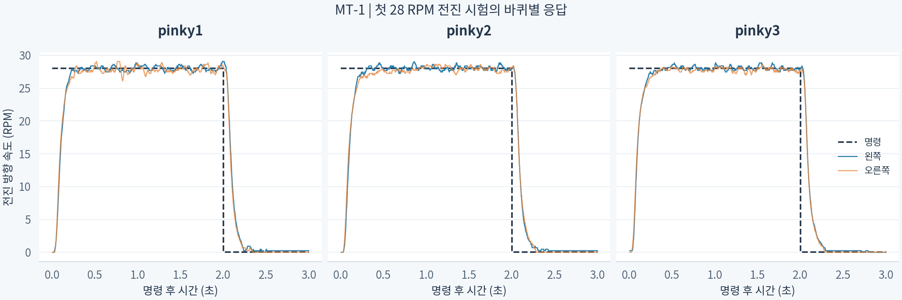
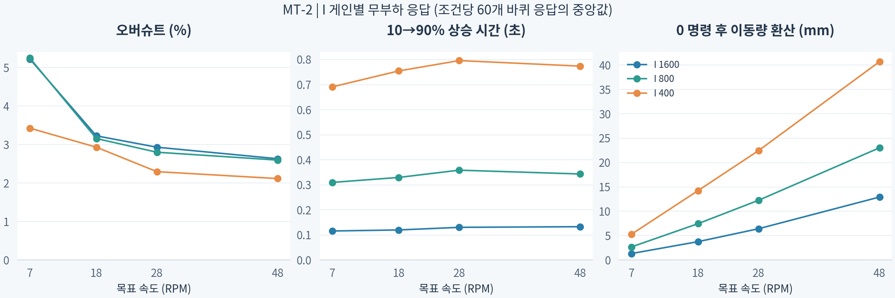
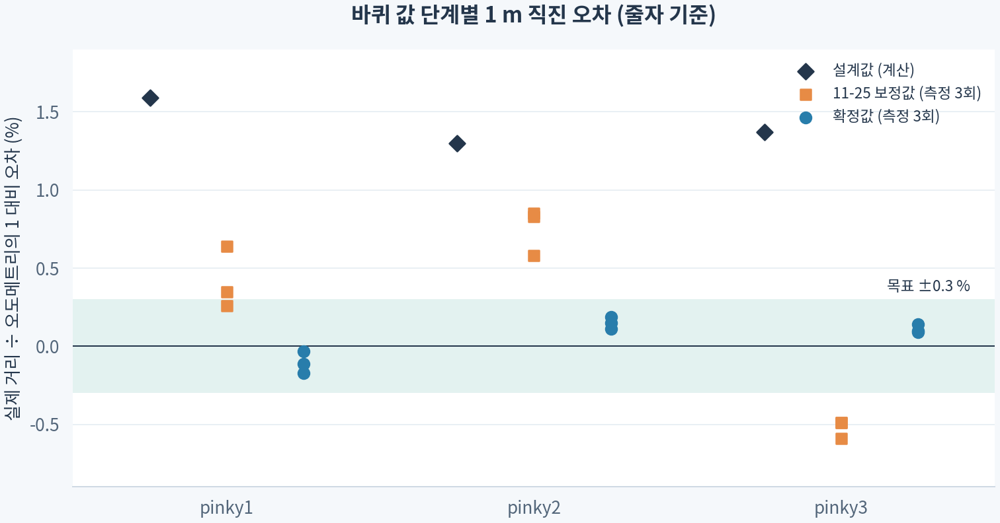
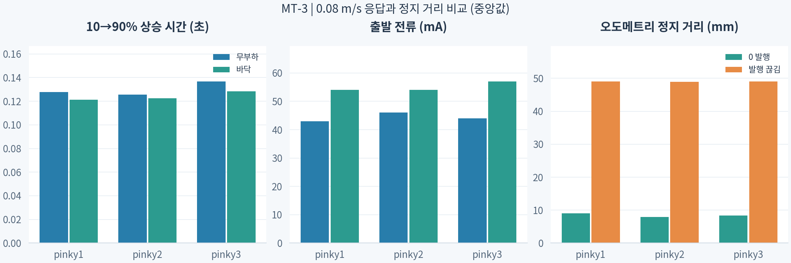
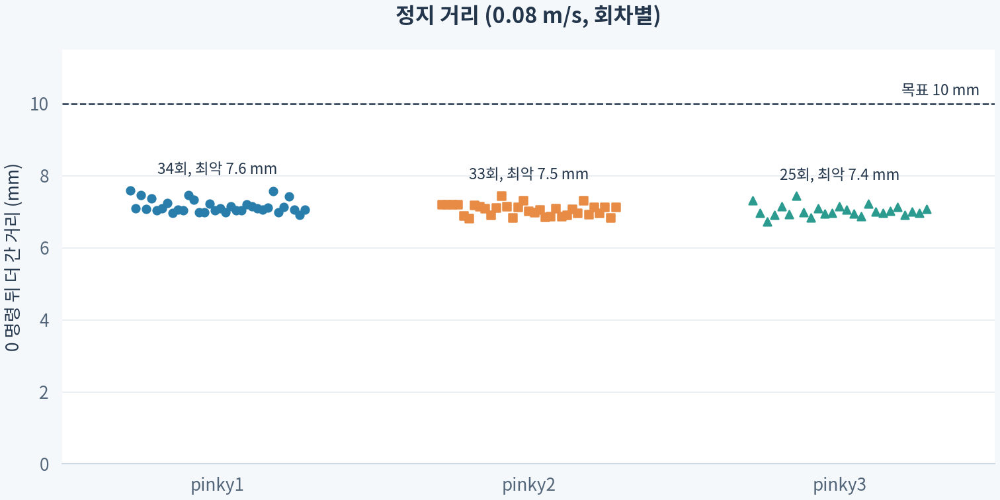
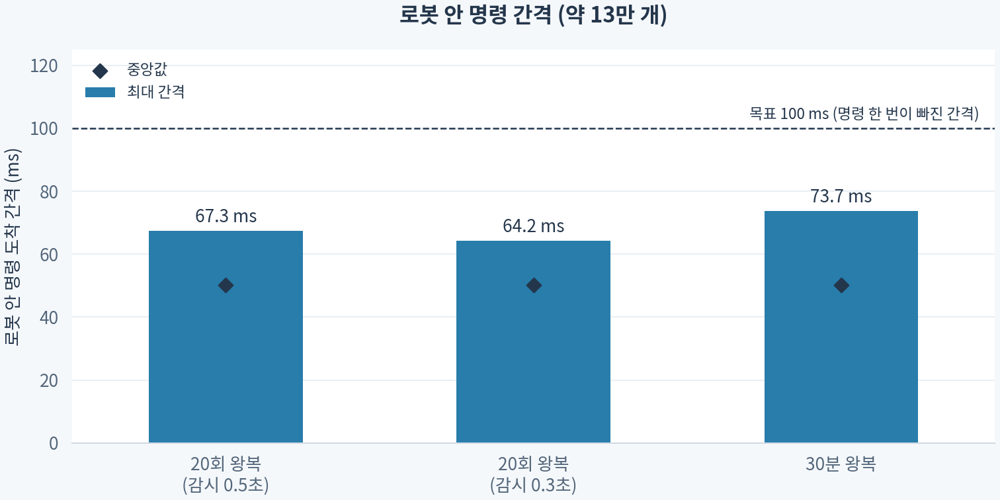
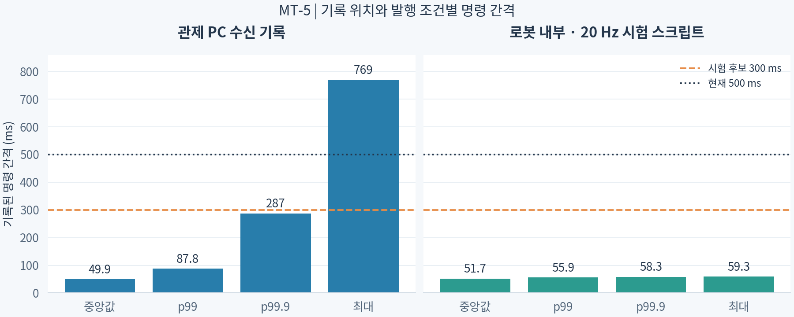
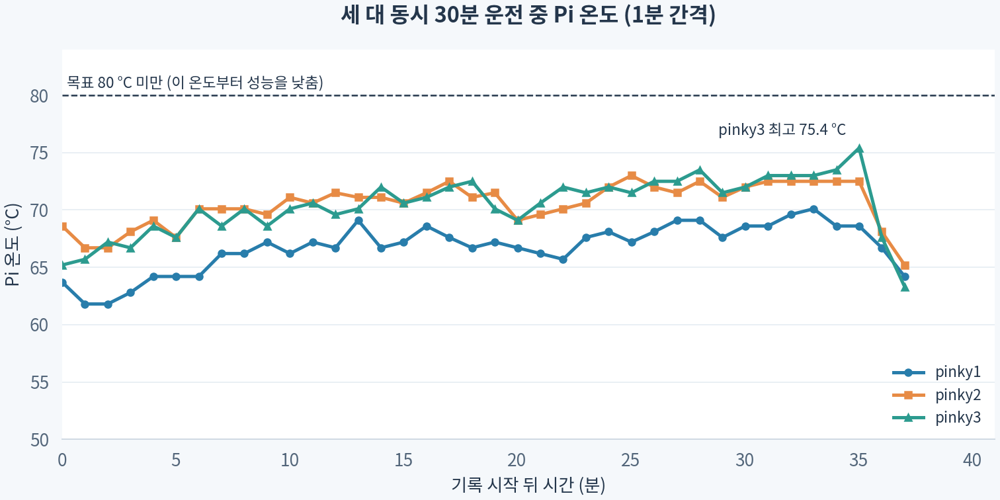
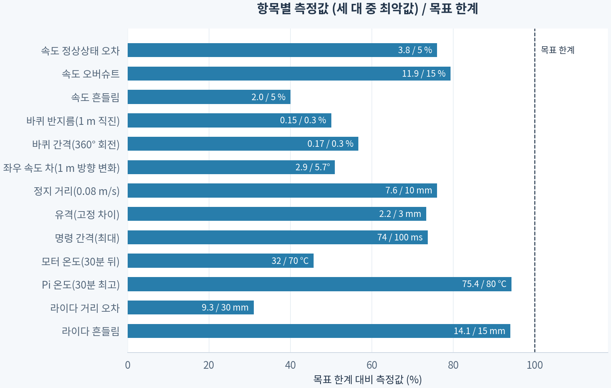

# Pinky Pro 하드웨어 검증 결과 (2026-11-24 ~ 11-26)

프로젝트 마무리 발표와 보고서에 쓰기 위해 정리하는 문서입니다. 시험별 원자료와 경과는 [모터 검사 기록](2026-11-24_MOTOR_PID_CHECK.md)에 있고, 이 문서는 왜 했는지, 무엇을 어떤 목표로 봤는지, 결과가 무엇인지를 담습니다.

## 1. 왜 하드웨어를 검증했는가

### 1.1 출발점

FryBot은 같은 관제·주행 코드로 시뮬레이션과 실제 Pinky를 모두 움직입니다. 시뮬레이션의 로봇은 명령한 속도로 정확히 움직이고 바퀴 치수도 설계값 그대로입니다. 실제 로봇이 그 가정대로 움직이는지는 확인된 적이 없었습니다.

- 모터 속도 제어 값(게인)은 모터 안에 들어 있는데, 코드에서 읽어 본 적이 없었습니다.
- 바퀴 반지름과 간격은 세 대 모두 같은 설계값(0.027 m, 0.0961 m)을 쓰고 있었습니다.
- 명령이 끊겼을 때 로봇이 얼마나 더 가는지, 스택을 끄면 모터가 어떤 상태로 남는지 잰 적이 없었습니다.

### 1.2 검증이 필요한 이유

로봇이 명령한 대로, 그리고 코드가 가정한 값대로 움직이는지 확인하는 것은 실제 로봇으로 주행을 개발할 때 먼저 해 두어야 하는 일입니다. 이유는 두 가지입니다.

1. **가정이 틀리면 그 위에 쌓은 것이 모두 어긋납니다.** 오도메트리, 위치 추정, 경로 계획의 시간 예측은 모두 "명령한 속도로 움직이고 바퀴 치수가 맞다"는 전제 위에 있습니다.
2. **문제가 생겼을 때 원인을 찾는 범위가 좁아집니다.** 주행 문제는 하드웨어, 내부 설정, 위치 추정, 경로 추종, 관제 어디에서든 생길 수 있습니다. 하드웨어가 검증돼 있으면 그 뒤의 문제는 소프트웨어와 운용 조건에서 찾으면 됩니다.

검증을 시작할 때 이미 원인이 가려지지 않은 주행 문제가 있었습니다. 제자리 회전에서 오도메트리와 위치 추정의 각도가 15% 달랐고(T-42), 위치 추정의 방향이 25° 틀어진 적이 있었으며(T-50), 구간마다 2.27초의 지연이 붙었습니다(T-23). 이 문제들은 모터, 주행 제어기, Nav2 어디에서든 생길 수 있어, 원인이 아닌 곳을 고치면 문제는 남고 정상이던 동작만 달라질 위험이 있었습니다.

### 1.3 검증으로 답하려는 것

| 질문 | 뜻 |
| --- | --- |
| 내부 파라미터가 맞게 설정됐는가 | 모터 게인, 바퀴 반지름·간격, 명령 감시 시간이 측정값에 맞는가 |
| 구동부에 문제가 없는가 | 모터·바퀴·엔코더가 명령한 대로 움직이고 서는가 |
| 그 밖의 하드웨어에 문제가 없는가 | 통신, 열과 전원, 라이다가 운용 조건에서 사양 안인가 |

최종적으로 말하려는 문장은 이것입니다. "측정 결과에 맞춰 로봇 내부 파라미터를 재조정했고, 확인한 범위에서 Pinky Pro 하드웨어에는 문제가 없다."

### 1.4 검증이 실제로 쓰인 예

검증 중에 나온 문제 세 가지가 이 목적대로 다뤄졌습니다.

| 증상 | 하드웨어를 의심할 수 있었던 이유 | 실제 원인 |
| --- | --- | --- |
| 스택을 꺼도 바퀴가 잠겨 있음 | 모터나 구동 회로 이상처럼 보임 | 드라이버 종료 처리의 신호 순서(소프트웨어, T-59) |
| 직진 거리가 로봇마다 1~2% 다름 | 바퀴나 엔코더 불량처럼 보임 | 보정의 기준으로 쓴 라이다 측정의 치우침(측정 방법, T-60) |
| 30분 주행 중 pinky3이 벽 앞에서 멈춤 | 모터나 센서 고장처럼 보임 | 매장 배치를 바꾼 뒤 지도를 갱신하지 않아 위치 추정이 밀린 것으로 추정(운용 조건, T-61) |

세 번째는 마지막 시험(30분 운전) 중에 나온 문제입니다. 모터·바퀴·통신·열이 목표 안임을 같은 시험에서 확인했기 때문에, 곧바로 위치 추정과 지도 쪽으로 범위를 좁힐 수 있었습니다. 이 문제의 원인은 아직 추정입니다(6.2절).

## 2. 무엇을 봤는가

### 2.1 항목과 정량 목표

명령이 로봇의 움직임이 되기까지의 순서를 따라가며, 단계마다 "코드가 가정한 것"을 측정으로 확인할 항목과 목표를 잡았습니다.

| 단계 | 코드가 가정한 것 | 확인한 항목 | 정량 목표 |
| --- | --- | --- | --- |
| 속도 명령 → 모터 | 명령한 속도로 돈다 | 모터 게인과 계단 응답(무부하·바닥) | 정상상태 오차 5% 이하, 오버슈트 15% 이하, 흔들림 5% 이하 |
| | 좌우가 같이 돈다 | 좌우 바퀴 속도 차 | 1 m 직진 뒤 방향 변화 5.7°(0.1 rad) 이하 |
| | 모터에 이상이 없다 | 모터 오류 상태 | Hardware Error 0 |
| 모터 → 바퀴 → 바닥 | 바퀴 반지름이 설정값과 같다 | 1 m 직진 거리 | 실제 거리 ÷ 오도메트리 = 1 ± 0.003 (1 m에서 3 mm) |
| | 바퀴 간격이 설정값과 같다 | 제자리 360° 회전 | 실제 회전각 ÷ 오도메트리 = 1 ± 0.003 |
| | 바퀴가 놀지 않는다 | 유격(이동마다 붙는 고정 차이) | 3 mm 이하 |
| 정지 | 0을 명령하면 곧 선다 | 정지 거리(0.08 m/s) | 1.0 cm 이하 |
| | 명령이 끊기면 스스로 선다 | 명령 감시 시간 | 0.3초 넘게 끊기면 정지 명령, 정상 주행 중 잘못 서는 일 0건 |
| | 끄면 모터가 풀린다 | 종료 뒤 모터 토크 | 시험한 종료 방법 모두에서 토크 꺼짐 |
| 명령 전달 | 명령이 끊기지 않고 닿는다 | 로봇 안 명령 간격 | 0.1초 넘는 간격 0건 |
| | 무선 연결이 안정적이다 | Wi-Fi 품질 | 응답 손실 0% |
| 지속 운전 | 계속 달려도 열과 전원이 버틴다 | 세 대 동시 30분 운전 | 모터 70 °C 미만, Pi 80 °C 미만, 배터리 6.8 V 초과, Hardware Error 0 |
| 거리 센서 | 라이다가 사양대로 잰다 | 라이다 거리·흔들림·주파수 | 거리 오차 30 mm 이하, 흔들림 15 mm 이하, 8~12 Hz |

이 항목들을 세 묶음으로 나눠 3~5장에 결과를 적습니다. 내부 파라미터(모터 게인, 바퀴 반지름·간격, 명령 감시 시간), 구동부(계단 응답, 좌우 속도 차, 정지 거리, 유격, 모터 오류), 그 밖의 하드웨어(명령 전달, 지속 운전, 라이다)입니다. 종료 뒤 모터 토크는 원인이 소프트웨어였으므로 6장 "검증 중 찾은 문제"에 따로 적습니다.

### 2.2 시험 조건

| 조건 | 값 |
| --- | --- |
| 대상 | Pinky Pro 세 대(pinky1·2·3), 모터 XL330-M288-T, 라이다 RPLIDAR C1 |
| 속도 | 시나리오에서 쓰는 0.05 m/s(안내)와 0.08 m/s(일반). 계단 응답은 0.135 m/s까지 |
| 상태 | 짐을 싣지 않은 로봇, 매장 바닥 |
| 기간 | 2026-11-24 ~ 11-26, 사흘 |
| 목표의 근거 | 모터·라이다·Pi는 제조사 사양, 나머지는 프로젝트 수치(3~5장에 항목별로 적음) |

### 2.3 시험 순서

| 날짜 | 시험 | 한 일 |
| --- | --- | --- |
| 11-24 | MT-1 ~ MT-3 | 모터 레지스터 읽기, 무부하·바닥 계단 응답, I 게인 변경 실험, 정지 거리 |
| 11-24 ~ 25 | MT-4 ~ MT-6 | 로봇별 바퀴 값 적용, 명령 간격 분석, 세 대 20회 왕복 |
| 11-25 | MT-7 | 명령 감시 시간 0.3초 적용, 종료 뒤 토크 문제 수정, 직진 오차 원인 추적 |
| 11-25 ~ 26 | 마무리 시험 | 정지 거리 재분석, 1 m 직진 줄자 대조와 바퀴 값 재보정, 세 대 30분 왕복 |

## 3. 내부 파라미터

로봇 안에 들어 있는 설정값 세 가지를 측정으로 확인하고, 맞지 않는 것은 고쳤습니다.

| 파라미터 | 처음 값 | 결과 | 조치 |
| --- | --- | --- | --- |
| 모터 속도 제어 게인 | 제조사 기본값(I 1600, P 180) | 목표 안, 바꿔도 이득 없음 | 유지 |
| 바퀴 반지름·간격 | 세 대 모두 설계값(0.027 m, 0.0961 m) | 설계값보다 반지름이 1.3~1.6% 큼 | 로봇별 값으로 보정 |
| 명령 감시 시간 | 0.5초 | 0.3초로 줄여도 잘못 서지 않음 | 0.3초로 변경 |

### 3.1 모터 속도 제어 게인

**왜 봤는가.** 바퀴 속도를 맞추는 제어는 모터 안에서 이뤄지고, 그 게인은 코드에서 읽거나 쓴 적이 없었습니다. 주행 문제가 생겼을 때 모터 쪽 튜닝이 필요한지부터 알 수 없는 상태였습니다.

**어떻게 봤는가.**

1. 세 대의 모터에서 게인과 한계값을 읽었습니다.
2. 바퀴를 띄운 상태(7~48 RPM)와 바닥(0.05~0.135 m/s)에서 속도 계단 명령을 주고 응답을 쟀습니다.
3. 게인을 실제로 바꿔 보고(I 1600 → 800 → 400) 응답이 나아지는지 비교했습니다.

**목표와 근거.** 정상상태 오차 5% 이하, 오버슈트 15% 이하, 흔들림 5% 이하. 모터를 손볼 필요가 있는지 거르기 위해 잡은 기준입니다. 관제가 경로 시간을 계산할 때 속도에 10% 여유를 두므로, 속도 오차가 5% 안이면 계획과 실제가 어긋나지 않습니다. 오버슈트는 약 0.1초 동안만 넘치는 것이라 15%여도 거리로는 1 mm 안팎이고, 흔들림 5%는 모터 속도 눈금 몇 칸에 해당합니다.

**결과.**

| 로봇 | 정상상태 오차(최악) | 오버슈트(최악) | 흔들림(최악) |
| --- | --- | --- | --- |
| pinky1 | 3.7% | 11.7% | 2.0% |
| pinky2 | 3.6% | 11.5% | 1.9% |
| pinky3 | 3.8% | 11.9% | 1.7% |

- 표는 바퀴를 띄운 상태에서 잰 최악값이고, 흔들림은 18 RPM 이상의 값입니다.
- 세 대 모두 목표 안이고, 로봇 간 차이가 거의 없습니다. 바닥에서도 응답 모양은 바퀴를 띄웠을 때와 비슷했습니다(4.1절).
- I 게인을 낮추면 오버슈트는 거의 줄지 않고 응답과 정지만 느려졌습니다.

**조치.** 게인은 제조사 기본값을 그대로 씁니다. 모터 튜닝은 필요하지 않습니다.

### 3.2 바퀴 반지름과 간격

**왜 봤는가.** 로봇은 바퀴가 돈 양에 반지름을 곱해 이동 거리를 계산합니다(오도메트리). 반지름 값이 1% 틀리면 계산한 거리도 1% 틀리고, 간격 값이 틀리면 회전각이 틀립니다. 세 대가 같은 설계값을 쓰고 있었고 실제 치수와 맞는지 확인한 적이 없었습니다.

**어떻게 봤는가.** 로봇을 1 m 직진시키고 줄자로 잰 실제 이동 거리를 오도메트리와 비교했습니다. 회전은 제자리에서 360° 돌린 뒤 정지 상태의 라이다 스캔으로 실제 회전각을 구해 비교했습니다. 로봇마다 직진 3회의 평균으로 판정했습니다.

**목표와 근거.** 실제 값 ÷ 오도메트리 = 1 ± 0.003. 지도에서 가장 긴 직선 통로(1.45 m)를 위치 보정 없이 가도 오차가 도착 허용 오차(1.5 cm) 안에 들려면 바퀴 값 오차가 1.0% 이하여야 합니다. 설계값의 오차(1.3~1.6%)는 이 한계를 넘습니다. 목표는 줄자로 확인할 수 있는 가장 엄격한 수준인 0.3%로 잡았습니다(1 m에서 3 mm, 줄자 읽기 오차 1~2 mm의 3회 평균으로 가를 수 있는 크기).

| 바퀴 값 오차 | 1.45 m에서 쌓이는 오차 | 도착 허용 오차 1.5 cm 대비 |
| --- | --- | --- |
| 설계값 그대로 (1.3~1.6%) | 19~23 mm | 넘음 |
| 필요 한계 (1.0%) | 14.5 mm | 경계 |
| 목표 (0.3%) | 4.4 mm | 약 3분의 1 |

실제 주행에서는 위치 추정이 라이다로 위치를 계속 고치므로 오도메트리 오차가 그대로 도착 오차가 되지는 않습니다. 이 목표는 위치 보정에 기대지 않아도 되는 수준을 뜻합니다.

**결과.**

| 로봇 | 설계값 (반지름 / 간격) | 보정값 (반지름 / 간격) | 설계값 대비 반지름 | 보정 뒤 직진 (3회 평균) | 보정 뒤 회전 (좌 / 우) |
| --- | --- | --- | --- | --- | --- |
| pinky1 | 0.02700 / 0.0961 | 0.02743 / 0.0966 | +1.6% | 0.9990 | 1.0003 / 0.9999 |
| pinky2 | 0.02700 / 0.0961 | 0.02735 / 0.0977 | +1.3% | 1.0015 | 1.0008 / 1.0017 |
| pinky3 | 0.02700 / 0.0961 | 0.02737 / 0.0983 | +1.4% | 1.0011 | 1.0002 / 1.0000 |

- 세 대 모두 실제 반지름이 설계값보다 1.3~1.6% 컸습니다. 설계값을 그대로 쓰면 1 m를 갔을 때 오도메트리가 13~16 mm 짧게 셉니다(보정값에서 계산한 값).
- 보정 뒤에는 세 대 모두 직진과 회전이 목표 안입니다.
- 보정한 반지름은 세 대가 0.3% 안에서 같습니다. 같은 바퀴를 쓰는 로봇이라는 점과 맞습니다.

**과정에서 알게 된 것.** 처음에는 로봇의 라이다로 이동 거리를 재서 보정했습니다. 그렇게 정한 값은 줄자 기준으로 확정한 값과 로봇마다 −0.9~+1.9% 달랐습니다. 라이다가 잰 이동 거리가 로봇마다 다르게 치우쳐(1 m에서 1~9 mm), 0.3%를 가리는 기준으로는 쓸 수 없었기 때문입니다. 보정 기준을 줄자로 바꿔 다시 맞췄습니다. 센서로 다른 센서를 보정할 때는 독립된 기준이 필요하다는 것을 확인한 사례입니다.

**조치.** 로봇별 보정값을 등록해 기동할 때 적용합니다.

### 3.3 명령 감시 시간

**왜 봤는가.** 주행 명령은 주기적으로 계속 와야 합니다. 통신이나 프로그램 문제로 명령이 끊기면 로봇은 마지막 속도로 계속 가므로, 일정 시간 명령이 없으면 드라이버가 스스로 모터를 세웁니다. 이 시간이 길면 끊겼을 때 더 멀리 가고, 짧으면 정상 주행 중에 잘못 설 수 있습니다. 처음 값 0.5초가 적당한지 측정한 적이 없었습니다.

**어떻게 봤는가.**

1. 0.08 m/s로 주행하다 명령을 일부러 끊고, 설 때까지 더 간 거리를 쟀습니다.
2. 로봇 안에서 명령이 실제로 얼마 간격으로 도착하는지 기록했습니다.
3. 감시 시간을 0.3초로 줄여 세 대를 동시에 주행시키고 잘못 서는 일이 있는지 봤습니다(20회 왕복, 30분 왕복).

**목표와 근거.** 명령이 0.3초 넘게 끊기면 드라이버가 정지 명령을 내리고, 정상 주행 중 잘못 서는 일이 0건. 0.3초는 측정한 명령 간격의 최댓값(74 ms)의 4배입니다.

**결과.**

| 항목 | 감시 0.5초 | 감시 0.3초 |
| --- | --- | --- |
| 감시가 걸린 시각(명령이 끊긴 뒤) | - | 0.31~0.33초 |
| 완전히 설 때까지 걸린 시간 | 0.70~0.74초 | 0.51~0.57초 |
| 명령이 끊긴 뒤 더 간 거리(0.08 m/s) | 4.9~5.3 cm | 3.3~3.7 cm |
| 정상 주행 중 감시가 잘못 걸린 횟수 | 0 (20회 왕복) | 0 (20회 왕복과 30분 왕복) |

로봇 안에서 잰 명령 간격은 중앙 50 ms, 최대 74 ms였습니다(약 13만 개, 5.1절).

**조치.** 드라이버의 기본값을 0.3초로 바꿨습니다.

## 4. 구동부 (모터·바퀴·엔코더)

모터가 명령대로 돌고, 로봇이 곧게 가고, 제때 서는지를 봤습니다.

| 항목 | 목표 | 결과 | 판정 |
| --- | --- | --- | --- |
| 바닥에서의 모터 응답과 오류 | 무부하와 같은 응답, Hardware Error 0 | 응답 같음, 전류는 한계의 6%, 오류 0 | 통과 |
| 좌우 바퀴 속도 차 | 1 m 직진 뒤 방향 변화 5.7° 이하 | −0.4° / +0.2° / −2.9° | 통과 |
| 정지 거리 | 0.08 m/s에서 1.0 cm 이하 | 최악 7.6 mm (로봇당 25~34회) | 통과 |
| 유격 | 이동마다 붙는 고정 차이 3 mm 이하 | 최대 2.2 mm | 통과 |

### 4.1 바닥에서의 모터 응답과 오류

**왜 봤는가.** 3.1절의 응답은 바퀴를 띄운 상태에서 잰 것입니다. 로봇 무게를 싣고 바닥을 굴러갈 때도 같은 응답이 나오는지, 모터에 무리가 가지 않는지는 따로 확인해야 합니다.

**어떻게 봤는가.** 매장 바닥에서 0.05·0.08·0.135 m/s 계단 명령을 주고 응답과 전류를 쟀습니다. 시험이 끝날 때마다 모터의 오류 상태(Hardware Error)를 읽었습니다.

**결과.**

- 정상상태 속도, 상승 시간(0.12~0.13초), 정지 시간(0.20~0.23초)이 바퀴를 띄웠을 때와 같았습니다. 오버슈트는 최악 8.3%입니다.
- 전류는 출발할 때 최대 113 mA로, 모터 한계(1,750 mA)의 6%입니다.
- Hardware Error는 사흘 동안 시험 전후에 읽을 때마다 세 대 모두 0이었습니다.

### 4.2 좌우 바퀴 속도 차

**왜 봤는가.** 바퀴 두 개의 속도 차로 방향을 바꾸는 로봇이라, 직진 명령에서 좌우 속도가 다르면 로봇이 휩니다. 막다른 곳에서 나올 때처럼 위치 보정 없이 직접 주행하는 구간에서는 이 차이가 그대로 경로 오차가 됩니다.

**어떻게 봤는가.** 방향 보정 없이 1 m를 직진시키고, 출발 전과 도착 뒤에 앞 벽이 보이는 각도의 차이로 실제 방향 변화를 구했습니다. 바퀴 엔코더가 돈 양의 좌우 차이도 함께 봤습니다.

**목표와 근거.** 1 m 직진 뒤 방향 변화 5.7°(0.1 rad) 이하. 주행 제어기는 목표 방향과 0.2 rad 넘게 어긋나면 멈춰서 다시 회전하므로, 그 절반을 여유로 잡았습니다. 좌우 속도 차로 환산하면 약 1%입니다.

**결과.**

| 로봇 | 1 m 직진 뒤 방향 변화(3회 평균) | 회차별 최대 | 엔코더 좌우 차 |
| --- | --- | --- | --- |
| pinky1 | −0.4° | 0.7° | 0.1% 이하 |
| pinky2 | +0.2° | 0.9° | 0.1% 이하 |
| pinky3 | −2.9° | 2.9° | 0.1% 이하 |

- 세 대 모두 3회가 전부 목표 안입니다.
- pinky3의 2.9°는 엔코더 좌우 차(0.1%는 약 0.5°에 해당)로 다 설명되지 않습니다. 약 2°가 남고, 원인(바퀴가 바닥에 닿는 차이, 미끄러짐, 방향 측정의 한계)은 확인하지 못했습니다.

**과정에서 알게 된 것.** 처음에는 모터가 보고하는 속도값으로 좌우 차를 계산해 "최악 2.3%"가 나왔습니다. 이 속도값은 눈금 하나가 0.229 RPM이고 정지 중에도 한 눈금이 찍혀, 방향에 따라 1~1.5%의 가짜 차이를 만듭니다. 엔코더가 실제로 돈 양으로 다시 계산하니 1 m 구간에서는 0.1% 이하, 짧은 구간까지 포함해도 최대 0.7%였습니다. 처음의 2.3%에는 이 가짜 차이가 섞여 있었던 것으로 보입니다.

### 4.3 정지 거리

**왜 봤는가.** 로봇이 0 명령을 받고 완전히 설 때까지 더 가는 거리입니다. 이 값을 알아야 장애물 앞에서 얼마나 일찍 서야 하는지 정할 수 있고, 도착 지점을 지나치지 않는지도 알 수 있습니다.

**어떻게 봤는가.** 마지막 주행 명령을 보낸 시각부터 완전히 설 때까지 오도메트리로 잰 이동 거리를 로봇 안 기록에서 구했습니다. 직진 시험들의 정지 구간을 모두 모아 로봇당 25~34회를 봤습니다.

**목표와 근거.** 0.08 m/s에서 1.0 cm 이하. 직접 주행할 때 장애물 앞에서 남기는 여유(로봇 앞끝에서 2.1 cm)의 절반입니다.

**결과.**

| 로봇 | 횟수 | 정지 거리 최악 | 정지 시간(중앙) |
| --- | --- | --- | --- |
| pinky1 | 34 | 7.6 mm | 0.22초 |
| pinky2 | 33 | 7.5 mm | 0.22초 |
| pinky3 | 25 | 7.4 mm | 0.22초 |

- 세 대의 최악값이 0.2 mm 안에서 같습니다. 선 뒤에 반대로 밀리는 일은 없었습니다.
- 0.05 m/s에서는 최악 4.5 mm입니다.

### 4.4 유격

**왜 봤는가.** 모터와 바퀴 사이, 바퀴와 바닥 사이에 놀음이 있으면 출발하거나 방향을 바꿀 때마다 엔코더는 돌았는데 로봇은 덜 움직입니다. 이 차이는 거리에 비례하지 않고 이동할 때마다 일정하게 붙어, 짧은 구간을 여러 번 오가는 주행에서 쌓입니다.

**어떻게 봤는가.** 바퀴 둘레의 0.5·1·1.5·2배 거리(약 9~35 cm)를 전진·후진으로 3회씩 오가며, 라이다로 잰 이동과 오도메트리의 차이를 거리에 대해 직선으로 맞췄습니다. 기울기는 거리에 비례하는 몫(바퀴 값 오차 등)이고, 절편이 이동마다 붙는 고정 차이입니다. 라이다로 잰 이동은 앞 벽까지의 거리 변화와 스캔 맞춤, 두 가지 방법으로 계산했습니다.

**목표와 근거.** 고정 차이 3 mm 이하. 도착 허용 오차(1.5 cm)의 5분의 1로 잡은 목표입니다.

**결과.**

| 로봇 | 고정 차이(전진 / 후진, 앞벽 거리 기준) | 같은 값(스캔 맞춤 기준) |
| --- | --- | --- |
| pinky1 | −0.1 / +0.3 mm | +0.3 / +0.6 mm |
| pinky2 | +1.2 / +0.7 mm | −1.3 / −0.5 mm |
| pinky3 | +1.1 / +0.9 mm | −2.2 / −1.7 mm |

- 두 가지 계산 방법 모두에서 세 대가 목표 안입니다(절댓값 최대 2.2 mm).
- 바퀴 둘레의 정수배 거리에서도 차이가 사라지지 않아, 바퀴 한 바퀴를 주기로 하는 오차(바퀴 중심 어긋남 등)는 보이지 않았습니다.
- 바퀴에 표시를 붙여 직접 잰 값이 아니라 주행 결과에서 뽑은 간접 값입니다.

## 5. 그 밖의 하드웨어 (명령 전달, 지속 운전, 라이다)

| 항목 | 목표 | 결과 | 판정 |
| --- | --- | --- | --- |
| 로봇 안 명령 간격 | 0.1초 넘는 간격 0건 | 약 13만 개 중 0건, 최대 74 ms | 통과 |
| Wi-Fi 품질 | 응답 손실 0% | 손실 0% | 통과 |
| 세 대 동시 30분 운전 | 모터 70 °C 미만, Pi 80 °C 미만, 배터리 6.8 V 초과, Hardware Error 0 | 모터 30~32 °C, Pi 최고 75.4 °C, 배터리 최저 7.20 V, 오류 0. 임무 보류 1건(위치 추정 문제, 6.2절) | 하드웨어 항목 통과 |
| 라이다 | 거리 오차 30 mm 이하, 흔들림 15 mm 이하, 8~12 Hz | 오차 최대 9.3 mm, 흔들림 최대 14.1 mm, 9.8~9.9 Hz | 통과 |

### 5.1 명령 전달

**왜 봤는가.** 로봇 안에서 주행 명령은 초당 20번 드라이버로 전달됩니다. 이 전달이 끊기거나 늦으면 로봇이 덜컥거리고, 0.3초 넘게 끊기면 명령 감시가 로봇을 세웁니다. 로봇의 컴퓨터(Raspberry Pi)가 주행 프로그램을 모두 돌리면서 명령을 제때 내보내는지 확인해야 했습니다.

**어떻게 봤는가.** 세 대를 동시에 주행시키면서, 로봇 안에서 드라이버가 받는 명령의 도착 간격을 모두 기록했습니다(20회 왕복 두 번과 30분 왕복). 시험 전마다 공유기까지의 응답 손실과 신호 세기를 쟀습니다.

**목표와 근거.** 0.1초 넘는 간격 0건. 주행 명령은 0.05초마다 나오므로(초당 20번), 간격이 0.1초를 넘으면 명령이 한 번 이상 빠진 것입니다. 즉 명령이 한 번 통째로 빠진 크기의 간격이 없어야 한다는 뜻입니다. 0.1초는 모터가 속도를 바꾸는 데 걸리는 시간(0.12~0.13초)보다 짧아 이 안의 흔들림은 움직임에 크게 드러나지 않고, 명령 감시 시간(0.3초)의 3분의 1이라 감시가 잘못 걸릴 여유도 충분합니다.

**결과.**

| 시험 | 기록한 간격 수 | 중앙값 | 최대 | 0.1초 넘는 간격 |
| --- | --- | --- | --- | --- |
| 20회 왕복 (감시 0.5초) | 25,083 | 50.1 ms | 67.3 ms | 0 |
| 20회 왕복 (감시 0.3초) | 23,390 | 50.1 ms | 64.2 ms | 0 |
| 30분 왕복 | 82,688 | 50.1 ms | 73.7 ms | 0 |

- Wi-Fi는 세 대 모두 응답 손실 0%, 신호 세기 −62~−70 dBm(5 GHz)이었습니다.

**과정에서 알게 된 것.** 처음에는 다른 날 관제 PC에서 기록한 자료로 명령 간격을 봤고, 0.5초를 넘는 간격이 여러 번 보였습니다. 로봇 안에서 다시 재니 최대 0.07초였습니다. PC에서 본 긴 간격은 대부분 무선 구간의 전달 지연으로 보이며, 드라이버가 실제로 겪은 것이 아니었습니다.

 측정은 그 값을 실제로 쓰는 곳에서 해야 한다는 것을 확인한 사례입니다.

### 5.2 세 대 동시 30분 운전

**왜 봤는가.** 앞의 시험들은 한 번에 몇 분씩이었습니다. 열과 전원 문제는 계속 달릴 때 나타나므로, 실제 운용처럼 세 대를 함께 오래 돌렸을 때 모터와 컴퓨터의 온도, 전압이 버티는지 따로 확인해야 했습니다.

**어떻게 봤는가.** 관제와 세 대를 모두 띄우고 왕복시켰습니다. 주행 시간의 합은 1,810초(로봇당 67~68회 왕복)이고, 중간에 두 번(약 2분, 약 4분) 멈췄다가 이어서 했습니다. 주행 중에는 로봇 컴퓨터의 온도와 과열·저전압 제한 여부를 1분마다, 배터리 전압을 계속 기록했습니다. 모터의 온도·전압·오류는 시작 전과 종료 직후에 모터에서 직접 읽었습니다.

**목표와 근거.** 모터는 제조사 사양의 온도 한계 70 °C(세 대의 모터에서 직접 읽어 확인)와 입력 전압 범위 3.7~6.0 V, Raspberry Pi는 성능을 낮추기 시작하는 80 °C, 배터리는 제조사 구동 프로그램이 저전압 경고를 내는 6.8 V입니다.

**결과.**

| 항목 | 목표 | pinky1 | pinky2 | pinky3 |
| --- | --- | --- | --- | --- |
| 모터 온도(시작 전 → 종료 뒤) | 70 °C 미만 | 29 → 32 °C | 28~29 → 30~31 °C | 27 → 30 °C |
| 모터 입력 전압 | 3.7~6.0 V | 5.0 V | 5.0 V | 4.9~5.0 V |
| 모터 Hardware Error | 0 | 0 | 0 | 0 |
| Pi 온도(기동 전 → 최고) | 80 °C 미만 | 52.1 → 70.1 °C | 57.9 → 73.0 °C | 56.0 → 75.4 °C |
| Pi 과열·저전압 제한 | 없음 | 없음 | 없음 | 없음 |
| 배터리(시작 → 최저) | 6.8 V 초과 | 7.45 → 7.20 V | 7.60 → 7.47 V | 7.51 → 7.39 V |

- 모터는 30분 운전에 약 3 °C 올랐습니다. 다만 모터 값은 종료 약 75초 뒤에 읽은 것이라 주행 중 최고 온도보다 낮을 수 있습니다.

- Pi 온도는 1분 간격으로 기록했습니다. 처음 10분에 빠르게 오른 뒤 완만해졌고, 가장 높은 pinky3이 목표까지 4.6 °C 남았습니다.
- 운전 중 pinky3의 임무가 한 번 보류됐습니다. 원인은 하드웨어가 아니라 위치 추정이었고, 6.2절에 적었습니다.

### 5.3 라이다

**왜 봤는가.** 라이다는 로봇이 자기 위치를 찾고 장애물 앞에서 서는 기준입니다. 라이다가 사양대로 재지 못하면 위치 추정과 안전 정지가 모두 흔들립니다.

**어떻게 봤는가.** 1 m 이동에서 라이다가 잰 앞 벽까지의 거리 변화를 줄자와 비교했고, 로봇이 서 있을 때 찍은 스캔(로봇당 30~40장)에서 흔들림과 주파수를 구했습니다.

**목표와 근거.** 제조사 사양(RPLIDAR C1)에서 가져왔습니다. 거리 오차는 사양의 정확도 ±30 mm, 흔들림은 사양의 거리 분해능 15 mm를 기준으로 삼았고, 스캔 주파수는 사양 범위 8~12 Hz입니다.

**결과.**

| 항목 | 목표 | pinky1 | pinky2 | pinky3 |
| --- | --- | --- | --- | --- |
| 1 m 이동 거리 오차(앞 벽 거리 변화 − 줄자, 3회) | 30 mm 이하 | −1.8 / −0.3 / −1.3 mm | −7.6 / −6.1 / −4.7 mm | −8.3 / −9.3 / −8.5 mm |
| 정지 흔들림(중앙 / 최대) | 15 mm 이하 | 0.80 / 14.1 mm | 0.83 / 7.4 mm | 0.89 / 8.5 mm |
| 스캔 주파수 | 8~12 Hz | 9.83 Hz | 9.94 Hz | 9.84 Hz |
| 장치 상태 | OK | OK | OK | OK |

**과정에서 알게 된 것.** 세 대 모두 사양 안이지만, 이동 거리 오차가 로봇마다 다릅니다(1 m에서 평균 −1 / −6 / −9 mm). 사양으로는 문제가 없는 크기인데, 바퀴 값을 0.3%까지 맞추는 기준으로 쓰기에는 큽니다. 3.2절에서 보정 기준을 줄자로 바꾼 이유입니다.

## 6. 검증 중 찾은 문제

하드웨어를 확인하는 과정에서 하드웨어처럼 보이는 문제가 나왔습니다. 바퀴 값의 보정 기준 문제는 3.2절에 적었고, 여기에는 나머지 두 가지를 적습니다. 하나는 소프트웨어 문제여서 고쳤고, 하나는 운용 조건의 문제로 보이며 확인이 남아 있습니다.

### 6.1 종료 뒤 모터 토크가 남는 문제

**목표.** 평소 쓰는 종료 방법(원격 정지, 관제 프로그램 중단, 관제 종료) 어느 것으로 끄더라도 모터 토크가 꺼질 것.

**왜 봤는가.** 시험을 정리하다가 스택을 끈 뒤에도 바퀴가 잠겨 있는 로봇을 발견했습니다. 모터 토크가 켜진 채 남으면 바퀴를 손으로 밀 수 없고, 모터가 계속 전류를 써 열과 배터리 소모가 생깁니다.

**어떻게 봤는가.** 종료 방법별로 반복해 재현 조건을 찾고, 원인을 고친 뒤 같은 방법으로 다시 확인했습니다. 종료할 때마다 모터에서 토크 상태를 직접 읽었습니다.

**원인.** 스택을 끌 때 드라이버가 종료 신호를 두 번 받는데, 두 번째 신호가 모터를 세우고 토크를 끄는 정리 코드를 중간에 끊었습니다. 하드웨어가 아니라 드라이버 종료 처리의 문제였습니다.

**결과.**

| 종료 방법 | 수정 전 | 수정 뒤 |
| --- | --- | --- |
| 원격 정지 명령 | 3회 중 3회 토크 남음 | 25회 모두 꺼짐 (세 대) |
| 관제 프로그램 중단(Ctrl-C) | | 3회 모두 꺼짐 |
| 세 대가 주행 중일 때 관제 종료 | | 세 대 모두 꺼짐 |
| 드라이버만 단독 종료 | 신호 간격에 따라 6회 중 6회 남음 | 11회 모두 꺼짐 |

함께 고친 것: 종료할 때 드라이버가 오류 코드를 남기던 문제도 고쳐, 원격 정지 15회에서 모두 정상 종료했습니다.

### 6.2 30분 운전 중 위치 추정이 밀린 문제 (원인 추정, 미해결)

**증상.** 30분 운전 중(12:14, 주행 누적 약 17분) pinky3이 벽 앞에서 멈추고 임무가 보류됐습니다. 로봇은 통로 끝(B5)에 와 있었는데, 스스로는 한 칸 앞(B4)에 있다고 알고 있었습니다(약 0.4 m 차이). 한 칸 더 가려다 벽이 앞에 있어 주행 프로그램이 충돌을 예상하고 멈춘 것입니다. 벽에 닿지는 않았습니다. 로봇을 다시 놓고 위치를 다시 잡아 준 뒤 이어서 했습니다. 같은 일이 한 번 더 있었고, 그때는 위치 감시 기능이 위치를 고쳐 스스로 회복했습니다.

**하드웨어로 보지 않는 이유.** 같은 시간 동안 모터 오류는 0이었고, 명령 전달·온도·전압이 모두 목표 안이었습니다(5.1·5.2절). 바퀴 값은 그날 줄자로 맞춘 직후였고, 0.4 m는 바퀴 값 오차로 생길 수 없는 크기입니다.

**원인(추정).** 그날 매장의 테이블 위치를 바꾸고 장애물을 추가했는데 지도는 다시 만들지 않았습니다. 로봇이 서 있을 때 찍은 스캔을 지도와 겹쳐 보면 지도와 5 cm 넘게 어긋나는 점이 전날보다 4~7%p 많았고, 위치 감시 기능이 위치를 고친 횟수도 전날보다 많았습니다(pinky3 21번 대 8번, pinky2 24번 대 7번. 주행 시간은 서로 다름). 지도를 다시 만든 뒤 같은 왕복을 돌려 확인해야 확정할 수 있습니다.

## 7. 결론

### 7.1 결론

측정 결과에 맞춰 로봇 내부 파라미터를 재조정했고, 확인한 범위에서 Pinky Pro 하드웨어에는 문제가 없습니다.

- **내부 파라미터:** 모터 게인은 측정으로 기본값이 적절함을 확인해 유지했고, 바퀴 반지름·간격은 로봇별 실측값으로, 명령 감시 시간은 0.3초로 고쳤습니다.
- **구동부:** 모터 응답, 좌우 속도 차, 정지 거리, 유격이 세 대 모두 목표 안이고, 사흘 동안 시험 전후에 읽은 모터 오류는 모두 0이었습니다.
- **그 밖의 하드웨어:** 명령 전달, 30분 운전의 열과 전원, 라이다가 모두 목표 안입니다.

확인한 조건은 Pinky Pro 세 대, 시나리오 속도(0.05·0.08 m/s), 짐을 싣지 않은 상태, 매장 바닥입니다.

### 7.2 결과 한눈에

| 묶음 | 항목 | 목표 | 결과 |
| --- | --- | --- | --- |
| 내부 파라미터 | 모터 게인(계단 응답) | 오차 5%, 오버슈트 15%, 흔들림 5% 이하 | 최악 3.8% / 11.9% / 2.0% |
| | 바퀴 반지름(1 m 직진) | 1 ± 0.003 | 0.9990 / 1.0015 / 1.0011 |
| | 바퀴 간격(360° 회전) | 1 ± 0.003 | 0.9999 ~ 1.0017 |
| | 명령 감시 시간 | 0.3초 넘게 끊기면 정지 명령, 잘못 서는 일 0건 | 0.31~0.33초에 감시가 걸림, 0건 |
| 구동부 | 바닥에서의 모터 응답 | 무부하와 같음 | 같음, 전류는 한계의 6% |
| | 모터 오류 | Hardware Error 0 | 0 |
| | 좌우 바퀴 속도 차 | 1 m 뒤 방향 변화 5.7° 이하 | −0.4° / +0.2° / −2.9° |
| | 정지 거리(0.08 m/s) | 1.0 cm 이하 | 최악 7.6 mm |
| | 유격 | 3 mm 이하 | 최대 2.2 mm |
| 그 밖 | 로봇 안 명령 간격 | 0.1초 넘는 간격 0건 | 약 13만 개 중 0건 |
| | Wi-Fi 품질 | 응답 손실 0% | 0% |
| | 30분 운전 | 모터 70 °C, Pi 80 °C 미만, 배터리 6.8 V 초과 | 30~32 °C, 최고 75.4 °C, 최저 7.20 V. 임무 보류 1건(위치 추정 문제, 6.2절) |
| | 라이다 | 오차 30 mm, 흔들림 15 mm 이하, 8~12 Hz | 최대 9.3 mm, 14.1 mm, 9.8~9.9 Hz |
| 찾은 문제 | 종료 뒤 모터 토크 | 시험한 종료 방법 모두에서 꺼짐 | 수정 뒤 모두 꺼짐 (6.1절) |

### 7.3 검증으로 바뀐 것

| 무엇 | 전 | 후 |
| --- | --- | --- |
| 바퀴 반지름 / 간격 | 세 대 모두 0.02700 / 0.0961 m | pinky1 0.02743 / 0.0966, pinky2 0.02735 / 0.0977, pinky3 0.02737 / 0.0983 m |
| 1 m를 갔을 때 오도메트리 오차 | 13~16 mm (계산) | 1.5 mm 이하 (측정, 로봇별 3회 평균) |
| 명령 감시 시간 | 0.5초 | 0.3초 |
| 명령이 끊긴 뒤 더 가는 거리 | 약 5 cm | 약 3.5 cm |
| 스택을 끈 뒤 모터 토크 | 켜진 채 남는 경우가 있음 | 시험한 종료 방법 모두에서 꺼짐 |
| 모터 게인 | 제조사 기본값 | 그대로(측정으로 적절함을 확인) |

### 7.4 검증에서 얻은 것

1. **문제의 원인을 찾는 범위가 좁아졌습니다.** 검증 중에 하드웨어처럼 보이는 문제가 세 번 나왔습니다. 바퀴 잠김은 소프트웨어를 고쳤고, 직진 거리 차이는 측정 기준을 바꿔 다시 보정했으며, 벽 앞 정지는 운용 조건(지도) 쪽으로 원인을 좁혔습니다(추정). 검증을 시작할 때 있던 주행 문제 세 가지(1.2절)도 원인이 모터·바퀴 쪽은 아니라는 것까지 좁혀졌습니다. 회전 각도 15% 차이는 바퀴 간격의 오차(최대 2.3%)로 설명되지 않고, 구간마다 붙는 2.27초 지연은 모터가 속도를 바꾸는 시간(0.12초)으로 설명되지 않습니다. 이 문제들의 원인은 위치 추정과 주행 제어 쪽에서 찾아야 합니다.
2. **센서로 센서를 보정하면 안 됩니다.** 라이다로 맞춘 바퀴 값은 줄자 기준으로 확정한 값과 최대 1.9% 달랐습니다. 라이다는 사양 안이었지만 로봇마다 치우침이 달랐습니다. 독립된 기준(줄자)으로 다시 맞춰 해결했습니다.
3. **측정은 그 값을 쓰는 곳에서 해야 합니다.** 관제 PC에서 본 명령 간격은 0.5초를 넘었지만, 로봇 안에서 드라이버가 실제로 받은 간격은 최대 0.07초였습니다.
4. **계산 방법에 따라 없는 문제가 보일 수 있습니다.** 좌우 속도 차 2.3%에는 모터 속도값의 눈금 때문에 생기는 가짜 차이가 섞여 있었고, 엔코더로 다시 계산하니 0.7% 이하였습니다.
