<!-- PAGE -->
# Frybot 알고리즘 학습 노트
## 레스토랑 로봇의 배정부터 도킹까지

**코드와 논문을 함께 읽는 한국어 해설서 · 2026-11-19**

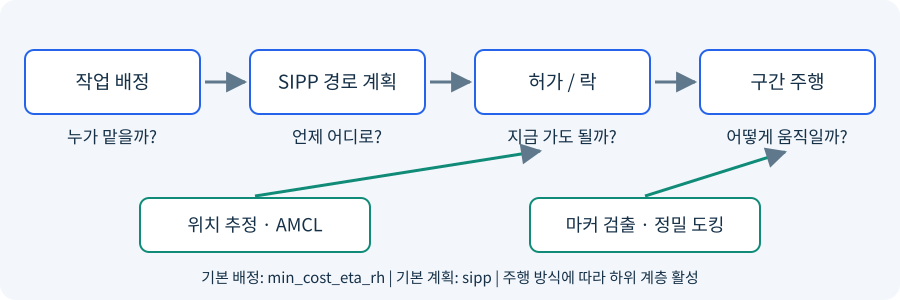

현재 기본 조합은 **`min_cost_eta_rh` 작업 배정 + `sipp` 경로 계획**이다. 이 자료는 앞서 정리한 표의 17개 항목을 같은 순서로 설명한다. 기본 알고리즘뿐 아니라 비교 옵션, 실물 주행에서 사용하는 하위 제어, 시뮬레이션 대역까지 포함한다.

각 장은 **① 무엇을 왜 하는가 → ② 어디에서 유래했는가 → ③ 어떻게 동작하는가 → ④ Frybot에는 어떻게 구현됐는가 → ⑤ 예시와 한계** 순서로 읽으면 된다. 그림과 계산 예시는 본 자료를 위해 직접 제작한 교육용 도식이며, 실험 성능이나 실제 매장의 측정값을 나타내지 않는다.

> **자료의 범위**  
> `/home/lee/frybot_ws/src/frybot`의 작성 시점 소스와 설정을 분석했다. 기준 Git HEAD는 `4ab5d33`이지만 작업 트리에 기존 미커밋 수정이 많으므로, 해당 커밋만으로 본 자료의 코드 상태를 재현할 수는 없다. 끝의 `source_snapshot.json`에 핵심 파일 해시와 주요 심벌 위치를 남겼다. 실행 중인 ROS 파라미터를 조회하거나 로봇을 운행한 결과는 아니다.

<!-- PAGE -->
# 읽기 지도와 목차

| 순서 | 알고리즘 / 구현 | 적용 구분 | 먼저 답할 질문 |
|---|---|---|---|
| 01 | SIPP | 기본 경로 계획 | 언제 통로를 사용하면 되는가? |
| 02 | CCBS 계열 | 선택 플래너 | 누가 양보해야 전체가 유리한가? |
| 03 | Cooperative A* | 선택 플래너 | 시간 칸까지 포함해 탐색하면? |
| 04 | Independent A* | 비교 기준 | 각자 최단 경로만 따르면? |
| 05 | Dijkstra | 공통 기반 | 통로를 따라 실제 최단 거리는? |
| 06 | FIFO + Nearest | 선택 스케줄러 | 먼저 온 작업을 누가 맡는가? |
| 07 | Priority Greedy + Aging | 선택 스케줄러 | 급한 작업과 오래 기다린 작업은? |
| 08 | Minimum-cost Assignment | 배정 계열의 기반 | 전체 배정 비용을 줄이려면? |
| 09 | ETA 기반 Minimum-cost | 기본 배정의 기반 | 예약 대기를 비용에 반영하면? |
| 10 | Rolling Horizon | 기본 작업 재배정 | 상황이 바뀌면 언제 바꿀 것인가? |
| 11 | NavFn의 A* | Nav2 사용 시 | 지도 위 구간 경로를 어떻게 만드는가? |
| 12 | Regulated Pure Pursuit | Nav2 사용 시 | 경로를 어떤 속도로 따라가는가? |
| 13 | AMCL | 실물 위치 추정 | 로봇은 지금 어디에 있는가? |
| 14 | ArUco + IPPE Square PnP | 도크 구성 시 | 카메라로 도크의 자세를 어떻게 아는가? |
| 15 | OpenNav Docking | 도크 구성 시 | 마지막 수 cm를 어떻게 맞추는가? |
| 16 | Open-RMF 연동 | helper 빌드 시 선택 | 다른 로봇들의 일정과 어떻게 협상하는가? |
| 17 | 임계값 기반 규칙 | 시뮬레이션 대역 | 모의 AI는 실제로 무엇을 판단하는가? |

**추천 읽기:** 처음에는 01 → 08 → 09 → 10으로 기본 의사결정을 이해하고, 11~15로 실제 주행을 연결한다. 이후 02~07의 비교 알고리즘을 읽는다. 본문 배열은 요청한 기존 표의 순서를 유지했다.

**표시 규칙:** `[R번호]`는 논문·공식 문서, `[C번호]`는 로컬 코드 근거다. ‘관련 배경’은 개념을 이해하기 위한 문헌이며, 그 논문을 그대로 구현했다는 의미가 아니다. 논문이 없는 프로젝트 고유 규칙에는 원 논문을 억지로 붙이지 않는다.

<!-- PAGE -->
# 먼저 알아야 할 공통 개념

**배정과 경로 계획과 제어는 서로 다른 문제다.** 배정은 “어느 로봇이 작업을 맡을까?”, 경로 계획은 “어느 길을 언제 지날까?”, 제어는 “바퀴를 지금 얼마나 돌릴까?”를 결정한다. AMCL과 카메라 검출은 이 판단에 필요한 상태를 추정한다.

| 용어 | 쉬운 뜻 | Frybot에서의 대응 |
|---|---|---|
| 노드 / 간선 | 통로의 정차·교차 지점 / 지점 사이 연결 | `Graph.nodes`, `Graph.adj` |
| 로드맵 | 로봇이 다닐 수 있도록 미리 정한 길의 그래프 | `layout.py`, 지도별 `roadmap.json` |
| 비용 지도 | 벽·장애물 주변의 통행 부담을 격자로 표현 | Nav2 costmap |
| ETA | 앞으로 도착까지 걸릴 것으로 보는 시간 | 배정 비용에서는 ‘첫 정차점’까지의 초 |
| 휴리스틱 h | 남은 비용을 빠르게 추정하는 값 | 정적 최단 거리 / 계획 속도 |
| g / f | 지금까지 든 비용 / 탐색 우선순위 | A*에서 `f = g + h` |
| 예약 | 특정 구역을 특정 시간 동안 쓰겠다는 계획 | `ReservationTable` |
| 락 / 허가 | 실제 점유권 / 다음 구간 이동 승인 | `locks`, `TrafficGrant` |
| 완전성 | 해가 있다면 찾는 성질 | 모델·탐색 범위 등 가정이 필요 |
| 최적성 | 정의한 비용에서 가장 좋은 해를 찾는 성질 | 전체 매장 효율 최적과는 별개 |

**공간과 시간의 단위:** 로드맵 거리는 m, 시간은 s, 각도는 주로 rad이다. 기본 `speed=0.08 m/s`는 8 cm/s이며, 계획 속도는 코어 기본값에서 여기에 `plan_speed_factor=0.9`를 곱한 `0.072 m/s`다. 구간 시간은 `overhead + 거리 / 계획 속도`로 계산한다. 기본 `plan_overhead=0.0`이므로 실물 회전·정착 지연을 모두 표현하지는 않는다. [C01, C02]

**가장 중요한 구분:** 현재 기본은 학습된 신경망이 아니라 탐색·최적화와 규칙이다. AMCL도 센서 관측으로 상태를 갱신하는 확률 추정이며, 운행 경험을 장기간 학습해 가중치를 개선하는 ETA 모델과 다르다.

> **실행 조건 주의:** `sim.launch.py`의 기본 `drive`는 `kinematic`이다. 따라서 Nav2 설정이 저장소에 있다고 해서 기본 시뮬레이션이 항상 NavFn·RPP를 통해 움직이는 것은 아니다. 실측 지도에서는 도크가 정의되지 않아 `docking_server`와 ArUco 검출기를 띄우지 않는다. [C02, C09]

<!-- PAGE -->
# 01 · SIPP
## 안전한 ‘시간 구간’을 탐색한다

**목적과 비유.** 좁은 복도를 예약 회의실처럼 생각한다. “복도가 비어 있는가?”만 보지 않고 “몇 초부터 몇 초까지 비어 있는가?”를 본다. Frybot은 다른 로봇이 이미 계획한 통로 점유를 피하면서 목적지에 도착할 시각을 정한다. 기본 플래너 이름은 `sipp`다. [C03]

**근원.** Phillips와 Likhachev의 *SIPP: Safe Interval Path Planning for Dynamic Environments* (ICRA 2011)가 핵심 출처다. 동적 장애물이 있을 때 `(위치, 모든 시간 칸)`을 전부 탐색하면 상태가 많아진다. SIPP는 한 위치에서 연속으로 안전한 시간을 하나의 구간으로 묶어 탐색 상태 수를 줄인다. [R01]

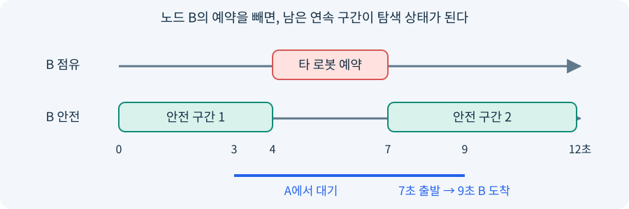

**동작 원리.** 다른 로봇이 노드 B를 4~7초에 예약했다면 안전 구간은 대략 `[0,4)`와 `[7,∞)`다. 같은 B라도 첫 구간에 도착한 상태와 두 번째 구간에 도착한 상태는 다르다. 탐색 상태는 `(노드, 안전 구간)`이며, 각 상태에 가장 이른 도착 시각을 기록한다. 대기가 필요하면 현재 노드에서 기다린 뒤 이동한다.

**Frybot의 탐색 우선순위.** `f = 도착 시각 + 정적 최단 거리 / 계획 속도`다. 정적 최단 거리는 Dijkstra 캐시를 사용한다. 실제 이동에는 구간 지연과 예약 대기가 더 붙지만 휴리스틱에는 이를 넣지 않는다. 비음수 지연과 올바른 그래프라는 전제에서 남은 시간을 낮게 추정하기 위한 선택이다. [C03, C05]

**입출력.** 시작·목적 노드, 출발 시각, 속도, 목적지 유지 시간, 예약 테이블을 받아 `Step(node, arrive, depart)` 목록을 반환한다. 경로는 노드 나열뿐 아니라 시간표이기도 하다.

**원문:** [R01 · SIPP 논문 PDF](https://www.cs.cmu.edu/afs/cs/Web/People/maxim/files/sipp_icra11.pdf)

<!-- PAGE -->
# 01 · SIPP를 코드와 예시로 읽기

**작은 계산 예시.** A에서 B까지 2초, B의 예약이 `[4,7)`이고 현재 시각이 3초라고 하자. 단순히 3초에 떠나 5초에 도착하면 예약과 겹친다. Frybot은 이동 중 출발 노드와 도착 노드 양쪽을 확보하므로, B가 비는 7초까지 A에서 기다린 뒤 출발해 9초에 도착하는 선택을 검토한다. A 역시 9초까지 사용 가능해야 한다. 이 예시는 이미 확장된 예약 구간을 사용하며 추가 패딩은 생략했다. [C03, C04]

**프로젝트의 예약 의미가 중요하다.** `ReservationTable.add_plan()`은 노드 점유를 이전 노드 출발부터 다음 노드 도착까지 잡는다. 노드에 정확히 서 있는 순간만 예약하는 모델보다 보수적이다. 기본 시간 패딩은 양쪽 `0.4초`, 서로 `0.155 m`보다 가까운 노드도 충돌 집합으로 확장한다. 따라서 원 논문의 모든 연속 궤적 충돌 검사를 그대로 구현한 것으로 읽으면 안 된다. [C04, C05]

**코드에서 따라갈 순서.** `safe_intervals()`가 예약의 빈틈을 만들고 → `SippPlanner.plan()`이 우선순위 큐에서 가장 유망한 상태를 꺼내며 → `segment_time()`으로 이동 시간을 구하고 → 가능한 다음 안전 구간을 검사한다. 목적지에서는 `goal_hold` 동안 머물 수 있는지도 확인한다. 시작 노드에는 이미 로봇이 서 있다는 사정을 반영한 `start_interval_end()` 예외가 있다. [C03, C04]

**계획 이후에도 확인한다.** 실제 운행에서는 센서 지연이나 로봇 감속 때문에 시간표가 어긋난다. 코어 `_drive()`는 출발 시각을 기다리고, 실제 락과 충돌 노드 점유를 확인한 뒤 이동 허가를 낸다. 지연이 커지면 남은 시간표를 뒤로 미룬다. 계획 단계의 무충돌과 실물 안전 전체는 같은 보장이 아니다. [C01]

**장점과 한계.** 시간 격자 없이 대기를 표현하며, 먼저 계획된 로봇의 경로를 반영하기 좋다. 반면 현재 구조는 우선순위 계획이어서 앞선 로봇을 고정 장애물처럼 취급한다. 우선순위를 바꾸면 해가 있어도 현재 순서에서는 못 찾을 수 있다. 단일 로봇 SIPP의 이론적 성질을 전체 로봇의 전역 최적성으로 확대하면 안 된다.

**확인 질문:** B는 비어 있는데 왜 A에서 출발하지 못할까? 답은 “이동 구간 동안 양쪽 점유가 가능한가?”에 있다. 기본 구간 지연이 0이라면 회전이 많은 경로의 ETA는 어떤 방향으로 틀릴까?

**코드 근거:** [C03] `planners/sipp.py: SippPlanner.plan` · [C04] `planners/base.py: ReservationTable` · [C01] `fleet_core.py: _drive`.

<!-- PAGE -->
# 02 · CCBS 계열
## 충돌이 생기면 ‘누가 양보할지’를 분기한다

**목적.** 우선순위 SIPP는 먼저 계획한 로봇이 유리하다. CCBS 계열은 움직이는 로봇들의 경로를 함께 검토하고, 충돌한 두 로봇 중 어느 쪽에 제약을 줄지 나누어 탐색한다. Frybot의 선택 이름은 `ccbs`이며 기본값은 아니다. [C06]

**근원.** Andreychuk, Yakovlev, Surynek, Atzmon, Stern의 *Multi-agent pathfinding with continuous time* (Artificial Intelligence, 2022)가 직접 관련된다. 고수준은 충돌 제약의 트리, 저수준은 개별 경로 탐색으로 분리하는 CBS 구조를 연속 시간으로 확장하고 SIPP를 결합한다. [R02]

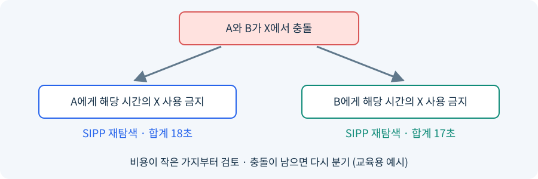

**두 단계로 이해하기.** 먼저 로봇별 경로를 만들고 서로 겹치는 점유를 찾는다. A와 B가 교차로 X를 같은 시간에 쓰려 하면, “A가 그 시간에 X를 쓰지 못한다”는 가지와 “B가 그 시간에 X를 쓰지 못한다”는 가지를 만든다. 각 가지에서는 제약을 받은 로봇의 경로를 SIPP로 다시 계산한다. 충돌이 사라질 때까지 반복한다.

**무엇을 더 좋은 해로 보나?** Frybot의 트리 우선순위는 `Σ(각 로봇 도착 시각 - 각 로봇 출발 시각)`이다. 마지막 로봇이 끝나는 시각인 makespan과는 다르다. 한 로봇을 조금 늦춰 여러 로봇을 빨리 보내는 해가 비용상 유리할 수 있다. [C06]

**원문:** [R02 · 2022 논문 PDF](https://surynek.net/publications/files/Yakovlev-Andreychuk-Surynek-Atzmon-Stern_MAPF-Continuous-Time_AIJ-2022.pdf) · [논문 DOI](https://doi.org/10.1016/j.artint.2022.103662)

<!-- PAGE -->
# 02 · Frybot의 CCBS는 ‘제한된 계열 구현’이다

**예시.** A와 B의 원래 소요 시간이 각각 8초, 7초이고 교차로에서 충돌한다고 하자. A를 기다리게 하면 11+7=18초, B를 기다리게 하면 8+9=17초라면 두 번째 가지가 우선 검토된다. 이때 비용은 로봇별 이동 시간의 합이다. 이 값만으로 음식 도착 지연이나 손님 만족도를 직접 최적화한 것은 아니다.

**실제 코드.** `CbsPlanner.plan_joint()`가 여러 `PlanRequest`를 받는다. `_low()`는 예약 테이블에 제약을 추가한 뒤 SIPP를 호출한다. `_conflict()`는 계획별 노드 점유 구간을 비교해 같은 노드 또는 충돌 집합의 겹침을 찾는다. 단일 로봇의 `plan()` 호출은 사실상 SIPP로 위임한다. [C06]

**시간 제한.** 생성자 기본값은 `max_nodes=120`, `time_limit=0.25초`다. 예산 내 해를 못 찾으면 `None`을 반환하며 코어의 공동 계획 경로는 실패를 기록하고 이후 개별 계획 절차를 사용한다. 이는 제한 없는 최적 CCBS 솔버와 동일하지 않다. 실행 머신의 속도나 부하에 따라 탐색한 가지 수가 달라질 수 있다. [C01, C06]

**원 논문과의 차이.** 원 논문은 명시한 연속 운동·충돌 모델과 탐색 가정 아래의 보장을 다룬다. Frybot은 공통 노드 락 의미에 맞춘 시간 구간 제약, 제한된 탐색 예산, 후속 실행 제어를 결합한다. 임의의 두 간선이 지도 중간에서 교차할 때도 모두 정확한 연속 궤적 충돌을 검출한다고 주장할 수 없다. 이런 교차는 로드맵 설계와 충돌 모델의 별도 검토가 필요하다.

**어디에서 유리한가?** 좁은 교차로에서 고정 우선순위 때문에 과도한 대기가 반복될 때 후보가 된다. 다만 ‘더 똑똑한 탐색’이 항상 더 빠른 운영을 뜻하지 않는다. 계획 계산 지연, 실패 시 대체 동작, 실제 주행 오차를 포함해 비교해야 한다.

**확인 질문:** A를 양보시킨 해가 A에게 불리해도 전체 비용에는 좋을 수 있는가? 총 이동 시간 최소와 가장 늦은 작업의 지연 최소는 언제 다른가?

**코드 근거:** [C06] `planners/cbs.py` · [C01] `fleet_core.py: _plan_joint, _start_move`.

<!-- PAGE -->
# 03 · Cooperative A*
## 지도에 시간 축을 한 칸 더 붙인다

**목적.** A*가 “어느 노드로 갈까?”를 찾는다면 Cooperative A*는 “어느 시각에 어느 노드로 갈까?”를 찾는다. 앞선 로봇의 시간표를 예약하고 다음 로봇이 이를 피해 탐색한다. `cooperative_astar`는 선택 플래너다. [C07]

**근원.** David Silver의 *Cooperative Pathfinding* (AIIDE 2005)이 CA*, HCA*, WHCA*를 설명한다. 공통 아이디어는 단일 로봇 탐색을 시간까지 확장하고 다른 로봇의 예약을 피하는 것이다. Frybot은 고정 시간 격자의 CA*를 구현하며, 논문의 계층화·이동 창 기법 전체를 구현한 것은 아니다. [R03]

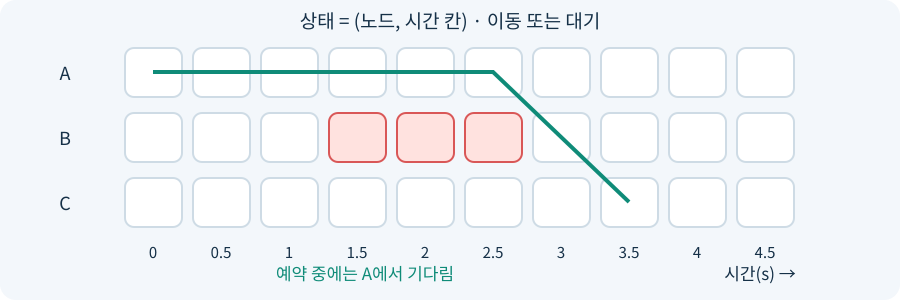

**동작.** 상태는 `(노드, 시간 칸 k)`다. 한 행동은 “옆 노드로 이동” 또는 “현재 노드에서 한 칸 대기”다. 다른 로봇이 그 시간 구간을 예약했다면 후보 행동을 버린다. 우선순위는 `경과 시간 + 남은 정적 거리 / 속도`로 정한다.

**SIPP와 차이.** 10초 동안 빈 노드가 있을 때 CA*는 시간 간격에 따라 많은 시각 상태를 만들 수 있다. SIPP는 그 연속 안전 시간을 한 구간으로 표현한다. 반대로 시간 격자는 그림으로 이해하기 쉽고 고정 주기의 시뮬레이터에 맞추기 쉽다.

**원문:** [R03 · 학회 페이지와 PDF](https://ojs.aaai.org/index.php/AIIDE/article/view/18726)

<!-- PAGE -->
# 03 · 시간 해상도의 대가

**Frybot 설정.** 기본 `dt=0.5초`, 탐색 한계 `horizon=600` 시간 칸이다. 이는 약 300초 깊이의 상태 확장을 제한하는 값이다. 이동은 한 번에 여러 칸을 차지할 수 있으므로 정확한 반환 경계는 코드의 행동 확장 방식에 따른다. 이를 모든 경로가 반드시 300초 이내라는 물리적 보장으로 해석하지 않는다. [C07]

**올림 계산.** 실제 계산된 구간 시간이 1.1초라면 `ceil(1.1 / 0.5)=3칸`, 계획상 1.5초를 사용한다. 같은 구간이 10개라면 예약 충돌이 없어도 총 4초가 더해질 수 있다. `dt`를 줄이면 이 오차는 작아지지만 상태 수와 메모리 부담은 커진다.

**이동 중 점유.** CA*도 Frybot의 공통 락 의미를 따른다. 이동하는 전체 구간 동안 출발 노드와 도착 노드가 모두 비어 있어야 한다. `wait` 행동은 현재 노드가 다음 한 칸 동안 비어 있을 때만 허용한다. 목적지에서는 필요한 `goal_hold`를 확인한다. [C04, C07]

**반환 형식.** 시간 칸마다 생긴 대기 상태는 `_path()`에서 같은 노드의 `depart` 시각으로 합쳐진다. 실행 코어는 SIPP와 같은 `Step` 형태를 받으므로 시간표 생성 방법을 바꿔도 허가·락 처리의 기본 인터페이스를 공유한다.

**한계.** 고정 우선순위, 시간 양자화, 유한한 탐색 한계가 영향을 준다. SIPP와 비교할 때는 계획 성공률뿐 아니라 계획 대기와 실제 대기, 총 이동 거리, 연산 시간을 구분해야 한다. 특정 매장이나 로봇 수에서 어느 쪽이 좋은지는 실측 비교 없이는 단정할 수 없다.

**확인 질문:** `dt`를 0.5초에서 0.1초로 줄이면 왜 항상 더 좋은 선택은 아닐까? 실제 1.1초 구간이 시간표에서 1.5초가 되는 이유를 계산해 보자.

**코드 근거:** [C07] `planners/cooperative_astar.py: plan, _path` · [C04] 예약 구간 검사.

<!-- PAGE -->
# 04 · Independent A*
## 각 로봇이 자기 최단 경로부터 구한다

**목적.** 협조 계획의 효과를 비교할 기준선이다. 각 로봇은 다른 로봇의 시간 예약을 고려하지 않고 거리 기준 최단 경로를 찾는다. `independent_astar`의 `coordinated=False`는 협조 시간표를 만들지 않는다는 뜻이다. [C08]

**근원.** Hart, Nilsson, Raphael의 *A Formal Basis for the Heuristic Determination of Minimum Cost Paths* (1968)가 A*의 고전적 출처다. A*는 지금까지 비용 `g`와 남은 비용의 추정 `h`를 합한 `f=g+h`가 작은 상태부터 탐색한다. 휴리스틱과 탐색 처리의 조건 아래 최단 경로를 찾을 수 있다. [R04]

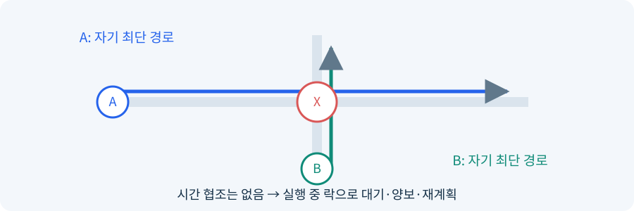

**동작.** 시작 노드에서 인접 노드의 누적 거리를 갱신한다. 더 짧은 도달 경로를 찾으면 부모 노드를 바꾸고 우선순위 큐에 넣는다. 목표에 도달한 뒤 부모를 역으로 따라가 경로를 복원한다. Frybot은 휴리스틱으로 목표에서 각 노드까지의 Dijkstra 정적 거리를 사용한다. 제한 노드 `req.blocked`는 피한다. [C05, C08]

**핵심 구분.** A* 자체가 항상 ‘비협조’인 것은 아니다. 무엇을 상태와 비용으로 넣는지가 중요하다. 이 플래너가 비협조인 이유는 시간·타 로봇 예약을 상태에 넣지 않기 때문이다. 앞의 Cooperative A*도 같은 A* 원리를 시간 상태에 적용한다.

**원문:** [R04 · A* 원 논문 PDF](https://ai.stanford.edu/~nilsson/OnlinePubs-Nils/PublishedPapers/astar.pdf)

<!-- PAGE -->
# 04 · 최단 경로가 가장 빠른 경로는 아니다

**예시.** A와 B가 서로 반대편 주방·테이블로 간다. 각자 최단 경로가 중앙 복도를 사용하면 정면에서 만나 대기할 수 있다. 한 로봇이 0.3m를 우회하는 편이 실제로 더 빨라도, 거리만 보는 첫 계획에는 반영되지 않는다.

**Frybot의 결과 시각.** 반환한 모든 `Step`의 `arrive`, `depart`는 0이다. 따라서 이 경로의 시각 0은 “운행 시간이 없다”는 뜻이 아니라 “이 플래너는 시각을 계획하지 않는다”는 표시다. `PlanRequest.overhead`도 경로 선택에 쓰지 않는다. [C08]

**충돌 처리는 어디에 있나?** 코어의 공통 트래픽 계층이 다음 노드와 인접 충돌 노드의 실제 점유를 검사한다. 비어 있을 때만 허가하고, 막히면 기다린다. 정체가 계속되면 재계획·양보·후퇴 등 공통 복구 절차가 개입한다. 그러므로 `independent_astar`라는 이름이 ‘로봇들이 아무 통제 없이 충돌하도록 달린다’는 뜻은 아니다. [C01]

**공정한 비교.** 이 기준선과 SIPP의 차이는 주로 충돌을 미리 시간표에서 해결하느냐, 실행하면서 해결하느냐에 있다. 두 방식 모두 같은 락 계층을 쓴다면, 성공률과 안전성의 차이를 플래너 하나에 전부 귀속하면 안 된다.

**이론의 범위.** A*가 계산한 그래프 경로의 거리 최적성과 실물 운행의 시간 최적성은 별개다. 회전, 좁은 구간 감속, 대기, 도킹은 거리 외 비용이다. 금지 노드 때문에 원래 정적 휴리스틱이 실제 비용보다 낮아져도 탐색 안내값으로는 쓸 수 있지만, 얼마나 효율적인지는 상황에 따라 달라진다.

**확인 질문:** 모든 로봇이 각자 최단 경로를 택했는데 전체 완료 시간이 길어지는 예를 그려보자. `Step` 시각이 0인 플래너의 ETA는 스케줄러가 어떻게 얻을까? 09장에서 대체 비용을 확인한다.

**코드 근거:** [C08] `planners/independent_astar.py` · [C01] `fleet_core.py: _drive, _resolve_stall`.

<!-- PAGE -->
# 05 · Dijkstra
## 통로를 따라가는 최단 거리의 공통 계산기

**목적.** 테이블과 로봇 사이 직선거리가 가까워도 벽을 돌아가야 할 수 있다. Dijkstra는 통행 가능한 그래프를 따라가는 최소 거리들을 계산한다. Frybot에서는 배정 비용, 휴리스틱, 우회 판단의 공통 기반이다. [C05]

**근원.** E. W. Dijkstra의 *A Note on Two Problems in Connexion with Graphs* (1959)는 그래프의 최소 연결·최단 경로 문제를 다룬다. 여기서 사용하는 것은 비음수 가중치 그래프의 최단 거리 알고리즘이다. [R05]

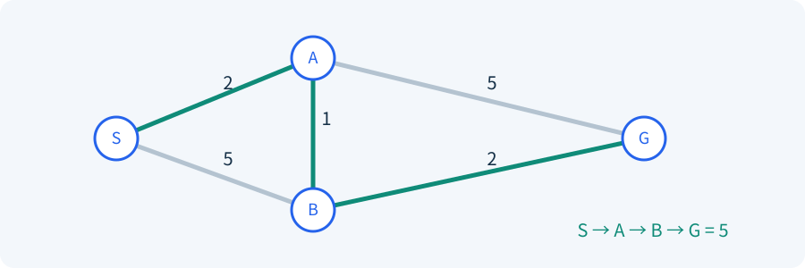

**핵심 원리.** 시작점의 거리를 0으로 놓고 나머지는 무한대로 둔다. 아직 처리하지 않은 노드 중 잠정 거리가 가장 작은 노드를 꺼낸다. 그 노드에서 이웃으로 갔을 때 더 짧다면 이웃의 거리를 갱신한다. 간선 비용이 비음수이므로 가장 짧은 후보부터 확정해 나갈 수 있다.

**A*와 관계.** Dijkstra는 목표 방향의 추가 안내값 없이 현재 거리만으로 탐색한다. A*는 여기에 남은 비용 `h`를 더한다. Frybot은 Dijkstra 결과를 재사용하여 A*·SIPP·CA*의 휴리스틱을 강하게 만든다. 기본 로드맵은 간선을 양방향으로 추가하므로 목표에서 계산한 거리를 출발점에서 목표까지의 거리로 사용할 수 있다. [C05]

**원문:** [R05 · CWI 원문 저장소](https://ir.cwi.nl/pub/9256) · [DOI](https://doi.org/10.1007/BF01386390)

<!-- PAGE -->
# 05 · 캐시와 단위를 이해하기

**예시.** S-A=2, S-B=5, A-B=1, A-G=5, B-G=2라면 처음 B의 잠정 거리는 5다. A를 거쳐 B로 가면 3이므로 갱신한다. G는 S-A-B-G로 5가 된다. ‘눈앞의 이웃 하나만 가장 가까운 곳으로 가기’가 아니라 모든 후보의 누적 거리를 관리하는 것이 핵심이다.

**Frybot 구현.** `Graph.sp_from(src)`는 `heapq`로 잠정 거리의 최소값을 꺼내고, 더 짧은 거리만 큐에 추가한다. 이미 개선된 옛 큐 항목은 건너뛴다. 결과 사전을 `_sp[src]`에 저장하므로 같은 출발점의 거리는 재계산하지 않는다. `shortest_dist(a,b)`는 목표 b의 거리 캐시를 이용한다. [C05]

**복잡도 감각.** 이진 힙 기반의 전형적 비용은 대략 `O((V+E) log V)`다. V는 노드 수, E는 간선 수다. 모든 목표의 결과를 캐시하면 반복 요청은 빨라지지만 저장량은 목표 수에 따라 늘어난다. 현재 `sp_from()`은 거리만 저장하며, 구체 경로 복원은 별도 `_shortest_path()` 등의 역할이다.

**캐시의 전제.** 그래프와 간선 가중치가 그대로라는 전제다. 매장 가구 배치나 통행 가능 간선이 바뀌면 캐시를 포함한 그래프 갱신이 필요하다. 특정 로봇의 순간 점유를 정적 그래프 자체에 섞지 않고 예약 테이블로 분리하는 이유도 이 구조와 연결된다.

**무엇을 모르는가?** 정적 거리에는 사람 때문에 생기는 지연, 다른 로봇 예약 대기, 회전 시간이 없다. 따라서 Dijkstra가 정확하게 계산해도 이를 속도로 나눈 ETA는 실물에서 틀릴 수 있다. 이것은 최단 거리 계산 오류와 시간 모델 오류를 구별해야 하는 이유다.

**확인 질문:** 직선거리를 휴리스틱으로 쓰는 것과 정적 최단 거리를 쓰는 것은 왜 다른가? 통로 예약이 바뀔 때 Dijkstra 캐시도 매번 지워야 할까?

**코드 근거:** [C05] `layout.py: Graph.__init__, sp_from, shortest_dist`.

<!-- PAGE -->
# 06 · FIFO + Nearest
## 먼저 들어온 작업에 가까운 로봇을 붙인다

**목적.** 복잡한 최적화 없이 접수 순서를 지키는 단순한 배정 기준이다. `fifo_nearest`는 대기 작업을 생성 시각순으로 정렬하고 각 작업마다 비용이 가장 작은 가용 로봇을 하나씩 고른다. [C10]

**근원.** FIFO 또는 FCFS는 오래된 대기열·스케줄링 규칙이다. ‘최초 논문 하나’를 특정하기보다 전통적인 처리 순서 정책으로 이해하는 편이 정확하다. 운영체제 교재 OSTEP의 Scheduling 장은 FIFO의 기본 원리와 긴 작업이 뒤 작업을 지연시키는 문제를 설명한다. 로봇 배정이라는 문제의 배경은 Gerkey와 Matarić의 MRTA 분석을 참고한다. 이 두 문헌은 Frybot 전용 규칙의 직접 구현 명세는 아니다. [R06, R08]

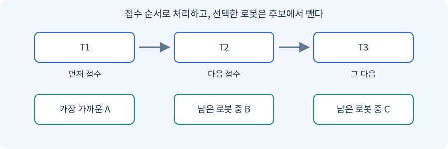

**동작 순서.** ① 작업을 `created` 오름차순으로 정렬한다. ② 맨 앞 작업에 대해 가용 로봇별 비용을 비교한다. ③ 가장 작은 로봇을 배정하고 가용 목록에서 뺀다. ④ 다음 작업으로 넘어간다. 로봇이 다 쓰이면 끝낸다.

**‘가까움’의 정의.** 이 스케줄러는 `uses_eta=False`이므로 현재 코어가 전달하는 정적 이동 시간 비용을 사용한다. 기본적으로 통로 최단 거리 / 속도이며, 설정했다면 구간 수에 따른 고정 지연을 더한다. 좌표 사이 직선거리로만 고르는 것은 아니다. [C01, C10]

**관련 배경:** [R06 · OSTEP Scheduling PDF](https://pages.cs.wisc.edu/~remzi/OSTEP/cpu-sched.pdf) · [R08 · MRTA 논문](https://doi.org/10.1177/0278364904045564)

<!-- PAGE -->
# 06 · 단순함이 만드는 장단점

**예시 비용표.** 아래 비용은 설명용 초 단위 값이며 거리 기반 비용으로 가정한다.

| 로봇 | 먼저 접수된 T1 | 나중 접수된 T2 |
|---|---:|---:|
| A | 4 | 5 |
| B | 6 | 100 |

FIFO는 T1에 A(4초)를 붙이고 T2에는 남은 B(100초)를 붙여 합계 104초가 된다. 반대로 T1에 B(6초), T2에 A(5초)를 붙이면 합계 11초다. 첫 작업에서 가장 좋은 선택이 전체 합계에서도 가장 좋은 선택은 아니다.

**좋은 점.** 결정 근거가 분명하고, 오래된 작업이 먼저 고려된다. 구현과 설명이 쉽기 때문에 복잡한 배정의 실제 개선 효과를 비교하는 기준선으로 유용하다. ‘왜 저 로봇이 맡았는가?’를 접수 순서와 거리로 설명할 수 있다.

**한계.** 전체 조합을 보지 않고 앞 작업부터 로봇을 소모한다. 작업 우선순위를 사용하지 않으며 통로 예약 대기도 비용에 직접 반영하지 않는다. 먼저 배정했다는 것과 먼저 완료된다는 것도 다르다. 작업 시간이 다르면 나중 작업이 먼저 끝날 수 있다.

**Frybot의 경계.** 이 정책은 모든 로봇을 대상으로 무조건 배정하지 않는다. 코어가 온라인 상태, 배터리, 비상정지, 오류, 현재 임무 등을 확인한 가용 로봇 목록을 전달한다. 또한 이미 음식이나 손님을 운반 중인 작업을 이 단순 배정 호출이 임의로 빼앗는 것은 아니다. [C01]

**확인 질문:** 접수 순서의 공정성과 전체 이동 시간 최소는 항상 양립할까? 위 표에서 T2가 긴급 주문이라면 FIFO는 그 사실을 반영할 수 있을까?

**코드 근거:** [C10] `schedulers/__init__.py: FifoNearestScheduler.assign` · [C01] `_available, _cost_fn, _schedule`.

<!-- PAGE -->
# 07 · Priority Greedy + Aging
## 급한 작업을 먼저, 오래 기다린 작업도 점점 앞으로

**목적.** FIFO보다 작업의 긴급도를 반영하되, 낮은 우선순위의 작업이 계속 밀리는 현상을 줄인다. 선택 이름은 `priority_greedy`다. [C10]

**근원.** 우선순위 스케줄링과 aging은 대기 중인 작업의 실효 우선순위를 높이는 일반적인 운영 정책이다. OSTEP의 MLFQ 장은 기아와 우선순위 상향의 배경을 설명하지만, Frybot의 연속 선형 가산식과 같은 알고리즘은 아니다. MRTA 문헌은 로봇-작업 쌍의 효용에 따라 배정하는 더 넓은 맥락을 제공한다. 특정 논문에서 `aging=0.05`를 가져왔다는 근거는 소스에 없다. [R07, R08]

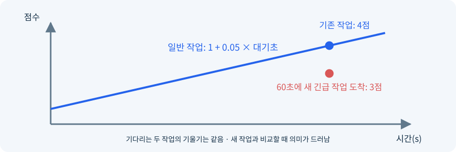

**Frybot 계산식.** `실효 우선순위 = priority + 0.05 × (현재 시각 - created)`다. 점수가 큰 작업부터 처리하며, 각 작업에 가장 가까운 가용 로봇을 배정한다. 로봇 선택 비용은 ETA 예약 대기가 아닌 정적 비용이다. [C10]

**왜 greedy인가?** 가장 우선인 작업에 현재 가장 좋은 로봇을 주고 다음 작업으로 넘어간다. 모든 작업-로봇 조합의 합을 최적화하지 않기 때문에 06장의 조합 손실이 여전히 생길 수 있다.

**관련 배경:** [R07 · OSTEP MLFQ PDF](https://pages.cs.wisc.edu/~remzi/OSTEP/cpu-sched-mlfq.pdf) · [R08 · MRTA 원문 PDF](https://cse-robotics.engr.tamu.edu/dshell/cs689/papers/gerkey04formal.pdf)

<!-- PAGE -->
# 07 · Aging의 정확한 의미

**수치 예시.** 새 긴급 작업의 우선순위가 3이고, 일반 작업의 우선순위가 1이며 60초 기다렸다면 일반 작업 점수는 `1+0.05×60=4`다. 새 긴급 작업의 3보다 높다. 같은 점수일 때는 Python의 안정 정렬과 입력 순서의 영향을 받으며, 코드에 별도 정교한 동점 정책이 있는 것은 아니다. [C10]

**흥미로운 점.** 두 작업이 동시에 대기하는 동안에는 둘 다 같은 속도로 점수가 오른다. 따라서 둘 사이 기존 점수 차이는 그대로다. Aging의 효과는 오래 기다린 작업이 ‘새로 들어온’ 높은 기본 우선순위 작업과 비교될 때 특히 나타난다. 그림의 비교선도 새 작업의 도착 시점을 함께 봐야 한다.

**계수의 해석.** `0.05 점/초`이면 20초 대기가 기본 우선순위 1점과 같은 가산을 준다. 이 값은 운영상의 교환 비율이다. 실제 식당에서 긴급도 1점과 20초 대기가 동등한지 검토해야 하며, 수학적으로 보편적인 최적값은 아니다.

**기아 방지 보장인가?** 일정한 유한 우선순위 범위와 충분한 처리 능력 같은 조건 없이 “모든 작업이 반드시 언젠가 처리된다”고 말할 수는 없다. 작업이 로봇의 가용 조건을 만족하지 못하거나 시스템이 과부하라면 계속 대기할 수 있다. Aging은 기아를 완화하는 정책이지 물리적 처리 용량을 늘리는 방법은 아니다.

**관찰할 지표.** 작업별 평균 대기뿐 아니라 최대 대기, 작업 종류별 지연, 긴급 작업의 지연을 함께 본다. 평균이 좋아도 일반 회수 작업이 오래 밀릴 수 있다. 이 장의 식과 다음 장의 우선순위 가중치는 서로 다른 위치에서 쓰인다는 점도 구분한다.

**확인 질문:** 오래 기다린 일반 작업과 새 긴급 작업 중 무엇을 먼저 해야 할까? 이는 알고리즘만의 문제가 아니라 식당의 서비스 정책이기도 하다.

**코드 근거:** [C10] `PriorityGreedyScheduler.aging, assign`.

<!-- PAGE -->
# 08 · Minimum-cost Assignment
## 하나씩 고르지 말고 조합의 합을 비교한다

**목적.** 각 작업마다 가까운 로봇을 고르면 뒤 작업에 나쁜 선택만 남을 수 있다. 최소 비용 배정은 여러 로봇-작업 쌍의 합계 비용을 줄인다. `min_cost`는 기본 스케줄러 계열의 계산 기반이다. [C10]

**근원.** 선형 배정 문제는 운영연구의 고전 문제다. Kuhn의 *The Hungarian Method for the Assignment Problem* (1955)은 역사적 핵심 문헌이다. 다만 Frybot이 Kuhn의 절차를 직접 구현한 것은 아니다. 현재 작은 규모에서는 전수 탐색을 쓰고, 후보 수가 커지면 SciPy의 수정 Jonker-Volgenant 알고리즘을 호출한다. SciPy는 Crouse (2016)를 구현 관련 문헌으로 제시한다. [R09, R10, R11]

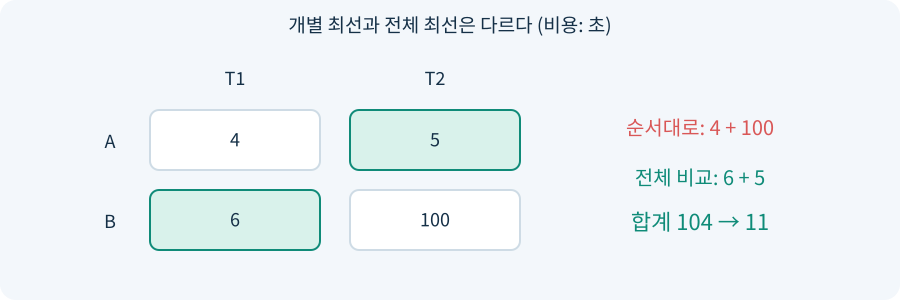

**수식.** 로봇 i를 작업 j에 붙이면 `xᵢⱼ=1`, 아니면 0이다. `ΣᵢΣⱼ cᵢⱼ xᵢⱼ`를 최소화한다. 한 로봇과 한 작업은 이번 배정에서 최대 한 번만 선택한다. Frybot은 가능한 쌍 수 `k=min(로봇 수, 작업 수)`를 채운다. 배정하지 않는 선택에 별도 비용을 두는 모델은 아니다.

**비용식.** `cᵢⱼ = 이동시간(i,j) - 6×priorityⱼ - 0.5×대기초ⱼ`다. 우선순위가 크거나 오래 기다릴수록 비용을 깎아 선택될 가능성을 높인다. 음수 비용도 시간 역행을 의미하지 않으며, 선호를 표현하는 점수다. [C10]

**원문:** [R09 · Kuhn 1955](https://doi.org/10.1002/nav.3800020109) · [R10 · Crouse 2016](https://doi.org/10.1109/TAES.2016.140952) · [R11 · SciPy 구현 설명](https://docs.scipy.org/doc/scipy/reference/generated/scipy.optimize.linear_sum_assignment.html)

<!-- PAGE -->
# 08 · ‘최소 비용’은 무엇에 대한 최적인가?

**예시.** 06장의 표에서 A→T1, B→T2는 104초지만 B→T1, A→T2는 11초다. 전수 탐색은 두 조합을 모두 비교해 11초를 선택한다. 3대와 작업 10개라면 코드의 후보 수는 `P(3,3)×C(10,3)=6×120=720`개다. 작은 규모에서는 명시적으로 모두 비교할 수 있다. [C10]

**풀이 전환 조건.** `P(n,k)×C(m,k)>20,000`이면 `scipy.optimize.linear_sum_assignment`를 시도한다. SciPy가 없으면 전수 탐색으로 돌아간다. 즉 ‘3대이면 무조건 전수 탐색’이 아니라 후보 수로 분기한다. 과거 `hungarian`, `hungarian_eta`, `hungarian_eta_rh`는 호환용 별칭이다. [C10]

**꼭 알아야 할 성질.** 모든 작업을 이번에 다 배정한다면 작업별 `-6×priority`, `-0.5×age` 항의 총합은 어느 로봇에 배정하든 같다. 따라서 이 항들은 그 경우 로봇-작업 매칭을 바꾸지 않는다. 작업이 로봇보다 많아 일부 작업을 선택할 때는 어떤 작업이 뽑히는지에 영향을 준다. ‘우선순위를 넣었으니 모든 상황에서 매칭이 변한다’는 해석은 틀리다.

**현재 비용의 범위.** 첫 정차점까지의 이동 비용을 중심으로 최적화한다. 픽업 이후 테이블까지의 이동, 조리 완료, 전체 작업 체인의 납기, 미래 주문까지 합친 하루 매출이나 총 완료 시간을 직접 최적화하는 모델은 아니다. 정확한 최적해도 비용 정의가 현실과 다르면 좋은 운영 결과를 보장하지 않는다.

**로봇을 묶는 상호작용.** 비용 행렬의 각 항은 현재 상태를 바탕으로 계산한다. 두 로봇을 동시에 새로 배정했을 때 새로 생기는 상호 혼잡까지 완전한 공동 최적화로 푸는 것은 아니다. 후속 플래너와 롤링 재배정이 이를 보완한다.

**확인 질문:** 3대와 작업 3개일 때 작업별 우선순위를 바꾸면 왜 매칭이 그대로일 수 있을까? ‘최적 알고리즘’보다 ‘올바른 비용’이 중요한 예를 들어보자.

**코드 근거:** [C10] `MinCostScheduler.assign, MAX_EXHAUSTIVE`.

<!-- PAGE -->
# 09 · ETA 기반 Minimum-cost
## 거리 비용을 ‘예약 대기를 포함한 도착 시간’으로 바꾼다

**목적.** 가까운 로봇이라도 복도가 막혀 있으면 늦을 수 있다. `min_cost_eta`는 최소 비용 배정의 풀이 구조를 유지하고 비용 입력을 바꾼다. 기본 `min_cost_eta_rh`도 이 기능을 상속한다. [C01, C10]

**근원.** 독립된 유명 단일 알고리즘을 그대로 이식한 이름이 아니라, 선형 배정 문제와 예약 기반 경로 계획을 결합한 프로젝트 구성이다. 배정의 배경은 MRTA와 선형 배정 문헌, 시간 예약은 SIPP 문헌을 참조한다. 이 이름의 원 논문이 따로 확인된 것은 아니다. [R01, R08, R09]

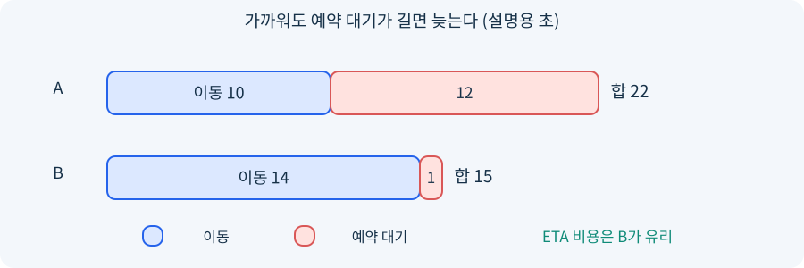

**코드 흐름.** 스케줄러의 `uses_eta=True`이면 코어 `_cost_fn()`이 후보 로봇과 작업의 첫 정차점에 대한 `PlanRequest`를 만든다. 협조 플래너가 경로를 찾으면 `마지막 arrive - 현재 시각`을 비용으로 쓴다. 여기에는 해당 계획에서 발생한 예약 대기가 들어간다. 같은 배정 계산 안에서는 `(robot_id, start_node)`로 결과를 캐시한다. [C01]

**왜 ETA를 학습할 수 있나?** 현재 ETA는 이미 유용한 물리·예약 모델의 출력이다. 학습은 이를 대체해야만 하는 것이 아니라, 이 값과 실제 소요 시간 사이의 반복적인 오차를 보정할 수 있다. 예컨대 좁은 코너의 회전·정착 지연이 일정하다면 입력 특징과 실제 기록의 관계를 배울 수 있다. 이는 제안이며 현재 코드에 학습 ETA가 연결된 상태는 아니다.

**참고:** [R01 · SIPP](https://www.cs.cmu.edu/afs/cs/Web/People/maxim/files/sipp_icra11.pdf) · [R08 · MRTA](https://doi.org/10.1177/0278364904045564)

<!-- PAGE -->
# 09 · 현재 ETA의 정확한 범위와 빈틈

**계산 예시.** A의 정적 이동 시간은 10초지만 예약 대기 12초가 붙으면 ETA는 22초다. B는 정적 14초, 예약 대기 1초라면 15초다. 거리 기준 배정은 A를, ETA 기준은 B를 유리하게 평가할 수 있다. 실제 도착 시간으로 검증하기 전에는 이 예시가 성능 개선의 증거는 아니다.

**현재 구현의 세부 값.** 요청 속도는 `self.speed × plan_speed_factor`, 목적지 유지 시간은 `goal_hold=4.0`, 구간 지연은 `plan_overhead`다. 요청 시작점은 `r.heading or r.node`, 시작 시각은 현재 `self.now`다. 이동 중인 로봇의 현재 위치에서 다음 노드까지 남은 시간을 이 비용 함수가 정밀하게 더하는 것은 아니다. 재배정 비교 시 이 근사가 중요하다. [C01]

**경로를 못 찾으면?** 협조 플래너가 실패하면 정적 비용의 3배를 사용한다. 비협조 플래너는 시간표를 요청하지 않고 정적 비용을 사용한다. 따라서 ‘ETA 모드’라는 이름이 항상 실제 예약 경로의 도착 시각을 뜻하지는 않는다. 3배는 실패 후보에 불이익을 주는 휴리스틱이며 학습된 실패 확률이나 이론적 최악 시간은 아니다. [C01]

**모든 후보가 동시에 계획되는가?** 각 후보 비용은 당시 다른 로봇의 예약을 보며 계산한다. 새로 선택할 모든 로봇-작업 조합의 상호 간섭을 한 번에 풀어 얻은 정확한 전역 비용 행렬은 아니다. 작업 배정 뒤 실제 경로를 만들면서 추가 대기나 우회가 생길 수 있다.

**학습으로 개선할 수 있는 부분.** 구간별 실제 속도, 회전 수, 현재 자세, 도킹 여부, 혼잡도, 이동 중 남은 거리 등을 넣어 잔차를 예측할 수 있다. 먼저 ‘첫 정차점 도착’의 판정 시점을 고정해야 한다. 도킹까지 포함한 시간인지, 로드맵 노드 도달 시간인지 섞으면 정답 데이터가 불일치한다.

**확인 질문:** 예약을 포함한 ETA가 정확해져도 첫 정차점 이후의 작업 완료가 늦어질 수 있을까? ETA 예측 오차와 배정 성능은 별도로 측정해야 할까?

**코드 근거:** [C01] `FleetCore._cost_fn` · [C10] `MinCostEtaScheduler`.

<!-- PAGE -->
# 10 · Rolling Horizon
## 한 번 내린 배정도 상황이 바뀌면 다시 비교한다

**목적.** 주문과 로봇 상태는 계속 변한다. 처음에는 A가 빨랐지만 새 지연이 생기면 B가 유리해질 수 있다. `min_cost_eta_rh`는 ETA 기반 최소 비용 배정을 주기적으로 다시 검토한다. 현재 기본 스케줄러다. [C01, C10]

**근원.** Rolling horizon은 현재 정보로 계획하고 일부를 실행한 뒤 다시 계획하는 일반적 운영 개념이다. 관련 로봇 논문으로 Li 외의 *Lifelong Multi-Agent Path Finding in Large-Scale Warehouses* (AAAI 2021)가 RHCR을 설명한다. 다만 RHCR은 제한된 시간 창의 경로 충돌 해결이며, Frybot의 ‘미착수 작업 재배정’을 그대로 구현한 논문은 아니다. 개념적 배경으로만 인용한다. [R12]

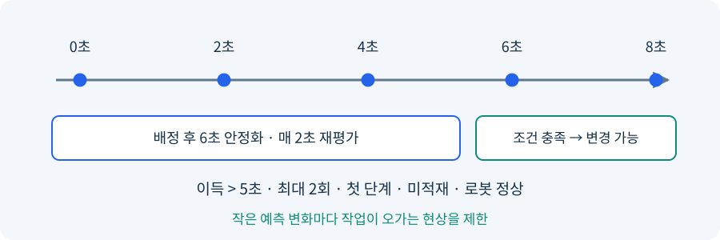

**동작.** 대기 작업과 재배정 가능한 진행 중 작업을 모아 가용 로봇 및 해당 작업의 로봇으로 새 배정을 계산한다. 새 결과가 충분히 좋으면 작업의 담당 로봇을 바꾸고 이동 단계를 다시 진행한다. 음식 적재나 손님 안내처럼 작업이 실제 서비스 단계로 넘어간 뒤에는 임의로 옮기지 않도록 범위를 제한한다. [C01]

**왜 변경 비용이 필요한가?** 작은 ETA 차이마다 바꾸면 로봇이 계속 방향을 바꾸고 손님도 혼란스럽다. 계산상 1초 이득이 취소·회전·재출발의 실제 손실보다 작을 수 있다. Frybot의 제한은 이런 흔들림을 줄이는 역할이다.

**관련 논문:** [R12 · RHCR 논문과 PDF](https://ojs.aaai.org/index.php/AAAI/article/view/17344)

<!-- PAGE -->
# 10 · 실제 재배정 조건을 빠짐없이 보기

| 조건 | 현재 코드 값 / 의미 |
|---|---|
| 재평가 간격 | 최소 2초 간격 |
| 작업 상태 | `IN_PROGRESS`, AMR 임무, `pi == 0` |
| 운반 상태 | `carrying=False` |
| 로봇 상태 | 온라인, 비상정지 아님, `_fault()` 없음 |
| 배정 안정화 시간 | 마지막 배정 후 6초 이상 |
| 변경 횟수 | 작업별 `rebalanced < 2` |
| 최소 이득 | 계산한 합계 이득이 **5초 초과** |
| 유효성 | 재평가 대상 기존 작업이 새 결과에 모두 포함되어야 함 |

**이득의 정의.** 코드의 `gain`은 기존 진행 작업들에 대해 `기존 담당 로봇 비용 - 새 담당 로봇 비용`을 더한 값이다. 신규 대기 작업을 포함한 전체 서비스 성과나 취소·회전 손실까지 정확히 합한 값은 아니다. 이 차이를 이해해야 5초 기준의 의미를 과장하지 않는다. [C01, C10]

**예시.** 첫 배정 3초 뒤 A의 ETA가 30초, B가 20초여도 6초 안정화 조건 때문에 즉시 바꾸지 않는다. 8초 뒤 새 비교에서 A가 28초, B가 19초이고 다른 조건도 충족한다면 9초 이득으로 변경 후보가 된다. 음식 적재 뒤에는 이 재배정 대상으로 넣지 않는다.

**한계.** `pi==0`은 프로그램의 단계 인덱스라는 구현 조건이다. 일반적 의미의 ‘모든 미착수 작업’을 자동으로 이해하는 AI 판단이 아니다. 또한 재배정과 새 경로 계획의 성공은 별개이며, 계획 실패 시 별도 복구 처리가 필요하다.

**운영 지표.** ETA 오차, 재배정 횟수, 재배정 후 실제 절약 시간, 방향 전환·정체 수, 최종 작업 완료 시간을 함께 본다. 재배정이 많다는 사실 자체가 성능이 좋다는 뜻은 아니다.

**확인 질문:** 최소 이득을 0초로 낮추면 무슨 일이 생길까? 예측 ETA가 흔들릴 때 왜 재배정 모델이 더 불안정해질 수 있을까?

**코드 근거:** [C10] `MinCostEtaRollingScheduler` · [C01] `FleetCore._schedule`.

<!-- PAGE -->
# 11 · NavFn의 A*
## 허가된 구간을 비용 지도 위의 경로로 바꾼다

**목적.** 중앙 관제의 로드맵은 큰 이동 순서와 통로 사용을 정한다. 실제 바퀴를 움직이려면 벽과 장애물 여유를 반영한 촘촘한 좌표 경로가 필요하다. Nav2 모드에서 NavFn이 이 역할을 맡는다. 중앙 SIPP를 대체하는 것이 아니라 다른 해상도의 계획 계층이다. [C09, C11]

**근원.** 탐색 원리는 A*의 고전 문헌에 연결된다. NavFn의 구체 동작은 공식 Nav2 문서를 함께 봐야 한다. 공식 설명은 Dijkstra 또는 A* 확장을 사용하는 holonomic planner이며, `use_astar=True`가 A* 확장을 선택한다. 홀로노믹 계획은 차체가 실제로 모든 방향으로 즉시 움직인다는 뜻이 아니라, 계획 단계에서 운동 제약을 단순화했다는 뜻이다. [R04, R13]

**Frybot 설정.** `GridBased` 플러그인은 `nav2_navfn_planner::NavfnPlanner`, `use_astar=true`, 목표 허용 오차 `0.02m`, `allow_unknown=false`다. 전역 비용 지도는 정적 지도와 inflation layer를 사용한다. 지역 비용 지도는 LiDAR obstacle layer와 inflation layer를 사용한다. [C11]

**Inflation의 의미.** 벽의 셀만 막으면 로봇 중심은 벽 옆을 너무 가깝게 지나갈 수 있다. 장애물 주변에 비용을 부여해 여유가 있는 길을 선호하게 한다. 다만 비용 증가와 차체 footprint 기반 충돌 검사는 같은 개념이 아니므로 둘을 함께 확인해야 한다.

**근거:** [R13 · NavFn 공식 문서](https://docs.nav2.org/rolling/configuration_and_development/configuration_guide/planners_plugins/configuring_navfn/) · [R04 · A*](https://ai.stanford.edu/~nilsson/OnlinePubs-Nils/PublishedPapers/astar.pdf)

<!-- PAGE -->
# 11 · 중앙 로드맵과 비용 지도를 혼동하지 않기

**계층 예시.** 중앙 관제가 `입구 → 교차로 → 테이블 앞` 순서와 각 구간 허가를 결정한다. 로봇은 현재 허가된 다음 지점을 Nav2 목표로 받아 비용 지도에서 경로를 계산하고 따라간다. 중앙의 ‘교차로 점유’와 Nav2의 ‘벽 옆 경로 비용’은 서로 다른 정보를 표현한다. [C01, C12]

**실제 설정의 세부 사항.** 비용 지도 해상도는 `0.01m`다. 지역 지도는 1m×1m rolling window이며 전역은 정적 지도를 따른다. 지역 inflation은 0.07m, 전역은 실물 실측 지도에서 0.07m, 그 외 0.08m로 채워진다. 이 수치는 기본 템플릿과 `navigator.py` 변환을 함께 읽은 결과다. [C09, C11]

**동적 장애물은 어디에 들어가나?** 현재 전역 레이어에는 LiDAR obstacle layer가 없다. 따라서 움직이는 손님 때문에 지역 주행이 멈춘다고 해서 전역 NavFn이 그 손님을 항상 반영해 우회 경로를 만들었다고 볼 수는 없다. 지역 충돌 검사, 정체 감지, 코어의 재계획 등이 서로 보완한다.

**운동학적 한계.** 좁은 경로가 비용 지도상 존재해도 실제 차체가 회전하거나 후진으로 들어가기 어려울 수 있다. 허용 목표 오차 2cm 역시 최종 도킹 정밀도를 보장하지 않는다. 방향과 실제 제어 가능성은 RPP, 모바일 제어기, 도킹 단계에서 다시 다룬다.

**실행 조건.** `drive=kinematic`은 단순 회전·직진 모의를 사용할 수 있다. 기본 시뮬레이션에서 본 경로 움직임을 NavFn 성능으로 해석하지 말고, 실행한 `drive` 인자와 활성 노드를 확인해야 한다. [C02, C12]

**확인 질문:** SIPP가 경로를 찾았는데 Nav2가 목표에 가지 못할 수 있는 이유는 무엇일까? 노드 사이 직선과 비용 지도 위 경로가 다르면 예약 시간에는 어떤 영향이 생길까?

**코드 근거:** [C11] `nav2_store.yaml: planner_server, global_costmap, local_costmap` · [C09] `params_file` · [C12] `_nav2_segment`.

<!-- PAGE -->
# 12 · Regulated Pure Pursuit
## 앞쪽의 목표점을 쫓되, 곡률과 충돌에 맞춰 감속한다

**목적.** 경로가 있어도 바퀴에 줄 선속도 v와 각속도 ω가 필요하다. Pure Pursuit는 경로 위 앞쪽의 점을 선택하고 그 점을 향하는 원호를 계산한다. Regulated Pure Pursuit(RPP)는 여기에 곡률·장애물·목표 접근을 고려한 속도 조절을 더한다. [R14, R15]

**근원.** Coulter의 *Implementation of the Pure Pursuit Path Tracking Algorithm* (1992)은 기하와 구현을 설명하는 고전 기술 보고서다. Macenski, Singh, Martín, Ginés의 *Regulated Pure Pursuit for Robot Path Tracking* (2023)은 서비스 로봇 환경에서 속도 조절을 더한 RPP를 설명한다. [R14, R15]

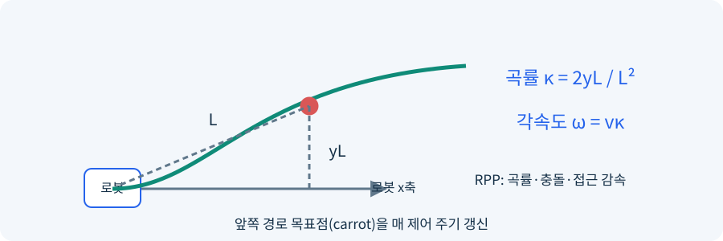

**기하를 간단히.** 로봇 기준 앞쪽 목표점이 `(xL,yL)`이고 거리 `L=sqrt(xL²+yL²)`라면 기본 곡률은 `κ=2yL/L²`다. 선속도 v가 주어졌을 때 기본 관계는 `ω=vκ`다. yL이 크면 더 크게 돌아야 하고, 목표점이 멀어지면 같은 횡오차에도 곡률이 작아진다. 이는 이해용 기본식이며 실제 Nav2의 여러 조건 분기 전체를 대체하지 않는다.

**Lookahead의 절충.** 너무 짧으면 경로를 예민하게 쫓아 흔들릴 수 있고, 너무 길면 코너를 크게 잘라갈 수 있다. 경로 추종의 정확성과 부드러움 사이에서 로봇 크기·속도·지도 해상도에 맞게 정해야 한다.

**원문:** [R14 · Coulter 보고서 PDF](https://publications.ri.cmu.edu/storage/publications/pub_files/pub3/coulter_r_craig_1992_1/coulter_r_craig_1992_1.pdf) · [R15 · RPP 논문](https://arxiv.org/abs/2305.20026)

<!-- PAGE -->
# 12 · Frybot에 켜져 있는 기능만 구분하기

| 항목 | 현재 템플릿 설정 |
|---|---|
| 제어 주기 | 20Hz |
| 희망 선속도 | 0.08m/s |
| Lookahead | 0.06m, 속도 비례 확장 꺼짐 |
| 곡률에 따른 선속도 조절 | 켜짐 |
| 비용값에 따른 선속도 조절 | **꺼짐** |
| 충돌 예측 검사 | 켜짐, 시간 상한 0.3초 및 carrot 한계 |
| 접근 시 최소 선속도 | 0.02m/s |
| 전진 / 후진 | `FollowPath`, `FollowPathReverse`로 선택 |

**수치 예시.** `L=0.1m`, `yL=0.02m`이면 `κ=4 /m`다. v=0.08m/s일 때 기본 각속도는 0.32rad/s다. 더 급한 코너에서는 조절 로직이 선속도를 낮출 수 있다. 이 계산은 실제 명령 로그가 아니라 기본식의 단위와 크기를 이해하기 위한 예시다.

**실측 지도에서의 덮어쓰기.** `navigator.py`는 실측 지도에서 `FollowPath.use_rotate_to_heading=true`, `allow_reversing=false`로 바꾼다. 후진 전용 `FollowPathReverse`는 회전 정렬을 끄고 후진을 허용한다. 공식 문서에서도 두 기능을 동시에 켜면 모호함이 생기는 조합이라고 설명한다. [C09, C11, R16]

**역할의 경계.** RPP는 주어진 경로를 따라가는 제어기이며 다른 로봇의 장기 통로 예약이나 작업 배정을 결정하지 않는다. 충돌 검사는 현재 속도와 비용 지도에 기반한 제한된 앞보기다. 사람의 의도를 장기 예측하거나 모든 돌발 상황의 안전을 보장하는 학습 정책은 아니다.

**실행 해석.** 템플릿의 비용 감속이 꺼져 있으므로 “RPP 논문에 있는 모든 감속 기능이 현재 켜져 있다”고 말하면 틀리다. 코어에서 전달하는 속도 제한이나 모바일 제어기의 구간별 선택도 실제 속도에 영향을 준다.

**확인 질문:** 좁은 코너에서 경로 오차가 커지면 lookahead만 줄이면 해결될까? 정체가 RPP의 제어 문제인지, 전역 경로 문제인지, 락 대기인지 어떤 로그로 구분할까?

**코드 근거:** [C11] `FollowPath, FollowPathReverse` · [C09] `navigator_nodes` · [C12] `_set_speed_limit, _nav2_segment`.

<!-- PAGE -->
# 13 · AMCL
## 가능한 위치 가설들을 센서로 좁혀간다

**목적.** 바퀴가 돌았다고 실제로 그만큼 이동한 것은 아니다. 바닥 미끄러짐과 오도메트리 오차가 누적된다. AMCL은 기존 지도와 LiDAR, 오도메트리를 이용해 로봇의 `(x,y,yaw)`를 추정한다. Frybot에서는 실물 로봇에 사용하고 시뮬레이션은 시뮬레이터의 자세를 사용한다. [C09, C11]

**근원.** Dellaert, Fox, Burgard, Thrun의 *Monte Carlo Localization for Mobile Robots* (ICRA 1999)는 위치 분포를 샘플 집합으로 표현한다. Fox의 *KLD-Sampling: Adaptive Particle Filters* (NIPS 2001)는 불확실성에 따라 샘플 수를 조절하는 배경이다. AMCL의 구체 구현과 파라미터는 Nav2 문서를 따른다. [R17, R18, R19]

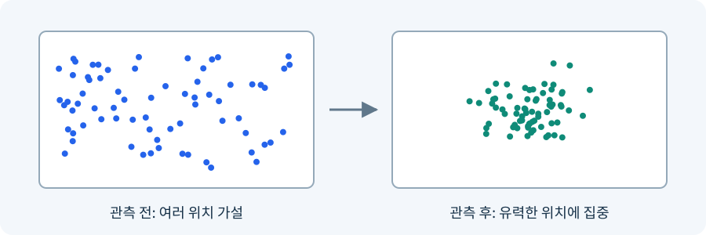

**네 단계.** ① 지도 위에 가능한 위치·방향을 가진 입자들을 둔다. ② 오도메트리 이동에 따라 각 입자를 노이즈와 함께 이동한다. ③ 그 위치라면 LiDAR가 어떻게 보일지와 실제 관측의 맞음을 평가해 가중치를 준다. ④ 그럴듯한 입자 주변을 중심으로 다시 샘플링한다. 입자 한 개는 센서 점이 아니라 위치 가설이다.

**개념 수식.** `현재 위치 신뢰도 ∝ 센서 관측의 그럴듯함 × 이동 후 예측 분포`다. 이를 입자 집합으로 근사하므로 복도 대칭처럼 가능한 위치가 여러 군집인 상태도 표현할 수 있다.

**원문:** [R17 · MCL 논문 페이지](https://publications.ri.cmu.edu/monte-carlo-localization-for-mobile-robots) · [R18 · KLD-Sampling 저자 페이지](https://rse-lab.cs.washington.edu/projects/mcl/abstracts/adaptive-sampling-nips-01.abstract.html)

<!-- PAGE -->
# 13 · AMCL은 지도를 만드는 알고리즘이 아니다

**지도와 위치를 구분하자.** AMCL은 이미 있는 지도에서 자신의 위치를 추정한다. 지도와 위치를 동시에 추정하는 SLAM과 다르다. 가구 배치나 벽이 크게 바뀌면 기존 지도와 관측의 불일치가 위치 추정에 영향을 준다.

**Frybot 설정.** `DifferentialMotionModel`, `laser_model_type=likelihood_field`, 입자 수 500~2000, 최대 사용 빔 90, 이동 갱신 기준 0.02m / 0.1rad, 리샘플링 간격 1이다. `alpha1~4=0.2`는 이동 노이즈 계수다. 단순히 숫자가 작을수록 더 정확하다고 볼 수는 없고 실제 오도메트리 오차에 맞춰야 한다. [C11]

**Likelihood field의 직관.** 입자의 위치에서 LiDAR 끝점을 지도에 놓았을 때 벽 가까이에 끝나는 점이 많으면 그 입자를 더 그럴듯하게 본다. 모든 센서 광선을 복잡하게 시뮬레이션하는 모델과 구분된다. 현재 모델 이름이 `likelihood_field`이므로 다른 변형인 `likelihood_field_prob`의 옵션을 그대로 가정하지 않는다. [R19]

**좌표계 역할.** 오도메트리는 짧은 시간의 연속적인 이동에 좋지만 장기적으로 드리프트한다. AMCL은 지도 기준 보정으로 `map → odom` 변환을 제공하고, 오도메트리는 `odom → base`를 제공한다. 지도 위치가 갑자기 보정되면 목표와 로봇의 상대 오차도 바뀔 수 있어 도킹에는 부드러운 odom 좌표를 쓰는 이유가 있다.

**초기 자세.** 템플릿 `set_initial_pose=false`이며, 실물 launch에 초기 자세를 주면 그 값을 덮어쓴다. 실측 지도에서 초기 자세를 설정하지 않은 상태와 충분히 수렴한 상태를 같은 출발 조건으로 비교하면 안 된다. [C09, C11]

**한계와 학습의 차이.** 비슷한 모양의 복도, LiDAR 가림, 시간 동기 오차, 잘못된 TF 때문에 추정이 틀릴 수 있다. 입자 수를 조절하는 ‘adaptive’가 과거 매장 기록을 학습한 신경망이라는 뜻은 아니다.

**확인 질문:** 입자들이 한 군집으로 모였다고 반드시 올바른 위치일까? 지도 자체가 틀리거나 초기 위치가 대칭 구간이라면 무엇을 확인해야 할까?

**코드 근거:** [C11] `amcl` · [C09] `navigator_nodes`.

<!-- PAGE -->
# 14 · ArUco + IPPE Square PnP
## ‘마커가 보인다’를 ‘어디로 가야 한다’로 바꾼다

**목적.** 전역 지도 위치만으로 맞추기 어려운 마지막 도킹 자세를 카메라 마커로 보정한다. 먼저 ArUco가 사각 마커의 ID와 네 꼭짓점을 찾고, PnP가 알려진 실제 크기와 영상 좌표로 마커의 3D 자세를 추정한다. [C13]

**근원.** Garrido-Jurado 외의 *Automatic Generation and Detection of Highly Reliable Fiducial Markers under Occlusion* (2014)이 ArUco 계열의 주요 문헌이다. Collins와 Bartoli의 *Infinitesimal Plane-Based Pose Estimation* (2014)이 IPPE의 출처다. OpenCV는 정사각형 전용 `SOLVEPNP_IPPE_SQUARE`를 제공한다. [R20, R21, R22]

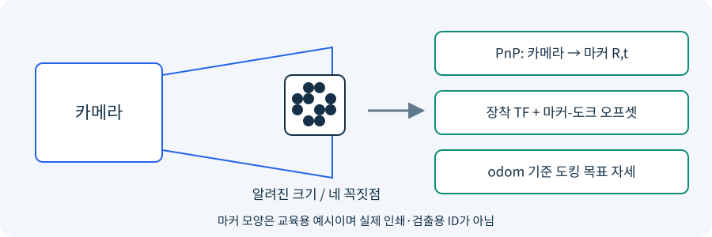

**추정 과정.** 회색조 영상에서 마커 후보를 찾고 ID를 읽는다. 원하는 도크 ID가 보이면 마커 평면의 실제 네 점과 영상 네 점을 대응시킨다. 카메라 내부 파라미터 K와 왜곡계수 D를 이용해 회전 R·이동 t를 구한다. 기본 투영 관계는 `영상점 ~ K(R·마커점 + t)`다.

**좌표 변환이 남아 있다.** PnP의 t는 도킹 완료 위치가 아니다. 카메라 기준 마커 위치를 카메라 장착 TF로 로봇 기준으로 바꾸고, 마커에서 도킹 목표까지의 오프셋을 적용한 후 odom 좌표의 목표 자세를 만든다. Frybot이 발행하는 것은 단순 마커 중심이 아니라 로봇이 도달할 도크 자세다. [C13]

**원문:** [R20 · ArUco 논문](https://doi.org/10.1016/j.patcog.2014.01.005) · [R21 · IPPE 저자 구현과 논문 안내](https://github.com/tobycollins/IPPE) · [R22 · OpenCV PnP](https://docs.opencv.org/4.x/d5/d1f/calib3d_solvePnP.html)

<!-- PAGE -->
# 14 · 평면 마커에는 두 자세 후보가 생길 수 있다

**Frybot 코드.** 사전은 `DICT_4X4_50`이고 `ArucoDetector.detectMarkers()`를 호출한다. `solvePnPGeneric(..., SOLVEPNP_IPPE_SQUARE)`로 후보 회전·이동을 얻는다. 이후 마커가 수직 벽에 있고 로봇 쪽을 향한다는 가정으로 법선의 방향과 수평성을 검사해 후보를 고른다. [C05, C13]

**왜 두 후보인가?** 작거나 멀리 있는 평면 마커는 서로 다른 3D 자세가 거의 비슷한 영상으로 투영될 수 있다. IPPE 저자 구현은 이 평면 자세의 모호성과 두 해를 설명한다. 단순히 계산 함수가 성공했다고 선택한 자세가 항상 정확한 것은 아니다. Frybot의 벽 가정도 카메라 설치와 마커 방향이 맞을 때에만 유효하다. [R21]

**오차의 예시.** 마커의 실제 한 변이 40mm인데 설정이 44mm라면 추정 거리의 스케일도 영향을 받는다. 초점거리, 렌즈 왜곡, 이미지 지연, 카메라 장착 각도의 오차가 차례로 목표 자세에 전파된다. 수 mm의 도킹 정확도를 논하려면 마커 인식률뿐 아니라 전체 보정 체인을 점검해야 한다.

**가려짐 처리.** 목표 마커가 화면 밖으로 나가거나 가까워져 흐려질 수 있다. 검출기는 마지막 목표를 odom 프레임에 유지하고 설정한 `hold_time` 동안 재발행한다. 이것은 잠깐의 미검출을 견디기 위한 보유값이지 새 카메라 측정은 아니다. odom 드리프트가 계속 누적될 수 있다. [C13]

**시간과 좌표의 주의점.** 영상 타임스탬프와 맞는 오도메트리 자세를 사용해야 한다. 현재 구현은 영상 시각의 odom을 보간하고 카메라 고정 장착 변환을 사용한다. 실측 지도에서는 도크가 없어 이 검출기를 실행하지 않는다는 launch 조건도 기억한다. [C09, C13]

**확인 질문:** 검출된 ID가 맞는데 도킹 목표가 옆으로 치우친다면 어떤 보정값을 확인할까? ‘마커 신뢰도’와 ‘최종 도크 자세 정확도’는 왜 다른가?

**코드 근거:** [C13] `_image, _resolve, _repeat` · [C05] `ARUCO_DICT, docks`.

<!-- PAGE -->
# 15 · OpenNav Docking
## 마지막 접근을 별도 제어 절차로 마무리한다

**목적.** 일반 경로 추종이 목적지 근처까지 이동한 다음, 정밀한 정렬과 접근이 필요하다. OpenNav Docking은 감지·접근·완료 판단을 묶는 프레임워크다. 하나의 신경망이나 하나의 경로 탐색 알고리즘이 아니다. [R23]

**근원.** 공식 Open Navigation 구현은 도킹용 graceful 제어기를 설명한다. 기하학적 자세 추종의 관련 원리로 Park와 Kuipers의 *A Smooth Control Law for Graceful Motion of Differential Wheeled Mobile Robots in 2D Environment* (ICRA 2011)를 읽을 수 있다. 논문은 차동 로봇의 부드러운 목표 자세 접근을 다루며, Frybot의 예외 처리·충전 완료 판단 전체를 증명한 논문은 아니다. [R23, R24]

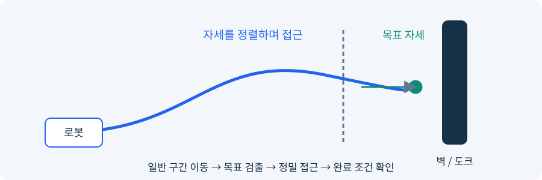

**직관.** 목표와의 거리뿐 아니라 “목표를 바라보는 방향”, “도착할 때 맞춰야 할 방향”을 함께 보고 선속도와 각속도를 정한다. 목표에 가까워지면 감속하고 반복 검출한 목표 자세로 보정한다. 급하게 끝점만 향하는 제어보다 최종 정렬을 다루기 좋다.

**Frybot 플러그인.** `marker_dock`와 `pose_dock` 모두 `SimpleNonChargingDock`다. 전자는 외부 검출 자세를 사용하고, 후자는 지도상의 도크 자세를 사용한다. 이름에 charger가 포함된 장소라도 이 플러그인 선택 자체가 전류를 측정해 충전 성공을 확인하는 구성이라는 뜻은 아니다. [C11]

**공식 구현 / 배경 논문:** [R23 · 도킹 프레임워크](https://github.com/open-navigation/opennav_docking) · [R24 · Park & Kuipers PDF](https://web.eecs.umich.edu/~kuipers/papers/Park-icra-11.pdf)

<!-- PAGE -->
# 15 · 정확한 도킹과 엄격한 허용 오차는 다르다

| 설정 | Frybot 템플릿 값 |
|---|---|
| 제어 주기 | 20Hz |
| 초기 검출 대기 / 접근 제한 | 4초 / 20초 |
| 서버 내부 최대 재시도 | 0 |
| 완료 위치 임계값 | 0.006m = 6mm |
| 선속도 범위 / 최대 각속도 | 0.02~0.05m/s / 1.0rad/s |
| 제어 이득 | `k_phi=8.0`, `k_delta=4.0` |
| 마커 검출 필터 계수 | 0.3 |

**6mm는 요구 조건이다.** 센서·카메라·기구 오차와 실험 분산을 측정하지 않고 “정확도 6mm”라고 말할 수 없다. 또한 모바일 제어기는 도크 목표와 종방향으로 나란해졌을 때 접근을 끝내는 추가 조건을 가진다. 서버의 위치 임계값만이 유일한 종료 조건은 아니다. [C11, C12]

**접근 흐름.** 코어가 도크 앞 로드맵 노드까지 보낸다 → 모바일 제어기가 도킹 액션을 요청한다 → 검출기 또는 지도 자세를 사용해 접근한다 → 도착·실패 결과를 처리한다. 서버 내부 재시도는 꺼져 있고 실패 시 모바일 제어기의 Nav2 대체 동작 등이 작동한다. 측정 지도에서는 이 절차 자체를 실행하지 않는다. [C09, C12]

**충돌 검사의 근거리 예외.** 도크가 벽 바로 앞에 있으므로 목표에 가까운 일부 구간은 비용 지도 충돌 검사에서 제외하는 설정이 있다. 코드 주석은 제어 목표가 도크 뒤 0.25m에 놓이고 임계값 0.33m가 마지막 약 8cm에 해당한다고 설명한다. 이는 구성 의도이며 실제 설치에서의 안전 거리를 검증한 측정값은 아니다. [C11]

**한계.** 필터는 노이즈를 줄이는 대신 추종 지연을 만들 수 있고, 높은 이득은 빠른 정렬과 진동 사이의 절충이다. 마커 방향, TF, 영상·odom 시간 정합이 틀리면 제어기를 조정해도 근본 원인이 남는다.

**확인 질문:** 임계값을 6mm에서 2mm로 줄이면 왜 오히려 완료 실패가 늘 수 있을까? 근거리 마커 손실과 실제 도킹 완료를 어떤 신호로 구분할까?

**코드 근거:** [C11] `docking_server` · [C12] `_dock_segment, _dock_result` · [C09] `navigator_nodes`.

<!-- PAGE -->
# 16 · Open-RMF 연동
## 교통 시간표·협상·임무 대기열을 외부 라이브러리로 푼다

**목적.** 여러 로봇의 예정 궤적과 임무를 공통 모델로 관리하려는 선택적 연동이다. Frybot은 Python 어댑터와 작은 C++ helper로 Open-RMF의 라이브러리를 호출한다. helper 실행 파일이 사용 가능할 때만 옵션을 등록한다. 기본 SIPP 조합이 자동으로 RMF를 사용하는 것은 아니다. [C14, C15]

**근원.** Open-RMF는 단일 논문 알고리즘 이름이 아니라 교통·작업·연동을 제공하는 공개 소프트웨어 체계다. 이 저장소의 실제 동작은 공식 `rmf_traffic`, `rmf_task` API와 helper 호출이 가장 직접적인 근거다. 이 장에서는 확인되지 않은 ‘RMF 원 논문’을 만들어 연결하지 않는다. [R25, R26]

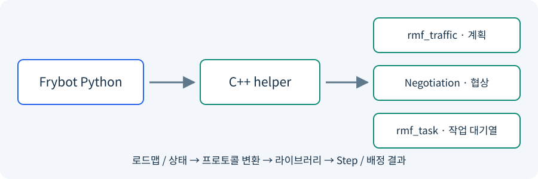

| 옵션 | 실제 호출 / 기능 |
|---|---|
| `rmf` | `agv::Planner` + schedule DB + `ScheduleRouteValidator` |
| `rmf_nego` | 위 계획 + `schedule::Negotiation`, `SimpleNegotiator` |
| `rmf_task` | `TaskPlanner`로 로봇별 작업 대기열 구성 |

**계획과 협상.** 다른 로봇의 예상 `(x,y,t)` 궤적을 교통 스케줄에 넣고, 내 계획이 그 궤적과 충돌하는지 검증한다. 협상 모드는 여러 이동 로봇이 일정을 조정할 수 있도록 공동 계획 훅을 사용한다. 모든 경우 전역 최적 합의를 반드시 찾는다는 의미는 아니다.

**공식 근거:** [R25 · rmf_traffic](https://github.com/open-rmf/rmf_traffic) · [R26 · rmf_task](https://github.com/open-rmf/rmf_task) · [태스크 디스패치 예제](https://github.com/open-rmf/rmf_demos)

<!-- PAGE -->
# 16 · 라이브러리 기능과 현재 어댑터의 범위

**RMF 배정의 입력.** Frybot의 대기 임무를 픽업·드롭오프 지점과 대기 시간을 가진 Delivery 요청으로 변환한다. 가용 로봇뿐 아니라 진행 중 임무가 있는 로봇의 예상 종료 위치·시각도 넣어 작업 대기열을 만든다. 지금 가용한 로봇의 첫 작업을 배정하고 뒤 작업은 대기 상태로 남겨 이후 다시 계산한다. [C15]

**SIPP 예약과 다르다.** 자체 플래너는 노드 락 의미의 예약 구간을 사용한다. RMF는 이동 궤적과 footprint·vicinity 기반 검증을 쓴다. Frybot은 결과를 다시 로드맵 노드의 `Step`으로 바꾸고 같은 실행 허가 계층에 연결한다. 따라서 외부 계획과 최종 실행의 연결 방식도 함께 검토해야 한다. [C01, C14]

**현재 어댑터의 제한.** `plan_overhead`는 helper 프로토콜에서 지원하지 않는다. `rmf_task` 배정의 이동 시간은 교통 대기를 포함하지 않는 RMF 계획을 바탕으로 한다. 비교용으로 배터리 효과를 사실상 꺼 두며, 우선순위도 `priority>=3`의 high/low로 바꾼다. 이는 Open-RMF 전체 기능의 한계가 아니라 이 프로젝트가 넘기는 정보의 범위다. [C14, C15]

**시간 제한과 기구 모델.** 협상 예산은 기본 1초다. helper의 차량 특성은 단순 모의 주행 비교에 맞춘 속도·가속 설정을 사용한다. 따라서 옵션이 존재한다는 사실만으로 실물 차체의 가감속과 회전 시간을 정밀하게 식별한 모델이라고 보기는 어렵다. [C14, C16]

**운영 인프라와 구분.** 현재 연동은 RMF 라이브러리 호출 중심이다. 도어·엘리베이터·다양한 제조사 fleet adapter가 포함된 완전한 매장 RMF 구축을 자동으로 완료한 것은 아니다. 필요한 연결은 별도 구성해야 한다.

**확인 질문:** `rmf_task`를 선택했을 때 작업 배정과 경로 계획이 같은 교통 정보를 쓰는가? `plan_overhead`를 조정해도 결과가 달라지지 않는 이유는 무엇일까?

**코드 근거:** [C14] `planners/rmf.py` · [C15] `schedulers/rmf_task.py` · [C16] `rmf_bridge/rmf_plan_server.cpp`.

<!-- PAGE -->
# 17 · 임계값 기반 규칙
## 모의 AI의 출력 형식을 테스트하는 대역

**목적.** 카메라→AI 서버→중앙 제어의 연결과 업무 흐름을 시험하기 위한 시뮬레이션 판정이다. 현재 `InferenceModel`은 사전학습된 딥러닝 모델을 로딩하지 않는다. 버전 문자열도 `sim-threshold-0.1`이다. [C17]

**근원.** 임계값 비교는 일반적인 결정 규칙이다. 이 프로젝트는 시뮬레이션 특징값을 비교하도록 직접 작성했으며 특정 시각 인식 논문의 재현이라고 할 근거가 없다. 이미지 히스토그램에서 임계값을 자동 선택하는 Otsu 같은 알고리즘을 이 코드가 사용한다고 설명해서는 안 된다.

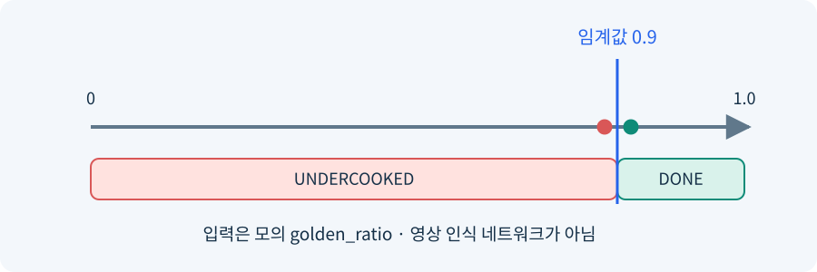

| 함수 | 입력 | 현재 규칙 |
|---|---|---|
| `doneness` | `golden_ratio` | 0.9 이상이면 `DONE`, 아니면 `UNDERCOOKED` |
| `seat_qr` | 테이블의 `qr_visible` | 가시성 필드를 정수로 변환 |
| `guest` | 손님 거리 | 2m 이하면 보인다고 판정 |

**중요한 경계.** 여기의 황금색 비율은 모의 특징값이다. 이 함수 자체가 영상의 음식 영역을 분할하거나 픽셀 색을 계산하지 않는다. QR 함수도 실제 영상에서 QR 코드를 해독하지 않으며, 손님 함수도 영상 검출·동일 인물 추적을 수행하지 않는다. [C17]

**직접 근거:** [C17 · `frybot_sim/frybot_sim/ai_server.py`](../../src/frybot/frybot_sim/frybot_sim/ai_server.py)

<!-- PAGE -->
# 17 · 데모 판정과 실물 인식을 분리하기

**수치 예시.** `golden_ratio=0.92`이면 DONE, 0.88이면 UNDERCOOKED다. 조명이나 카메라 노출 변화에 강하다는 증거는 없다. 실제 음식에서 색과 내부 익힘 상태의 관계도 별도 데이터와 기준으로 확인해야 한다.

**신뢰도처럼 보이는 값.** 익힘 함수는 `round(abs(ratio-0.9)/0.9 + 0.5, 2)`도 반환한다. 이는 임계값에서 멀수록 커지는 수식일 뿐, 라벨이 맞을 확률로 학습·보정한 신뢰도는 아니다. “0.8이면 80% 확률로 맞다”고 읽을 수 없다. [C17]

**실물 모델로 바꾸려면.** 음식 인식은 촬영 조건과 라벨 정의, 손님 추적은 검출과 ID 유지, QR은 실제 영상 디코딩 파이프라인이 필요하다. ETA 모델은 이들과 또 다른 문제다. ETA의 입력은 경로·로봇 상태·예약 등이고 정답은 실제 소요 시간이다. ‘AI 서버가 있다’는 사실만으로 이 기능들이 하나의 모델에서 학습됐다는 뜻은 아니다.

**자료 평가의 기준.** 시뮬레이션에서 주문이 정상 완료됐다는 결과는 업무 흐름 테스트다. 그것만으로 실제 음식 익힘 인식률이나 사람 추적 정확도를 입증할 수 없다. 어느 계층이 모의값을 받았는지 기록해야 실험을 해석할 수 있다.

**확인 질문:** 일정한 거리 이하의 객체를 ‘손님이 보임’으로 처리하는 규칙과 실제 손님 추적은 어떤 데이터가 다를까? 임계값을 조절하는 것과 모델을 학습하는 것은 어떻게 다를까?

**코드 근거:** [C17] `InferenceModel.doneness, seat_qr, guest`.

<!-- PAGE -->
# 전체를 하나의 주문으로 연결하기

1. 주문과 작업이 만들어진다. 코어는 로봇의 온라인·배터리·오류·진행 상태를 검사한다.
2. 기본 `min_cost_eta_rh`가 각 후보의 첫 정차점 ETA를 요청하고 최소 비용 조합을 고른다.
3. 기본 SIPP가 다른 로봇의 예약을 피해 노드와 시각의 경로를 만든다.
4. 실행 코어가 실제 락을 확인하고 다음 구간 허가를 낸다. 로봇은 허가 없이 다음 노드로 넘어가지 않도록 구성된다.
5. Nav2 모드라면 NavFn이 지도 위 구간 경로를 만들고 RPP가 속도 명령을 낸다. 실물에서는 AMCL 위치 추정이 이를 뒷받침한다.
6. 도크가 정의된 구성에서는 ArUco/PnP와 Docking이 정밀 접근을 수행한다. 실측 지도 구성에서는 이 부분이 생략된다.
7. 진행 상태가 코어로 돌아온다. 아직 첫 단계인 임무는 조건을 만족하면 재배정될 수 있다. 작업 단계에 따라 적재·이동·하역 등을 이어간다.

**중간에 지연이 생겼다면 원인을 분리하자.**

| 관찰 | 먼저 확인할 계층 | 구분할 내용 |
|---|---|---|
| 작업이 배정되지 않음 | 배정 / 가용 조건 | 배터리·오류·온라인·작업 상태 |
| 계획부터 실패 | 로드맵 / 예약 / 플래너 | 단절, 목적지 점유, 탐색 제한 |
| 경로는 있는데 출발 안 함 | 트래픽 허가 | 계획 출발 대기인지 실제 락 대기인지 |
| 허가됐는데 움직이지 않음 | 모바일 / Nav2 / 구동 | 목표 거절, 위치 상실, LiDAR 정지 |
| 도착 예상보다 계속 늦음 | ETA 시간 모델 | 회전·감속·도킹·혼잡 지연의 누락 |
| 도크 앞에서 마무리 실패 | 인식 / 좌표 / 도킹 | 마커 크기, K·D, TF, 시간 정합, 종료 조건 |

**이 자료의 핵심 경계:** 최단 거리 ≠ 최소 도착 시간 ≠ 최소 작업 완료 시간. 계획상 무충돌 ≠ 모든 실물 위험에 대한 보장. 알고리즘 설명 ≠ 해당 매장의 실측 성능.

<!-- PAGE -->
# 비교표 · 어떤 차이를 보고 실험할까?

| 계열 | 사용하는 핵심 정보 | 강점 | 주의할 한계 |
|---|---|---|---|
| Independent A* | 정적 그래프 거리 | 단순 비교 기준 | 충돌 대기를 미리 반영하지 않음 |
| CA* | 공간 + 고정 시간 격자 + 예약 | 시간 상태가 직관적 | 양자화 오차·상태 수·우선순위 |
| SIPP | 노드 + 안전 시간 구간 | 대기를 연속 구간으로 압축 | 고정된 선행 계획에 의존 |
| CCBS 계열 | 충돌 제약 트리 + SIPP | 양보 대상을 함께 검토 | 제한 예산·충돌 모델 차이 |
| FIFO / Priority Greedy | 순서 + 정적 비용 | 설명과 비교가 쉬움 | 전체 매칭 비용을 보지 않음 |
| Minimum-cost | 비용 행렬 | 현재 비용 합의 최소 조합 | 비용이 현실을 얼마나 표현하는가 |
| ETA + RH | 예약 ETA + 주기적 재평가 | 상태 변화에 대응 | 예측 오차·재배정 흔들림 |

**실험에서 분리할 지표:** 계획 계산 시간, 계획 실패율, 예약 대기, 실제 락 대기, 실제 이동·회전 시간, 도킹 시간, 작업 완료 시간, 재배정 횟수, 최대 대기 시간. 같은 지도·주문·로봇 수·속도·난수 조건으로 반복 비교해야 한다.

**ETA 학습 전에 정할 것.** 첫 정차점까지의 예측 시점과 도착 판정 시점을 고정한다. 계획이 취소되거나 다른 로봇으로 재배정된 기록을 성공 도착의 정답으로 잘못 연결하지 않는다. 시뮬레이션·실물 데이터와 지도 버전을 구분한다. 향후 모델 검증에서는 같은 운행의 일부가 학습과 평가에 섞이지 않도록 운행 단위 또는 시간 순서로 나누는 것이 좋다. 이는 후속 구현을 위한 제안이며 현재 학습 모델의 실험 결과는 아니다.

**학습 효과의 판정:** 기존 ETA 대비 예측 오차가 줄었는지 먼저 확인하고, 이어 배정에 사용했을 때 전체 서비스 성과가 개선되는지 별도로 본다. 예측 성능과 운영 성능은 같은 지표가 아니다.

<!-- PAGE -->
# 논문을 읽는 순서와 스스로 해볼 문제

**첫 번째 읽기: 개념.** SIPP [R01]의 안전 구간 그림 → A* [R04]의 `g+h` → 배정 문제 [R09] 순서로 본다. 처음부터 모든 증명을 읽기보다 입력·출력·목적함수를 한 문장씩 적는다.

**두 번째 읽기: 실제 로봇.** Pure Pursuit [R14]의 원호 기하 → RPP [R15]의 감속 → MCL [R17]의 입자 → IPPE [R21]의 평면 모호성을 읽는다. 센서와 기구의 가정이 어디에 들어가는지 표시한다.

**세 번째 읽기: 확장과 보장.** CCBS [R02]와 CA* [R03]를 비교한다. RHCR [R12]는 ‘재배정’이 아니라 ‘경로 충돌 해결 창’이라는 점을 확인한다. 본 자료의 코드 차이와 원 논문의 문제 정의를 나란히 놓고 읽는다.

| 연습 | 스스로 설명할 내용 |
|---|---|
| 교차로 두 로봇 | 예약 표를 그리고 SIPP의 대기 출발을 계산하기 |
| 거리 0.2m 구간 | 속도 0.072m/s와 지연 0.5초일 때 계획 시간을 계산하기 |
| 비용 행렬 | 로봇 2대·작업 3개의 모든 배정 조합을 비교하기 |
| 우선순위 항 | 작업이 전부 배정될 때 왜 매칭에 영향이 없을 수 있는지 증명하기 |
| 재배정 | 2초·6초·5초·2회 조건이 각각 막는 현상 설명하기 |
| 좌표 변환 | 마커 좌표 → 카메라 → 로봇 → odom의 의미 설명하기 |
| 지연 분석 | 락 대기·위치 상실·도킹 실패를 서로 다른 원인으로 분류하기 |

**계산 확인:** 위 0.2m 구간은 `0.5 + 0.2/0.072 ≈ 3.28초`다. 이 수치는 계획 모델의 결과이며 실제 측정과 같다고 가정하지 않는다.

**다음 질문을 남길 자리.** 알고리즘 이름만 적기보다 “입력 상태가 무엇이었고, 기대한 결정은 무엇이며, 실제 코드가 어떤 조건으로 달리 결정했는가?”를 기록하면 코드와 이론을 연결하기 쉽다.

<!-- PAGE -->
# 참고문헌 · 탐색과 배정

- **[R01]** Mike Phillips, Maxim Likhachev. *SIPP: Safe Interval Path Planning for Dynamic Environments*. ICRA, 2011. [저자 공개 PDF](https://www.cs.cmu.edu/afs/cs/Web/People/maxim/files/sipp_icra11.pdf). 직접 관련: 01장. 단일 로봇 안전 구간 탐색의 출처.
- **[R02]** Anton Andreychuk, Konstantin Yakovlev, Pavel Surynek, Dor Atzmon, Roni Stern. *Multi-agent pathfinding with continuous time*. Artificial Intelligence 305, 103662, 2022. [DOI](https://doi.org/10.1016/j.artint.2022.103662) · [저자 공개 PDF](https://surynek.net/publications/files/Yakovlev-Andreychuk-Surynek-Atzmon-Stern_MAPF-Continuous-Time_AIJ-2022.pdf). 직접 관련: 02장. Frybot은 제한된 CCBS 계열 구현.
- **[R03]** David Silver. *Cooperative Pathfinding*. AIIDE 1(1), 117-122, 2005. [학회 원문 / PDF](https://ojs.aaai.org/index.php/AIIDE/article/view/18726). 직접 관련: 03장. CA*, HCA*, WHCA*를 구분할 것.
- **[R04]** Peter E. Hart, Nils J. Nilsson, Bertram Raphael. *A Formal Basis for the Heuristic Determination of Minimum Cost Paths*. IEEE Transactions on Systems Science and Cybernetics 4(2), 100-107, 1968. [저자 공개 PDF](https://ai.stanford.edu/~nilsson/OnlinePubs-Nils/PublishedPapers/astar.pdf). 기초: 04·11장.
- **[R05]** E. W. Dijkstra. *A Note on Two Problems in Connexion with Graphs*. Numerische Mathematik 1, 269-271, 1959. [CWI 원문 저장소](https://ir.cwi.nl/pub/9256) · [DOI](https://doi.org/10.1007/BF01386390). 직접 관련: 05장.
- **[R06]** Remzi H. Arpaci-Dusseau, Andrea C. Arpaci-Dusseau. *Operating Systems: Three Easy Pieces*, Scheduling: Introduction. [저자 교재 PDF](https://pages.cs.wisc.edu/~remzi/OSTEP/cpu-sched.pdf). 교재 배경: 06장. FIFO+Nearest 전용 원 논문은 아님.
- **[R07]** 같은 저자. *Operating Systems: Three Easy Pieces*, Scheduling: The Multi-Level Feedback Queue. [저자 교재 PDF](https://pages.cs.wisc.edu/~remzi/OSTEP/cpu-sched-mlfq.pdf). 기아·우선순위 조절의 배경: 07장. 선형 aging 식의 직접 출처는 아님.
- **[R08]** Brian P. Gerkey, Maja J. Matarić. *A Formal Analysis and Taxonomy of Task Allocation in Multi-Robot Systems*. IJRR 23(9), 939-954, 2004. [DOI](https://doi.org/10.1177/0278364904045564) · [공개 PDF](https://cse-robotics.engr.tamu.edu/dshell/cs689/papers/gerkey04formal.pdf). MRTA 배경: 06~09장.
- **[R09]** H. W. Kuhn. *The Hungarian Method for the Assignment Problem*. Naval Research Logistics Quarterly 2, 83-97, 1955. [DOI / 출판사](https://doi.org/10.1002/nav.3800020109). 역사적 배경: 08장. 현재 작은 규모의 풀이가 Hungarian은 아님.
- **[R10]** David F. Crouse. *On Implementing 2D Rectangular Assignment Algorithms*. IEEE TAES 52(4), 1679-1696, 2016. [DOI](https://doi.org/10.1109/TAES.2016.140952). SciPy가 인용한 구현 문헌.
- **[R11]** SciPy 공식 문서. *linear_sum_assignment*. [문서](https://docs.scipy.org/doc/scipy/reference/generated/scipy.optimize.linear_sum_assignment.html). 수정 Jonker-Volgenant 구현 설명.
- **[R12]** Jiaoyang Li, Andrew Tinka, Scott Kiesel, Joseph W. Durham, T. K. Satish Kumar, Sven Koenig. *Lifelong Multi-Agent Path Finding in Large-Scale Warehouses*. AAAI 35(13), 11272-11281, 2021. [학회 원문 / PDF](https://ojs.aaai.org/index.php/AAAI/article/view/17344). Rolling horizon의 관련 배경이며 Frybot 재배정과 동일하지 않음.

<!-- PAGE -->
# 참고문헌 · 주행·인식·연동

- **[R13]** Nav2 공식 문서. *NavFn Planner*. [문서](https://docs.nav2.org/rolling/configuration_and_development/configuration_guide/planners_plugins/configuring_navfn/). 11장 구현 배경. 최신 문서와 로컬 버전의 기본값 차이에 주의.
- **[R14]** R. Craig Coulter. *Implementation of the Pure Pursuit Path Tracking Algorithm*. CMU-RI-TR-92-01, 1992. [기관 공개 PDF](https://publications.ri.cmu.edu/storage/publications/pub_files/pub3/coulter_r_craig_1992_1/coulter_r_craig_1992_1.pdf). 12장 기본 기하.
- **[R15]** Steve Macenski, Shrijit Singh, Francisco Martín, Jonatan Ginés. *Regulated Pure Pursuit for Robot Path Tracking*. Autonomous Robots 47, 685-694, 2023. [저자 공개 원고](https://arxiv.org/abs/2305.20026). 12장 RPP 원리.
- **[R16]** Nav2 공식 문서. *Regulated Pure Pursuit*. [문서](https://docs.nav2.org/rolling/configuration_and_development/configuration_guide/controller_plugins/configuring_regulated_pp/). 기능 설명용. 수치 설정은 로컬 YAML을 우선함.
- **[R17]** Frank Dellaert, Dieter Fox, Wolfram Burgard, Sebastian Thrun. *Monte Carlo Localization for Mobile Robots*. ICRA 2, 1322-1328, 1999. [기관 페이지](https://publications.ri.cmu.edu/monte-carlo-localization-for-mobile-robots) · [공개 PDF](https://publications.ri.cmu.edu/storage/publications/pub_files/pub1/dellaert_frank_1999_2/dellaert_frank_1999_2.pdf). 13장 MCL 기초.
- **[R18]** Dieter Fox. *KLD-Sampling: Adaptive Particle Filters*. Advances in Neural Information Processing Systems 14, 2001. [저자 페이지와 원문](https://rse-lab.cs.washington.edu/projects/mcl/abstracts/adaptive-sampling-nips-01.abstract.html). 13장 적응형 샘플 수의 배경.
- **[R19]** Nav2 공식 Jazzy 문서. *AMCL*. [문서](https://ros-navigation.github.io/mkdocs.nav2.org/jazzy/configuration_and_development/configuration_guide/others/configuring_amcl/). [Jazzy 소스 API](https://api.nav2.org/nav2-jazzy/html/amcl__node_8cpp_source.html). 13장 구현 파라미터.
- **[R20]** S. Garrido-Jurado, R. Muñoz-Salinas, F. J. Madrid-Cuevas, M. J. Marín-Jiménez. *Automatic Generation and Detection of Highly Reliable Fiducial Markers under Occlusion*. Pattern Recognition 47(6), 2280-2292, 2014. [DOI](https://doi.org/10.1016/j.patcog.2014.01.005) · [공개 PDF](https://andrewd.ces.clemson.edu/courses/cpsc482/papers/GMMM14_arucoMarkers.pdf). 14장 ArUco 배경.
- **[R21]** Toby Collins, Adrien Bartoli. *Infinitesimal Plane-Based Pose Estimation*. IJCV 109, 252-286, 2014. [DOI](https://doi.org/10.1007/s11263-014-0725-5) · [저자 구현](https://github.com/tobycollins/IPPE). 14장 IPPE와 평면 모호성.
- **[R22]** OpenCV 공식 문서. *Perspective-n-Point Pose Computation*. [문서](https://docs.opencv.org/4.x/d5/d1f/calib3d_solvePnP.html). 정사각형 전용 IPPE의 점 순서와 투영 모델.
- **[R23]** Open Navigation / Nav2. *Docking Framework*. [공식 저장소](https://github.com/open-navigation/opennav_docking) · [서버 문서](https://docs.nav2.org/rolling/configuration_and_development/configuration_guide/core_servers/configuring_docking_server/). 15장. 구 저장소의 Nav2 이전 안내와 버전 차이에 주의.
- **[R24]** Jong Jin Park, Benjamin Kuipers. *A Smooth Control Law for Graceful Motion of Differential Wheeled Mobile Robots in 2D Environment*. ICRA, 4896-4902, 2011. [저자 PDF](https://web.eecs.umich.edu/~kuipers/papers/Park-icra-11.pdf). 15장 자세 접근 제어의 관련 원리.
- **[R25]** Open-RMF. *rmf_traffic*. [공식 소스](https://github.com/open-rmf/rmf_traffic). 계획·스케줄·협상 API.
- **[R26]** Open-RMF. *rmf_task*. [공식 소스](https://github.com/open-rmf/rmf_task). [rmf_demos 디스패치 예시](https://github.com/open-rmf/rmf_demos). 16장 작업 계획.

문헌·링크 확인 기준: **2026-11-19**. 논문 전문 접근 가능 여부는 출판사·기관 정책에 따라 달라질 수 있다. 본문은 직접 인용문을 길게 복제하지 않고 원리와 코드 차이를 자체 서술했다.

<!-- PAGE -->
# 코드 근거와 자료 사용법

모든 경로의 기준은 `/home/lee/frybot_ws/src/frybot/`다. 줄 번호는 변경될 수 있으므로 함수 이름을 함께 검색한다. 본 자료는 문서만 추가했으며 제어 코드나 실행 설정을 변경하지 않았다.

| ID | 파일 | 주요 심벌 / 확인 내용 |
|---|---|---|
| C01 | `frybot_control/frybot_control/fleet_core.py` | `_cost_fn`, `_schedule`, `_adopt`, `_drive`, `_plan_joint` |
| C02 | `frybot_bringup/launch/sim.launch.py`, `real.launch.py` | 기본 planner·scheduler·drive·speed |
| C03 | `frybot_control/frybot_control/planners/sipp.py` | `SippPlanner.plan` |
| C04 | `frybot_control/frybot_control/planners/base.py` | `PlanRequest`, `ReservationTable`, `start_interval_end` |
| C05 | `frybot_control/frybot_control/layout.py` | `Graph`, `SAFE_DIST`, `docks`, `ARUCO_DICT` |
| C06 | `frybot_control/frybot_control/planners/cbs.py` | `CbsPlanner.plan_joint`, `_conflict` |
| C07 | `frybot_control/frybot_control/planners/cooperative_astar.py` | 시간 격자 `plan`, `_path` |
| C08 | `frybot_control/frybot_control/planners/independent_astar.py` | 시각 없음 `plan` |
| C09 | `frybot_mobile/frybot_mobile/navigator.py` | `params_file`, `navigator_nodes` |
| C10 | `frybot_control/frybot_control/schedulers/__init__.py` | 배정 5종·기본값·별칭 |
| C11 | `frybot_mobile/config/nav2_store.yaml` | NavFn, RPP, AMCL, docking 설정 |
| C12 | `frybot_mobile/frybot_mobile/mobile_controller.py` | 구간 주행·도킹·kinematic 분기 |
| C13 | `frybot_mobile/frybot_mobile/aruco_dock_detector.py` | `_image`, `_resolve`, `_repeat` |
| C14 | `frybot_control/frybot_control/planners/rmf.py` | `available`, RMF 계획·협상 어댑터 |
| C15 | `frybot_control/frybot_control/schedulers/rmf_task.py` | Delivery 변환·작업 대기열 |
| C16 | `frybot_control/rmf_bridge/rmf_plan_server.cpp` | RMF 라이브러리 호출·차량 모델 |
| C17 | `frybot_sim/frybot_sim/ai_server.py` | `InferenceModel` 모의 규칙 |

**함께 저장한 파일:** 인쇄용 PDF, 단독 열람 가능한 HTML, 수정용 Markdown, 18개 SVG 도식, 생성 스크립트, 코드 해시·심벌 위치 스냅샷. HTML의 목차는 클릭해서 해당 장으로 이동할 수 있고, PDF는 책갈피와 논문 링크를 포함한다.

**정정·보완:** 앞선 간단한 목록의 ‘현재 사용’은 기본·옵션·실행 조건을 함께 포함한 표현이었다. 이 자료에서는 이를 분리했다. 특히 실측 지도의 도킹 비활성, 시뮬 기본 kinematic, 비용 감속 비활성, 전수 탐색과 Hungarian의 구분이 중요한 보완점이다.
