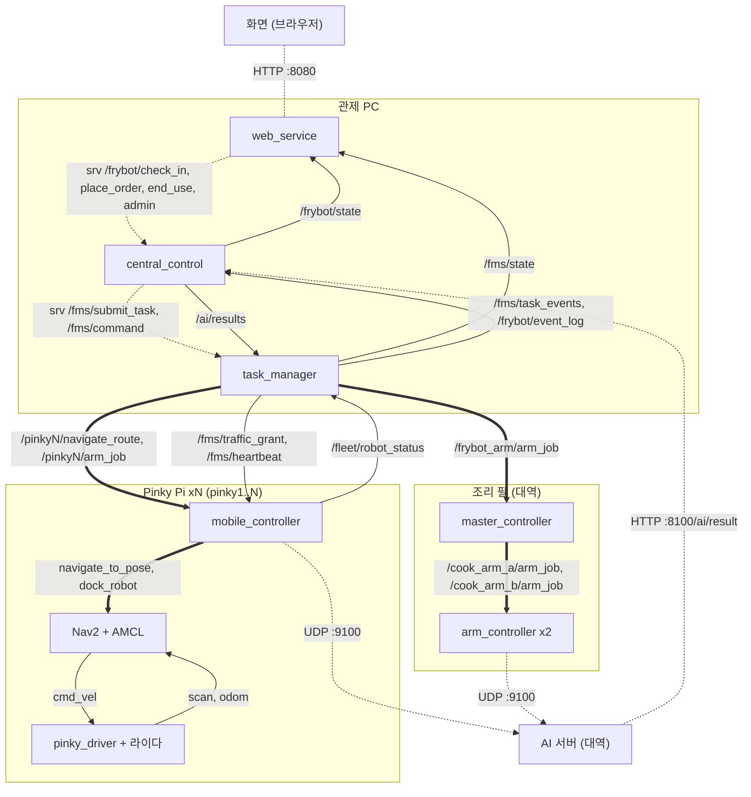

# FryBot — 다중 로봇 협업 스마트 레스토랑

AMR(Pinky) 여러 대가 손님 안내·서빙·식기 회수를 나눠 맡고, 조리 팔 2대가 음식을 만드는 매장을 관제하는 ROS 2 Jazzy 작업 공간입니다. 같은 관제 코드로 경량 시뮬레이션, Gazebo Harmonic + Nav2, 실제 Pinky를 모두 돌립니다.

## 폴더

경로는 작업 공간(`~/frybot_ws`) 기준입니다.

```
src/frybot/frybot_interfaces/    msg·srv·action (인터페이스 원본)
src/frybot/frybot_control/       관제 PC: central_control, task_manager(fleet_core), 스케줄러·플래너, 지도(maps/)
src/frybot/frybot_web/           관제 PC: web_service (HTTP ↔ ROS 2), 관리자·접수·테이블 화면
src/frybot/frybot_mobile/        Pinky Pi: mobile_controller, pinky_driver, pinky_battery, Nav2 설정, 아루코 도킹
src/frybot/frybot_arm/           조리 팔: master_controller, arm_controller(대역), camera_streamer
src/frybot/frybot_sim/           시험: AI 서버 대역, 매장·손님, 시나리오, Gazebo 월드
src/frybot/frybot_ai/            AI 서버(실제 추론): guest_tracker — Pinky 카메라에서 YOLO로 손님 추적, GUEST_TRACK 전송(2026-11-24)
src/frybot/frybot_bringup/       장치별 launch, RViz 설정, 로봇 목록 예시(config/robots.example.yaml), robot_remote
src/frybot/frybot_description/   로봇 모델 (Pinky Pro, JetCobot 280의 URDF·메시)
```

아키텍처 컴포넌트와 패키지의 대응:

| 컴포넌트 | 패키지 | 노드 |
| --- | --- | --- |
| Central Control, DB | `frybot_control` | `central_control` (식당 상태 State Diagram v4, 실행 로그) |
| Task Manager | `frybot_control` | `task_manager` (임무 배정, 경로 계획, 통행 허가, 조리 셀 조율) |
| Web Service | `frybot_web` | `web_service` (상태를 갖지 않음) |
| FrybotMobile Controller, FrybotNavigator, FrybotMobile Arm Controller, Camera Streamer | `frybot_mobile` | `mobile_controller`, Nav2, `pinky_driver`, `pinky_battery`, `aruco_dock_detector` |
| FrybotArm Master Controller, FrybotArm Controller, Camera Streamer | `frybot_arm` | `master_controller`, `arm_controller` ×2 |
| AI Server (대역) | `frybot_sim` | `ai_server` |
| AI Server (손님 추적, 2026-11-24) | `frybot_ai` | `guest_tracker` (ROS 없음, 가상 환경 `~/venv/yolo`의 Python으로 실행) |

- `frybot_mobile`은 시뮬과 실제 Pinky에서 같은 코드를 씁니다.
- 조리 팔은 구동 방식이 정해지지 않아 `arm_controller`가 대역입니다(관절 애니메이션, 가상 튀김기). 단독 실행: `ros2 launch frybot_arm cooking.launch.py`
- `frybot_description`의 출처와 라이선스는 [패키지 README](frybot_description/README.md)에 있습니다.

## 연결



실선은 토픽, 점선은 서비스와 ROS 밖 통신(HTTP, UDP), 굵은 선은 액션.

- 관제(`task_manager`)가 경로와 공유 구간의 통과 순서를 정하고, AMR은 허가(`TrafficGrant`)받은 구간까지만 갑니다.
- 관제의 생존 신호(`/fms/heartbeat`)가 끊기거나 비상 정지가 오면 AMR은 멈춥니다.
- `mobile_controller`는 방향 전환과 양보 후진 때 Nav2를 거치지 않고 `cmd_vel`을 직접 냅니다. 손님 안내 구간은 Nav2로 후진합니다.
- 손님 안내 중 동행 확인은 `/frybot/guest_track`으로 받습니다. 실기기 런치는 값이 오지 않으면 안내 구간을 출발하지 않습니다(`guest_track_required:=true`가 기본). 시뮬은 값이 한 번도 오지 않으면 확인 없이 안내합니다.
- 같은 목적지로 가는 계획이 20초 넘게 이어서 실패하면 관제는 그 임무를 보류(`SUSPENDED`, 사유 `PLAN_FAIL`)하고 관리자 알람을 냅니다. `RETRY_TASK`로 재개합니다. 다른 로봇이 같은 목적지나 바로 옆 노드로 가는 중이면 이동 명령은 거절됩니다(2026-11-18, T-32·T-33).
- 로봇의 상태 보고가 1초(2026-11-24, 이전 2초) 넘게 끊기면 관제는 새 통행 허가를 내지 않고, 로봇은 관제 생존 신호가 1초(`fms_timeout`, 이전 2초) 넘게 끊기면 서며(`WAIT_FMS`, 실기기 확인 필요), 오류를 보고 중인 로봇에는 새 임무를 배정하지 않습니다. 로봇은 위치 추정(TF)이 1초 넘게 갱신되지 않으면 서서 `SENSOR_ERROR`를 보고하고, `pinky_driver`는 `cmd_vel`이 0.3초(`cmd_vel_timeout`, 2026-11-25, 이전 0.5초) 넘게 끊기면 모터를 세웁니다. 주행 중 기본 20초(`no_progress_sec` 초과, 0 이하면 감시 끔) 동안 위치 변화가 3 cm(`no_progress_dist`), 방향 변화가 0.2 rad(`no_progress_yaw`)를 넘지 않으면 로봇은 `NO_PROGRESS`로 경로를 돌려주고, 관제는 진행 중인 임무를 보류(`SUSPENDED`)하고 알람을 냅니다. 임무 없는 이동은 `ROUTE_FAIL`로 기록합니다(허가·관제·위치 추정·손님 대기는 감시하지 않으며 감시 공백이 1초를 넘으면 초기화). Nav2 구동은 오도메트리, 경량 시뮬은 자세를 기준으로 합니다(2026-11-20, T-44: s5에서 막다른 곳 출발 확인, Nav2 실패·무진행 처리는 PC 확인이며 실기기 미확인).
- 관리자 명령(`/frybot/admin`): `PAUSE`(일시 중단)·`RESUME`, `ESTOP`, `RETRY_TASK`·`REASSIGN`·`CANCEL_TASK`, `GO_HOME`, `MOVE_TO_VERTEX`, `SET_SCHEDULER`·`SET_PLANNER`, `SET_STANDBY`(`on`·`off`), `SET_TABLE`(`AVAILABLE`·`CLOSED`), `END_USE`.

## 인터페이스

아래는 빠른 개요입니다. 노드·실행 위치와 타입별 전체 연결을 정리한 [상세 인터페이스 문서](../../docs/2026-11-23_INTERFACES_OLD.md)와 [PDF](../../docs/2026-11-23_INTERFACES_OLD.pdf)는 2026-11-23 코드 기준의 구버전입니다(2026-11-27에 파일 이름을 바꿈). 최종 기준은 Confluence I/F v0.3 최종 판입니다.

원본은 `frybot_interfaces/`의 `msg/`, `srv/`, `action/`입니다. `{pinky}`는 `pinky1..N`, `{arm}`은 `cook_arm_a`, `cook_arm_b`.

관제 PC 안의 서비스·토픽 이름은 Confluence I/F v0.3 최종 판(I/F 목록과 개별 정의서)을 따릅니다(2026-11-26. 2026-11-25에 통합 I/F 정의서 v0.2 이름(`/frybot/central/…`, `/frybot/tasks/…`)으로 바꿨다가 최종 판 이름으로 되돌림, 필드·HTTP 경로는 그대로). 2026-11-25~26 사이의 실행 기록에는 v0.2 이름이 남아 있습니다. PDF는 다시 만들지 않았습니다(이름은 v0.3 과 같음).

### 토픽

| 이름 | 타입 | QoS | 방향 |
| --- | --- | --- | --- |
| `/fms/traffic_grant` | `TrafficGrant` | EVENT | task_manager → AMR (0.5초마다 재발행) |
| `/fms/heartbeat` | `FleetHeartbeat` | DEFAULT 10 | task_manager → AMR (5 Hz, 비상 정지 목록 포함) |
| `/fms/task_events` | `TaskEvent` | EVENT | task_manager → central_control |
| `/frybot/event_log` | `std_msgs/String` | EVENT | task_manager → central_control (실행 로그용) |
| `/fms/state` | `std_msgs/String` (JSON) | DEFAULT 10 | task_manager → web_service |
| `/frybot/state` | `std_msgs/String` (JSON) | DEFAULT 10 | central_control → web_service |
| `/ai/results` | `std_msgs/String` (JSON) | DEFAULT 50 | central_control → task_manager |
| `/fleet/robot_status` | `RobotStatus` | DEFAULT 50 | AMR → task_manager (10 Hz) |
| `/fleet/arm_status` | `ArmStatus` | DEFAULT 20 | 조리 팔 A·B, AMR 서빙 팔 → task_manager (2 Hz, 상태·오류 보고) |
| `/frybot/guest_track` | `GuestTrack` | DEFAULT 10 | central_control → AMR (안내 중인 손님의 동행 상태, AI 서버 결과) |
| `/{pinky}/cmd_vel` | `geometry_msgs/Twist` | DEFAULT 10 | Nav2·mobile_controller → pinky_driver |
| `/{pinky}/odom` | `nav_msgs/Odometry` | DEFAULT 10 | pinky_driver → Nav2 |
| `/{pinky}/scan` | `sensor_msgs/LaserScan` | SENSOR | 라이다 → Nav2, mobile_controller |
| `/{pinky}/battery/percent` | `std_msgs/Float32` | DEFAULT 10 | pinky_battery → mobile_controller |
| `/{pinky}/speed_limit` | `nav2_msgs/SpeedLimit` | DEFAULT 10 | mobile_controller → Nav2 (손님 안내 속도 제한) |
| `/{pinky}/controller_selector` | `std_msgs/String` | LATCHED | mobile_controller → Nav2 (구간에 쓸 제어기: `FollowPath` / `FollowPathReverse`) |
| `/{pinky}/dock_target`, `/{pinky}/detected_dock_pose` | `std_msgs/Int32`, `geometry_msgs/PoseStamped` | DEFAULT 5 | mobile_controller ↔ aruco_dock_detector |

시뮬에서만 쓰는 토픽: `/sim/world_state`(매장·손님 → web_service, AMR), `/sim/customer_cmd`(손님 시뮬레이터 → 매장), `/map`과 `/frybot/markers_static`(LATCHED), `/frybot/markers`(매장 → RViz), `/gz/model_poses`(Gazebo → AMR).

### 액션

| 이름 | 타입 | 방향 |
| --- | --- | --- |
| `/{pinky}/navigate_route` | `NavigateRoute` (mode = NORMAL / GUIDE / YIELD) | task_manager → AMR |
| `/{pinky}/arm_job` | `ArmJob` | task_manager → AMR (서빙 팔) |
| `/{pinky}/serving_arm/arm_job` | `ArmJob` | 서빙 팔 실물 구동부(`serving_arm_driver`, 팔의 Pi)가 받음. `mobile_controller`가 `serving_arm:=real`일 때 `/{pinky}/arm_job`을 넘김(피드백·결과·취소 그대로, 비상 정지 시 취소, 2026-11-20) |
| `/frybot_arm/arm_job` | `ArmJob` | task_manager → master_controller |
| `/{arm}/arm_job` | `ArmJob` | master_controller → arm_controller (`arm_id`로 나눔) |
| `/{pinky}/navigate_to_pose` | `nav2_msgs/NavigateToPose` | Pinky 안 (mobile_controller → Nav2) |
| `/{pinky}/dock_robot` | `nav2_msgs/DockRobot` | Pinky 안 (mobile_controller → Nav2 docking_server) |

### 서비스

| 이름 | 타입 | 방향 |
| --- | --- | --- |
| `/frybot/check_in` | `CheckIn` | web_service → central_control |
| `/frybot/place_order` | `PlaceOrder` | web_service → central_control |
| `/frybot/end_use` | `EndUse` | web_service → central_control |
| `/frybot/admin` | `AdminCommand` | web_service → central_control |
| `/fms/submit_task` | `SubmitTask` | central_control → task_manager |
| `/fms/command` | `FleetCommand` | central_control → task_manager |
| `/frybot/spot_check` | `SpotCheck` | AMR(auto_localize) → ceiling_locator(관제 PC). 기동 때 위치 추정이 모호하면 후보 자리를 천장 카메라로 확인(2026-11-23, T-55) |

### QoS

| 이름 | 신뢰성 | 지속성 | 깊이 |
| --- | --- | --- | --- |
| EVENT (코드의 `QOS`) | reliable | volatile | 100 |
| DEFAULT n | reliable | volatile | n |
| SENSOR (`qos_profile_sensor_data`) | best_effort | volatile | 5 |
| LATCHED | reliable | transient_local | 1 |

### ROS 밖

| 구간 | 방식 | 내용 |
| --- | --- | --- |
| 브라우저 ↔ web_service | HTTP :8080 | `GET /api/state, /api/layout, /api/maps, /api/map, /api/events`(`prefix`, `skip`, `since`, `until`, `result`, `limit`), `POST /api/visits, /api/orders, /api/end_use, /api/admin/operations` |
| Camera Streamer → AI 서버 | UDP :9100 | 영상 대신 작은 JSON 프레임 (대역) |
| central_control → AI 서버(`guest_tracker`) | HTTP :8095 | `POST /guides` 안내 중인 (로봇 → 방문) 목록, 손님 고정용(2026-11-24) |
| Pinky 카메라 → AI 서버(`guest_tracker`) | TCP :8554 | `rpicam-vid` MJPEG 640×480 15 fps·품질 70 (`frybot_mobile/launch/camera_streamer.launch.py`). AI 서버가 로봇에 직접 붙음, 한 번에 하나만(2026-11-24) |
| AI 서버 → central_control | HTTP :8100 | `POST /ai/result` (`kind`: `SEAT_QR`, `DONENESS`, `GUEST_TRACK`) |
| 손님 시뮬레이터 | HTTP :8090 | 가상 매장 시험용 UI |

영상은 ROS로 보내지 않습니다.

- 손님 추적(2026-11-24): `guest_tracker`는 사람(COCO person) 중 상자가 가장 큰 사람을 손님으로 보고, 상자 높이로 거리를 추정해 `GUEST_TRACK`(`robot_id`, `visible`, `distance`)을 로봇마다 5 Hz로 보냅니다. `visit_id`는 보내지 않고 `central_control`이 그 로봇이 맡은 안내 방문(ASSIGNED·GUIDING)으로 채우며, 그런 방문이 없으면 `/frybot/guest_track`을 내지 않습니다. 안내 시작(`AT_START`)부터 자리 안내 완료(`ARRIVED`)까지는 `central_control`이 안내 중인 (로봇 → 방문) 목록을 AI 서버(`POST :8095/guides`, 1초마다)로 보내고, AI 서버는 안내 시작 때 가장 앞 사람의 추적 번호로 손님을 고정해 다른 사람이 끼어들어도 그 사람만 봅니다. pinky1·2·3 공통(카메라 목록은 로봇 등록부, 회전은 `camera_rotate`). 거리는 상자 높이로 추정하며 보정 전 값입니다(인형 키 0.17 m, 화각 53.5°)([시험 기획](../../docs/2026-11-24_GUEST_TRACK_YOLO_PLAN.md), 실기기 안내 주행 확인 필요).

## 빠른 시작

```bash
cd ~/frybot_ws && colcon build --symlink-install --packages-up-to frybot_bringup && source install/setup.bash
ros2 launch frybot_bringup sim.launch.py            # 경량 시뮬 + RViz (가상 매장 도면)
ros2 run frybot_sim scenario --scenario demo        # 다른 터미널: 자동 시나리오 (demo | normal | rush | single)
./scripts/stop_all.sh                               # 전체 종료 (단독 명령으로 실행)
```

`colcon build`만 실행하면 외부 저장소(`mycobot_ros2`)에서 실패하므로 `--packages-up-to frybot_bringup`을 붙입니다.

| 화면 | 주소 |
| --- | --- |
| 관리자 (통합 관제 · 테이블/주문 · 알람/이력 · 설정) | http://localhost:8080/admin |
| 입구 접수 키오스크 / 테이블 주문 | http://localhost:8080/reception , http://localhost:8080/table?id=1 |
| 손님 시뮬레이터 (아키텍처 밖 시험용 UI, 가상 매장에서만) | http://localhost:8090 |

상황별 명령은 [docs/COMMANDS.md](../../docs/COMMANDS.md)에 모아 두었습니다.

## 실행 방식

| 방식 | 명령 | 로봇 주행 | 쓰는 곳 |
| --- | --- | --- | --- |
| 경량 시뮬, 가상 매장 | `ros2 launch frybot_bringup sim.launch.py` | 자세를 직접 움직임 | 접수부터 서빙·회수까지 전체 흐름 |
| 경량 시뮬, 실측 지도 | `ros2 launch frybot_bringup sim.launch.py map_id:=test_map_v001` | 자세를 직접 움직임 | 실측 지도의 노드 간 이동, 양보 확인 |
| Gazebo + Nav2 | `ros2 launch frybot_bringup gazebo.launch.py` | 로봇마다 Nav2, costmap 주행 | 주행 검증 (가상 매장 전용) |
| 실기기 | `ros2 launch frybot_bringup real.launch.py map_id:=test_map_v001` | 실제 Pinky의 Nav2 + AMCL | 실측 지도의 노드 간 이동 |
| 오프라인 비교 | `ros2 run frybot_control fleet_bench --scenario rush` | ROS 없이 계산만 | 알고리즘 조합 비교 |

- 경량 시뮬은 Nav2·라이다·AMCL을 거치지 않아 소요 시간이 실기기와 다릅니다(T-23).
- 실측 지도로 띄우면 가상 매장용 노드(매장·손님, 손님 시뮬레이터, 조리 팔, AI 서버)는 뜨지 않습니다.
- 시뮬은 기본으로 전용 도메인 74에서 돌아(`net:=sim`) 켜져 있는 Pinky(도메인 73)와 서로 보이지 않습니다. 시뮬에 `ros2` 명령을 쓰는 터미널에서는 `export ROS_DOMAIN_ID=74`를 먼저 실행합니다. 같은 PC에서 시뮬과 실기기를 함께 띄우지 않습니다.

### 런치 인자

| 인자 | 기본값 | 내용 |
| --- | --- | --- |
| `map_id` | `proto` (시뮬) | 지도 이름. `maps/`의 폴더 이름. 시뮬은 비워 두면 환경 변수 `FRYBOT_MAP_ID`, 그것도 없으면 `proto`. 실기기는 필수 |
| `robots` | `3` (시뮬) | AMR 대수. 이름은 `pinky1..N`. 실기기는 `robots:=2` 또는 `robots:=pinky1,pinky3` |
| `scheduler` | `min_cost_eta_rh` | `min_cost`, `min_cost_eta`, `min_cost_eta_rh`, `priority_greedy`, `fifo_nearest` |
| `planner` | `sipp` | `sipp`, `ccbs`, `cooperative_astar`, `independent_astar` |
| `rviz` | `true` | RViz 표시 |
| `map_id` (`fleet_rviz.launch.py`) | 없음 | RViz만 따로 띄울 때 그 지도의 로드맵(노드·통로·이름)도 그림. `real.launch.py`는 자기 `map_id`로 항상 그림 |
| `rviz_displays` | `true` (실기기) | `false`면 RViz 왼쪽의 Displays 창 없이 띄움(화면 녹화용). `fleet_rviz.launch.py`에도 같은 인자가 있음 |
| `rviz_wait`, `rviz_wait_sec` | `false`, `120` (실기기) | `true`면 로봇이 모두 상태를 보고한 뒤(또는 120초 뒤)에 RViz를 띄움. 실기기에서 RViz가 뜬 직후 상태 보고가 4~8초 끊긴 적이 있어 기본은 꺼 둠(T-40) |
| `net` | `sim` (시뮬) | `sim`: 시뮬 전용 도메인(`sim_domain`, 기본 74). `local`: 탐색을 이 PC로 제한(Gazebo에서는 Nav2가 주행하지 못함, T-29). `lan`: 실기기와 같은 도메인(예전 기본값) |
| `admin_token` | 없음 (실기기) | 관제 PC가 아닌 기기에서 관리자 명령을 보낼 때 쓰는 토큰. 비워 두면 관리자 명령은 관제 PC에서만 받음 |
| `discovery` | `peers` (실기기) | 로봇은 자기 안과 관제 PC만 탐색하고 로봇끼리는 탐색하지 않음. `subnet`은 예전처럼 같은 대역 전체를 탐색(로봇이 늘면 기동이 크게 느려짐, T-38). 실기기 확인 필요 |
| `standby` | `true` (시뮬), `false` (실기기) | 임무가 없는 로봇의 대기 위치 사용 |
| `cook_time_scale` | `20` | 조리 시간 축소 (튀김 10분 → 30초) |
| `undercooked_prob` | `0.25` | 덜 익음 판정 확률 (시뮬) |
| `qr_vacant_sec` | `8` | 의자 QR이 보인 뒤 빈자리로 판단하기까지의 시간(초) |
| `drive` | `nav2` (Gazebo), `kinematic` (경량 시뮬) | `kinematic`은 자세를 직접 움직임. `cmd_vel`은 costmap 없는 예전 직선 주행 (비교용) |
| `speed`, `guide_speed` | `0.08`, `0.05` | 일반 주행 속도와 손님 안내 속도(m/s) |
| `serving_arm` | 없음 | `real`이면 서빙 팔 작업을 실물 구동부(`/{pinky}/serving_arm/arm_job`)로 넘김. 로봇 런치·경량 시뮬. 실기기 원격 기동은 등록부 `arms`로 자동 지정(2026-11-20). 경량 시뮬은 `serving_robots`를 주면 그 로봇에만 넘김(2026-11-26: 팔 없는 로봇이 주행 전 접기에서 `ARM_OFFLINE`으로 서지 않게) |
| `serving_robots` | 없음 | SERVE·COLLECT를 맡길 로봇(쉼표). 실기기는 비우면 등록부 `arms`에서 켜진 서빙 팔의 `mount`, `all`이면 모든 로봇. 경량 시뮬은 비우면 모든 로봇(예전 동작). 제한 목록이 지정됐는데 해당 로봇이 하나도 관제에 없으면 SERVE·COLLECT 접수를 거절하고, 있으면 그 로봇이 빌 때까지 기다림(2026-11-20, T-47) |
| `sim_domain` | `74` (시뮬) | `net:=sim`일 때 쓰는 `ROS_DOMAIN_ID` |
| `run_id` | 없음 | 실행 로그 폴더 이름(`runs/<run_id>`). 비워 두면 `run_YYYYMMDD_HHMMSS` |
| `scenario_name` | `interactive` (경량 시뮬) | 실행 기록(`manifest.json`)에 남기는 시나리오 이름 |
| `sim_time` | `false` (경량 시뮬) | 노드의 `use_sim_time`. Gazebo 런치가 Nav2 주행일 때 `true`로 넘김 |
| `prefer_yield` | `true` (실기기) | 동선이 겹치면 기다리거나 비켜 섬. `false`는 예전처럼 서로 돌아서 감 |
| `gui` | `true` (Gazebo) | Gazebo 창 표시 |
| `remote`, `poses`, `auto_home` | `true`, 없음, `false` (실기기) | SSH 원격 기동, 출발 위치, 출발 노드로 자동 이동. `auto_home` 기본은 2026-11-20부터 `false`(이전 `true`, T-48): 연결된 로봇은 지금 자리에서 대기. [실기기](#실기기-pinky) 참고 |
| `auto_localize` | `true` (로봇 런치) | 실측 지도·`drive:=nav2`·`pose_source:=tf`에서 초기 자세(`poses`/`initial_pose`)가 없으면 라이다 스캔으로 자기 자세를 찾음(2026-11-20, T-49) |
| `robots_file` | 없음 (실기기) | 로봇 등록부 경로. 비워 두면 `~/.config/frybot/robots.yaml` |
| `wheel_radius`, `wheel_separation` | 없음 (로봇 런치) | 이 로봇의 바퀴 반지름·간격(m). `pinky_driver`의 속도 명령 → RPM과 오도메트리가 함께 씀. 비우면 명목값 0.027·0.0961(예전과 같음). 명목값에서 10% 넘게 벗어나거나 숫자가 아니면 로봇 런치가 멈춤. 원격 기동은 등록부의 같은 이름 키를 넘김(2026-11-24, T-58, 실기기 주행 확인 필요) |
| `cmd_vel_timeout` | 없음 (로봇 런치) | `pinky_driver`가 `cmd_vel`이 이 시간(s) 넘게 끊기면 0 RPM을 보냄. 비우면 노드 기본값 0.3(2026-11-25 MT-7, 이전 0.5. MT-6 실기기 세 대 20회 왕복에서 0.3 s 발동 0회, 로봇 안 명령 간격 최대 67 ms, 끊긴 뒤 더 가는 거리 약 5 → 3.3~3.7 cm). 0 이하는 감시를 끔(경고 로그), 2 s를 넘거나 숫자가 아니면 로봇 런치가 멈춤. 원격 기동은 `robot_remote --arg cmd_vel_timeout:=0.5`(예전 값) 또는 등록부 `launch_args`. `real.launch.py`에는 이 인자가 없음(2026-11-24) |
| `web_port`, `ai_http_port` | `8080`, `8100` (실기기) | `web_service`와 AI 결과 수신 포트 |
| `ceiling_camera`, `ceiling_device` | `true`, `/dev/video0` (실기기) | 관제 PC의 천장 카메라 노드(`ceiling_locator`)를 띄움. 로봇 자동 위치 추정이 모호할 때 후보 자리를 확인함. 빈 바닥 기준 화면이 없거나 카메라가 없으면 답하지 않고 로봇은 예전 규칙으로 감(2026-11-23, T-55, 실기기 확인 필요). `false`면 로봇에도 `localize_camera:=false`를 넘겨 카메라를 기다리지 않음(T-57) |
| `plan_overhead` | `0.0` | 계획의 구간 지연(초). 구간 시간 = 지연 + 거리 ÷ (`speed` × 0.9). 실기기 권장값은 `plan_overhead:=2.27 speed:=0.135`(실기기 확인 필요). 경량 시뮬은 0.0 |

가상 매장에서 AMR은 최대 7대입니다. 조리 팔 2대는 고정입니다. 4번째 로봇부터는 충전대가 없어 비켜 서는 곳을 홈으로 쓰고, 배터리가 낮으면 빈 충전대를 빌립니다. 자리를 늘리려면 `frybot_control/layout.py`의 `HOME_SPOTS`에 추가합니다. 실측 지도에서는 `roadmap.json`의 `homes` 수가 상한입니다.

## 지도

지도는 `frybot_control/frybot_control/maps/<map_id>/`에 폴더 하나씩 있습니다.

| `map_id` | 내용 |
| --- | --- |
| `proto` | 가상 매장 도면(200×100 cm). `layout.py`에서 만든 파일이며, 치수나 로드맵을 바꾸면 `ros2 run frybot_control export_map --proto`로 다시 만듦 |
| `test_map_v001` | 실측 지도 1번 |
| `test_map_v002` | 실측 지도 2번. v001과 같은 지도 이미지에 로드맵을 줄인 것(노드 34 → 20, 2026-11-19 편집 완료) |
| `test_map_v03` | 실측 지도 3번(2026-11-19). 지도 이미지를 새로 만든 것. 노드 40, 통로 41 |
| `test_map_v04` | 실측 지도 4번(2026-11-19). v03과 같은 통로에 노드를 줄인 것(노드 20, 통로 21). A·B 통로의 노드 번호가 v03과 다름 |
| `test_map_v06` | 실측 지도 6번(2026-11-26). 바뀐 매장을 pinky1으로 SLAM 매핑해 다듬은 이미지(41×22칸, 0.05 m, 원점 (-0.201, -0.361)). 노드 17(위 통로 A1~A5, 아래 통로 B1~B5, 세로 D1_IN·C2·C3, 조리대 도크 D1_STOP, 충전소 H1~H3), 통로 18. 홈·대기 위치 H1~H3. 도크 D1_STOP·H1~H3은 모두 후진 도킹(`dock_backwards: true`). 2026-11-27: H 앞 노드 A5·C3·B5를 5 cm 왼쪽(x 1.524 → 1.474)으로 옮김(H와 중심 거리 15.7 → 20.7 cm, B5·C3에서 회전하는 로봇 모서리와 H에 선 로봇 사이 여유). 로드맵 초안, 실기기 확인 전 |
| `test_map_v05` | 실측 지도 5번(2026-11-20). v04를 복사해 A5·C3·D2_IN·D2_STOP을 지우고 A1과 D1_IN을 합쳐 D1_IN(A1 자리 (0.091, 0.045)), D1_STOP을 벽에서 4 cm 물림((0.091, 0.155)). 노드 15, 통로 15(고리 하나). D1_IN–D1_STOP이 11 cm라 동시 점유 불가: D1_STOP에 로봇이 서 있으면 교차점 D1_IN이 잠김 |

폴더에는 파일 세 개를 둡니다.

| 파일 | 내용 |
| --- | --- |
| `<map_id>.yaml` | Nav2 지도 설정(`image`, `resolution`, `origin`, 임계값) |
| `<map_id>.pgm` (또는 `.png`) | 점유 격자 이미지 |
| `roadmap.json` | `label`, `map_yaml`, `nodes`(지도 좌표계의 미터 단위 `[x, y]`), `edges`(양방향 통로), `homes`(로봇 번호 순서의 출발 노드), `waiting`(대기 위치), `docking_candidates`, 선택: `stations`·`docks`·`dock_backwards`(아래), `ceiling_markers`(천장 카메라용 바닥 ArUco id → 중심 `[x, y]`, 2026-11-23) |

새 실측 지도를 추가하는 순서:

1. `maps/<새 이름>/`에 위 세 파일을 넣습니다. `roadmap.json`이 있는 폴더는 자동으로 지도 목록에 올라갑니다.
2. 관리자 화면에 노드 역할을 표시하려면 `frybot_web/static/stations-<새 이름>.json`을 만듭니다.
3. `colcon build --symlink-install --packages-select frybot_control frybot_web`으로 다시 빌드합니다.
4. 실기기에 쓰려면 `ros2 run frybot_bringup robot_remote --all --deploy`로 로봇에도 배포합니다. PC와 Pinky가 같은 `map_id`를 써야 합니다.

로드맵을 그릴 때 지킬 것:

- **통행 규칙:** 로봇(11×12 cm)이 노드 간격보다 커서, 중심 거리 15.5 cm(`SAFE_DIST`) 미만인 두 노드는 동시에 점유할 수 없습니다. 예약과 실행 락에 모두 적용됩니다.
- 홈과 대기 위치는 통로 노드와 15.5 cm 이상 떼어야, 서 있는 로봇이 통로를 막지 않습니다.
- 노드는 벽에서 로봇 반길이(6.2 cm) + inflation(7 cm) 이상 띄우는 편이 안전합니다.

<!-- [수정 2026-11-20] stations·docks 키와 실측 지도 서빙 임무 -->
실측 지도는 기본으로 노드 간 이동만 지원합니다. `roadmap.json`에 다음 키를 넣으면 그 지도에서도 서빙 임무(`SubmitTask` `SERVE`)를 받습니다(2026-11-20, 지금은 `test_map_v04`, `test_map_v05`, `test_map_v06`).

- `stations`: `{"places": {"FRY_PICKUP": "D1_STOP", "WOK_PICKUP": "D1_STOP"}, "tables": {"1": ["B4"]}}`. 작업 지점 이름 → 노드, 테이블 번호 → 정지 노드 목록. 관제는 임무에 필요한 지점만 확인하고, 없으면 그 임무를 거절합니다.
- `docks`: `{"D1_STOP": {"yaw_deg": 90}}`. 이 노드로 끝나는 경로의 마지막 구간을 정밀 도킹(Nav2 `docking_server`)으로 들어갑니다. `yaw_deg`는 도크에서 로봇이 향하는 방향(도)입니다. `marker_id`와 `marker`(`[x, y, 마커가 바라보는 방향(도)]`)를 함께 주면 ArUco 마커 도크, 없으면 지도 좌표 기준 도크(`pose_dock`)입니다. `test_map_v04`의 D1_STOP은 마커가 없습니다.
- `dock_backwards`(2026-11-26): `true`이면 그 지도의 도크에 모두 뒤로 들어갑니다. 로봇이 도크 방향의 반대로 다가가며, 도킹 서버(`docking_server`의 `dock_backwards`)와 마지막 구간·대체 주행·creep이 후진이고, 도킹 중 정지는 뒤 라이다(`rear_stop_dist` 0.10 m)로 봅니다. 도크에서 나올 때는 전진입니다. 키가 없으면 실측 지도는 `true`(사용자 결정: 조리대·충전소 모두 후진), `test_map_v04`·`test_map_v05`는 `false`(전진, 예전 동작), 가상 매장(`proto`) 마커 도크는 앞 카메라로 마커를 보므로 늘 전진입니다. `yaw_deg`는 두 경우 모두 도킹한 로봇이 향하는 방향입니다(`test_map_v06`: D1_STOP 0°, H1~H3 180°). 경량 시뮬로 진입 후진·출발 전진을 확인했고, 도킹 서버의 후진 동작·정지 오차·충전 접점은 실기기 확인 필요입니다. 계산상 D1_STOP(벽에서 11.5 cm)에서는 라이다-벽이 약 9.8 cm라 도크 자세 약 2 mm 앞에서 뒤 라이다로 섭니다. 도킹 서버(opennav_docking 1.3.13)는 후진 모드에서 도크 자세의 방향을 진행 방향(도킹한 로봇 방향의 반대)으로 보므로, `mobile_controller`는 후진 도킹이면 서버에 넘기는 도크 자세 방향만 `yaw_deg` + 180°로 넘깁니다(2026-11-27, T-64: 전에는 `yaw_deg`를 그대로 넘겨 D1_STOP은 도크 반대로 후진, H2는 제자리 회전 뒤 시간 초과. PC에서 실제 도킹 서버로 확인, 실기기 확인 필요).

접수·안내는 아직 실측 지도에서 지원하지 않습니다. 관리자 화면의 지도 목록에서는 다른 실측 지도를 미리 볼 수 있고, 실제 주행 지도는 런치의 `map_id`로 정합니다.

## 실기기 (Pinky)

```bash
# 관제 + ~/.config/frybot/robots.yaml 에 등록된 Pinky 전부(SSH)
ros2 launch frybot_bringup real.launch.py map_id:=test_map_v001
# 로봇과 출발 위치 지정 (노드 이름, 선택으로 :방향(도))
ros2 launch frybot_bringup real.launch.py map_id:=test_map_v001 robots:=pinky1,pinky3 poses:=pinky1:A2,pinky3:W3
# 로봇 코드 배포 / 점검 / 정지
ros2 run frybot_bringup robot_remote --all --deploy
ros2 run frybot_bringup robot_remote --all --check
ros2 run frybot_bringup robot_remote --all --stop
```

- 로봇 주소와 계정은 `~/.config/frybot/robots.yaml`에 등록합니다. 비밀번호가 들어가므로 저장소 밖에 두며, `frybot_bringup/config/robots.example.yaml`을 복사해 채웁니다(권한 600). 등록부가 없으면 `robot_remote`는 안내 후 끝나고 `real.launch.py`는 관제만 띄웁니다. 로봇 항목에 `wheel_radius`, `wheel_separation`(m)을 적으면 `robot_remote`(와 `real.launch.py` 원격 기동)가 그 로봇의 `robot.launch.py`에 넘깁니다. 바닥 줄자 1 m 직진 3회 평균(2026-11-26, T-60)으로 정한 값은 pinky1 0.02743·0.0966, pinky2 0.02735·0.0977, pinky3 0.02737·0.0983입니다(이전 2026-11-24 MT-3 스캔 맞춤 기준 값 0.02706·0.0953, 0.02685·0.0960, 0.02763·0.0992는 라이다 치우침이 들어가 확정값 대비 pinky1 −1.4 %, pinky2 −1.8 %, pinky3 +0.9 % 어긋났음, T-60). 키가 없으면 명목값입니다. 적용 여부는 로봇 기동 로그의 `[pinkyN] wheel_radius ... (robot value)` 줄과 `robot_remote`의 `바퀴 치수(등록부)` 줄로 확인합니다(T-58).
- `map_id`는 필수이고 실측 지도여야 합니다. 빠뜨리거나 `proto`를 주면 런치가 오류로 멈춥니다. 로봇 쪽 `robot.launch.py`도 `map_id:=`가 필수입니다(2026-11-18).
- 시뮬 전용 입력·출력(Gazebo 참값 자세, 가짜 배터리·바퀴 관절값, `/sim/world_state`)은 `frybot_mobile/sim_backend.py`가 맡고 시뮬에서만 붙습니다(2026-11-18, T-36).
- 노드 기본값은 실기기 값입니다(2026-11-18, T-34). 지도를 쓰는 노드는 `FRYBOT_MAP_ID` 없이 띄우면 멈추고, `web_service`는 런치 없이 띄워도 관리자 명령을 관제 PC에서만 받습니다. 시뮬 런치는 시뮬 값을 명시합니다.
- `remote:=false`는 SSH 기동 없이 관제만 띄웁니다. 이때는 각 Pinky에서 `ros2 launch frybot_mobile robot.launch.py robot_id:=pinky1 map_id:=test_map_v001`을 실행합니다.
- 원격 기동은 로봇의 DDS 탐색을 로봇 안과 관제 PC로 제한하고(`discovery:=peers`가 기본), 실측 지도에서 `docks`가 없으면 도킹 노드(`docking_server`, `aruco_dock_detector`)를 띄우지 않습니다(T-38의 기동 부하 절감). 지도에 `docks`가 있으면 `docking_server`를 띄우고, 마커 도크가 있을 때만 `aruco_dock_detector`도 띄웁니다(2026-11-20).
- 연결된 로봇은 지금 자리에서 대기합니다(2026-11-20, `auto_home` 기본 `false`, 이전 `true`). `auto_home:=true`를 주면 예전처럼 위치가 잡힌 로봇이 자기 출발 노드(`homes`)로 한 번 스스로 이동합니다.
- 서 있는 로봇(허가받은 구간을 주행 중이 아닌 로봇)은 보고 위치로도 점유를 판단합니다. 보고 위치에서 12 cm(`pos_block_dist`, SAFE_DIST 15.5 cm − 위치 추정 흔들림 3.5 cm) 안의 노드는 다른 로봇에게 허가하지 않고 계획(예약표)에서도 피합니다. W1–B1처럼 15.7 cm 떨어진 노드에서는 B1 쪽으로 3 cm 흔들려도 이 추가 점유 기준에 걸리지 않습니다. 이 점유로 경로를 계획할 수 없는 상태가 20초 넘게 지속되면 `PLAN_FAIL`로 임무를 보류하고 알람을 내며, 벗어난 로봇을 `MOVE_TO_VERTEX`로 노드에 다시 세우면 풀립니다. 같은 노드로 다시 세우는 명령은 1.5 cm 넘게 벗어났을 때 받습니다(2026-11-20, T-48·T-52: PC·시뮬 확인, 실기기 확인 필요).
- 이동 가능 상태 검사에서 거절되면 메시지와 이벤트 `MOVE_REJECT`에 어떤 조건인지(연결 끊김, 비상 정지, 임무 중, 로봇 오류 이름, 보고 상태 등) 남깁니다. 이미 도착한 노드·출발 노드 점유 등 이후 검사에서 거절되는 경우는 별도 반환 메시지로 확인합니다(2026-11-20, T-52).
- 서빙 등 임무를 마치면 자기 출발 노드(`homes`)로 돌아갑니다. 돌아가는 중에도 새 임무를 받으면 그 임무로 바뀝니다. 관리자 이동 명령(`MOVE_TO_VERTEX`)으로 보낸 로봇은 그 자리에 남습니다(2026-11-20, T-45: 실기기 확인).
- 도킹 접근(도킹 서버가 미는 구간과 도크 노드로 기어가는 구간)과 막다른 노드에서 `cmd_vel`로 전진해 나가는 첫 구간은 앞쪽 라이다를 봅니다. 로봇 앞 폭 ±6.5 cm(`front_half_width`) 안에서 라이다 기준 앞 거리가 10 cm(`front_stop_dist`, 앞끝에서 2.1 cm) 미만이면 바로 섭니다. 도킹 서버 접근 단계에서는 도킹을 취소하고 그 자리를 도착으로 치며 마무리 회전을 하지 않습니다. 이 단계에서 새 스캔이 1초 넘게 없어도 같습니다. creep 단계에서는 앞이 막히거나 유효한 새 스캔이 없으면 전진을 중단하지만, 마무리 회전까지 생략하는 조건은 아닙니다. 막다른 곳 전진 출발은 트일 때까지 서서 기다리고(상태 `FRONT_BLOCKED`), 20초 넘으면 무진행(`NO_PROGRESS`)으로 경로를 돌려줍니다(2026-11-20, T-46: 단위 확인, 실기기 확인 필요). 후진 도킹 지도(`dock_backwards: true`, 2026-11-26)에서는 도킹 접근과 creep 정지를 같은 규칙으로 뒤 라이다(`rear_stop_dist` 0.10 m)가 맡습니다.
- 초기 자세는 `poses:=`로 주거나, 실측 지도·Nav2/AMCL에서 주지 않고 `auto_localize`가 켜져 있으면 기동 때 라이다 스캔 한 장으로 자세를 찾아 AMCL에 넣습니다(`auto_localize`, 2026-11-20, T-49). 로봇 런치에는 `initial_pose:="x y yaw"`(미터, 라디안)를 넘길 수 있고, 주면 그 값이 우선입니다.
  - 찾는 동안 상태는 `LOCALIZING`(관리자 화면 '기동·초기 점검 중')이고, 관제는 그 로봇을 위치·배정·허가에 쓰지 않습니다.
  - 후보: 마지막 저장 자세(위치가 잡힌 동안 5초마다와 종료 때 로봇의 `~/.frybot/last_pose/<map_id>/<robot>.json`)를 스캔으로 검증하고, 로봇이 꺼진 동안 옮겨졌을 수 있어 전체 지도도 항상 탐색합니다.
  - 모호할 때: 가장 좋은 자세와, 20 cm 또는 30도 넘게 다른 다음 후보의 점수 차가 6 mm(`localize_margin`) 미만이면 모호로 봅니다. 2026-11-23부터는 먼저 관제 PC의 천장 카메라에 후보 자리들을 묻습니다(아래 '천장 카메라 판정'). 카메라가 고르지 못하면 저장 자세에서 30 cm·30도 안의 후보(`OK_SAVED`)를 고르고, 없으면 아래 홈 근처 우선(`OK_HOME`)을 적용합니다.
  - 천장 카메라 판정(2026-11-23, T-55): 로봇이 `/frybot/spot_check`로 후보 위치를 보내면 `ceiling_locator`가 후보 둘레 20 cm 정사각형에서 빈 바닥 기준 화면과 달라진 화소 비율을 돌려줍니다. 한 후보만 0.15 이상이고 나머지가 0.05 이하이며 서로 30 cm 넘게 떨어져 있으면 그 후보를 넣습니다(`OK_CAMERA`). 위치가 잡힌 다른 로봇이 20 cm 안에 있는 후보는 판정에서 뺍니다. 서비스 발견과 응답은 로봇 노드가 뜬 뒤 35초(`localize_camera_wait_sec`)까지 기다리고, 응답이 3초(`localize_camera_timeout_sec`) 안에 없으면 그 안에서 다시 요청합니다. 그래도 답이 없으면 예전 규칙 그대로입니다(2026-11-23, T-57: 세 대를 함께 띄우면 기동 중인 로봇이 관제 PC 서비스를 찾는 데 20~28초 걸려 예전 3초 대기로는 한 번도 묻지 못했음). `real.launch.py ceiling_camera:=false`이면 로봇에 `localize_camera:=false`를 넘겨 기다리지 않습니다. `robot_remote`로 직접 띄우면 기본은 켬이라, 카메라 노드가 없을 때 모호하면 그만큼 늦어집니다(`--arg localize_camera:=false`로 끔). 저장 자세·홈 우선은 사람이 로봇을 대칭 쪽으로 옮기면 틀린 자세를 넣었습니다(17-B 2번 `OK_SAVED`, 18-T 2회차 `OK_HOME`). 카메라가 답하지 못하면 이 한계는 그대로이고, 가운데 자리처럼 방향만 다른 모호성은 카메라로 풀지 못합니다. 영상과 지도의 대응은 바닥 모서리 ArUco 4개(`ceiling_markers`)가 보이면 그것으로, 없으면 벽 바닥선 수동 대응으로 합니다. 준비 절차는 [docs/COMMANDS.md](../../docs/COMMANDS.md)의 '천장 카메라 위치 판정 준비'. PC·녹화 프레임·가짜 통합 확인, 실기기 확인 필요 두 단계로도 선택하지 못하면 자세를 넣지 않고 `NOT_LOCALIZED` + `SELF_CHECK_ERROR`를 보고합니다. 이 경우 RViz의 **2D Pose Estimate**로 정하면 바로 정상 보고로 바뀝니다. test_map_v05의 W3은 스캔만으로 대칭 모호성이 남지만, 가짜 스캔 시험에서는 홈 W3을 주면 `OK_HOME`, 잘못된 홈 W1을 주면 `AMBIGUOUS`였습니다(T-50·T-51).
  - 맞는 자세가 없을 때(점수가 `localize_max_score` 4 cm 초과)와 30초(`localize_budget_sec`) 안에 못 끝낼 때도 같습니다. PC 기준 한 번에 0.3~0.4초이고, Pi는 약 10배로 추정합니다(실기기 확인 필요).
  - 모호한데 저장 자세 근처 후보가 없으면(저장 자세가 없거나, 사람이 로봇을 옮겨 저장 자세가 어느 후보와도 맞지 않으면, 2026-11-20 T-51) 자기 홈 노드(`homes`) 30 cm 안의 후보를 고릅니다(`localize_home_prior`, 기본 켬, 로그 `OK_HOME`, 2026-11-20 T-50). 최선 점수와 6 mm 미만 차이인 홈 30 cm 안 후보 중 하나의 자세군으로 좁혀질 때만 선택하며, 후보가 없거나 홈 근처에도 서로 다른 자세군이 남으면 모호로 유지합니다. 홈 정보는 실제 출발 위치를 측정한 값이 아니라 등록된 홈을 우선하는 가정입니다. 실기기 08 첫 기동에서 두 대 모두 홈에서 맞는 자세를 찾고도 대칭 후보와 4.4·5.5 mm 차이로 모호였던 경우입니다.
- 위치 추정 감시·보정(2026-11-20, T-50): 서 있을 때(오도메트리 2초 정지) 8초마다 지금 AMCL 자세의 스캔 점수를 보고, 1.2 cm(`pose_check_score`)보다 나쁘면 ±20 cm·±45도만 다시 맞춥니다. 새 스캔 점수가 허용 상한(`localize_max_score`) 이하이고, 기존보다 5 mm 이상 개선되며 기존 점수의 0.6배 이하일 때만 `initialpose`로 다시 넣고 `pose corrected` 경고를 남깁니다(30도 넘게 고치면 오류 로그). 보정 뒤 20초는 다시 하지 않습니다. Nav2 구간 실패 때는 재시도 전에 먼저 이 확인을 합니다(2026-11-23, T-56: 이 확인에서 오류가 나도 재시도·`NAV2_FAILED` 반환으로 진행. 전에는 예외로 경로 결과가 사라져 관제가 임무를 IN_PROGRESS로 잡았음). 주행 중에는 하지 않습니다. `pose_monitor`는 `mobile_controller`의 노드 파라미터로 기본 켬(`True`)이고, `robot.launch.py`·`real.launch.py`는 이 값을 넘기지 않아 실기기에서도 켜진 채 동작합니다. 끄려면 노드 파라미터로 `pose_monitor:=false`를 줘야 하며 런치 인자는 없습니다(2026-11-26 정정: T3 30분 왕복에서 실기기 보정이 실제로 pinky3 21번·pinky2 24번 일어남, T-61). 가짜 스캔·PC 확인, 실기기 확인 필요. 감시 결과는 60초마다와 종료 때 `pose monitor: checks N, last score S, corrections K, skipped ...` 한 줄로, Nav2 실패 때는 `pose check (...)` 한 줄(점수와 가장 가까운 스캔 점)로 남습니다(T-52).
- `real.launch.py`는 모든 로봇의 전역·지역 코스트맵이 켜진 RViz를 띄웁니다. 세 대를 함께 띄우면 관제 연결이 2~3분 걸립니다(T-40, 미해결). `rviz:=false`로 띄웠다면 `ros2 launch frybot_bringup fleet_rviz.launch.py robots:=pinky1,pinky2,pinky3`로 따로 볼 수 있습니다(`robots`를 비우면 등록된 로봇 전부).
- 관리자 화면의 운영 지도에서 로봇과 목적 노드를 고르고 **이동 명령**을 누르면, 관제가 경로와 통행 허가를 보내고 Pinky가 Nav2로 구간을 주행합니다.

### 서빙 팔 (JetCobot 280, 2026-11-20)

아래는 구현 기준 설명이며 실기기 통합 동작·도킹·비상 정지는 확인 전입니다. `LOAD`·`UNLOAD`는 실제 음식 전달이 아닌 시험용 동작입니다.

<!-- [수정 2026-11-20] rest 를 0도 시험 자세에서 주행용 접은 자세로 바꿈 -->
<!-- [수정 2026-11-20] rest J5 74 → 0(유지 발열), 속도 기본 10 → 70 -->
<!-- [수정 2026-11-20] 속도 기본 70 → 60(70 에서 육안 흔들림, 사용자 결정) -->
`rest`는 시나리오의 AMR 주행 중 팔 접힘을 나타내는 자세 `[0, 122, -148, 143, 0, 60]`(도)이고, 그때 그리퍼는 닫습니다(`rest_gripper: 0`). 2026-11-20 jetcobot1 실물에서 정했습니다. 측정 근거와 수치는 [docs/2026-11-20_SERVING_ARM_REST_POSE.md](../../docs/2026-11-20_SERVING_ARM_REST_POSE.md)에 있습니다.
실물 팔은 평평한 테이블 위에서 동작하며, 판단 기준은 유지 발열·재현성·왕복 시간·자기 간섭입니다(2026-11-21 전제 정정). AMR 탑재 주행 안정성·라이다 간섭은 검증 대상에서 제외합니다.
- 사용자가 손으로 접은 값에서 J3·J4가 pymycobot 명령 한계(±150, ±145)를 넘어 2도 여유로 줄였습니다.
- J5는 처음 74도였으나, 그 자세로 두면 J5 서보가 계속 달아올라 0도로 바꿨습니다(모양은 사용자가 현장에서 확인).
- 실기기에서 확인한 것(`send_angles` 직접 호출): 0도 ↔ `rest` 왕복, 몸체 간섭 없음, J5 0도의 유지 발열, 이전 J5 74도 자세에서 속도 20~70의 관측 가능한 구간의 목표 초과·정착·발열. 새 J5 0도 자세에서는 속도 20 접기 한 번과 속도 70·60 왕복을 확인했고, 70에서 사용자가 육안으로 흔들림을 봐 60으로 정했습니다(측정 문서 7.1절).
- 아직 확인하지 못한 것: 구동부 액션(`REST`·`HOME`, 작업 앞의 0도·작업 끝의 `rest`)을 거친 실물 동작, 속도 80 이상, 음식을 든 상태.

시나리오상 AMR에 탑재되는 서빙 팔은 실물 시험에서는 테이블 위에 놓고, 자기 Raspberry Pi에서 `serving_arm_driver`를 띄웁니다. 팔의 Pi에는 `frybot_interfaces`, `frybot_mobile`만 복사해 빌드합니다(`~/frybot_robot_ws`).

```bash
# 팔의 Pi에서: 직접 실행 예시. peers 통신 설정까지 포함한 명령은 아래 --arm-command 사용
source /opt/ros/jazzy/setup.bash && source ~/frybot_robot_ws/install/setup.bash
ros2 launch frybot_mobile serving_arm.launch.py robot_id:=pinky1
```

- `pymycobot`이 가상 환경(`~/venv/jetcobot`)에만 있어, 런치가 그 Python으로 노드를 실행합니다(`python:=`로 바꿈).
- 작업별 자세는 `frybot_mobile/config/serving_arm.yaml`에 도(deg) 단위로 적습니다. `LOAD`·`UNLOAD`는 시험용 좌우 흔들기이고, 자세가 빈 작업은 움직이지 않고 `NO_POSE`로 실패합니다. 작업 이름(2026-11-26 통일, 사용자 결정): `REST`는 `rest`(주행용 접은 자세)로, `HOME`은 0도 `home` 자세 `[0, 0, 0, 0, 0, 0]`(충전소 대기 자세)로 갑니다. 2026-11-20의 `HOME`(= rest로 감)은 `REST`로 이름이 바뀌었습니다.
- 자세가 있는 작업은 `home`(0도) → 작업 자세들 → `rest` 순서입니다(2026-11-26). 맨 앞이 `home`이 아니면 구동부가 덧붙이고, 마지막 경유 자세가 `rest`가 아니면 `rest`를 덧붙입니다. 이미 닿아 있는 자세(모든 관절 3도 미만)는 명령 없이 지나갑니다(실물은 `send_angles` 한 번에 약 1.6초). `rest`로 갈 때 `rest_gripper`가 있으면 그리퍼를 먼저 그 값으로 맞춘 뒤 관절을 접습니다(키가 없으면 그리퍼는 그대로). 기동할 때는 자동으로 접지 않습니다(2026-11-20).
- 이동 속도 기본은 60(`speed`, 2026-11-20에 20 → 10 → 70 → 60), 자세 하나의 제한 시간은 30초(`move_timeout`, 예전 20초)입니다. 속도를 정한 측정은 위 문서 4절·7.1절에 있습니다.
- 취소가 오면 팔을 그 자리에 세웁니다. 취소·시간 초과·오류 때는 `rest`로 가지 않습니다. jetcobot1에서 `send_angles` 한 번이 약 1.6초 동안 돌아오지 않아, 취소 반응이 그만큼 늦을 수 있습니다.
<!-- [수정 2026-11-20] mobile_controller 연결과 robot_remote 의 arms 구역 -->
- 관제의 팔 작업은 `/{pinky}/arm_job`으로 `mobile_controller`에 옵니다. 로봇 런치에 `serving_arm:=real`을 주면 이것을 팔의 `/{pinky}/serving_arm/arm_job`으로 넘기고 피드백·결과(`NO_POSE`, `ARM_TIMEOUT` 등)를 그대로 돌려줍니다. 관제의 취소나 비상 정지(생존 신호의 정지 목록)가 오면 팔 쪽 목표를 취소합니다. 팔 구동부가 없으면 2초 뒤 `ARM_OFFLINE`, 목표를 거절하면 `REJECTED`이고, 관제는 임무를 보류(`SUSPENDED`)합니다. 기본(`serving_arm` 없음)은 예전처럼 시간만 지나면 성공하는 대역입니다. 경량 시뮬에도 같은 인자가 있습니다(가짜 서버로 시험).
- 팔의 주소와 계정은 등록부(`~/.config/frybot/robots.yaml`)의 `arm_defaults`·`arms` 구역에 적습니다(2026-11-20, `jetcobot1..3`). `mount`는 팔을 올릴 수 있는 로봇으로, 문자열 하나(`mount: pinky1`) 또는 목록(`mount: [pinky1, pinky2, pinky3]`)으로 적습니다. 팔 한 대를 옮겨 쓰는 경우 목록을 사용할 수 있지만, 자동 배정 제한은 실제 장착 위치를 감지하지 않고 등록된 목록을 따릅니다. 목록에 `robots`에 없는 이름이 있으면 `robot_remote`가 오류로 멈춥니다. `robot_remote`(와 `real.launch.py`의 원격 기동)는 `enabled`인 서빙 팔의 `mount`에 그 로봇이 있으면 로봇의 탐색 상대(`ROS_STATIC_PEERS`)에 팔 주소를 더하고 `serving_arm:=real`을 넘깁니다(`--arg serving_arm:=`로 덮어씀). `mount`가 세 로봇 목록이면 함께 띄운 세 대가 모두 `real`이 되고, `real.launch.py`는 같은 `mount` 목록을 관제의 `serving_robots`로 넘겨 SERVE·COLLECT를 그 로봇에만 배정합니다(2026-11-20, T-47). 전에는 팔이 없는 로봇에 서빙 임무가 가면 `ARM_OFFLINE`으로 보류됐습니다. `mount`가 여러 대이면 그 로봇 모두가 배정 대상이므로, 팔을 실제로 올린 로봇만 받게 하려면 등록부 `mount`를 그 로봇으로 줄이거나 `serving_robots:=pinky1`을 줍니다.
- 팔 Pi의 구동부는 원격으로 띄우지 않습니다(실물 모터를 켜는 일이라 현장에서 직접). `ros2 run frybot_bringup robot_remote jetcobot1 --arm-command --mount pinky2`가 팔 Pi에서 칠 명령 한 줄(팔 안·지금 올린 로봇·관제 PC만 탐색, `robot_id:=`는 그 로봇)을 출력합니다. `mount`가 여럿이면 `--mount`가 필수이고(빠뜨리면 후보를 보여 주고 종료 코드 2), 하나면 생략할 수 있습니다. `--mount`는 출력할 팔 구동부 명령의 `robot_id`와 탐색 상대를 선택하며 등록부나 관제의 임무 배정을 바꾸지 않습니다. 팔을 옮기면 기존 구동부를 종료한 뒤 새 `--mount`로 생성한 명령으로 다시 실행합니다. 팔 Pi에 배포하는 기능은 아직 없습니다.
<!-- [수정 2026-11-26] 서빙 팔 자세 연동(docs/2026-11-26_SERVING_ARM_POSE_LINK_PLAN.md) -->
- 자세 연동(2026-11-26, `serving_arm:=real`일 때만): `mobile_controller`가 실물 팔 자세를 작업 결과로 추적합니다(`HOME` / `REST` / `UNKNOWN`, 기동 때 `HOME`). 경로를 움직이기 전에 `REST`가 아니면 `REST` 작업을 보내 접고(상태 `ARM_FOLD`), 접기에 실패하면(`ARM_OFFLINE`·`ARM_TIMEOUT` 등) 출발하지 않고 그 사유로 경로를 돌려줘 관제가 임무를 보류합니다. 팔 작업 중에 온 경로는 `ARM_BUSY`로 거절합니다. 자기 홈(충전소, `roadmap.json`의 `homes`)에서 경로가 끝나면 1초(`arm_home_delay`) 뒤 `HOME`을 보내 0도로 폅니다(그 사이 새 경로·비상 정지·관제 팔 작업이 오면 펴지 않거나 펴던 것을 끊고, 다음 주행 전에 다시 접음). 실패·취소·비상 정지 뒤에는 자세를 `UNKNOWN`으로 보아 다음 주행 전에 접습니다. 팔 없이 시험할 때는 `serving_arm`을 비워 띄웁니다(구동부가 없으면 접기에 실패해 출발하지 못함). 경량 시뮬과 가짜 팔(실제 `serving_arm_driver`)로 확인: 이동 중 rest 아닌 시간 0초, 충전소 대기 중 0도 아닌 시간 0초(펴고 접는 전환 시간 제외), LOAD·UNLOAD 12/12가 0도를 거침(`archive/sim_runs_2026-11-26/20261126_integ2_rest_sim_step1` 등). 실기기 확인 필요(접고 펴는 실제 시간, 0도 대기의 높이·발열).
- 팔 관절값은 `/{pinky}/serving_arm/joint_states`로 나오고, `mobile_controller`의 `/{pinky}/arm/joint_states`(RViz 모델)는 전달 중에도 `arm_common.REST`의 대역 자세를 유지합니다. 이 값은 실물 구동부의 `serving_arm.yaml`에 지정한 주행용 `rest`와 별개여서, RViz 모델만으로 실제 접힘 완료를 판단하지 않습니다.

준비 절차와 단계별 검증은 [실기기 명령과 시험 초안](../../docs/COMMANDS.md#2-실기기-pinky), 양보·노드 복귀·비상 정지 채널은 [docs/2026-11-16_CHANGES.md](../../docs/2026-11-16_CHANGES.md)에 있습니다.

## 결과 확인

```bash
ros2 run frybot_control analyze_run runs/<run_id>       # 지표 요약 (runs/<run_id>/events.csv)
ros2 run frybot_control replay_run runs/<run_id> -v     # 실기기 로그의 이동 명령을 모의 로봇으로 다시 실행해 비교
ros2 run frybot_control replay_run --find-yield --map-id test_map_v001   # 양보가 일어나는 명령 조합 찾기
```

## 알고리즘

기본값은 `min_cost_eta_rh` + `sipp`입니다. 통로가 로봇 한 대만 지나는 폭(32 cm에 11 cm 로봇, 로봇 간 최소 중심 거리 15.5 cm)이라 단선 로드맵 위에서 시간까지 계획해야 마주침이 없고, 로봇 3대에 임무 몇 건이면 최소 비용 배정이 즉시 풀리기 때문입니다.

| 종류 | 이름 | 내용 |
| --- | --- | --- |
| 경로 | `sipp` | 우선순위 SIPP (Phillips & Likhachev 2011). 먼저 계획한 로봇의 예약을 피해 한 대씩 계획 |
| 경로 | `ccbs` | 충돌 기반 탐색 + SIPP 하위 탐색 (CCBS 계열, Andreychuk et al. 2022). 움직이는 로봇을 함께 계획하고, 충돌하면 어느 쪽이 양보할지 양쪽 다 탐색. 탐색 한도(노드 120개, 0.25초)를 넘으면 우선순위 SIPP로 대체 |
| 경로 | `cooperative_astar` | 0.5초 시간 격자 협조 A* (Silver 2005) |
| 경로 | `independent_astar` | 기준선: 각자 최단 경로 + 실행 중 점유 대기 |
| 배정 | `min_cost` | 최소 비용 배정. 비용 = 그래프 최단 거리 기준 이동 시간 |
| 배정 | `min_cost_eta` | 같은 배정, 비용 = 통로 예약 대기를 포함한 플래너의 도착 예상 시각 |
| 배정 | `min_cost_eta_rh` | ETA 배정 + 롤링 호라이즌: 첫 지점에 닿지 않은 임무를 2초마다 재평가해 5초 넘게 줄면 재배정. 손님 안내 중이거나 음식을 실은 임무는 유지 |
| 배정 | `priority_greedy`, `fifo_nearest` | 기준선 |

`min_cost*`는 2026-11-13 전까지 `hungarian*`이라고 불렀습니다. 배정 문제를 풀 뿐 헝가리안 방법을 구현한 것은 아니어서 이름을 바꿨습니다. 로봇 3대 규모에서는 가능한 배정이 수백 가지뿐이라 전수 탐색으로 최적해를 구하고, 후보가 2만 가지를 넘으면 SciPy `linear_sum_assignment`로 전환합니다. 옛 이름도 런치 인자와 `fleet_bench`에서 그대로 받습니다.

### 교체와 추가

- 스케줄러: `frybot_control/schedulers/__init__.py`의 `Scheduler.assign(tasks, robots, cost, now)`
- 경로 계획: `frybot_control/planners/base.py`의 `PathPlanner.plan(graph, request, reservation_table)`
- 새 알고리즘은 클래스를 만들고 `SCHEDULERS` / `PLANNERS`에 등록하면 런치 인자, 관리자 화면, 벤치마크에 바로 나타납니다.
- 실행 중 교체: 관리자 화면의 선택 상자, 또는 `/frybot/admin` 서비스(`SET_SCHEDULER`, `SET_PLANNER`).

### 비교

```bash
ros2 run frybot_control fleet_bench --scenario bottleneck --seeds 3 --schedulers min_cost min_cost_eta_rh --planners sipp ccbs --csv out.csv
```

- 시나리오는 `normal | rush | bottleneck`, `--seeds N`은 손님 도착 시각을 ±4초 흔든 N회 평균, `--robots N`은 로봇 대수입니다.
- 열: 접수→착석(`seat_avg`), 주문→전달(`deliver_avg`), 조리 완료→전달(`ready_to_deliver`), 점유 대기(`blocked_wait`), 재계획, 계획 시간, 최소 로봇 간격(`min_sep`), 재배정 수.
<!-- [수정 2026-11-18] W3: 시간 모델·흔들림·기준선·통과 판정·실측 지도 이동 명령 -->
- 모의 로봇은 `frybot_control/mock_fleet.py`에 있으며 `replay_run`도 같은 것을 씁니다. 관제 코어는 실기기와 같은 코드입니다.
- `--time-model measured`(구간마다 2.27초 + 거리 ÷ 0.135 m/s, 11-16 실기기 로그에서 맞춘 값), `--overhead`, `--exec-speed`, `--jitter 0.2`(구간 시간 0.8~1.2배), `--plan-speed`(관제의 일반 속도, 런치의 `speed:=`와 같음. 계획은 이 값 × 0.9), `--plan-guide-speed`(관제의 안내 속도, 기본 0.05), `--plan-speed-factor`(계획 속도 배율, 기본 0.9), `--plan-overhead`(관제의 계획 구간 지연)로 실행 조건을 바꿉니다(2026-11-18 W10: `--plan-speed`가 안내 속도까지 바꾸던 것을 고침). 결과의 `eta_ratio`는 계획 ETA 대비 실제 소요 비율의 중앙값입니다.
- `--baseline "fifo_nearest independent_astar"`는 같은 씨앗끼리 짝지어 기준선과의 차이를 냅니다. `--check`는 전부 완료, 계획에 없는 정지가 30초 넘게 이어진 경우 0건, 의도된 대기(계획상 출발 전·비켜 선 뒤 대기·팔 작업)가 20초 넘게 이어진 경우 0건(2026-11-18 추가, 종류별 `intended20_plan`·`intended20_yield`·`intended20_arm`, 참고로 `unplanned20`·`intended30`·`intended_wait_max`), 같은 목적지의 계획 실패가 20초 넘게 이어진 경우 0건, 최소 간격 0.155 m 이상을 판정하고, 못 넘으면 종료 코드 1을 돌려줍니다.
- 실측 지도: `--scenario moves --map-id test_map_v001 --robots 2`는 씨앗으로 정한 이동 명령을 로봇이 한가해질 때마다 넣습니다. 배정 차이는 나오지 않고 경로 계획만 비교됩니다.
- `--csv`는 씨앗당 한 줄, `--csv-mean`은 조합별 평균(예전 `--csv` 형식)입니다. `--jobs N`으로 병렬 실행합니다. `--only-seed N`은 씨앗 하나만 다시 돌리고, `--no-standby`는 임무가 없는 로봇을 항상 충전대로 돌려보내며, `--max-t`는 모의 시간 상한(초, 기본 1500, `measured`는 3000), `--verbose`는 상세 출력입니다. 2026-11-18 비교 결과는 `archive/mock_compare_2026-11/`와 `docs/2026-11-18_IMPROVEMENT_PLAN.md` 9장에 있습니다.

Open-RMF 비교용 플래너 `rmf`, `rmf_nego`와 스케줄러 `rmf_task`는 도우미를 빌드한 경우에만 목록에 나타납니다.

```bash
source /opt/ros/jazzy/setup.bash && cmake -S src/frybot/frybot_control/rmf_bridge -B build/rmf_bridge && cmake --build build/rmf_bridge
```

조합 선정 보고서와 비교 자료(`ALGORITHM_SELECTION_REPORT.md`, `ALGORITHM_BENCHMARK.md`, `bench_*.csv`, `gz_validation/`)는 작업 공간의 `archive/algorithm_comparison_2026-11.tar.gz`에 보관했습니다. 2026-11-14 맵 변경 이전의 수치입니다.

## Gazebo + Nav2 구조

- AMR 노드는 허가받은 구간마다 Nav2 `NavigateToPose`를 보냅니다.
- 로봇마다 다음을 네임스페이스로 띄웁니다. 설정은 `frybot_mobile/config/nav2_store.yaml`, 행동 트리는 `frybot_mobile/config/segment_bt.xml`.
  - `planner_server`: NavFn, 전역 costmap = 매장 맵 + inflation
  - `controller_server`: Regulated Pure Pursuit, 지역 costmap = 라이다 + inflation, 충돌 예측 시 정지
  - `bt_navigator`: 구간용 BT (제어기 선택 → 경로 계산 → 추종, 회복 동작 없음)
  - 제어기는 `FollowPath`와 후진 전용 `FollowPathReverse` 두 개이며, AMR 노드가 구간마다 `/{pinky}/controller_selector`로 고릅니다. 실측 지도에서는 `FollowPath`가 전진 전용이라 손님 안내 구간만 `FollowPathReverse`로 후진합니다.
- 시뮬레이션의 위치 추정은 AMCL 대신 Gazebo의 실제 모델 자세로 map→odom을 보정합니다(`pose_source:=gz`). 바퀴 오도메트리만 쓰면 미끄러짐으로 1 m 넘게 어긋났습니다. 실제 로봇은 `pose_source:=tf`로 AMCL 위치를 씁니다.
- Gazebo 라이다가 주행 중 간헐적으로 무효값만 내보내, 지역 costmap을 1초마다 비우고 최신 스캔으로 다시 채웁니다.
- 손님 안내는 후진 주행입니다. 로봇이 손님을 바라보며 0.05 m/s로 후진하고, Nav2에서는 `speed_limit` 토픽으로 제한합니다.
- 통로가 로봇 한 대 폭이라 제자리 U턴 대신 후진합니다. 양보(`RETREAT`)할 때는 비켜 설 자리를 골라 `mode=YIELD`로 후진해 들어가고, 재계획된 경로가 왔던 길로 되돌아가면 처음 1~2구간을 후진합니다(가상 매장. 실측 지도의 Nav2는 전진 전용이라 이 경우도 회전 뒤 전진). 막다른 노드(이웃 1개: 도크, 대기 위치)에서 출발하는 일반 이동은, 경로에 노드가 2개 이상 있고 로봇이 그 노드에서 기본 5 cm(`dead_end_settle_dist`) 미만이거나, 출구 노드까지의 선분 옆 5 cm(`dead_end_lane_dist`) 이내에 있으면 그 노드를 다시 맞추지 않고 바로 다음 노드로 갑니다. 선분 판정은 막다른 노드 뒤쪽으로 `dead_end_settle_dist`만큼까지 포함하고 출구 노드 너머는 제외합니다(T-44). 첫 구간은 다음 노드와의 방향 오차가 90°보다 크면 후진, 아니면 전진입니다. 실측 지도·`drive:=nav2`·`yield_reverse:=true`에서는 이 첫 구간을 Nav2 대신 `cmd_vel`로 직접 주행합니다(후진이면 뒤 라이다 검사). 단, 다음 노드가 경로의 마지막 도킹 목표이면 도킹 분기가 우선합니다. 직접 주행도 목표 방향과의 오차가 0.2 rad(약 11.5°)를 넘으면 먼저 제자리 회전합니다. 가상 매장의 Nav2에서는 Nav2 경로를 따릅니다(2026-11-20, T-42 2차: 실기기 s5에서 D1_STOP 탈출 1초 확인. 다른 자세·장애물 조건의 일반화는 별도 검증 필요). 뒤가 6초 넘게 막히면 후진을 해제하고 회전을 시도하므로, 벽 앞에서 회전하지 않는다고 보장하는 수정은 아닙니다. 자리를 고르는 순서는 두 가지입니다.
  - 길이 막혀 물러날 때: 다른 로봇의 경로에 걸리지 않는 자리, 로봇 뒤쪽에 있는 자리, 가까운 자리 순입니다. 비켜 서는 곳·대기 위치는 두 노드만큼 가깝게 칩니다.
  - 관제가 미리 양보를 정했을 때: 상대의 경로를 실제로 비우고 자기 목적지에도 갈 수 있는 자리만 후보로 삼고, 가까운 자리, 로봇 뒤쪽에 있는 자리 순입니다. 비켜 서는 곳·대기 위치는 한 노드만큼 가깝게 칩니다.
- 방향 전환은 AMR 노드가 Nav2에 목표를 보내기 전에 직접 합니다(제자리 회전 중 costmap 충돌 판정으로 멈추는 문제 방지). 가상 매장에서는 Nav2가 같은 구간을 3번 실패하거나 15초 동안 2 cm도 나아가지 못하면 그 구간만 직접 주행하고, 실측 지도에서는 재시도 뒤 `NAV2_FAILED`를 돌려줍니다. 돌려주기 직전에 진행 방향 라이다 띠(`front_half_width` 폭, 후진 구간이면 뒤쪽)의 최소 거리가 몸 중심에서 `blocked_backoff_trigger`(0.20 m) 미만이면, 반대쪽으로 `blocked_backoff_dist`(0.05 m, 오도메트리, 0 이하면 끔)만큼 `cmd_vel`로 물러난 뒤 돌려줍니다(상태 `BACKOFF`, 시간 제한 `blocked_backoff_timeout` 4 s, 물러나는 쪽이 `rear_stop_dist`·`front_stop_dist` 안이면 거기서 멈춤, 비상 정지·취소·관제 끊김·위치 추정 끊김에서 즉시 정지). 관제의 다음 경로가 장애물 바로 앞에서 제자리 회전하지 않게 하려는 것입니다(2026-11-27, T-63: 단위 확인, 실기기 확인 필요). 도크 구간과 직접 주행 구간은 해당하지 않습니다.

## 가정한 것 (팀 확인 필요)

가상 매장 도면(`proto`)에 해당하는 내용입니다.

- **테이블 번호와 정지 지점:** 2026-11-13 맵 치수표 기준이며 번호는 조리 구역 쪽부터 셉니다(1 오른쪽 위, 2 오른쪽 아래, 3 가운데 오른쪽, 4 가운데 왼쪽, 5 왼쪽 위, 6 왼쪽 아래). 테이블의 x 위치와 정지 지점은 치수표에 없어 도면에서 읽었습니다. AMR은 안내·서빙·회수 모두 테이블 앞의 같은 지점에 서고(`layout.py`의 `TABLES`, `guide`와 `serve`가 같은 값), 지점은 좌석 구역에서 11 cm(`STOP_GAP`) 떨어져 있습니다.
  - 가운데 4인석(3·4번)은 위·아래 통로 쪽에 한 곳씩 있고, Task Manager가 로봇에게 더 빠른 쪽을 고릅니다. 3번: (131,33)·(131,67), 4번: (74,33)·(74,67)
  - 벽 쪽 2인석: 1번 (131,23), 2번 (131,77), 5번 (54,23), 6번 (54,77)
  - 위·아래 통로(y = 28, 72)는 x = 38, 101, 153의 세로 통로로 이어집니다.
- **비켜 서는 곳과 대기 위치:** 비켜 서는 곳(5·6번과 1·2번 사이)과 대기 위치(1·2번 오른쪽)는 경로 그림 기준으로 넣었고 치수는 추정입니다. 임무가 없는 AMR 한 대는 충전대(입구 쪽)에, 나머지는 대기 위치(조리 구역 쪽)에 섭니다. 배터리 40% 미만이면 충전대로 갑니다.
- **퇴식구:** 맵 치수표에 없어 조리 구역 가운데(183, 50)로 두었습니다.
- **음식 받는 곳:** 후라이드 → 튀김 받는 곳, 양념치킨·볶음밥 → 볶음밥 받는 곳(웍 팔 B가 올림).
- **서빙 팔:** AMR에 붙는 서빙 팔은 실제 크기로는 실을 수 없어 RViz에서 0.3배로 표시합니다.
- **DB:** MySQL 대신 실행 폴더의 SQLite 파일입니다(테이블 이름은 논리 모델과 같음).
- **AI 서버:** 추론은 임계값 모의입니다(익힘: 황금색 비율 0.9 이상, 의자 QR: 보이는 개수).
- **조리:** 조리 시간은 `cook_time_scale`로 줄였고, 조리 팔 동작은 관절 애니메이션입니다(집기·물리 없음).
